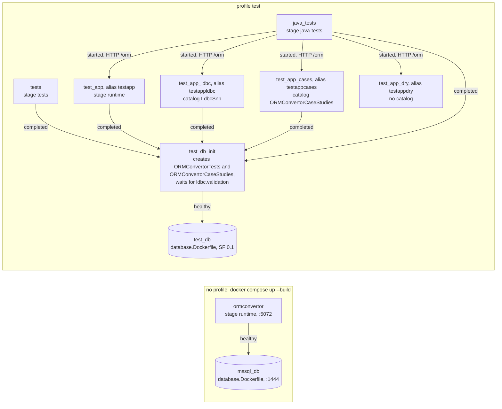
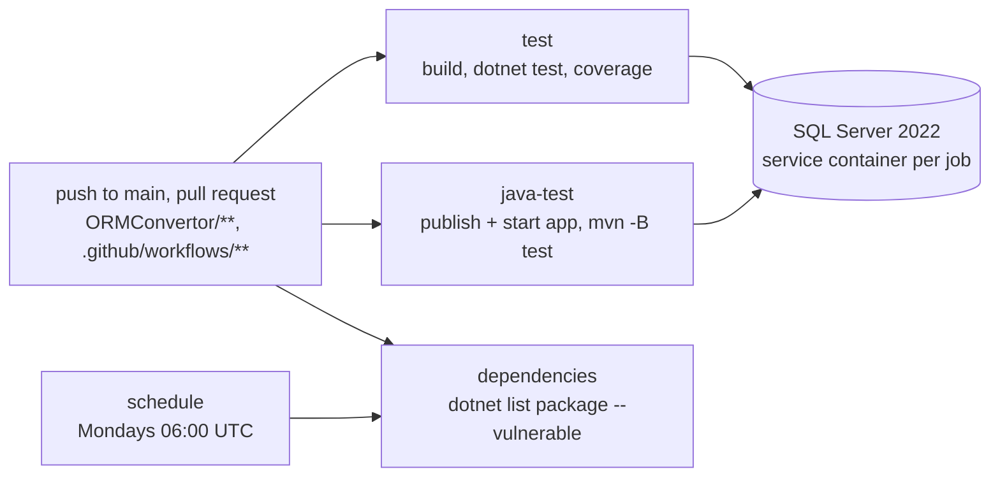

A web-based tool for translating between ORM frameworks. This operating manual says how it is run, deployed, configured and tested, and how each path was verified — the operational half of the deployment view (decision [058](../docs/decisions/058-only-the-operational-half-of-the-deployment-view-moves.md)); the tool itself is described in [`docs/architecture.md`](../docs/architecture.md), and what each run of the suites and each measurement found is recorded in [`docs/runs/`](../docs/runs/README.md) (decision [167](../docs/decisions/167-records-of-runs-and-measurements-have-a-folder-of-their-own.md)). **Last verified against the code: 2026-10-18.**

# Deployment

One ASP.NET Core process, `ORMConvertorAPI`, serves the REST API and the static frontend under the path base `/orm`. The connection strings in `appsettings.json` are empty (S4, decision [029](../docs/decisions/029-database-connection-is-the-consumer-projects-fact.md)); see [Configuration](#configuration). **No endpoint requires a login**: a trusted network or an access-controlling proxy is assumed ([`threat-model.md`](../docs/threat-model.md)).

| Path | Environment | Verified by running it, on two machines |
|---|---|---|
| [Visual Studio](#visual-studio), [.NET CLI](#net-cli) | `Development` | profiles `http`, `https`: frontend served, `CatalogState = Reached` |
| [Docker](#docker-application--database) | `Development` | 2026-08-23, 2026-08-24; see below |
| [PM2](#pm2) | `Development` | `CatalogState = Reached`, version in the run record |
| [Real instance](#deploying-a-real-instance) | `Production` | Windows only; see below |

## Visual Studio

Open `ORMConvertor.sln`, startup project `ORMConvertorAPI`. The profiles in `ORMConvertorAPI/Properties/launchSettings.json` set `Development` (Swagger UI, user secrets) and open the relative `orm/` on their `applicationUrl`: `http` on `http://localhost:5072`, `https` on `https://localhost:7124` and `http://localhost:5072` (needs `dotnet dev-certs https`). `IIS Express` is an unverified template leftover. Only Visual Studio opens a browser.

## .NET CLI

```sh
dotnet run --configuration Release --launch-profile http --project ORMConvertorAPI/ORMConvertorAPI.csproj
```

The URL is printed to the console (typically [http://localhost:5072/orm/](http://localhost:5072/orm/)).

## Docker (application + database)

`docker-compose.yml` holds the system and, under the profile `test`, the test suites (decision [039](../docs/decisions/039-container-configuration-of-the-environment.md)); `docker compose up --build` starts only `ormconvertor` and `mssql_db`. Arrows are `depends_on` with its condition.



`ORMConvertorAPI/Dockerfile`: `advisor-native` builds `libadvisor.so`, `dotnet-build` publishes, `tests` builds on it, `java-tests` on `maven:3.9.11-eclipse-temurin-25-noble`, `runtime` on `aspnet:10.0` with `libglpk40`; every base image is pinned by digest beside its tag, and the packages restore in `--locked-mode` from the committed `packages.lock.json` files (decision [186](../docs/decisions/186-the-build-environment-is-pinned-on-content-lock-files-image-digests-and-action-commits-moved-by-dependabot.md)). **`dotnet-build` copies every `.csproj` and its `packages.lock.json` by name: a new project needs a line in that `COPY` list.** `java-tests` copies all of `Tests/Database/`, `database/ldbc/updates/` and `SampleData/ThirdParty/`; the pom's `<testResources>` selects from them.

- **`ormconvertor`** — [http://localhost:5072/orm/](http://localhost:5072/orm/), Swagger UI at `/orm/swagger`; gets `ConnectionStrings__AdvisorDatabase` and `ConnectionStrings__CatalogDatabase`.
- **`mssql_db`** — SQL Server 2022 on `localhost,1444`, `SA` / `Testingorms123` (development only), with `WideWorldImporters` and `LdbcSnb`: LDBC SNB Interactive v1 at scale factor 1 (decision [110](../docs/decisions/110-ldbc-snb-as-a-second-reference-domain.md)), downloaded at build (222 MB) and loaded by `database/ldbc/load-ldbc.sh` on the first start in about a minute, with the validation set of the same scale factor, the judge of the LDBC catalog (decision [117](../docs/decisions/117-the-interactive-v1-validation-set-judges-the-ldbc-catalog-at-the-fourth-level.md)), in the table `ValidationOperation`. A database whose extended property `ldbc.dataset` is missing or names another archive is reloaded, one lacking only `ldbc.validation` gets the set alone, and a failed load leaves the server up without it. The loader asks nothing before this start's errorlog says `Recovery is complete` and stops at a question the server does not answer, leaving the database as it was; a new container over a loaded volume (after `down`, a rebuilt image or `--force-recreate`) therefore skips the load.
- **`Fiben`** — the third database of `mssql_db` (decision [149](../docs/decisions/149-fiben-as-a-third-reference-domain-run-on-demand-against-a-judge-of-our-own.md)): the FIBEN benchmark of IBM Research (Apache-2.0), `data.zip` of `IBM/fiben-benchmark` downloaded at build (80 MB; `FIBEN_DATASET` names the commit, `none` leaves it out) and loaded by `database/fiben/load-fiben.sh` on the first start in two to three minutes, with the extended property `fiben.dataset`; beside it the judge of the FIBEN catalog, `database/fiben/judge.tsv`, in the table `Judge` (property `fiben.judge`, the file's checksum; reloaded when the file changes). The loader keeps the rules of the LDBC one; the profile `test` does not carry the database, as the catalog runs on demand against this service ([the FIBEN run](#the-fiben-run)).
- Port 1444 is also bound by the inherited benchmarks: run one at a time.
- **The environment is fixed for measurement** (decision [145](../docs/decisions/145-the-measurement-environment-and-the-iteration-policy-are-fixed.md)): `init-db.sh` sets `max server memory (MB)` 4096 and `max degree of parallelism` 1 on every start; the compose file pins the databases to processors 0–1 and every client to 2–3; the Docker host gives the VM four processors and 12 GB without swap (on MIS3 the WSL2 `.wslconfig`, decision [193](../docs/decisions/193-the-docker-vm-has-twelve-gigabytes-so-that-the-limits-inside-it-add-up-to-less-than-it.md)), so that the limits of everything a run starts at once fit in it. The iteration policy is `AdvisorBenchmarking/BenchmarkPolicy`, returned by a run as `policy`. The CPU boost of the host is outside the tool: on MIS3 the power plan holds the processor state at 99 % for both minimum and maximum, which turns turbo off, and a record of a measurement says whether that held.
- **The judge's mode** (decisions [164](../docs/decisions/164-the-database-server-has-a-measurement-mode-and-a-judge-mode-switched-by-one-file.md) and [166](../docs/decisions/166-the-judge-reads-a-segment-between-inserts-in-every-framework-at-once.md)): the measurement environment above is the default of both databases; `judge.env` beside the compose file switches them to every processor of the VM, with single-threaded plans because the judge's frameworks read at once, for runs that check correctness and measure nothing - the LDBC judge, with turbo on, and the FIBEN run without its measurement. `docker compose --env-file judge.env up -d mssql_db` switches, `docker compose up -d mssql_db` switches back; both recreate the container over the same volume, and the log line `Server settings: …` says which mode it started in. The variables are `DATABASE_CPUSET` (empty for every processor), `DATABASE_MAXDOP` and `DATABASE_MAX_SERVER_MEMORY_MB`. **While `mssql_db` runs in the judge's mode, every compose command that touches it carries `--env-file judge.env`:** `up` of a service that depends on it without the file recreates the database in the measurement mode, which cuts a running replay.

**Verified** on the same Docker Desktop version: `POST /convert` from Dapper completed `Sales.Customers` (table, schema, types, length, nullability) from the catalog — F6 through the interface; `POST /advisor/run` solved the model through `libadvisor.so` (outside the guarantees, [`architecture.md`](../docs/architecture.md) §9). On a fresh volume (release `2.1.0`) `LdbcSnb` loaded in about 40 s, and an infeasible model sent to `/advisor-test` logged its message with that call.

## PM2

`ecosystem.config.js`, inherited from the original prototype, defines the [PM2](https://pm2.keymetrics.io/) app `orm`, which runs the [.NET CLI](#net-cli) command: `pm2 start ecosystem.config.js`, `pm2 delete orm` to stop. `cwd: __dirname` makes the relative `--project` path work; the `env` block blanks `version` and `Version`, which `dotnet run` would turn into an MSBuild property overriding the assembly version. Needs Node.js with PM2 (`npm install -g pm2`) and the .NET SDK; listens on `localhost:5072` only.

## Deploying a real instance

**1. Publish**; the server needs only the ASP.NET Core runtime:

```sh
dotnet publish ORMConvertorAPI/ORMConvertorAPI.csproj --configuration Release --output /srv/ormconvertor
cd /srv/ormconvertor && dotnet ORMConvertorAPI.dll
```

**The `cd` matters:** the working directory is the content root, where `wwwroot` and `appsettings.json` are looked for. Started elsewhere, the API answers but `/orm/` returns an empty 404; the only trace is `Request reached the end of the middleware pipeline without being handled by application code`. Otherwise name it:

```sh
dotnet /srv/ormconvertor/ORMConvertorAPI.dll --contentRoot /srv/ormconvertor
```

**2. `Production` is the default:** no Swagger UI and no user secrets, so configuration arrives as environment variables.

**3. Proxy.** The app listens on `ASPNETCORE_URLS` without TLS; `UsePathBase` strips `/orm` without requiring it. A public instance belongs behind a reverse proxy that terminates HTTPS and keeps the prefix.

**4. `AllowedHosts` is `*`:** narrow it when exposed directly.

**Verified** on two Windows machines: `/orm/swagger` 404, `/orm/` 200; the catalog variable moved `CatalogState` from `NotConfigured` to `Reached`; `/advisor-test` 400 with the `libadvisor.so` load error; `--contentRoot` cured the content-root failure. **Not covered:** a Linux host, a real reverse proxy, the Advisor with its native library.

# Configuration

No connection string has a value in the repository, except the disposable credentials of servers that compose and CI create ([`threat-model.md`](../docs/threat-model.md)). Keys use `:` in user secrets and `appsettings.json`, `__` in environment variables. The application reads user secrets only in `Development`; the test project always.

| Key | Used by | Purpose; when unset | Set in |
|---|---|---|---|
| `ConnectionStrings:CatalogDatabase` | API | Catalog completion. Unset: conventions only, reported in `CatalogState`; F4 and F6 do not hold through the interface. | secret, env; compose `ormconvertor`, `test_app`, `test_app_ldbc`, `test_app_cases`; CI |
| `ConnectionStrings:AdvisorDatabase` | API | Advisor benchmarking. Unset: the Advisor names the key and stops. | secret, env; compose `ormconvertor` |
| `ConnectionStrings:TestDatabase` | .NET suite | Database tests. Unset: they skip with a reason. | secret, env; compose `tests`; CI |
| `ORMCONVERTOR_REQUIRE_TEST_DATABASE` | .NET suite | `1`: a missing database fails. | env; compose `tests`; CI |
| `ConnectionStrings:CaseStudyDatabase` | .NET suite | The case-study database (decision [176](../docs/decisions/176-the-schema-of-an-excerpted-project-is-an-excerpt-created-empty-in-the-case-study-database-and-the-case-study-runs-over-it-at-the-fourth-level.md)). Unset: `ORMConvertorCaseStudies` on the server of the test database. | secret, env, by hand |
| `ORMCONVERTOR_TEST_CASESTUDY_JDBC_URL` | Java suite | JDBC URL of the case-study database. Unset: the test database's with `databaseName=ORMConvertorCaseStudies`. | env, by hand |
| `ORMCONVERTOR_CASESTUDY_API_URL` | Java suite | Running instance over the case-study database, `http://testappcases:5072/orm`. Unset: the case studies are left out of the experiment run and no schema is created there. | env; compose `java_tests` |
| `ORMCONVERTOR_TEST_SCHEMA` | both suites | Plain SQL identifier. Unset: `ormconvertor_test`, `ormconvertor_java_test`. | env |
| `ORMCONVERTOR_TEST_JDBC_URL` | Java suite | JDBC URL with user and password. | env; compose `java_tests`; CI |
| `ORMCONVERTOR_API_URL` | Java suite | Running instance with `/orm`: `http://testapp:5072/orm`, in CI `http://localhost:5072/orm`. | env; compose `java_tests`; CI |
| `ORMCONVERTOR_RECORD_DIFFERENTIAL` | both suites | Path where a recording run writes canonical results. | env, by hand |
| `ASPNETCORE_ENVIRONMENT` | API | `Development`: Swagger UI, user secrets. Unset: `Production`. | launch profiles, compose, CI |
| `ASPNETCORE_URLS` | API | Listening address. | image `runtime`, CI |
| `Parsing:MaxNestingDepth` | API | Depth cap of the text and of the model (decisions [092](../docs/decisions/092-input-nesting-depth-capped-before-the-descent.md), [191](../docs/decisions/191-the-depth-of-the-model-is-capped-by-the-same-number-as-the-text-and-a-reader-that-runs-out-of-stack-refuses.md)); `0` is off. Unset: 128. | `appsettings.json`, env |
| `Parsing:MaxQueryTextLength` | API | Cap on the characters of one query's text, held over the model as written, the LINQ operand and the MyBatis include while they are written, and the finished artifact (decision [194](../docs/decisions/194-the-text-of-one-query-is-capped-and-the-same-number-holds-the-model-as-written-the-linq-operand-the-mybatis-include-and-the-finished-artifact.md)); `0` is off. Unset: 1048576. | `appsettings.json`, env |
| `ORMCONVERTOR_CATALOG_DATABASE` | compose | Catalog of `ormconvertor`. Unset: `WideWorldImporters`; `LdbcSnb` for the LDBC queries, `Fiben` for the FIBEN catalog. | shell |
| `LDBC_SCALE_FACTOR` | compose | `1`, another Interactive v1 scale factor (`0.1`, `0.3`, `3`, `10`, …) or `none` (no `LdbcSnb`). | shell |
| `LDBC_TEST_SCALE_FACTOR` | compose, profile `test` | Scale factor of `test_db`. Unset: `0.1`. | shell |
| `FIBEN_DATASET` | compose, build of the database image | Commit of `IBM/fiben-benchmark` whose `data.zip` the image downloads, or `none` (no `Fiben`; the profile `test` sets it). | shell, `docker-compose.yml` |
| `ConnectionStrings:LdbcDatabase`, `ORMCONVERTOR_REQUIRE_LDBC_DATABASE`, `ORMCONVERTOR_LDBC_VALIDATION_ROWS`, `ORMCONVERTOR_TEST_LDBC_JDBC_URL`, `ORMCONVERTOR_LDBC_API_URL` | both suites | The LDBC judge: [its table](#the-ldbc-judge). Unset: the judge skips with the reason. | secret, env; compose `tests`, `java_tests` |
| `ConnectionStrings:FibenDatabase`, `ORMCONVERTOR_REQUIRE_FIBEN_DATABASE`, `ORMCONVERTOR_FIBEN_QUERIES`, `ORMCONVERTOR_FIBEN_RESULTS`, `ORMCONVERTOR_FIBEN_MEASURE`, `ORMCONVERTOR_TEST_FIBEN_JDBC_URL`, `ORMCONVERTOR_FIBEN_API_URL` | both suites | The FIBEN run: [its table](#the-fiben-run). Unset: every case skips with the reason. | secret, env, by hand |
| `ORMCONVERTOR_SERIES_AXES`, `ORMCONVERTOR_SERIES_CATALOG`, `ORMCONVERTOR_DRY_API_URL` | both suites (the axes: .NET) | The limits run: [its table](#the-limits-run). Unset: every axis, with the fixture as the catalog. | env, by hand; compose `java_tests` (the dry instance) |
| `ORMCONVERTOR_FOREIGN_ARTIFACTS`, `ORMCONVERTOR_FOREIGN_RESULTS`, `ORMCONVERTOR_FOREIGN_INPUTS` | both suites (the inputs: .NET) | [Foreign artifacts](#foreign-artifacts): the directory judged, the directory of rows, the directory the inputs are written into. Unset: the one case skips with the reason. | env, by hand; `foreign-run.sh` |

**The nesting cap is the operator's alone**: read at startup, absent from `/convert`. It counts brackets, `CASE` up to its `END` in SQL, HQL and JPQL, and runs of prefix operators in the text before any parser descends, and the depth of the query's model - a chain of operations, CASEs, negations or set operations without a bracket - right after the reading; deeper input is a `Failure`. With the cap off, a reader that runs out of stack still refuses its unit, but a walk after the reading overflows the stack, which .NET cannot catch, and kills the process ([`threat-model.md`](../docs/threat-model.md), threat 2). Each response reports the cap in `maxNestingDepth`.

# Advisor prerequisites

Translation works anywhere. The Advisor also needs SQL Server with WideWorldImporters (`ConnectionStrings:AdvisorDatabase`) and `libadvisor.so`, built only in the Docker image — elsewhere its endpoints fail. The ILP model: [`architecture.md`](../docs/architecture.md) §8.

# Tests

Which runs exist, when each is started, what to check on the host before a long one and in which order a full run goes: [`docs/runs/`](../docs/runs/README.md#metodika).

## In a container

```sh
docker compose --profile test build tests java_tests test_app test_app_ldbc test_app_cases test_app_dry test_db
docker compose --profile test run --rm tests         # the .NET suite
docker compose --profile test run --rm java_tests    # the Java suite
```

S5's "one main command" per suite: the host needs only Docker. Each `run` starts SQL Server, creates the database once it is healthy and runs the whole suite in its own schema (decision [076](../docs/decisions/076-java-wrappers-in-csharp-jvm-in-containers.md)). `test_app` is the tool the Java suite translates against (decision [078](../docs/decisions/078-java-suite-as-a-client-of-a-running-instance.md)), its catalog on the test database, aliased `testapp` because the JDK's `HttpClient` refuses `_` in a host name; `test_app_cases` is the same over the case-study database, for the case studies of the experiment run (decision [176](../docs/decisions/176-the-schema-of-an-excerpted-project-is-an-excerpt-created-empty-in-the-case-study-database-and-the-case-study-runs-over-it-at-the-fourth-level.md)), and `test_app_dry` the same with no catalog, for the dry walk of [the limits run](#the-limits-run). The SQL Server of the profile is the image of `mssql_db` at scale factor 0.1 (`LDBC_TEST_SCALE_FACTOR`), so its first start restores WideWorldImporters and loads `LdbcSnb` with its validation set before `test_db_init` lets the suites run; both suites then run [the LDBC judge](#the-ldbc-judge) as well, `test_app_ldbc` serving the Java one.

> **`run` does not rebuild.** Without `build` it measures the tree the images were built from — green, with nothing to say so. **The only tell is the test count** against [the size of the suite](../docs/runs/README.md#velikost-sady-a-pokrytí).

## On the host

```sh
dotnet test Tests/Tests.csproj --configuration Release
```

A plain `dotnet restore` rewrites a project's `packages.lock.json` when a pinned version moved; commit the lock file with the move, because CI and the image restore with `--locked-mode` and fail on a lock that disagrees (decision [186](../docs/decisions/186-the-build-environment-is-pinned-on-content-lock-files-image-digests-and-action-commits-moved-by-dependabot.md)).

Database tests need `ConnectionStrings:TestDatabase`, e.g. `Server=(localdb)\MSSQLLocalDB;Database=ORMConvertorTests;Trusted_Connection=True;TrustServerCertificate=True`.

## The test database

The tests **create their schema themselves** in any reachable SQL Server (decision [016](../docs/decisions/016-generated-artifact-verification-levels.md)), from `Tests/Database/`.

- **Schema** `ormconvertor_test` from `Database/TestSchema.sql` (`{{schema}}` for the name), the expected answer F4 measures against: single-part keys by `IDENTITY` (`Customers`, `Suppliers`) and assigned (`Products`); composite keys of two (`Orders`, `ProductSuppliers`), three (`OrderLines`) and four parts (`OrderLineAllocations`); one- to three-column foreign keys; 1:1 over a shared key (`CustomerProfiles`); a junction table (`ProductSuppliers`); length, precision/scale, nullability. `TestSchemaFixtureTest` guards it.
- **Lifetime.** `TestSchemaFixture` serves the collection `TestDatabaseSchema`: dropped, created once, dropped after. A writing test (level 4: `DapperToNHibernatePersistenceTest`, `DapperToEFCorePersistenceTest`) rolls back its own transaction over `OpenConnection()`.
- **Skip or fail.** `SkipIfUnavailable()` skips with a reason, since the tool must translate without a database; with `ORMCONVERTOR_REQUIRE_TEST_DATABASE` it fails.
- **LDBC:** schema `<schema>_ldbc` from `database/ldbc/schema.sql`, `constraints.sql` and `indexes.sql`, empty tables for `Combined/LdbcCatalogTest`; beside `TestSchema.sql`, the second expected answer of [the F4 share](#the-f4-share).
- **Case studies** (decision [176](../docs/decisions/176-the-schema-of-an-excerpted-project-is-an-excerpt-created-empty-in-the-case-study-database-and-the-case-study-runs-over-it-at-the-fourth-level.md)): a second database, `ORMConvertorCaseStudies` on the same server (or `ConnectionStrings:CaseStudyDatabase`), which the environment creates as it creates the test database - compose and CI do, a developer's machine once by hand. In it the fixture creates `<schema>_<project>` from `SampleData/ThirdParty/<project>/schema.sql` for every excerpted project, empty: the catalog the experiment run translates the excerpt with and the tables its queries run over. Apart, because JPetStore's `orders` and the fixture's `Orders` are one name to a lookup that states no schema. Without the database the case-study tests skip with the reason; with `ORMCONVERTOR_REQUIRE_TEST_DATABASE` they fail.

### The F4 share

`Catalog/CatalogMetadataShareTest` counts the criterion of F4 — at least 95 % of the tracked metadata read correctly against the test database, deviations recorded — over both schemas above, the expected facts read out of their scripts. It prints the share per schema and kind; a deviation the test does not record fails it, even above 95 %. The measured shares are [recorded in `docs/runs/`](../docs/runs/README.md#podíl-f4).

## The LDBC judge

The validation set of LDBC Interactive v1 judges the Interactive queries of the LDBC catalog at level 4 (decision [117](../docs/decisions/117-the-interactive-v1-validation-set-judges-the-ldbc-catalog-at-the-fourth-level.md); [`architecture.md`](../docs/architecture.md) §6.2): both suites replay it in order over `LdbcSnb` - the inserts from `database/ldbc/updates`, every read against the generated artifact of each framework - and return the database to its loaded state before and after.

| Setting | .NET suite | Java suite |
|---|---|---|
| `LdbcSnb` with the data set and the validation set | `ConnectionStrings:LdbcDatabase` (user secret or `ConnectionStrings__LdbcDatabase`) | `ORMCONVERTOR_TEST_LDBC_JDBC_URL` |
| an instance of the tool whose catalog is `LdbcSnb` | — (translates in process) | `ORMCONVERTOR_LDBC_API_URL`, e.g. `http://localhost:5080/orm` |
| a missing judge fails instead of skipping | `ORMCONVERTOR_REQUIRE_LDBC_DATABASE=1` | the same |
| replay only the first n lines | `ORMCONVERTOR_LDBC_VALIDATION_ROWS` | the same |

- **Without the settings** the judge skips with the reason; the rest of the suite does not need `LdbcSnb`.
- **The compose profile** sets everything and replays the first 1000 lines of the SF 0.1 set - a check.
- **The whole set over SF 1 is a run of its own**, the two suites one after the other because they share the lock, in the judge's mode of decision [164](../docs/decisions/164-the-database-server-has-a-measurement-mode-and-a-judge-mode-switched-by-one-file.md) (in the measurement mode it projects to several days per suite, [the projection](../docs/runs/2026-10-18-ldbc-judge-time-by-step.md)). It runs against `mssql_db` of the system profile and, for the Java suite, an instance over the LDBC catalog, every command with `--env-file judge.env`. Build the suites first — days spent on a stale image is the trap above at its most expensive — and start each detached, named and without `--rm`, so that `docker logs <name>` keeps the result whatever happens to the shell that started it; afterwards `docker compose up -d mssql_db` returns the database to the measurement mode:

  ```sh
  docker compose --env-file judge.env up -d --build mssql_db
  ORMCONVERTOR_CATALOG_DATABASE=LdbcSnb docker compose --env-file judge.env up -d --build ormconvertor
  docker compose --env-file judge.env --profile test build tests java_tests
  docker compose --env-file judge.env --profile test run -d -T --no-deps --name ldbc_judge_dotnet \
    -e "ConnectionStrings__LdbcDatabase=Server=mssql_db,1433;Database=LdbcSnb;User ID=sa;Password=Testingorms123;TrustServerCertificate=true;" \
    -e ORMCONVERTOR_LDBC_VALIDATION_ROWS= \
    tests --filter "FullyQualifiedName~LdbcValidationTest" --logger "console;verbosity=detailed"
  docker compose --env-file judge.env --profile test run -d -T --no-deps --name ldbc_judge_java \
    -e "ORMCONVERTOR_TEST_LDBC_JDBC_URL=jdbc:sqlserver://mssql_db:1433;databaseName=LdbcSnb;user=sa;password=Testingorms123;encrypt=true;trustServerCertificate=true" \
    -e ORMCONVERTOR_LDBC_API_URL=http://ormconvertor:5072/orm -e ORMCONVERTOR_LDBC_VALIDATION_ROWS= \
    java_tests -Dtest=LdbcValidationTest
  ```

  A run stopped in the middle leaves the inserts of the lines it replayed in `LdbcSnb`; the next replay removes them first, and `database/ldbc/updates/undo.sql` does the same by hand.
- **The record** of a whole-set run goes into [`docs/runs/`](../docs/runs/README.md) as a file of its own: the commit, the mode of the server, the tests, the verdict of each framework and the replay time.
- **Loading the set elsewhere:** take `validation_params-sf<N>.csv` of the scale factor the data has from `validation_params-interactive-v1.0.0-sf0.1-to-sf10.tar.zst` at `datasets.ldbcouncil.org/interactive-v1/`, run `database/ldbc/validation.sql` with `{{schema}}` replaced by `dbo` and `-v ValidationFile=<path the server can read>`, then add the extended property `ldbc.validation` with the file's name. After a change to `database/ldbc/indexes.sql` (decision [121](../docs/decisions/121-the-text-of-a-catalog-query-takes-the-shape-its-planner-needs-and-ldbcsnb-carries-the-indexes-its-reads-need.md)) run that script the same way; it is rerunnable, and the container does it by itself on the next start.
- **One replay at a time:** a replay holds the application lock `ldbc.validation` on its connection, so the other suite waits; the lock dies with the connection.
- **The frameworks of a suite read at once** (decision [166](../docs/decisions/166-the-judge-reads-a-segment-between-inserts-in-every-framework-at-once.md)): the reads between two inserts see the same state, so each framework reads them in a thread of its own and in the order of the lines, and the next insert waits for all of them. The select times a replay prints are therefore taken under the others' load; the replay is as long as its slowest framework in each segment.
- **Every command of a replay has the same time limit** (decision [146](../docs/decisions/146-the-java-branch-measures-with-the-same-loop-in-its-own-container-and-an-execution-has-one-time-limit.md)), the reads of the cells included: each suite puts it into the connection string (`Command Timeout`) or the JDBC URL (`queryTimeout`) it hands the frameworks, whatever the configured one said, so the driver applies it to every statement without any framework being told. It is the limit of one execution in the Advisor's policy as well, and `LdbcValidationTest` holds the three equal. A read over it fails its cell.

## The FIBEN run

The FIBEN catalog (decision [149](../docs/decisions/149-fiben-as-a-third-reference-domain-run-on-demand-against-a-judge-of-our-own.md); [`architecture.md`](../docs/architecture.md) §6.2) never runs as part of a build. It runs **on demand, for a version or a substantial change**, both suites one after the other against `mssql_db` of the system profile, in the order of the decision: the catalog is complete (held at every build by `Combined/FibenCatalogTest`), every query reaches every target with the catalog and only the entities of the tables it reads, the artifacts compile, every target returns the rows the catalog's own text returns and the text returns the rows the judge holds, and every cell is measured by the policy of decision [145](../docs/decisions/145-the-measurement-environment-and-the-iteration-policy-are-fixed.md). The run measures only over a server in the measurement mode, `MAXDOP` 1 on the two processors of its own (decisions [164](../docs/decisions/164-the-database-server-has-a-measurement-mode-and-a-judge-mode-switched-by-one-file.md) and [166](../docs/decisions/166-the-judge-reads-a-segment-between-inserts-in-every-framework-at-once.md)); over the judge's mode the same commands check correctness alone, and the first line of the summary names the server's settings and why the measurement was left out.

| Setting | .NET suite | Java suite |
|---|---|---|
| `Fiben` with the benchmark and the judge | `ConnectionStrings:FibenDatabase` (user secret or `ConnectionStrings__FibenDatabase`) | `ORMCONVERTOR_TEST_FIBEN_JDBC_URL` |
| an instance of the tool whose catalog is `Fiben` | — (translates in process) | `ORMCONVERTOR_FIBEN_API_URL` |
| a missing database fails instead of skipping | `ORMCONVERTOR_REQUIRE_FIBEN_DATABASE=1` | the same |
| limit the run to some queries (a check, never a record) | `ORMCONVERTOR_FIBEN_QUERIES=q1,q2,…` | the same |
| write the files of the run into a directory | `ORMCONVERTOR_FIBEN_RESULTS` | the same (`java-` prefixed files) |
| leave the measurement out | `ORMCONVERTOR_FIBEN_MEASURE=0` | the same |

- **Without the settings** every case skips with the reason; nothing else in either suite needs `Fiben`.
- **The record of a run** goes into [`docs/runs/`](../docs/runs/README.md) as a file of its own, beside the LDBC runs: the commit, the environment, the stage each query reached in each framework, the agreement with the source and with the judge, the medians, and a line of notes. The files of a run - `cells.tsv` (one line per cell with its outcome, times, rows and agreement), `judge-candidate.tsv` (the source rows in the form of the judge) and `summary.txt`, and their `java-` counterparts - stay out of git (decision [042](../docs/decisions/042-measured-benchmark-output-out-of-git.md)), except the judge made from a documented run, `database/fiben/judge.tsv`.
- **Start it detached and named**, as the LDBC judge, after rebuilding what it runs - the suites, the database image and, for the Java suite, an instance over the FIBEN catalog:

  ```sh
  docker compose up -d --build mssql_db                                   # loads Fiben on the first start of the new image
  ORMCONVERTOR_CATALOG_DATABASE=Fiben docker compose up -d --build ormconvertor
  docker compose --profile test build tests java_tests
  docker compose --profile test run -d -T --no-deps --name fiben_run_dotnet \
    -e "ConnectionStrings__FibenDatabase=Server=mssql_db,1433;Database=Fiben;User ID=sa;Password=Testingorms123;TrustServerCertificate=true;" \
    -e ORMCONVERTOR_REQUIRE_FIBEN_DATABASE=1 -e ORMCONVERTOR_FIBEN_RESULTS=/app/fiben-results \
    tests --filter "FullyQualifiedName~FibenRunTest" --logger "console;verbosity=normal"
  docker compose --profile test run -d -T --no-deps --name fiben_run_java \
    -e "ORMCONVERTOR_TEST_FIBEN_JDBC_URL=jdbc:sqlserver://mssql_db:1433;databaseName=Fiben;user=sa;password=Testingorms123;encrypt=true;trustServerCertificate=true" \
    -e ORMCONVERTOR_FIBEN_API_URL=http://ormconvertor:5072/orm -e ORMCONVERTOR_REQUIRE_FIBEN_DATABASE=1 \
    -e ORMCONVERTOR_FIBEN_RESULTS=/src/JavaTests/fiben-results \
    java_tests -Dtest=FibenRunTest
  ```

  The two run one after the other, not at once: the measurement of one would be the noise of the other. With `--env-file judge.env` on every command the same run is a check of correctness in the judge's mode, without medians. `docker cp fiben_run_dotnet:/app/fiben-results <dir>` takes the files out before the container is removed. From the host the .NET run works the same against `localhost,1444`. From Git Bash prefix the `run` commands with `MSYS_NO_PATHCONV=1`: without it the shell rewrites the `/app/…` and `/src/…` values of the `-e` arguments into Windows paths and the files land in a directory of that name under the test output.
- **The judge** is the `judge-candidate.tsv` of a documented run that meets the conditions of decision 149 (the first as decision [157](../docs/decisions/157-a-target-cell-that-differs-by-a-stated-limit-does-not-block-the-fiben-judge.md) reads it), copied to `database/fiben/judge.tsv` with a header line naming the run and loaded by the next start of the container (the loader reloads it whenever the file's checksum changes); the present one is from the .NET half of [the run of 2026-10-24](../docs/runs/2026-10-24-fiben.md), the first after decision [170](../docs/decisions/170-rows-tied-on-the-ordering-key-compare-as-a-set-and-a-fiben-slice-gets-a-deciding-key.md): it keeps the rows of the judge of 2026-10-22 (decision [163](../docs/decisions/163-the-fiben-judge-takes-the-eight-queries-of-decisions-161-and-162-from-the-dotnet-half-of-the-run-of-2026-10-22.md)) for every query the canonical form and the deciding key of decision 170 left as it was, and takes the rows of the six they changed from that run. A new judge is a decision with a date and a reason, never a fix in the comparison.

## Foreign artifacts

An artifact the tool did not make - a translation by a language model, by hand, by another tool - enters the verification levels beside the client (decision [172](../docs/decisions/172-a-foreign-artifact-enters-the-verification-levels-as-a-directory-with-a-manifest-beside-the-client.md)): a directory of files with a manifest, which either suite reads from a variable, puts through the levels of decision 016 in the suite that owns its target, and writes down as one row. A run on demand, never part of a build, and no instance of the tool is needed. The format, the levels and the measures: [`architecture.md`](../docs/architecture.md) §6.2, *Cizí artefakt*.

- **An artifact is a directory**: the units of the target as files - every file a consumer would get from `/convert` for the same input, the query as the bare method the tool writes - and `artifact.json`:

  ```json
  {
    "answers": "matrix:q1-entity-filter-ordered",
    "source": "Dapper",
    "target": "Hibernate",
    "producer": "llm",
    "units": [
      { "path": "DifferentialProduct.java", "contentType": "JavaEntity" },
      { "path": "ExpensiveProducts.java", "contentType": "JavaQuery" },
      { "path": "ExpensiveProducts.jpql" }
    ],
    "metadata": { "model": "...", "prompt": "p1", "temperature": 0, "attempt": 3 }
  }
  ```

  `answers` names the input: `matrix:<section of matrix.txt>`, `fiben:<key>`, `ldbc:<key>`, `cross:<source framework>` (the scenario of `CrossFrameworkInputs`), `example:<key of GET /examples>` (a whole project, the excerpts of real projects among them - decision [174](../docs/decisions/174-the-reference-databases-of-the-experiments-are-three-by-role-and-the-case-study-of-t1-is-the-keycloak-excerpt-judged-to-the-third-level.md)); `ldbc:`, `cross:` and an `example:` written for the tool end at the third level. An artifact with several queries is a project and is judged to the third level as one: the entities compiled once, every query compiled on top of them, the factory and every query accepted. The project of a case study - an `example:` of a real project - goes on to the fourth level over the empty tables of its schema in the case-study database (decision [176](../docs/decisions/176-the-schema-of-an-excerpted-project-is-an-excerpt-created-empty-in-the-case-study-database-and-the-case-study-runs-over-it-at-the-fourth-level.md)): every query runs with a value of its parameters' types, the row says `ran` with the rows that came back and no `agrees`, or `failed` with the query that did not run; a Dapper or MyBatis artifact, whose SQL names the tables without a schema, stays at the third level and says so. `contentType` is a name of `ConversionContentType`; a `.sql`, `.hql`, `.jpql` or `.xml` file may leave it out, a `.cs` or `.java` file says whether it is an entity or a query. `metadata` is copied into the row unread; for an artifact of a language model the protocol of decision [175](../docs/decisions/175-the-comparison-with-a-language-model-is-a-protocol-over-the-foreign-path.md) names the fields the record needs - `model`, `version`, `prompt` (an identifier of the template), `temperature`, `attempt`, `variant` (`zero-shot`, `few-shot`, `rag`, `repair`, or an ablation `rag-no-schema`, `rag-no-docs`, `rag-no-examples`, `repair-no-verdict`), `round`, `tokensIn`, `tokensOut`, `seconds`, `costUsd` - and the summary of the experiment run groups the rows by `model` and `variant`. `{{schema}}` in a file is replaced by the suite's schema, as in the inputs; keep it where the input had it. The artifacts under `Tests/Database/Foreign` are examples for every target.
- **The inputs** the suites send, as files to hand to whoever makes artifacts: `ORMCONVERTOR_FOREIGN_INPUTS=<dir> dotnet test Tests/Tests.csproj --filter "FullyQualifiedName~TheInputsAreWrittenWhereAsked"` writes one directory per key and source with the units and an `input.json`; the FIBEN ones carry the questions of the query.
- **One run** over a directory of artifacts, or over one artifact, in one process of each suite:

  ```sh
  ORMCONVERTOR_FOREIGN_ARTIFACTS=<dir> ORMCONVERTOR_FOREIGN_RESULTS=<out> dotnet test Tests/Tests.csproj --filter "FullyQualifiedName~ForeignArtifactRunTest"
  cd JavaTests && ORMCONVERTOR_FOREIGN_ARTIFACTS=<dir> ORMCONVERTOR_FOREIGN_RESULTS=<out> mvn -B test -Dtest=ForeignArtifactRunTest
  ```

  Each suite takes the artifacts whose target it owns and leaves the rest; the rows go to `foreign-rows.tsv` and `java-foreign-rows.tsv` under `<out>`, rewritten after every level. A `matrix:` key runs over the fixture of the test database, a `fiben:` key over `Fiben` with its judge (`ConnectionStrings:FibenDatabase`, `ORMCONVERTOR_TEST_FIBEN_JDBC_URL`), an `example:` key of a real project over the case-study database (the Java suite needs `ORMCONVERTOR_CASESTUDY_API_URL` to know it is configured), an `ldbc:`, `cross:` or other `example:` key ends at the third level. The row carries the `language` of the artifact's query - `target`, `native SQL`, `mixed`, `none` - beside the level it reached. This is a check, what a look at a few artifacts does.
- **The run that is recorded** is one process per artifact with a time limit: `./foreign-run.sh <dir> <out> [seconds per artifact]` from `ORMConvertor/`, on a host with both toolchains, builds both suites once, runs every artifact in a process of its own, kills one that outlives the limit and writes it down at the level it had reached as `timed out`, and gathers `<out>/foreign-rows.tsv`; the log of each artifact is `<out>/<artifact>/log.txt`. In the containers the same loop is one `docker compose --profile test run` per artifact with the two variables. The record goes into [`docs/runs/`](../docs/runs/README.md) with the provenance the manifests carried (decision [167](../docs/decisions/167-records-of-runs-and-measurements-have-a-folder-of-their-own.md)).
- **A red level is a row, not a failure**: an artifact that the language does not read, that does not compile, that the factory refuses, that fails to run or that returns other rows is written down as that. What fails the run is the path itself: a manifest without a key, a key no measure answers, a target the other suite owns, a measure whose database is not configured.

### A language model in a web frontend

Attempts of a language model made by hand in a web frontend (decision [189](../docs/decisions/189-a-web-frontend-attempt-is-a-new-conversation-with-one-self-contained-prompt-answered-in-text-without-the-web-and-paired-with-the-tool.md)): one new conversation per attempt, one prompt pasted whole, one reply in text, imported as a foreign artifact and judged beside the tool over the same cells. Everything lives in one directory, the run, named by `ORMCONVERTOR_LLM_RUN`; it is also the directory of the experiment run of the same cells. In Git Bash, `export` the variables first.

1. **Cells.** Write `<run>/cells.tsv`, tab-separated: a header `answers`, `source`, `target`, `variant` and optionally `attempts` (3 by default), then one cell per line. The variant with a template is `zero-shot`.

   ```
   answers	source	target	variant
   matrix:AggregationGroupingAndHaving	Dapper	EFCore	zero-shot
   ```

2. **Prompts.** `ORMCONVERTOR_LLM_RUN=<run> dotnet test Tests/Tests.csproj --filter "FullyQualifiedName~WebAttemptTest.ThePromptsAreWrittenWhereAsked"` writes the inputs of the cells to `<run>/inputs/`, one `<run>/attempts/<id>/prompt.md` per attempt and the table `<run>/attempts.tsv`. Running it again keeps what you wrote into the table.
3. **Each attempt**, in the frontend:
   - **Before**: a new conversation. Web search and browsing, code execution, connectors, files and projects, memory across conversations, personalization and custom instructions are off; a frontend that cannot switch search off is not used. In a developer console (Anthropic Workbench, OpenAI Playground, Google AI Studio): temperature 0, an empty system prompt, no tool, the output limit at the model's maximum.
   - **Send** the whole `prompt.md` unchanged and note the time. Do not answer a question of the model and do not ask it to continue.
   - **After**: note the time at the end of the reply, copy the whole reply with the frontend's copy button (Markdown) into `<run>/attempts/<id>/reply.md`, and fill the attempt's row of `attempts.tsv`: `model` as the frontend names it, with its mode; `version` (the snapshot, or the date where none is shown); `channel` - `console` or `chat`, required; `frontend` (the host); `temperature` (blank in a chat application, which then records `default`); `seconds` from sending to the end of the reply, by your clock; `tokensIn`, `tokensOut`, `costUsd` only where the console shows them - never an estimate; `credits` and `creditsUnit` as the frontend's counter before minus after, where it shows one; `note`.
4. **Import.** `ORMCONVERTOR_LLM_RUN=<run> dotnet test Tests/Tests.csproj --filter "FullyQualifiedName~WebAttemptTest.TheRepliesAreImportedWhereAsked"` writes `<run>/artifacts/<id>/` for every reply that gives an artifact and a row at level 0 in `<run>/attempt-rows.tsv` for every reply that gives none. A reply with a trace of a search - the name of the repository or the tool anywhere, a link outside its files, a tool or a source in its report - or a reply to a prompt changed after step 2 is refused: it moves to `refused-<n>.md` beside its reason, the test fails naming it, and the attempt is made again in a new conversation.
5. **The tool over the same inputs.** The experiment run with `ORMCONVERTOR_EXPERIMENT_RESULTS=<run>` takes `<run>/inputs/` and writes the tool's rows - both halves where a cell has a Java target ([The experiment run](#the-experiment-run)).
6. **Judge.** `./foreign-run.sh <run>/artifacts <run>` for the run that is recorded; for a check, `ORMCONVERTOR_FOREIGN_ARTIFACTS=<run>/artifacts ORMCONVERTOR_FOREIGN_RESULTS=<run>` on `ForeignArtifactRunTest` of the suite that owns the target.
7. **Summary.** `ExperimentSummaryTest` with `ORMCONVERTOR_EXPERIMENT_RESULTS=<run>` adds to `summary.md` the section *Foreign artifacts beside the tool over the same cells*: per producer, model, channel and variant the tool's share, the share per attempt and best-of-n over the same cells, and the cells one by one.

Steps 2 and 4 need neither a database nor an instance of the tool. A recorded run goes into [`docs/runs/`](../docs/runs/README.md) with the frontends and channels, the templates, the cells and why they were chosen, the refused replies per model, the training cut-off each vendor states for its model, and the sums of time, tokens, cost and credits where the channel had them.

## The experiment run

The table of T2 × T3 (decision [173](../docs/decisions/173-the-experiment-run-judges-the-tools-artifact-through-the-foreign-path-and-measures-mapping-completeness-by-reading-the-artifact-back.md); [`architecture.md`](../docs/architecture.md) §6.2, *Experimentální běh*): the tool translates every input the suites know into every target and the artifact goes through the levels of the foreign-artifact path into the same row, producer `tool`. It runs **on demand, for a version or a substantial change**, never as part of a build, in the containers of the `test` profile as the FIBEN run does; its record goes into [`docs/runs/`](../docs/runs/README.md).

| Setting | .NET suite | Java suite |
|---|---|---|
| the directory of the run; the rows, the mapping rows and the summary go there | `ORMCONVERTOR_EXPERIMENT_RESULTS` | the same |
| the inputs (default `inputs/` under the directory of the run; the .NET suite writes them there when missing) | `ORMCONVERTOR_EXPERIMENT_INPUTS` | the same |
| the kinds of keys to take (`matrix,cross,example,ldbc,fiben`; default every kind the environment can measure) | `ORMCONVERTOR_EXPERIMENT_KINDS` | the same |
| a `fiben:` key needs the database with the judge | `ConnectionStrings:FibenDatabase` | `ORMCONVERTOR_TEST_FIBEN_JDBC_URL` and an instance over `Fiben`, `ORMCONVERTOR_FIBEN_API_URL` |
| an `ldbc:` key needs, in the Java suite, an instance over `LdbcSnb` | — (the empty LDBC tables of the fixture are the catalog) | `ORMCONVERTOR_LDBC_API_URL` |
| an `example:` key of a real project (a case study, decision [176](../docs/decisions/176-the-schema-of-an-excerpted-project-is-an-excerpt-created-empty-in-the-case-study-database-and-the-case-study-runs-over-it-at-the-fourth-level.md)) needs the case-study database with the schemas the suite creates in it | — (`ORMConvertorCaseStudies` beside the test database, or `ConnectionStrings:CaseStudyDatabase`) | an instance over that database, `ORMCONVERTOR_CASESTUDY_API_URL` (compose: `test_app_cases`); the JDBC URL is derived from the test database's unless `ORMCONVERTOR_TEST_CASESTUDY_JDBC_URL` says otherwise; without the instance the case studies are left out |

- **Three steps, in this order**: the .NET half (exports the inputs, judges the three .NET targets into `tool-rows.tsv`, measures the completeness of the transferred mapping facts for all six targets into `mapping-rows.tsv`), the Java half over the same inputs against an instance (`java-tool-rows.tsv`), then the summary (`summary.md`: the shares of T3 by pair of ecosystems, direction, category of T2 and kind of input, and the rows of foreign artifacts by producer, model and variant). On a host with both toolchains and a test database:

  ```sh
  export ORMCONVERTOR_EXPERIMENT_RESULTS=<dir>
  dotnet test Tests/Tests.csproj --configuration Release --filter "FullyQualifiedName~Tests.Experiment.ExperimentRunTest"
  (cd JavaTests && mvn -B test -Dtest=ExperimentRunTest)      # ORMCONVERTOR_API_URL of an instance whose catalog is the test database
  dotnet test Tests/Tests.csproj --configuration Release --filter "FullyQualifiedName~ExperimentSummaryTest"
  ```

  In the containers the same three commands are `docker compose --profile test run` of `tests` and `java_tests` with the variable, the directory a volume or taken out with `docker cp`, and for the `fiben:` keys the `Fiben` settings of [the FIBEN run](#the-fiben-run). Without `ORMCONVERTOR_EXPERIMENT_RESULTS` every case skips with the reason.
- **No row fails the run.** A refused translation is the row `refused` at level 0, a red level is a row; what fails is the path - an input without a manifest, a key no measure answers, a database a kind needs that is not configured. The numbers are the record of the version, not a claim: T3 claims that they are measured and how, not what they come to ([`architecture.md`](../docs/architecture.md) §9).
- **A check from the host** - a few kinds, `ORMCONVERTOR_EXPERIMENT_KINDS=matrix,cross,example,ldbc` on a machine without the `Fiben` judge - is never recorded.

### The limits run

Where the tool stops along one axis (decision [182](../docs/decisions/182-the-limits-of-the-tool-are-searched-by-synthetic-series-growing-along-one-axis-as-a-run-on-demand-over-the-foreign-path.md)): synthetic series over the domain of the query-shape matrices - one more join, one more level of nesting, one more property, one more entity in the request - walked point by point from every source into every target, in a child process per axis and source, because the series with the cap switched off end where the stack overflows. The path judges a direction up to the first point whose artifact it does not accept; from there, and past the ceiling of `entities`, the translation alone goes on until it fails itself (decision [190](../docs/decisions/190-a-point-of-the-limits-run-that-does-not-finish-within-thirty-minutes-is-hung.md)), so the summary gives where the translator stopped and where the path did. It runs **on demand, for a version or a change of a parser or builder**, never as part of a build, over the `test_db` of the `test` profile; it measures the time and the memory of the translation, so the processor states of a measured run apply ([`docs/runs/README.md`](../docs/runs/README.md), *Před dlouhým během*).

| Setting | Meaning |
|---|---|
| `ORMCONVERTOR_EXPERIMENT_RESULTS` | the directory of the run: `series-points.tsv` (the rows of the path with `axis`, `point`, `catalog`, `step`, the translation time and memory beside them) and the inputs of the points reached under `inputs/`, keys `series:<axis>-<point>` |
| `ORMCONVERTOR_SERIES_AXES` | the axes to walk, comma-separated (`joins`, `conditions`, `nesting`, `subqueries`, `exists`, `ctes`, `unions`, `expression`, `case`, `not`, `properties`, `relations`, `key-parts`, `unit-size`, `entities`); every axis without it |
| `ORMCONVERTOR_SERIES_CATALOG` | `fixture` (default): the fixture's schema is the catalog, which the Dapper and MyBatis sources need for their keys; `none`: dry, the other half of what S3 separates. Both halves take it. A record of a version runs both into the same directory: a point's row ends in its catalog (`series-<axis>-<point>-<source>-<target>-<catalog>`), and the summary gives each direction once per catalog |
| `ORMCONVERTOR_DRY_API_URL` | the Java half of the dry walk: an instance with no catalog (`ConnectionStrings__CatalogDatabase` empty, the default of `appsettings.json`), in compose `test_app_dry`. A dry Java half without it fails by name, and so does a series point whose instance answers with a catalog state that does not match the walk |
| `ORMCONVERTOR_EXPERIMENT_KINDS=series` | the Java half: `experiment/ExperimentRunTest` judges the exported points into the three Java targets; `series` is in no half's default kinds |

```sh
export ORMCONVERTOR_EXPERIMENT_RESULTS=<dir>
dotnet test Tests/Tests.csproj --configuration Release --filter "FullyQualifiedName~Tests.Experiment.LimitSearchTest"
ORMCONVERTOR_SERIES_CATALOG=none dotnet test Tests/Tests.csproj --configuration Release --filter "FullyQualifiedName~Tests.Experiment.LimitSearchTest"
(cd JavaTests && ORMCONVERTOR_EXPERIMENT_KINDS=series mvn -B test -Dtest=ExperimentRunTest)
(cd JavaTests && ORMCONVERTOR_EXPERIMENT_KINDS=series ORMCONVERTOR_SERIES_CATALOG=none ORMCONVERTOR_DRY_API_URL=<instance with no catalog> mvn -B test -Dtest=ExperimentRunTest)
dotnet test Tests/Tests.csproj --configuration Release --filter "FullyQualifiedName~ExperimentSummaryTest"   # the section "Limits" of summary.md
```

In the containers the same five commands are `docker compose --profile test run` of `tests` and `java_tests` with the variables and the directory a volume, as for the experiment run; the child processes run inside the `tests` container, and `java_tests` already carries `ORMCONVERTOR_DRY_API_URL`. The Java half of one walk keeps the rows of the other walk's points in `java-tool-rows.tsv`. A walk stopped from outside continues where it was: a point already in the file is not walked again. No point fails the run - a refusal, a crash (the row names the method in which the stack overflowed), a point over the 30 s of S3 (a translation that has not returned by then is cut, and the child ends itself) are rows, and so is a point still in progress after 30 minutes (decision [190](../docs/decisions/190-a-point-of-the-limits-run-that-does-not-finish-within-thirty-minutes-is-hung.md)), which the parent kills as `hung` before the walk goes on with the next target -; only a walk that makes no progress fails, by name. A check from the host - one axis, `ORMCONVERTOR_SERIES_AXES=key-parts` - is never recorded.

## The Java test suite

`JavaTests/`, Maven and JUnit outside `ORMConvertor.sln`, the suite of F12 (decision [076](../docs/decisions/076-java-wrappers-in-csharp-jvm-in-containers.md)); what each test verifies is in [`architecture.md`](../docs/architecture.md) §6.2.

- **Verdict** only from the `java-tests` stage and the `java-test` job. A host with JDK 25 and Maven (e.g. those bundled with IntelliJ) can `mvn test-compile`, or run the suite against its own database and an instance whose catalog names that same database, as a check.
- **Size:** the suite counts itself — `SuiteSizeTest` fails below F12's 60 tests or 20 integration tests and reports what it cannot count as *uncountable* (decision [087](../docs/decisions/087-an-integration-test-is-a-run-against-the-database.md)).
- **Versions** of Hibernate, EclipseLink, MyBatis, `mssql-jdbc` and JUnit live only in `JavaTests/pom.xml`; `TargetFrameworkDescriptorTest.JavaSuiteDependenciesMatchTheJavaDescriptors` binds the three framework versions to the descriptors.
- **Inputs:** `ORMCONVERTOR_TEST_JDBC_URL`, e.g. `jdbc:sqlserver://localhost:1433;databaseName=ORMConvertorTests;user=sa;password=...;encrypt=true;trustServerCertificate=true`, the schema built from the same `TestSchema.sql`; `ORMCONVERTOR_API_URL`, polled at `/required-content`.
- **No skip**: where it runs, a database and an instance were started for it - but for [the LDBC judge](#the-ldbc-judge) and [the FIBEN run](#the-fiben-run), which need `LdbcSnb` or `Fiben` and an instance over it and skip without them. `mvn test -Dgroups=integration` runs the integration tests alone (decision [087](../docs/decisions/087-an-integration-test-is-a-run-against-the-database.md)).

Framework behaviour asserted as measured: decisions [078](../docs/decisions/078-java-suite-as-a-client-of-a-running-instance.md), [079](../docs/decisions/079-fractional-second-precision-as-second-precision.md), [080](../docs/decisions/080-eclipselink-as-the-second-profile-over-the-jpa-layer.md).

## Continuous integration

`.github/workflows/ormconvertor-tests.yml`, permissions `contents: read`:



| Job | What it does | Uploads |
|---|---|---|
| `test` | build (Release), `dotnet test` with `--collect:"XPlat Code Coverage"`, the database required | `test-results` |
| `java-test` | Temurin 25; starts the published app on `http://localhost:5072` in `Production`, not waited for; `mvn -B test` | `java-test-results`; `java-test-app-log` on failure |
| `dependencies` | `dotnet list ORMConvertor.sln package --vulnerable --include-transitive`, judged by `grep` (it exits 0 either way) under `set -o pipefail` | — |

`dependencies` alone also runs weekly (decision [098](../docs/decisions/098-the-number-is-decided-once-per-release.md)). Every restore runs in `--locked-mode` against the committed lock files, the actions are pinned by commit and the service container by digest, the same reference as in the Dockerfiles and the compose file; `.github/dependabot.yml` proposes their moves weekly (decision [186](../docs/decisions/186-the-build-environment-is-pinned-on-content-lock-files-image-digests-and-action-commits-moved-by-dependabot.md)). CI proves the suites against SQL Server of the stated version, compose that they run where nothing is installed. Coverage is never gated; `dotnet test Tests/Tests.csproj --collect:"XPlat Code Coverage"` writes `coverage.cobertura.xml` under `Tests/TestResults/`; the measured coverage is [recorded in `docs/runs/`](../docs/runs/README.md#velikost-sady-a-pokrytí).

# API

Paths are relative to `http://<host>/orm`; the interface and its decisions are in [`architecture.md`](../docs/architecture.md) §6.5. `/orm/openapi/v1.json` is served in every environment and is authoritative; the committed snapshot [`ORMConvertorAPI/openapi.json`](ORMConvertorAPI/openapi.json) is refreshed from it as below; the Swagger UI at `/orm/swagger` renders it in `Development` only.

```sh
curl http://localhost:5072/orm/openapi/v1.json -o ORMConvertorAPI/openapi.json
```

| Method | Path | Purpose | Request → response |
|---|---|---|---|
| `GET` | `/required-content` | Languages each source reads | → `List<RequiredContentDefinition>` |
| `GET` | `/required-content-advisor` | The same for the Advisor | → `List<AdvisorRequiredContentDefinition>` |
| `GET` | `/samples`, `/samples-advisor` | A sample per unit | → `Dictionary<int, string>` |
| `GET` | `/examples` | Examples as whole inputs | → `List<ExampleDefinition>` |
| `GET` | `/ldbc` | 41 LDBC read queries | → `LdbcCatalogDefinition` |
| `GET` | `/fiben` | 237 FIBEN queries with their questions | → `FibenCatalogDefinition` |
| `POST` | `/convert` | Translation | `ConvertRequest` → `ConvertResponse` |
| `POST` | `/archive` | ZIP of client-named files | `ArchiveRequest` → `application/zip` |
| `POST` | `/advisor/run` | Advisor run with its translations ([059](../docs/decisions/059-advisor-response-carries-the-measured-translations.md)) | `AdvisorRunRequest` → `AdvisorRunResult` |
| `POST` | `/advisor-test` | Bare ILP solver | `AdvisorSolveRequest` → `AdvisorSolveResponse` |

A failing `POST` answers `400` with RFC 9457 `ProblemDetails`. Types live in `ORMConvertorAPI/Dtos/`; `ConvertResponse` carries the S6 run record.

# Frontend

Static pages in `ORMConvertorAPI/wwwroot` — HTML, ES modules, CSS, no build step (decision [032](../docs/decisions/032-frontend-as-static-pages-without-a-build.md)); Pico CSS and highlight.js are vendored in `wwwroot/vendor/`. Six pages — `index.html`, `translation.html`, `examples.html`, `ldbc.html`, `fiben.html` and `advisor.html`; what each shows is in [`architecture.md`](../docs/architecture.md) §6.3. What the browser runs is what is in git: after editing a page, reload it and check the browser console.
