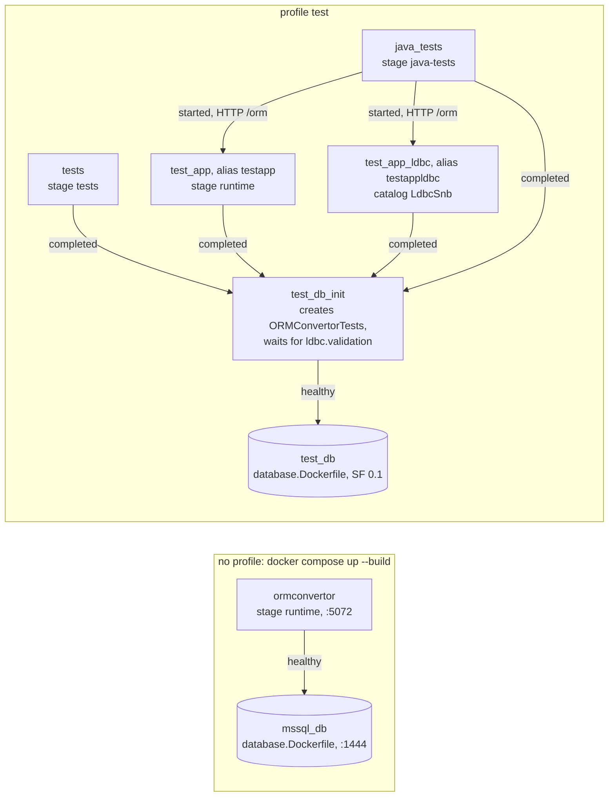
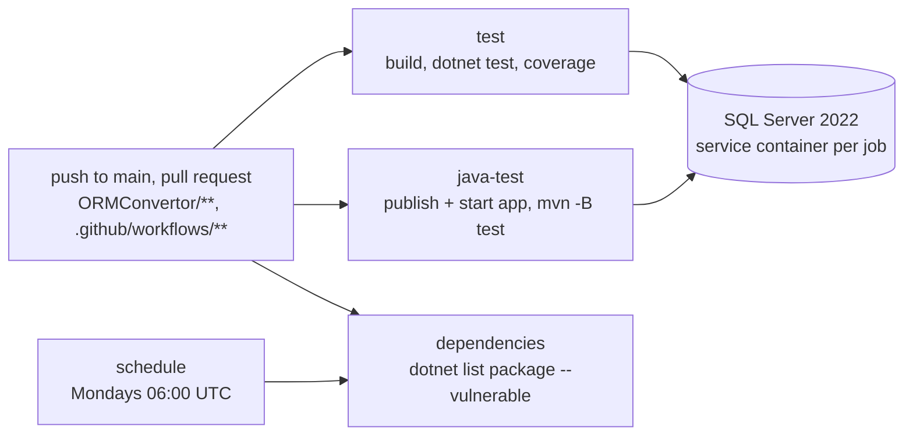

A web-based tool for translating between ORM frameworks. This operating manual says how it is run, deployed, configured and tested, and how each path was verified — the operational half of the deployment view (decision [058](../docs/decisions/058-only-the-operational-half-of-the-deployment-view-moves.md)); the tool itself is described in [`docs/architecture.md`](../docs/architecture.md). **Last verified against the code: 2026-10-12.**

# Deployment

One ASP.NET Core process, `ORMConvertorAPI`, serves the REST API and the static frontend under the path base `/orm`. The connection strings in `appsettings.json` are empty (S4, decision [029](../docs/decisions/029-database-connection-is-the-consumer-projects-fact.md)); see [Configuration](#configuration). **No endpoint requires a login**: a trusted network or an access-controlling proxy is assumed ([`threat-model.md`](../docs/threat-model.md)).

| Path | Environment | Verified by running it, on two machines |
|---|---|---|
| [Visual Studio](#visual-studio), [.NET CLI](#net-cli) | `Development` | profiles `http`, `https`: frontend served, `CatalogState = Reached` |
| [Docker](#docker-application--database) | `Development` | 2026-08-23, 2026-08-24; see below |
| [PM2](#pm2) | `Development` | `CatalogState = Reached`, version in the run record |
| [Real instance](#deploying-a-real-instance) | `Production` | Windows only; see below |

## Visual Studio

Open `ORMConvertor.sln`, startup project `ORMConvertorAPI`. The profiles in `ORMConvertorAPI/Properties/launchSettings.json` set `Development` (Swagger UI, user secrets) and open the relative `orm/` on their `applicationUrl`: `http` on `http://localhost:5072`, `https` on `https://localhost:7124` and `http://localhost:5072` (needs `dotnet dev-certs https`). `IIS Express` is an unverified template leftover. Only Visual Studio opens a browser.

## .NET CLI

```sh
dotnet run --configuration Release --launch-profile http --project ORMConvertorAPI/ORMConvertorAPI.csproj
```

The URL is printed to the console (typically [http://localhost:5072/orm/](http://localhost:5072/orm/)).

## Docker (application + database)

`docker-compose.yml` holds the system and, under the profile `test`, the test suites (decision [039](../docs/decisions/039-container-configuration-of-the-environment.md)); `docker compose up --build` starts only `ormconvertor` and `mssql_db`. Arrows are `depends_on` with its condition.



`ORMConvertorAPI/Dockerfile`: `advisor-native` builds `libadvisor.so`, `dotnet-build` publishes, `tests` builds on it, `java-tests` on `maven:3.9.11-eclipse-temurin-25-noble`, `runtime` on `aspnet:10.0` with `libglpk40`. **`dotnet-build` copies every `.csproj` by name: a new project needs a line in that `COPY` list.** `java-tests` copies all of `Tests/Database/` and `database/ldbc/updates/`; the pom's `<testResources>` selects from them.

- **`ormconvertor`** — [http://localhost:5072/orm/](http://localhost:5072/orm/), Swagger UI at `/orm/swagger`; gets `ConnectionStrings__AdvisorDatabase` and `ConnectionStrings__CatalogDatabase`.
- **`mssql_db`** — SQL Server 2022 on `localhost,1444`, `SA` / `Testingorms123` (development only), with `WideWorldImporters` and `LdbcSnb`: LDBC SNB Interactive v1, scale factor 1 (decision [110](../docs/decisions/110-ldbc-snb-as-a-second-reference-domain.md)), downloaded at build (222 MB) and loaded by `database/ldbc/load-ldbc.sh` on the first start in about a minute; beside it the validation set of LDBC Interactive v1 for the same scale factor, the judge of the LDBC catalog (decision [117](../docs/decisions/117-the-interactive-v1-validation-set-judges-the-ldbc-catalog-at-the-fourth-level.md); the image keeps its scale factor's file of the 205 MB archive), in the table `ValidationOperation`. A database whose extended property `ldbc.dataset` is missing or names another archive is reloaded; one that has the data and lacks `ldbc.validation` gets the set alone; a failed load leaves the server up without it. The loader asks only after the server has started every database of the volume — `init-db.sh` waits for the line `Recovery is complete` in this start's errorlog, because the server takes logins while its catalog still lists an unstarted database as online and a read of it fails with error 904 — and a question the server does not answer stops the loader with the database as it was. So a new container over a loaded volume (after `down`, a rebuilt image or `--force-recreate`) waits a few seconds and skips the load.
- Port 1444 is also bound by the inherited benchmarks: run one at a time.

**Verified** on the same Docker Desktop version: `POST /convert` from Dapper completed `Sales.Customers` (table, schema, types, length, nullability) from the catalog — F6 through the interface; `POST /advisor/run` solved the model through `libadvisor.so` (outside the guarantees, [`architecture.md`](../docs/architecture.md) §9). On a fresh volume (release `2.1.0`) `LdbcSnb` loaded in about 40 s — 17 tables, 29 foreign keys, 9 892 persons, 3 055 774 messages — and an infeasible model sent to `/advisor-test` logged its message with that call.

## PM2

`ecosystem.config.js`, inherited from the original prototype, defines the [PM2](https://pm2.keymetrics.io/) app `orm`, which runs the [.NET CLI](#net-cli) command: `pm2 start ecosystem.config.js`, `pm2 delete orm` to stop. `cwd: __dirname` makes the relative `--project` path work; the `env` block blanks `version` and `Version`, which `dotnet run` would turn into an MSBuild property overriding the assembly version. Needs Node.js with PM2 (`npm install -g pm2`) and the .NET SDK; listens on `localhost:5072` only.

## Deploying a real instance

**1. Publish**; the server needs only the ASP.NET Core runtime:

```sh
dotnet publish ORMConvertorAPI/ORMConvertorAPI.csproj --configuration Release --output /srv/ormconvertor
cd /srv/ormconvertor && dotnet ORMConvertorAPI.dll
```

**The `cd` matters:** the working directory is the content root, where `wwwroot` and `appsettings.json` are looked for. Started elsewhere, the API answers but `/orm/` returns an empty 404; the only trace is `Request reached the end of the middleware pipeline without being handled by application code`. Otherwise name it:

```sh
dotnet /srv/ormconvertor/ORMConvertorAPI.dll --contentRoot /srv/ormconvertor
```

**2. `Production` is the default:** no Swagger UI and no user secrets, so configuration arrives as environment variables.

**3. Proxy.** The app listens on `ASPNETCORE_URLS` without TLS; `UsePathBase` strips `/orm` without requiring it. A public instance belongs behind a reverse proxy that terminates HTTPS and keeps the prefix.

**4. `AllowedHosts` is `*`:** narrow it when exposed directly.

**Verified** on two Windows machines: `/orm/swagger` 404, `/orm/` 200; the catalog variable moved `CatalogState` from `NotConfigured` to `Reached`; `/advisor-test` 400 with the `libadvisor.so` load error; `--contentRoot` cured the content-root failure. **Not covered:** a Linux host, a real reverse proxy, the Advisor with its native library.

# Configuration

No connection string has a value in the repository, except the disposable credentials of servers that compose and CI create ([`threat-model.md`](../docs/threat-model.md)). Keys use `:` in user secrets and `appsettings.json`, `__` in environment variables. The application reads user secrets only in `Development`; the test project always.

| Key | Used by | Purpose; when unset | Set in |
|---|---|---|---|
| `ConnectionStrings:CatalogDatabase` | API | Catalog completion. Unset: conventions only, reported in `CatalogState`; F4 and F6 do not hold through the interface. | secret, env; compose `ormconvertor`, `test_app`, `test_app_ldbc`; CI |
| `ConnectionStrings:AdvisorDatabase` | API | Advisor benchmarking. Unset: the Advisor names the key and stops. | secret, env; compose `ormconvertor` |
| `ConnectionStrings:TestDatabase` | .NET suite | Database tests. Unset: they skip with a reason. | secret, env; compose `tests`; CI |
| `ORMCONVERTOR_REQUIRE_TEST_DATABASE` | .NET suite | `1`: a missing database fails. | env; compose `tests`; CI |
| `ORMCONVERTOR_TEST_SCHEMA` | both suites | Plain SQL identifier. Unset: `ormconvertor_test`, `ormconvertor_java_test`. | env |
| `ORMCONVERTOR_TEST_JDBC_URL` | Java suite | JDBC URL with user and password. | env; compose `java_tests`; CI |
| `ORMCONVERTOR_API_URL` | Java suite | Running instance with `/orm`: `http://testapp:5072/orm`, in CI `http://localhost:5072/orm`. | env; compose `java_tests`; CI |
| `ORMCONVERTOR_RECORD_DIFFERENTIAL` | both suites | Path where a recording run writes canonical results. | env, by hand |
| `ASPNETCORE_ENVIRONMENT` | API | `Development`: Swagger UI, user secrets. Unset: `Production`. | launch profiles, compose, CI |
| `ASPNETCORE_URLS` | API | Listening address. | image `runtime`, CI |
| `Parsing:MaxNestingDepth` | API | Parser nesting cap (decision [092](../docs/decisions/092-input-nesting-depth-capped-before-the-descent.md)); `0` is off. Unset: 128. | `appsettings.json`, env |
| `ORMCONVERTOR_CATALOG_DATABASE` | compose | Catalog of `ormconvertor`. Unset: `WideWorldImporters`; `LdbcSnb` for the LDBC queries. | shell |
| `LDBC_SCALE_FACTOR` | compose | `1`, another Interactive v1 scale factor (`0.1`, `0.3`, `3`, `10`, …) or `none` (no `LdbcSnb`). | shell |
| `LDBC_TEST_SCALE_FACTOR` | compose, profile `test` | Scale factor of `test_db`. Unset: `0.1`. | shell |

**The nesting cap is the operator's alone**: read at startup, absent from `/convert`. Deeper input overflows the stack, which .NET cannot catch, and kills the process ([`threat-model.md`](../docs/threat-model.md), threat 2). Each response reports it in `maxNestingDepth`.

# Advisor prerequisites

Translation works anywhere. The Advisor also needs SQL Server with WideWorldImporters (`ConnectionStrings:AdvisorDatabase`) and `libadvisor.so`, built only in the Docker image — elsewhere its endpoints fail. The ILP model: [`architecture.md`](../docs/architecture.md) §8.

# Tests

## In a container

```sh
docker compose --profile test build tests java_tests test_app test_app_ldbc test_db
docker compose --profile test run --rm tests         # the .NET suite
docker compose --profile test run --rm java_tests    # the Java suite
```

S5's "one main command" per suite: the host needs only Docker. Each `run` starts SQL Server, creates the database once it is healthy and runs the whole suite in its own schema (decision [076](../docs/decisions/076-java-wrappers-in-csharp-jvm-in-containers.md)). `test_app` is the tool the Java suite translates against (decision [078](../docs/decisions/078-java-suite-as-a-client-of-a-running-instance.md)), its catalog on the test database, aliased `testapp` because the JDK's `HttpClient` refuses `_` in a host name. The SQL Server of the profile is the image of `mssql_db` at scale factor 0.1 (`LDBC_TEST_SCALE_FACTOR`), so its first start restores WideWorldImporters and loads `LdbcSnb` with its validation set before `test_db_init` lets the suites run; both suites then run [the LDBC judge](#the-ldbc-judge) as well, `test_app_ldbc` serving the Java one.

> **`run` does not rebuild.** Without `build` it measures the tree the images were built from — green, with nothing to say so; it has silently reported a stale tree twice. **The only tell is the test count** against [the size of the suite](#how-large-the-suite-is-and-what-it-covers).

## On the host

```sh
dotnet test Tests/Tests.csproj --configuration Release
```

Database tests need `ConnectionStrings:TestDatabase`, e.g. `Server=(localdb)\MSSQLLocalDB;Database=ORMConvertorTests;Trusted_Connection=True;TrustServerCertificate=True`.

## The test database

The tests **create their schema themselves** in any reachable SQL Server (decision [016](../docs/decisions/016-generated-artifact-verification-levels.md)), from `Tests/Database/`.

- **Schema** `ormconvertor_test` from `Database/TestSchema.sql` (`{{schema}}` for the name), the expected answer F4 measures against: single-part keys by `IDENTITY` (`Customers`, `Suppliers`) and assigned (`Products`); composite keys of two (`Orders`, `ProductSuppliers`), three (`OrderLines`) and four parts (`OrderLineAllocations`); one- to three-column foreign keys; 1:1 over a shared key (`CustomerProfiles`); a junction table (`ProductSuppliers`); length, precision/scale, nullability. `TestSchemaFixtureTest` guards it.
- **Lifetime.** `TestSchemaFixture` serves the collection `TestDatabaseSchema`: dropped, created once, dropped after. A writing test (level 4: `DapperToNHibernatePersistenceTest`, `DapperToEFCorePersistenceTest`) rolls back its own transaction over `OpenConnection()`.
- **Skip or fail.** `SkipIfUnavailable()` skips with a reason, since the tool must translate without a database; with `ORMCONVERTOR_REQUIRE_TEST_DATABASE` it fails.
- **LDBC:** schema `<schema>_ldbc` from `database/ldbc/schema.sql`, `constraints.sql` and `indexes.sql`, empty tables for `Combined/LdbcCatalogTest`.

## The LDBC judge

The validation set of LDBC Interactive v1 judges the Interactive queries of the LDBC catalog at level 4 (decision [117](../docs/decisions/117-the-interactive-v1-validation-set-judges-the-ldbc-catalog-at-the-fourth-level.md); [`architecture.md`](../docs/architecture.md) §6.2): both suites replay it in order over `LdbcSnb` - the inserts from `database/ldbc/updates`, every read against the generated artifact of each framework - and return the database to its loaded state before and after.

| Setting | .NET suite | Java suite |
|---|---|---|
| `LdbcSnb` with the data set and the validation set | `ConnectionStrings:LdbcDatabase` (user secret or `ConnectionStrings__LdbcDatabase`) | `ORMCONVERTOR_TEST_LDBC_JDBC_URL` |
| an instance of the tool whose catalog is `LdbcSnb` | — (translates in process) | `ORMCONVERTOR_LDBC_API_URL`, e.g. `http://localhost:5080/orm` |
| a missing judge fails instead of skipping | `ORMCONVERTOR_REQUIRE_LDBC_DATABASE=1` | the same |
| replay only the first n lines | `ORMCONVERTOR_LDBC_VALIDATION_ROWS` | the same |

- **Without the settings** the judge skips with the reason; the rest of the suite does not need `LdbcSnb`.
- **The compose profile** sets everything and replays the first 1000 lines of the SF 0.1 set - a check.
- **The whole set over SF 1 is a run of its own**, about a day per suite ([the record](#whole-set-runs): 20 hours for the .NET one, 25 for the Java one), the two suites one after the other because they share the lock. It runs against `mssql_db` of the system profile, started with `docker compose up -d --build mssql_db`, and for the Java suite an instance over the LDBC catalog, `ORMCONVERTOR_CATALOG_DATABASE=LdbcSnb docker compose up -d --build ormconvertor`. Build the suites first — a day spent on a stale image is the trap above at its most expensive — and start each detached, named and without `--rm`, so that `docker logs <name>` keeps the result whatever happens to the shell that started it:

  ```sh
  docker compose --profile test build tests java_tests
  docker compose --profile test run -d -T --no-deps --name ldbc_judge_dotnet \
    -e "ConnectionStrings__LdbcDatabase=Server=mssql_db,1433;Database=LdbcSnb;User ID=sa;Password=Testingorms123;TrustServerCertificate=true;" \
    -e ORMCONVERTOR_LDBC_VALIDATION_ROWS= \
    tests --filter "FullyQualifiedName~LdbcValidationTest" --logger "console;verbosity=detailed"
  docker compose --profile test run -d -T --no-deps --name ldbc_judge_java \
    -e "ORMCONVERTOR_TEST_LDBC_JDBC_URL=jdbc:sqlserver://mssql_db:1433;databaseName=LdbcSnb;user=sa;password=Testingorms123;encrypt=true;trustServerCertificate=true" \
    -e ORMCONVERTOR_LDBC_API_URL=http://ormconvertor:5072/orm -e ORMCONVERTOR_LDBC_VALIDATION_ROWS= \
    java_tests -Dtest=LdbcValidationTest
  ```

  A run stopped in the middle leaves the inserts of the lines it replayed in `LdbcSnb`; the next replay removes them first, and `database/ldbc/updates/undo.sql` does the same by hand.
- **Loading the set elsewhere:** take `validation_params-sf<N>.csv` of the scale factor the data has from `validation_params-interactive-v1.0.0-sf0.1-to-sf10.tar.zst` at `datasets.ldbcouncil.org/interactive-v1/`, run `database/ldbc/validation.sql` with `{{schema}}` replaced by `dbo` and `-v ValidationFile=<path the server can read>`, then add the extended property `ldbc.validation` with the file's name. After a change to `database/ldbc/indexes.sql` (decision [121](../docs/decisions/121-the-text-of-a-catalog-query-takes-the-shape-its-planner-needs-and-ldbcsnb-carries-the-indexes-its-reads-need.md)) run that script the same way; it is rerunnable, and the container does it by itself on the next start.
- **One replay at a time:** a replay holds the application lock `ldbc.validation` on its connection, so the other suite waits; the lock dies with the connection.

### Whole-set runs

The verdict of decision [117](../docs/decisions/117-the-interactive-v1-validation-set-judges-the-ldbc-catalog-at-the-fourth-level.md): the whole `validation_params-sf1` (138 747 lines, 7 041 of them inserts) over `mssql_db` on MIS3, the image built by `build` right before. A record names the commit it measured (decision [095](../docs/decisions/095-a-dated-run-record-names-its-commit.md)).

| Started | Tree | Suite | Tests | As specified (19 queries) | IC 13, IC 14 (measured) | Replay |
|---|---|---|---|---|---|---|
| 2026-10-12 | `580ab90` | .NET: Dapper, EF Core, NHibernate | 86 passed, 0 skipped | every read agrees in all three | 6 818 of 6 818 reads (100.0 %) each, in all three | 1226 min, 113 lines a minute |
| 2026-10-14 | `5656945` | Java: Hibernate, EclipseLink, MyBatis | 81 passed, 0 skipped | every read agrees in all three | 6 818 of 6 818 reads (100.0 %) each, in all three | 1518 min, 91 lines a minute |

The tests also count the five mutations of IC 2 in each framework, all rejected, and the compensation, which returned `LdbcSnb` to its loaded state. Both runs judged IC 13 and IC 14 as the simplifications they were then; since decisions [140](../docs/decisions/140-ldbc-path-queries-as-breadth-first-search-in-non-recursive-definitions-with-the-depth-of-the-data.md) and [141](../docs/decisions/141-one-data-set-for-the-ldbc-catalog-and-the-depth-of-a-path-query-as-a-measured-property-of-it.md) the five path queries are translated as specified, so the next whole-set run judges them by verdict. A check on 2026-10-15, the first 2000 lines of SF 1 through the .NET suite from the host over `86a102b` + the next commit: 86 of 87 cells passed, IC 13 and IC 14 agreeing on every read in Dapper and NHibernate and IC 13 in EF Core; IC 14 in EF Core agreed on 94 of 95 reads and one read timed out at the 30 s default, which the same statement with the same parameters did not repeat by hand (2.2 s).

### Time by step

The compensation test of each suite prints the time of the replay split by step: the steps outside the cells, per framework the translation and compilation of its cells and the select and comparison summed over its reads, and per query the mean select of a read in each framework. Measured 2026-10-17 over `bac7dd4` + the next commit, the first 500 lines of SF 1 (476 reads of all 21 judged queries, 24 inserts) against `mssql_db`, the .NET suite from the host and the Java suite in its container against the rebuilt `ormconvertor`, one after the other; Intel Core i9-9900, SQL Server 2022 in Docker Desktop. Every cell agreed with the judge.

| | Dapper | EF Core | NHibernate | Hibernate | EclipseLink | MyBatis |
|---|---|---|---|---|---|---|
| translation of 21 cells | 1.6 s | 1.5 s | 0.9 s | 2.6 s | 1.3 s | 1.0 s |
| compilation of 21 cells | 3.5 s | 8.2 s | 4.0 s | 6.5 s (4.0 s bootstrap) | 3.3 s (1.0 s bootstrap) | 4.2 s (0.3 s bootstrap) |
| select, 476 reads | 120.2 s | 130.3 s | 111.0 s | 137.7 s | 130.3 s | 151.4 s |
| select, mean of a read | 253 ms | 274 ms | 233 ms | 289 ms | 274 ms | 318 ms |
| comparison, mean of a read | 0.06 ms | 0.06 ms | 0.06 ms | 0.10 ms | 0.09 ms | 0.11 ms |

The replay took 6.7 min in the .NET suite and 7.5 min in the Java one; the selects are 90 % of the first and 93 % of the second. The steps outside the cells together took under 20 s in either: the compensation before the replay 2.8 s (.NET, removing what the interrupted run before it had inserted) and 0.2 s (Java), the row counts 0.3–1.6 s each, the mutated artifacts 1.9 s to prepare and 12 s (.NET) or 5 s (Java) to run until caught, paging, expected rows and the 24 inserts under 0.5 s each, the Java instance and catalog 1.1 s. The mean of a read is set by IC 9, IC 12 and IC 14 at about a second each in every framework; the one query whose time differs by framework is IC 3, 140–150 ms in the .NET frameworks and 700–770 ms in the Java ones, and the short queries show a floor of about 20 ms a read in MyBatis (a session per read) and the first-read cost of EF Core and Hibernate on IS 1. The per-query lines are in the test output of a run.

### Catalog query times

The window of decision [140](../docs/decisions/140-ldbc-path-queries-as-breadth-first-search-in-non-recursive-definitions-with-the-depth-of-the-data.md): every query of the catalog runs over `LdbcSnb` on MIS3 between 0.2 s and 300 s, the upper bound met by scale factor 1, the lower one by repetitions in a measurement (decision [141](../docs/decisions/141-one-data-set-for-the-ldbc-catalog-and-the-depth-of-a-path-query-as-a-measured-property-of-it.md)). Measured 2026-10-15 over `86a102b` + the next commit (the five path queries in their new texts, the rest unchanged): each text with its example parameters through Dapper against `mssql_db` (SF 1), four runs, the smallest of the three warm ones; Intel Core i9-9900, SQL Server 2022 in Docker Desktop.

| Query | ms | Query | ms | Query | ms | Query | ms |
|---|---|---|---|---|---|---|---|
| IS 1 | 2 | IC 1 | 58 | IC 12 | 1 001 | BI 9 | 341 |
| IS 2 | 2 | IC 2 | 85 | IC 13 | 170 | BI 10 | 1 004 |
| IS 3 | 3 | IC 3 | 1 446 | IC 14 | 2 243 | BI 11 | 5 205 (2.5–14 s between runs) |
| IS 4 | 2 | IC 4 | 61 | BI 1 | 235 | BI 12 | 603 |
| IS 5 | 2 | IC 5 | 210 | BI 2 | 305 | BI 13 | 257 |
| IS 6 | 2 | IC 6 | 266 | BI 3 | 479 | BI 14 | 38 469 |
| IS 7 | 3 | IC 7 | 68 | BI 4 | 412 | BI 15 | 5 259 |
| | | IC 8 | 8 | BI 5 | 2 820 | BI 16 | 3 959 |
| | | IC 9 | 237 | BI 6 | 26 785 | BI 17 | 1 488 |
| | | IC 10 | 173 | BI 7 | 130 | BI 18 | 11 807 |
| | | IC 11 | 19 | BI 8 | 835 | BI 19 | 6 623 |
| | | | | | | BI 20 | 128 |

The texts with a depth bound they replaced measured IC 13 116, IC 14 2 003, BI 15 46 084, BI 20 166 and BI 19 over 500 000 ms the same day. Below 0.2 s are index lookups and small joins (IS 1–7, IC 1, IC 2, IC 4, IC 7, IC 8, IC 10, IC 11, IC 13, IC 14, BI 7, BI 20), which no scale factor lifts over the bound.

The depths of the path queries, measured from every person over the same data set (`LdbcJudge/LdbcPathQueryTest` holds them):

| Edges | Persons with an edge | Average degree | Components | Depth | Pairs at the depth |
|---|---|---|---|---|---|
| `knows` (IC 13, IC 14) | 9 163 | 39.4 | 1 | 5, the diameter | 2 172 of 83 951 406 |
| `knows` between persons who replied to each other (BI 19) | 8 674 | 32.4 | 1 | 5, the most edges on a cheapest path | 21 056 of 75 229 602 |
| `knows` through a shared university (BI 20) | 3 038 | 4.9 | 443 | 7 | 12 of 70 146 |
| `knows` priced by the forums of the example timeframe (BI 15) | 9 163 | 39.4 | 1 | 11 | 4 of 83 951 406 |

## The Java test suite

`JavaTests/`, Maven and JUnit outside `ORMConvertor.sln`, the suite of F12 (decision [076](../docs/decisions/076-java-wrappers-in-csharp-jvm-in-containers.md)); what each test verifies is in [`architecture.md`](../docs/architecture.md) §6.2.

- **Verdict** only from the `java-tests` stage and the `java-test` job. A host with JDK 25 and Maven (e.g. those bundled with IntelliJ) can `mvn test-compile`, or run the suite against its own database and an instance whose catalog names that same database, as a check.
- **Versions** of Hibernate, EclipseLink, MyBatis, `mssql-jdbc` and JUnit live only in `JavaTests/pom.xml`; `TargetFrameworkDescriptorTest.JavaSuiteDependenciesMatchTheJavaDescriptors` binds the three framework versions to the descriptors.
- **Inputs:** `ORMCONVERTOR_TEST_JDBC_URL`, e.g. `jdbc:sqlserver://localhost:1433;databaseName=ORMConvertorTests;user=sa;password=...;encrypt=true;trustServerCertificate=true`, the schema built from the same `TestSchema.sql`; `ORMCONVERTOR_API_URL`, polled at `/required-content`.
- **No skip**: where it runs, a database and an instance were started for it - but for [the LDBC judge](#the-ldbc-judge), which needs `LdbcSnb` and an instance over it and skips without them. `mvn test -Dgroups=integration` runs the integration tests alone (decision [087](../docs/decisions/087-an-integration-test-is-a-run-against-the-database.md)).

Framework behaviour asserted as measured: decisions [078](../docs/decisions/078-java-suite-as-a-client-of-a-running-instance.md), [079](../docs/decisions/079-fractional-second-precision-as-second-precision.md), [080](../docs/decisions/080-eclipselink-as-the-second-profile-over-the-jpa-layer.md).

## Continuous integration

`.github/workflows/ormconvertor-tests.yml`, permissions `contents: read`:



| Job | What it does | Uploads |
|---|---|---|
| `test` | build (Release), `dotnet test` with `--collect:"XPlat Code Coverage"`, the database required | `test-results` |
| `java-test` | Temurin 25; starts the published app on `http://localhost:5072` in `Production`, not waited for; `mvn -B test` | `java-test-results`; `java-test-app-log` on failure |
| `dependencies` | `dotnet list ORMConvertor.sln package --vulnerable --include-transitive`, judged by `grep` (it exits 0 either way) under `set -o pipefail` | — |

`dependencies` alone also runs weekly (decision [098](../docs/decisions/098-the-number-is-decided-once-per-release.md)). CI proves the suites against SQL Server of the stated version, compose that they run where nothing is installed. Coverage is never gated; `dotnet test Tests/Tests.csproj --collect:"XPlat Code Coverage"` writes `coverage.cobertura.xml` under `Tests/TestResults/`.

## How large the suite is, and what it covers

The only place that records it; a record names the commit it measured (decision [095](../docs/decisions/095-a-dated-run-record-names-its-commit.md)). All runs 0 failed; 0 skipped, except that since decision [118](../docs/decisions/118-nhibernate-writes-a-linq-form-beside-its-hql.md) the differential matrix skips the LINQ form of NHibernate where the provider cannot speak it (an `Omitted` record), and the note counts those. *Pinned* = the `build` + `run` pairs; integration counted by `-Dgroups=integration`.

| Date | Tree | .NET | Java (integration) | Note |
|---|---|---|---|---|
| 2026-09-21 | `2571694` | 1442, pinned | 146 (97), pinned | F7–F10, F12 and F13 enter the guarantees |
| 2026-09-21 | `3e8a286` | 1551, pinned | 146 (97), pinned | **release `2.0.0`**; later release commits touch no code; `/advisor-test` solved |
| 2026-09-30 | `b756535` + next commit ([104](../docs/decisions/104-a-projection-into-a-sql-target-materializes-as-an-untyped-row.md)) | 4273, pinned | 1076 (760), pinned | |
| 2026-09-30 | `2257bfd` + next commit ([107](../docs/decisions/107-an-expression-is-the-sixth-operand-shape-and-stands-wherever-an-operand-stands.md)) | 5185, host | 1367 (961), pinned | container out of memory |
| 2026-10-03 | `c32948b` + next commit | 7746, pinned | 2082 (1527), pinned | **release `2.1.0`** |
| 2026-10-03 | `a1e3a1e` + next commit ([117](../docs/decisions/117-the-interactive-v1-validation-set-judges-the-ldbc-catalog-at-the-fourth-level.md)) | 7878, pinned | 2163 (1608), pinned | the LDBC judge over 1000 lines of SF 0.1 in both; integration of the Java suite as 1527 + the judge's 81, not recounted |
| 2026-10-11 | `e321ea7` + next commit ([122](../docs/decisions/122-the-text-of-a-catalog-query-takes-the-shape-a-targets-implementation-needs-under-the-same-criterion.md), [123](../docs/decisions/123-a-native-query-of-eclipselink-expands-a-collection-parameter-at-run-time.md)) | 9294, pinned (46 skipped: the `Omitted` LINQ forms) | 2633 (1662), pinned | the judge over 1000 lines of SF 0.1 in both, the BI queries accepted by the Java targets; integration as 1608 + the 54 differential rows of the new category, not recounted |
| 2026-10-12 | `fcb4ccb` + next commit ([133](../docs/decisions/133-an-add-on-package-over-a-framework-is-not-that-framework.md)) | 9936, pinned (46 skipped: the `Omitted` LINQ forms) | 2757 (2023), pinned | **release `2.2.0`**; the judge over 1000 lines of SF 0.1 in both, the BI queries accepted by the Java targets; integration recounted |
| 2026-10-15 | `86a102b` + next commit ([140](../docs/decisions/140-ldbc-path-queries-as-breadth-first-search-in-non-recursive-definitions-with-the-depth-of-the-data.md), [141](../docs/decisions/141-one-data-set-for-the-ldbc-catalog-and-the-depth-of-a-path-query-as-a-measured-property-of-it.md)) | 9931, host (137 skipped: the 46 `Omitted` LINQ forms, the judge and the path queries without `LdbcSnb`) | 2765 (not recounted), pinned | the five path queries as level chains; on the host the judge and `LdbcPathQueryTest` ran separately over `mssql_db` (SF 1, [above](#the-ldbc-judge)); the Java judge over 1000 lines of SF 0.1 in the container |

**Coverage** is measured, never a threshold. Over `36d688d`, the same 1551 tests: **80.0 % of lines** (12 650 / 15 801), **69.1 % of branches** (8 047 / 11 642). By project: `SampleData`, `EclipseLinkWrappers` 100; `CSharpEntityParsing` 99.1; `DapperWrappers` 97.6; `HibernateWrappers` 97.0; `OrmConvertor` 95.8; `Model` 94.2; `DatabaseCatalog` 90.2; `NHibernateWrappers` 89.3; `AbstractWrappers` 89.2; `EFCoreWrappers` 87.1; `Common` 83.2; `TransactSql` 81.3; `JakartaPersistence` 80.3; `MyBatisWrappers` 78.5 (branches 53.7); `JavaEntityParsing` 75.8; `LinqParsing` 74.6; `ORMConvertorAPI` 45.1; `Advisor`, `AdvisorBenchmarking` **0.0** — the measured basis of area 1 in [`architecture.md`](../docs/architecture.md) §9. No coverage is measured for the Java suite.

**The Java suite counts itself:** `SuiteSizeTest` fails below F12's 60 tests or 20 integration tests and reports what it cannot count as *uncountable* (decision [087](../docs/decisions/087-an-integration-test-is-a-run-against-the-database.md)).

**A count belongs to the tree**, not the machine. A different total means a different tree, usually a stale image; the environment moves only the split into passed and skipped, and skipped tests prove nothing about F4 and F6.

## Translation performance (S3)

Bound: 30 s for 100 entities and 100 queries through `ConversionHandler.Convert`, EF Core → NHibernate; artifact counts are asserted. Release builds, 16 GB RAM:

| Test | Machine | Measured |
|---|---|---|
| `TranslationPerformanceTest`, no catalog | Intel Core i9-9900 (8 cores), Windows 10 Pro | ~0.2 s (2026-08-21) |
| `TranslationPerformanceTest`, no catalog | Intel Core i7-1065G7 (4 cores), Windows 11 Pro | 0.4–0.7 s (2026-08-24) |
| `CatalogTranslationPerformanceTest`, local SQL Server | Intel Core i9-9900 (8 cores), Windows 10 Pro | 0.4–0.5 s, catalog read (`CatalogReadMilliseconds`) 210–330 ms (2026-08-26) |

The margin is at least fortyfold. In the catalog variant three entities match the test schema and `OrderLine` exists only through the key the catalog supplies.

# API

Paths are relative to `http://<host>/orm`; the interface and its decisions are in [`architecture.md`](../docs/architecture.md) §6.5. `/orm/openapi/v1.json` is served in every environment and is authoritative; the committed snapshot [`ORMConvertorAPI/openapi.json`](ORMConvertorAPI/openapi.json) is refreshed from it as below; the Swagger UI at `/orm/swagger` renders it in `Development` only.

```sh
curl http://localhost:5072/orm/openapi/v1.json -o ORMConvertorAPI/openapi.json
```

| Method | Path | Purpose | Request → response |
|---|---|---|---|
| `GET` | `/required-content` | Languages each source reads | → `List<RequiredContentDefinition>` |
| `GET` | `/required-content-advisor` | The same for the Advisor | → `List<AdvisorRequiredContentDefinition>` |
| `GET` | `/samples`, `/samples-advisor` | A sample per unit | → `Dictionary<int, string>` |
| `GET` | `/examples` | Examples as whole inputs | → `List<ExampleDefinition>` |
| `GET` | `/ldbc` | 41 LDBC read queries | → `LdbcCatalogDefinition` |
| `POST` | `/convert` | Translation | `ConvertRequest` → `ConvertResponse` |
| `POST` | `/archive` | ZIP of client-named files | `ArchiveRequest` → `application/zip` |
| `POST` | `/advisor/run` | Advisor run with its translations ([059](../docs/decisions/059-advisor-response-carries-the-measured-translations.md)) | `AdvisorRunRequest` → `AdvisorRunResult` |
| `POST` | `/advisor-test` | Bare ILP solver | `AdvisorSolveRequest` → `AdvisorSolveResponse` |

A failing `POST` answers `400` with RFC 9457 `ProblemDetails`. Types live in `ORMConvertorAPI/Dtos/`; `ConvertResponse` carries the S6 run record.

# Frontend

Static pages in `ORMConvertorAPI/wwwroot` — HTML, ES modules, CSS, no build step (decision [032](../docs/decisions/032-frontend-as-static-pages-without-a-build.md)); Pico CSS and highlight.js are vendored in `wwwroot/vendor/`. Five pages — `index.html`, `translation.html`, `examples.html`, `ldbc.html` and `advisor.html`; what each shows is in [`architecture.md`](../docs/architecture.md) §6.3. What the browser runs is what is in git: after editing a page, reload it and check the browser console.
