# Architektura aplikace – současný stav

**Účel:** popis architektury tak, jak je dnes implementovaná — „jak to teď funguje". Proč jsme co zvolili, je v [`decisions/`](./decisions/README.md), co zbývá udělat, v [`open-items.md`](./open-items.md), co se přeloží a co ne, v [`subset.md`](./subset.md).

---

## Obsah

| Kapitola | O čem je | Kdo se ptá |
|---|---|---|
| [1. Přehled](#1-přehled) | pipeline, zafixované verze | každý |
| [2. Struktura řešení (.NET solution)](#2-struktura-řešení-net-solution) | projekty a závislosti | kdo přidává framework (modulový pohled §2–§4, §7) |
| [3. Použité návrhové vzory](#3-použité-návrhové-vzory) | kde který vzor | dtto |
| [4. Mezireprezentace](#4-mezireprezentace) | entity, klíč, vztahy, dotazy | kdo sahá na model |
| [5. Parsery a buildery – jak fungují dnes](#5-parsery-a-buildery--jak-fungují-dnes) | chování po frameworcích, diagnostika (5.1), katalog (5.2) | kdo hledá ztracený fakt (běhový pohled) |
| [6. Ověření artefaktů, frontend a rozhraní](#6-ověření-artefaktů-frontend-a-rozhraní) | ověření (6.2), frontend (6.3), REST a OpenAPI (6.5) | kdo nasazuje; provoz v [`ORMConvertor/README.md`](../ORMConvertor/README.md) (rozh. [058](./decisions/058-only-the-operational-half-of-the-deployment-view-moves.md)) |
| [7. Rozhraní parserů a builderů](#7-rozhraní-parserů-a-builderů) | abstraktní buildery, šablonový `Build()` | kdo píše wrapper |
| [8. Advisor – implementační detaily](#8-advisor--implementační-detaily) | ILP, `libadvisor.so`, koncové body | kdo sahá na Advisor |
| [9. Co tahle verze nárokuje a co je vyňaté ze záruk](#9-co-tahle-verze-nárokuje-a-co-je-vyňaté-ze-záruk) | nárok a hranice záruk | uživatel, oponent; kanonicky *Guarantees* v [`README.md`](../README.md), důkazy v [`traceability.md`](./traceability.md) |

*Kdo se ptá* = pohledy podle ISO/IEC/IEEE 42010. Mimo tento dokument: [`subset.md`](./subset.md) (přeloží se konstrukce?) a [`threat-model.md`](./threat-model.md) (čemu je instance vystavená).

## 1. Přehled

Aplikace překládá entity, mapování a dotazy mezi šesti ORM přes frameworkově nezávislou mezireprezentaci (§4): .NET Dapper, EF Core, NHibernate; javové Hibernate a EclipseLink jako tenké profily nad sdílenou vrstvou Jakarta Persistence (rozh. [077](./decisions/077-hibernate-wrapper-over-the-shared-jpa-layer.md), [080](./decisions/080-eclipselink-as-the-second-profile-over-the-jpa-layer.md)) a MyBatis nad dvěma vrstvami *jazyka*, Javy a T-SQL (rozh. [084](./decisions/084-mybatis-wrapper-over-the-shared-sql-reading.md)). Javové wrappery jsou v C#, JVM do procesu aplikace nevstupuje (rozh. [076](./decisions/076-java-wrappers-in-csharp-jvm-in-containers.md)). Advisor doporučí pro sadu dotazů framework nebo kombinaci podle naměřeného výkonu (§8).

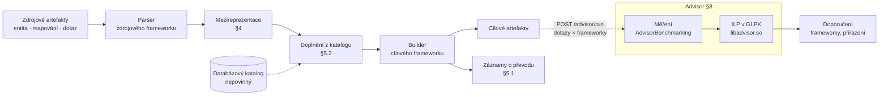

Diagramy draw.io v `diagrams/` jsou obraz prototypu z července 2025, před všemi rozhodnutími; dnešní stav nepopisují.

### Zafixované verze

Kanonické místo verzí, proti kterým platí tvrzení o frameworcích zde i v `docs/analysis/` (rozh. [013](./decisions/013-target-framework-versions.md)). Strojově je píše vždy jediné místo (rozh. [034](./decisions/034-central-version-management.md)): `ORMConvertor/Directory.Packages.props` (všechny přímé balíčky, tabulka jen ty, o nichž něco tvrdíme; `.csproj` verze nenesou, `CentralPackageVersionOverrideEnabled` vypnuté), `Directory.Build.props` (`TargetFramework`) a `global.json` (SDK `10.0.100`, `rollForward: latestFeature`), `JavaTests/pom.xml` (vlastnosti `*.version`), obraz stupně `java-tests` (Maven, JDK).

| Komponenta | Verze |
|---|---|
| .NET | 10 (`net10.0`) |
| NHibernate | 5.7.0 |
| Microsoft.EntityFrameworkCore(.SqlServer) | 10.0.10 |
| Dapper | 2.1.79 |
| Microsoft.Data.SqlClient | 7.0.2 |
| Microsoft.CodeAnalysis.CSharp (Roslyn) | 5.6.0 |
| Microsoft.SqlServer.TransactSql.ScriptDom | 180.78.1 (gramatika `TSql160Parser`) |
| xUnit | v3 (3.2.2) |
| JDK | 25 (LTS) |
| Jakarta Persistence | 3.2 |
| Hibernate ORM | 7.4.5.Final |
| EclipseLink | 5.0.0 |
| MyBatis | 3.5.19 |
| `mssql-jdbc` | 13.4.0.jre11 |
| Maven a JDK javové sady (obraz stupně `java-tests`) | `maven:3.9.11-eclipse-temurin-25-noble` — Maven 3.9.11, Temurin 25 |
| JUnit (javová sada) | 6.1.3 (Jupiter, Surefire 3.6.0) |
| Jackson (javová sada) | 2.22.2 (`jackson-databind`) |
| SQL Server | 2022 |
| Pico CSS (vendorovaná ve `wwwroot/vendor/`) | 2.1.1 (classless) |
| highlight.js (vendorovaná ve `wwwroot/vendor/`) | 11.12.0 (jádro + gramatiky C#, Java, XML, SQL) |

- **Deskriptor** každého wrapperu (`TargetFrameworkDescriptor`) nese `Version` a `Dialect` (rozh. [086](./decisions/086-target-database-dialect-declared-by-the-descriptor.md)) a jen odtud je vydává záznam běhu (S6, §5.1). Jinou verzi zvolit nelze. Deskriptory Hibernatu a EclipseLinku nesou vedle instance i `JpaImplementationProfile` (`…Descriptor.Profile`, §5).
- **Shodu hlídají** `DeclaredVersionsMatchTheVerificationPackages` (deskriptor ↔ balíček ověřovací úrovně, rozh. [016](./decisions/016-generated-artifact-verification-levels.md)), `JavaSuiteDependenciesMatchTheJavaDescriptors` (deskriptor ↔ vlastnost `pom.xml` a závislost na ní; text, bez JVM) a `EveryDescriptorDeclaresTheOnlyDialectThisVersionTargets`.
- **Bezpečnostní hlášení** hlídá úloha `dependencies` v CI (`dotnet list package --vulnerable --include-transitive`, i týdně podle rozvrhu). Hlášení proti tranzitivnímu balíčku řeší přímá reference na opravenou verzi (rozh. [034](./decisions/034-central-version-management.md)): `System.Security.Cryptography.Pkcs` 9.0.21 stojí vedle každé přímé reference `Microsoft.Data.SqlClient`, jehož 7.0.2 táhne 9.0.13 (GHSA-846f-f764-76mx, GHSA-2fmv-rv2c-59x7).
- **Verze nástroje** je `<Version>` v `Directory.Build.props` — **jediné místo, kde se číslo píše jako současný stav**; nadpisy ani nárok ho nenesou. Protějškem je `version` v [`CITATION.cff`](../CITATION.cff), posouvaný při vydání (rozh. [098](./decisions/098-the-number-is-decided-once-per-release.md)). Čte ji `ToolRelease.Version` do záznamu běhu; `ecosystem.config.js` vyprazdňuje proměnnou prostředí `Version`, jinak by ji v `dotnet run` přepsala ([`README`](../ORMConvertor/README.md#pm2)).

## 2. Struktura řešení (.NET solution)

`ORMConvertor.sln` (.NET 10) má dvaadvacet projektů:

- **`ORMConvertorAPI`** — spouštěcí ASP.NET projekt: REST API a statický frontend z `wwwroot` bez buildu (rozh. [032](./decisions/032-frontend-as-static-pages-without-a-build.md), obrazovky [137](./decisions/137-text-runs-the-full-width-and-controls-keep-a-fixed-width.md); §6.3); OpenAPI a Swagger UI v §6.5.
- **`Tests`** (xUnit v3) — složka na wrapper (javové jen 1. stupeň), `Combined/` (matice `ORMEnum` × `ORMEnum`: 36 směrů, 18 napříč ekosystémy, vstupy z `CrossFrameworkInputs.cs`; řádky na framework rukou jen `EnforcedMembersTest`, rozh. [037](./decisions/037-enforced-member-binding-held-by-the-test.md)), `Catalog/`, `Verification/` (2.–3. stupeň), `Differential/` (4. stupeň), `LdbcJudge/` (soudce LDBC, rozh. [117](./decisions/117-the-interactive-v1-validation-set-judges-the-ldbc-catalog-at-the-fourth-level.md)), `FibenJudge/` (běh katalogu FIBEN na vyžádání, rozh. [149](./decisions/149-fiben-as-a-third-reference-domain-run-on-demand-against-a-judge-of-our-own.md)), `Database/`, `Api/`.
- **dvacet knihoven**, jen jako reference (níž).

Mimo `.sln` jsou **`JavaTests/`** (Maven, JUnit), v adresáři řešení kvůli triggeru CI; staví ji stupeň `java-tests` obrazu a job `java-test` (rozh. 076), obsah §6.2 — a konzolový **`FibenImport/`**, který se spouští ručně nad checkoutem benchmarku FIBEN a generuje soubory katalogu (§6.2, *Katalog FIBEN*).

### Knihovní projekty a jejich zodpovědnost

Závislosti bez tranzitivních (`Tests` odkazuje skoro na vše):

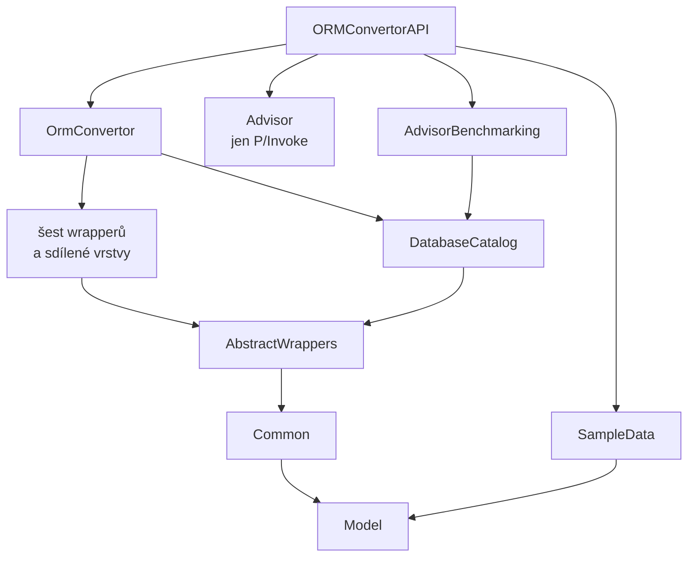

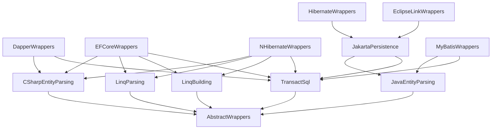

| Projekt | Zodpovědnost | Závisí na |
|---|---|---|
| `Model` | mezireprezentace (§4); typ výjimky nenese — ten žije, kde se háže i chytá (`JavaSyntaxError`, `JavaInputTooDeep`, `JpqlParseError`, `HqlParseError`; rozh. [097](./decisions/097-an-exception-type-lives-where-it-is-thrown.md)), očekávaný stav je záznam (rozh. [010](./decisions/010-diagnostics-as-returned-data.md)) | — |
| `Common` | `AccessModifierConvertor`, `CSharpTypeConvertor`; `Common.Compilation` (jediná kompilace Roslynem: `CSharpSourceCompiler`, `MetadataReferenceProvider`), `Common.Xml` (rozh. [046](./decisions/046-xml-mapping-written-through-an-element-writer.md)), `Common.Reading` (jediné čtení C#: `CSharpSource`, `CSharpUnit`; rozh. [128](./decisions/128-a-csharp-unit-with-a-syntax-error-is-refused-with-a-position.md)), `Common.Naming` (entita ↔ tabulka, rozh. [050](./decisions/050-one-home-for-the-singular-plural-heuristic.md); jména metod a parametrů dotazu), `Common.Sql` (hláskování typové rodiny dialektem: `SqlTypeReading`, `SqlTypeSpelling` s `Read`, `Name`, `Literal`; cizí deklarovaný dialekt `ForeignDialect`; rozh. 086). Tabulka jazykový ↔ databázový typ je ve wrapperech (rozh. [014](./decisions/014-language-type-model.md)) | `Model` |
| `AbstractWrappers` | `IParser`, `IEntityParser`, `IQueryParser`, abstraktní buildery (§7), deskriptor, `Diagnostics/ConversionRecord` (§5.1), `ParseLimits`, `NestingDepthGuard` (rozh. [092](./decisions/092-input-nesting-depth-capped-before-the-descent.md)) | `Common` |
| `DapperWrappers`, `EFCoreWrappers`, `NHibernateWrappers` | .NET parsery a buildery, každý framework zvlášť; `TransactSql` je projekt jazyka, ne cizí wrapper (rozh. [082](./decisions/082-t-sql-read-and-written-by-a-shared-project.md)); Dapper čte Roslynem literál z každého volání `SqlMapper`; NHibernate píše dotaz dvěma tvary, HQL a LINQ (rozh. [118](./decisions/118-nhibernate-writes-a-linq-form-beside-its-hql.md)) | `CSharpEntityParsing`, `TransactSql`; EF Core a NHibernate i `LinqParsing` a `LinqBuilding` |
| `LinqParsing` | sdílené čtení LINQ, dědí EF Core a NHibernate (rozh. [026](./decisions/026-home-of-shared-query-reading.md)) | `AbstractWrappers` |
| `LinqBuilding` | sdílený zápis LINQ (rozh. 118): `AbstractLinqQueryBuilder` (osm kroků nad standardními operátory), `LinqQueryVisitor`, `LinqScope`, `ILinqMembers` (člen sloupce: `EntityPathMembers` cesta přes referenci), `LinqJoinCall`; potomci `EFCoreLinqQueryBuilder` a `NHibernateLinqQueryBuilder` dodávají kořen, rukojeť, členy, operátory joinu a visitor provideru | `AbstractWrappers` |
| `CSharpEntityParsing` | sdílené čtení entitní třídy v C#, dědí všechny tři .NET wrappery přes zásuvné body (`FindHandovers`, `FieldNote`, `UnreadAttributeNote`; EF Core navíc atributy a konvence, NHibernate `DeferredModifiers`) | `AbstractWrappers` |
| `JavaEntityParsing` | `JavaLexer`, `JavaClassReader` (podmnožina: třídy a rozhraní, pole, hlavičky metod; těla přeskakuje), `JavaTypeConvertor`, `JavaEntityParser`; bez JVM a ANTLR, neznámý tvar je `Failure` s řádkem a sloupcem | `AbstractWrappers` |
| `JakartaPersistence` | JPA vrstva: `JpaAnnotationReader` a `JpaOrmXmlParser` → `JpaEntityFacts` → `JpaMappingWriter`; `JpaEntityParser`, `AbstractJpaEntityBuilder`, `AbstractJpaQueryBuilder`, `JpqlQueryParser`, `JpaColumnPrecision` (rozh. [079](./decisions/079-fractional-second-precision-as-second-precision.md)), `JpaSqlTypeWriting` (doslovný typ čte `Common.Sql.SqlTypeSpelling.Read`), `JpaImplementationProfile` s `JpaCounterTable`, `JakartaPersistenceDescriptor`; „JPA" jako cíl nevzniká | `JavaEntityParsing`, `TransactSql` |
| `TransactSql` | T-SQL nad ScriptDom, sdílený kompozicí: `SqlText`, `SqlQueryReader`, `SqlParameterFacts`, `SqlQueryVisitor`, `AbstractSqlQueryBuilder` (frameworkově specifická jen `Emit`), `SqlPlaceholders`, `SqlRenamedColumns` (§5, §7) | `AbstractWrappers` |
| `HibernateWrappers` | profil Hibernate (háček 1: defaulty implementace, `AUTO` → sekvence) a háčky 2–4 rozh. 076: `@Nationalized` při zápisu, vendor anotace při čtení, HQL `limit`/`offset` | `JakartaPersistence` |
| `EclipseLinkWrappers` | profil EclipseLink, nationalizace doslovným typem, líná reference | `JakartaPersistence` |
| `MyBatisWrappers` | bez vrstvy frameworku: doménová třída, rozhraní a XML mapperu, `MyBatisStatementText`, `jdbcType`, buildery | `JavaEntityParsing`, `TransactSql` |
| `OrmConvertor` | `ConversionHandler`: přes `Factories/` vybere parser a builder, nabídne jednotku oběma průchodům (rozh. [081](./decisions/081-a-unit-may-be-a-mapping-and-a-query-at-once.md)), spustí doplnění z katalogu, vrátí `ConversionResult` (artefakty, záznamy, čas katalogu — S3); wrappery zná jen přes rozhraní | šest wrapperů, `DatabaseCatalog` |
| `SampleData` | vstupy pro `/samples`, `/samples-advisor`, `/examples`, katalog LDBC SNB (`LdbcSnbSample`) pro `/ldbc` (rozh. [110](./decisions/110-ldbc-snb-as-a-second-reference-domain.md)) a katalog FIBEN (`FibenSample` nad prostředky `Fiben/queries.json` a `Fiben/Entities/*.cs`, které generuje `FibenImport`) pro `/fiben` (rozh. [149](./decisions/149-fiben-as-a-third-reference-domain-run-on-demand-against-a-judge-of-our-own.md)); i testy. Ve složce `ThirdParty/` výňatky cizích open-source projektů s licencí, README a poznámkou o původu v každém souboru, vložené jako prostředky a vyjmuté z překladu; čte je `ThirdPartySources` (rozh. [138](./decisions/138-code-of-open-source-projects-enters-as-a-marked-excerpt-under-its-own-permissive-licence.md)) | `Model` |
| `Advisor` | ILP v GLPK přes P/Invoke (§8) | — |
| `AdvisorBenchmarking` | spuštění a měření vygenerovaného kódu: `Common.Compilation`, kolektibilní `AssemblyLoadContext`, názvy tabulek z `DatabaseCatalog` | `DatabaseCatalog` |
| `DatabaseCatalog` | jediné čtení metadat databáze (rozh. [015](./decisions/015-mapping-fact-completion-from-the-catalog.md)): `SqlServerCatalogReader`, `CatalogCompletion`, `LanguageTypeInference`; wrappery na něm nezávisejí (S1) | `AbstractWrappers` |

## 3. Použité návrhové vzory

| Vzor | Kde | K čemu |
|---|---|---|
| Adapter | každý wrapper | rozhraní ORM ↔ mezireprezentace |
| Visitor | `IQueryVisitor`: `SqlQueryVisitor`, `LinqQueryVisitor` (potomci `EFCoreLinqQueryVisitor`, `NHibernateLinqQueryVisitor`), `NHibernateHqlQueryVisitor`, `JpqlQueryVisitor` | dotaz z instrukcí a podmínek |
| Builder | entitní a dotazové buildery | výstup skládaný přes `StringBuilder` |
| Factory | `OrmConvertor/Factories/` | parser, builder a deskriptor podle ORM |
| Šablonová metoda | `AbstractEntityBuilder.Build()`, `AbstractQueryBuilder` (§7, rozh. [023](./decisions/023-query-builder-template-method.md)) | pevné pořadí kroků; krok bez výstupu je prázdný override |

## 4. Mezireprezentace

Dvě části: entity a mapování (`Model.AbstractRepresentation`), dotazové instrukce (`Model.QueryInstructions`). **Mezireprezentace nevaliduje** — unese i kombinaci, kterou databáze odmítne; validace patří builderu nebo bráně úplnosti (§5.1). **Entity se odkazují jménem**, ne referencí (rozh. [001](./decisions/001-entity-reference-by-name.md)). Typy s pravidly vznikají továrnami, takže neplatná kombinace polí není zapsatelná.

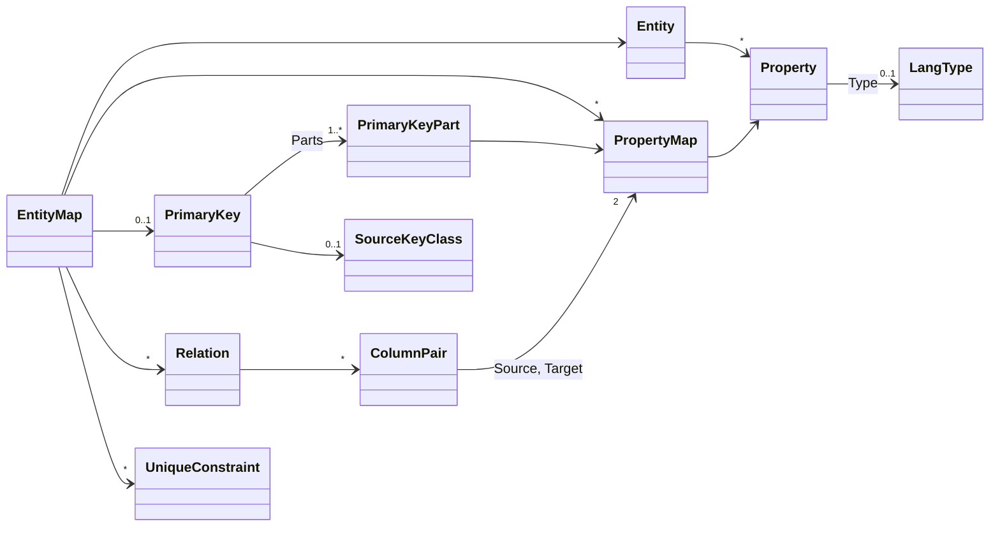

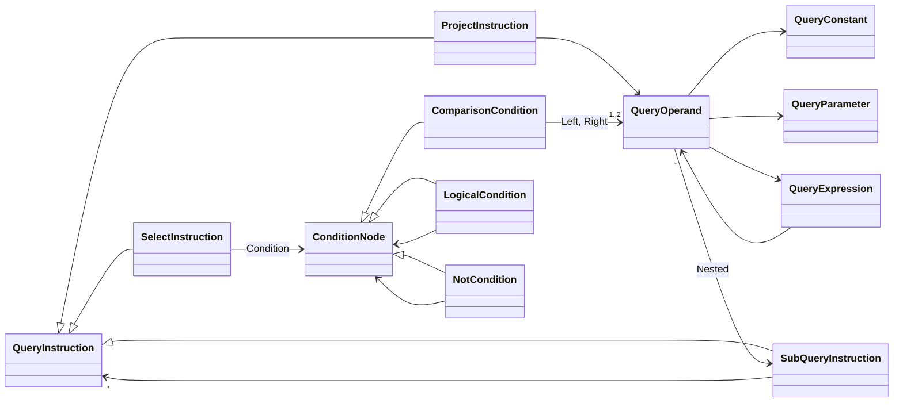

### 4.1 Entity a mapování

`Entity` a `Property` jsou aplikační strana (název, jmenný prostor, modifikátory, přístupové metody, inicializátor, `LangType`); `EntityMap` přidává `Table`, `Schema` a fakta níž.

| `PropertyMap` | Význam |
|---|---|
| `ColumnName` | prázdný = výchozí sloupec, nikdy „žádný sloupec" |
| `Type` (`DatabaseType?`) | typová rodina; „fakt chybí" je jedině `null` (`None` neexistuje) — stojí na tom brána úplnosti i doplnění |
| `IsUnicode`, `Length`, `Precision`, `Scale` | facety; `IsUnicode` dělí `nvarchar`/`varchar` (NHibernate `Char`/`AnsiChar`), `null` = cíl doplní konvenci (EF Core i NHibernate unicode); `Precision` nese i zlomky vteřin |
| `IsNullable` | databázová strana; jazyková je na `LangType` (pravidlo E4) |
| `SourceSqlType` | doslovný typ zdroje **vedle** rodiny; neznámý typ = rodina `null` + `SourceSqlType` + záznam o neúplnosti, ne výjimka |
| `IsVersion` | token optimistické souběžnosti — mapovací fakt, ne typ (rozh. [030](./decisions/030-scope-of-version-1-0.md)) |
| `IsApplicationManagedVersion` | upřesnění `IsVersion`: novou hodnotu vyrábí aplikace, ne databáze ani framework (EF Core `[ConcurrencyCheck]`, rozh. [116](./decisions/116-concurrency-check-is-the-version-the-application-keeps.md)); bez něj buildery odvozují výrobce z rodiny — binární databáze, jinak framework |
| `IsTransient` | zdroj vyslovil nepersistovanost: `[NotMapped]`, vlastnost chybějící v `hbm.xml`, `@Transient` (rozh. [072](./decisions/072-a-transient-property-is-a-carried-mapping-fact.md)); vlastnost zůstává v `Entity.Properties`, `false` = nikdo netvrdil |
| `TrimmedOnRead` | program zdroje dostává hodnotu sloupce pevné šířky bez koncových znaků do U+0020 (rozh. [169](./decisions/169-a-fixed-width-value-is-the-value-sql-returns-in-every-target.md)); čtečka EclipseLinku ho dává každé textové vlastnosti, protože to dělá jeho výchozí relace; pevnou šířku rozhoduje až builder podle `Type`, `false` = hodnota doplněná, jak ji vrátí SQL |

- **Vztah na `PropertyMap` není**, žije na entitě (§4.3). Mapovací fakt bez pole se neukládá a hlásí `Loss` (rozh. [048](./decisions/048-a-fact-with-no-place-in-the-model-is-a-loss.md)).
- Typ, unicode a `SourceSqlType` předává parser typovanou `SetPropertyDatabaseType`; slovník `SetPropertyDatabaseMapping` nese jen sloupec a číselné či pravdivostní fakty.
- **`DatabaseType`** (rozh. [019](./decisions/019-neutral-database-type-vocabulary.md)) — dvacet rodin, termín SQL standardu, kde ho má; typ jediného systému hodnotu nemá: `Boolean`, `TinyInt`, `SmallInt`, `Integer`, `BigInt`, `Decimal`, `Real`, `DoublePrecision`, `Date`, `Time`, `Timestamp`, `TimestampWithTimeZone`, `Char`, `VarChar`, `Text`, `Binary`, `VarBinary`, `Blob`, `Uuid`, `Xml`. `datetime`, `datetime2`, `smalldatetime` jsou `Timestamp` ve třech přesnostech, `money` je `Decimal(19,4)`.
- **`UniqueConstraint`** (rozh. [130](./decisions/130-a-unique-constraint-over-a-foreign-key-names-the-navigation.md)) — na entitě: `Name?`, `PropertyNames` (jména členů v pořadí zdroje); prázdné a s duplicitou odmítnuto; totožnost dává množina členů (`CoversSameAs`). Členem je vlastnost, nebo navigace vlastnícího N:1/1:1 (`EntityMap.ForeignKeyNamedBy`), která zastupuje všechny sloupce jeho FK; samotná navigace vlastnícího 1:1 se nepřidá (unikátnost nese kardinalita). Primární klíč mezi ně nepatří; `check`, `default` a neunikátní index jsou `Loss`.

**`LangType`** (rozh. [014](./decisions/014-language-type-model.md)) vzniká jen továrnami `Scalar/Reference/Collection/Unknown`; nese `IsNullable`, takže ji má i prvek kolekce. `Property.Type == null` = jazykový typ nikdo neuvedl.

| Kategorie | Nese |
|---|---|
| `Scalar` | `ScalarType`: `Bool`, `Byte`, `Short`, `Int`, `Long`, `Float`, `Double`, `Decimal`, `Char`, `String`, `DateTime`, `Guid`, `Object` (zdroj napsal `object`), `Date`, `TimeOfDay`, `DateTimeOffset`, `Duration`, `ByteArray` — posledních pět je C# `DateOnly`, `TimeOnly`, `DateTimeOffset`, `TimeSpan`, `byte[]` a Java `LocalDate`, `LocalTime`, `OffsetDateTime`, `Duration`, `byte[]` (rozh. [071](./decisions/071-five-scalars-with-a-counterpart-in-both-ecosystems.md)) |
| `Reference` | jméno cílové entity; vzniká, když to zdroj tvrdí (`AddForeignKey` povýší navigaci, zachová nullabilitu a druh kolekce), nebo při rozresolvování jmen (§4.3) |
| `Collection` | `LangType` prvku, `CollectionKind` (`Unspecified`, `List`, `Set`); mapy mimo rozsah |
| `Unknown` | název ze zdroje; builder ho tak vypíše, nikdy výjimka; po rozresolvování jmen `Incompleteness` (rozh. [075](./decisions/075-unknown-language-type-is-a-reported-incompleteness.md)) |

### 4.2 Primární klíč

| Pole | Význam |
|---|---|
| `PrimaryKey.Parts` | `PrimaryKeyPart` seřazené podle `Order` (řadí setter); jednoduchý klíč = jedna část. Prázdný klíč a duplicitní pořadí odmítne výjimkou (S2); souvislost číslování se nevyžaduje |
| `.Order` | explicitní; parsery číslují od 1 (EF Core pořadí v `[PrimaryKey(...)]`, NHibernate pořadí `<key-property>`), model začátek ani souvislost nevyžaduje |
| `.Strategy` | `PrimaryKeyStrategy`, per part |
| `.SourceStrategyName` | co zdroj napsal a slovník nezachytil (vlastní generátor, `foreign`, `guid.comb` vedle `Uuid`); kanonický název se nekopíruje |
| `.StrategyParameters` | `GeneratorParameter` → hodnota |
| `.SourceStrategyParameters` | doslovně: u únikové cesty (`Unspecified` se jménem generátoru) všechny, jinak slova lokální generátoru (`where` u `hilo`) |
| `PrimaryKey.SourceKeyClass` | záznam o klíčové třídě zdroje: `ClassName`, `Form` (`KeyClassForm`), `PropertyName` (jen `Embedded`); dvojici hlídá konstruktor |
| `EntityMap.HasNoKey` | vyslovené popření klíče (EF Core `[Keyless]`, `MarkNoKey`; rozh. [063](./decisions/063-stated-keylessness-as-a-carried-fact.md)) — jiné než prázdný `PrimaryKey`: konvenční klíč EF Core se neodvodí, katalog ho nedodá |

- **`PrimaryKeyStrategy`** jmenuje mechanismus, ne generátor (rozh. [011](./decisions/011-key-generation-strategy-vocabulary.md)): `Unspecified` (nikdo neřekl), `Assigned` (dodá aplikace), `Auto` (vybere framework podle dialektu; `native` i `AUTO`), `Identity`, `Sequence`, `HiLo`, `Uuid`, `Increment` (jen NHibernate).
- **`GeneratorParameter`** (rozh. [020](./decisions/020-canonical-generator-parameter-vocabulary.md)): `SequenceName`, `Schema`, `BlockSize`, `InitialValue`, `CounterTable`, `CounterValueColumn`, `CounterKeyColumn`, `CounterKeyValue`. Fixuje význam a jednotku, ne pravopis: `BlockSize` je počet hodnot v bloku (NHibernate `max_lo` + 1, JPA `allocationSize` beze změny). Neuvedený se nematerializuje. Pořadí deklarace = pořadí emise (S2). Kanonizuje parser, zpět překládá builder.
- **Model je permisivní:** unese dvě části `Identity` (hlídá builder nebo databáze) i `HasNoKey` s vyplněným klíčem; ten rozpor odmítá brána úplnosti (§5.1), stejně jako část klíče s `IsTransient` (`Failure` kategorie `TransientProperty`).
- **Vynucené členy** kompozitního klíče (NHibernate `Equals`, `GetHashCode`, `[Serializable]`; JPA ID třída) v modelu nejsou, generuje je builder (rozh. [006](./decisions/006-flat-composite-key-rendering.md)).

**Klíčová třída se zaznamenává, ne převádí** — cíle vykreslují klíč ploše.

| `KeyClassForm` | Cesta k části | Zdroj |
|---|---|---|
| `Embedded` | přes vlastnost entity (`o.Id.OrderID`) | `<composite-id name= class=>`; `@EmbeddedId` — odložená `AddEmbeddedPrimaryKey`, před rozpuštěním zhmotněná nad všemi vlastnostmi třídy, `Assigned` |
| `Mirrored` | vlastnosti na entitě, třída je zrcadlí (`o.OrderID`) | `<composite-id class=>` bez `name`; `@IdClass` |

**Rozpuštění klíčové třídy** (`DissolveKeyClasses`, rozh. [031](./decisions/031-key-class-as-declaration-of-key-parts.md)) — co třída deklaruje, jsou části klíče:

| Situace | Výsledek |
|---|---|
| nárok jmenuje třídu | najde ji nejdřív jako třídu téhož prostého jména vnořenou v entitě, která nárok vyslovila, teprve pak první toho jména v převodu (rozh. [142](./decisions/142-a-key-class-claim-binds-first-to-the-class-nested-in-the-entity-that-names-it.md)); třídu nalezenou ve vlastním rozsahu záznam o sdíleném jménu (rozh. 094) nepočítá |
| člen je částí klíče | přenese jazykový typ (i nullabilitu), modifikátor, přístupové metody, inicializátor; jen do prázdného, sloupce zůstávají z mapování (rozh. [017](./decisions/017-source-precedence-for-mapping-facts.md)) |
| člen je navigací vztahu entity (`Key.user` u odvozené identity) | není ztráta: část klíče je sloupec vztahu |
| forma `Embedded` | držící vlastnost z entity zmizí — `Loss` |
| třída bez vlastní tabulky, schématu, klíče a vztahu | vyjme se z `EntityMaps` (pravidlo E1); s nimi zůstane entitou — `Conflict` |
| člen, který mapování nejmenuje jako část klíče | nepersistuje se — `Loss` |
| třídu nikdo nedeklaruje | `Incompleteness`, jen u `Embedded` nebo chybí-li části jazykový typ |

Fáze je idempotentní a nezávislá na pořadí jednotek (S2), signál po ní zůstává. .NET buildery ho nečtou; JPA builder jím pojmenuje klíčovou třídu, bez něj `<Entita>Id` se záznamem `Convention`.

### 4.3 Vztahy

**`Relation` žije na `EntityMap`, nikdy na `PropertyMap`** — strana „mnoho" nemá sloupec. Vztah je vlastnost odkazující na entitu nebo kolekce entit (pravidlo E6).

| Pole | Význam |
|---|---|
| `Cardinality` | `OneToOne`, `OneToMany`, `ManyToMany`, `ManyToOne`; jediný nositel násobnosti |
| `Role` | `Owning` = drží fyzický FK, `Inverse` = navigace bez sloupce (pravidlo E7). **FK i tvar značky určuje role, ne kardinalita:** NHibernate vlastnící 1:1 je `<many-to-one unique="true">`, `<one-to-one>` strana bez sloupce nebo sdílený klíč s generátorem `foreign` (rozh. [012](./decisions/012-foreign-key-rendering.md)). Unikátnost FK vztahu 1:1 nese `Cardinality.OneToOne` a každý cíl ji píše znovu; `unique` nad sloupcem FK čte NHibernate jako kardinalitu, JPA jako omezení schématu, jehož členem je navigace (rozh. [130](./decisions/130-a-unique-constraint-over-a-foreign-key-names-the-navigation.md)) |
| `SourceEntity`, `TargetEntity` | jména entit |
| `ColumnPairs` | uspořádané `ColumnPair(Source, Target)` (třída, ne tuple — kvůli System.Text.Json). `Source` je sloupec na straně s FK (`Owning`: zdroj, `Inverse`: cíl), `Target` odkazovaná část klíče (`<many-to-one>` i `<key>` vypisují `Source`, EF Core bere z `Target` typ a jméno dogenerované vlastnosti). Pořadí je autoritativní, buildery nepřeskládávají; rozpor s pořadím klíče je `Incompleteness`. **Prázdný = nerozresolvováno** |
| `SourceNavigationProperty` | navigace zdrojové entity |
| `InverseRelationName` | navigace protější strany (`[InverseProperty]`, `mappedBy`); plní EF Core parser, JPA builder jí určí `mappedBy` dřív než odvozením z párů; nedeklarované jméno se nevypíše |
| `Name` | nikdo neplní ani nečte; místo pro víc vztahů mezi touž dvojicí |

**N:M nemá vlastní typ** (rozh. [005](./decisions/005-many-to-many-as-explicit-junction-entity.md)): spojovací entita s `IsJunctionTable = true` a dvěma `Owning` relacemi `ManyToOne`. „Bohatá" spojovací tabulka je běžná entita; `IsJunctionTable` buildery nepotřebují.

```
StudentCourse (IsJunctionTable = true)
 ├─ Relation(Owning, ManyToOne) → Student   (ColumnPairs: [StudentId ↔ Id])
 └─ Relation(Owning, ManyToOne) → Course    (ColumnPairs: [CourseId ↔ Id])
```

**Fáze mezi parsováním a generováním** (`AbstractEntityBuilder`) v pevném pořadí; první dvě spouští i doplnění z katalogu jako úvodní kroky (§5.2), jinak `Build()`:

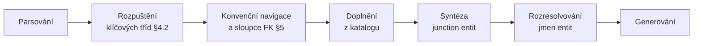

**Syntéza** (`SynthesizeJunctionEntities`) — N:M ze zdroje (`<many-to-many>`) i z katalogu:

- Z `JunctionFacts` (NHibernate `table`, `schema`, sloupce `<key>` a `<many-to-many>`) postaví entitu: vlastnosti po sloupcích s typy odkazovaných částí klíčů, složený klíč `Assigned`, dvě `Owning` N:1, název z tabulky (heuristika koncového „s") se záznamem `Convention`. Obě strany si fakta doplní; jejich kolekce se přesměrují na entitu jako inverzní 1:N a inicializátor kolekce jde s typem prvku (`new HashSet<Tag>()` → `new HashSet<ProductTag>()`; `[]`, `new()` a javový diamant beze změny; inicializátor s prvky vzdálené entity zmizí s `Loss`; `RetargetInitializer`).
- Bez tabulky či sloupců zůstane N:M a NHibernate builder vypíše `<many-to-many>` s fakty zdroje. Nesoulad sloupců s klíčem a kolize jmen jsou `Incompleteness`. Sebereference se nesyntetizuje.

**Rozresolvování jmen** (`ResolveEntityNames`):

| Případ | Výsledek |
|---|---|
| cíl vztahu je v převodu | sloupce z `AddForeignKey` se spárují s klíčem cíle; mimo převod je věc katalogu (rozh. [015](./decisions/015-mapping-fact-completion-from-the-catalog.md)) |
| sloupec bez vlastnosti | odpojená `PropertyMap` jen v páru |
| nesouhlasí počet sloupců, cíl chybí, N:M bez spojovací entity | `Incompleteness` (rozh. [010](./decisions/010-diagnostics-as-returned-data.md)); N:M se nepáruje nikdy |
| netypovaná vlastnost FK (`<key-many-to-one>`) | typ a sloupcová fakta z odkazované části klíče — `Convention` |
| `Unknown` se jménem entity převodu | → `Reference` (u kolekce prvek) |
| co zůstane `Unknown` | jeden `Incompleteness` na vlastnost, bez kategorie a jednotky; překlep od třídy mimo převod nerozezná |

### 4.4 Dotazové instrukce a podmínkový strom

Dotaz je seznam instrukcí a vedle něj seznam definic (`WithInstruction`). Co se nevykresluje přes visitor, čtou kroky builderu (§7).

| Instrukce | Nese | Visitor | Rozh. |
|---|---|---|---|
| `FromInstruction` | `Table` (i jméno definice), `Alias?` | ano | |
| `ProjectInstruction` | operand, `Alias?`, `DelimitedAlias` (zdroj alias oddělil, protože není identifikátorem — `AS "product.productId"`); celý řádek jedné proměnné rozsahu = sloupec `*` pod jejím aliasem (`IsWholeRow`; `SELECT t.*`, `select r` za joinem, `Select(x => x.r)`), dotaz bez projekce = celý spojený řádek (Q3); celý řádek definice vedle sloupců rozepíše šablona na její sloupce (`ExpandWholeRowsOfDefinitions`, rozh. [161](./decisions/161-a-window-aggregate-is-a-window-of-the-vocabulary-and-the-whole-row-of-a-definition-beside-columns-is-its-columns.md)) | ano | [107](./decisions/107-an-expression-is-the-sixth-operand-shape-and-stands-wherever-an-operand-stands.md) |
| `SelectInstruction` | jeden `ConditionNode` | ano | |
| `JoinInstruction` | `JoinKind` (`Inner`, `Left`, `Right`, `Full`), `LeftTable`, `RightTable`, `RightTableAlias?`, `OnCondition` (Q6) | ano | |
| `GroupByInstruction` | `Key`: sloupec nebo výraz, ne agregát ani okenní funkce | ano | [113](./decisions/113-native-sql-as-the-escape-path-and-the-vocabulary-ldbc-needs.md) |
| `HavingInstruction` | jeden `ConditionNode` (Q9) | ano | |
| `OrderByInstruction` | operand (i agregát bez aliasu), `Asc`; alias = sloupec bez tabulky | ano | 107 |
| `SetOperationInstruction` | `Union`, `UnionAll`, `Intersect`, `Except`, `ExceptAll`; `Left`, `Right` | ano | |
| `PaginationInstruction` | `Offset?`, `Limit?` jako `RowCount` (`Literal` ≥ 0, `Bound` parametr); nejvýš jedna na (pod)dotaz | ne | [060](./decisions/060-pagination-as-a-query-instruction.md), [085](./decisions/085-a-row-count-is-a-number-or-a-parameter.md) |
| `DistinctInstruction` | značka scope (Q3), idempotentní; `Normalize()` → `QueryClauses.Distinct` | ne | [073](./decisions/073-distinct-as-a-flag-of-the-query-scope.md) |
| `SubQueryInstruction` | vnořený rozsah; visitor volá zpět builder | ne | [061](./decisions/061-subquery-as-a-condition-operand.md) |
| `WithInstruction` | `Name`, `Body` (`AbstractQueryBuilder.Define`) | ne | [112](./decisions/112-a-query-as-a-row-source-is-a-named-intermediate-result.md) |

- Stránkování a `DISTINCT` rozšiřují normalizovanou sadu článku (jeho §5.4 to připouští). Q7 (implicitní join z metadat vztahu) se vyrábí do téhož stromu, po asociační cestě v `join` (rozh. [101](./decisions/101-a-join-along-an-association-path-is-derived-from-the-relation.md)) i mimo něj (rozh. [144](./decisions/144-a-path-through-an-association-outside-join-is-an-implicit-join-or-the-foreign-key-column.md)).
- **Seskupený dotaz** čte v projekci, `HAVING` a řazení jen klíče a agregáty; brána (§7) porovnává strukturně (`OperandStructure.Same`).
- **`ExceptAll`** bez protějšku v cíli je `Failure`, artefakt nevzniká (rozh. [053](./decisions/053-a-query-that-would-return-other-rows-is-not-emitted.md)); `TSql160Parser` ho přijme, SQL Server odmítne až za běhu. `INTERSECT ALL` slovník nemá — `Failure` při čtení.
- **Definice:** `WITH` i odvozená tabulka (pojmenovaná aliasem a **vyzdvižená na úroveň dotazu**); tělo je `SELECT` nebo množinová operace, jejíž sloupce jmenuje levý operand; syntaxi zdroje model nepamatuje; definice čte jen definice před sebou, jméno je jedno na dotaz; sloupce jsou její projekce a šablona ji popíše jako entitu platnou v dotazu. **Rekurzivní** definice nemá vlastní instrukci; limit `MAXRECURSION` je fakt dotazu (`AbstractQueryBuilder.LimitRecursion`: 0 = bez limitu, chybí = výchozí dialektu).

**Operand** (`QueryOperand`, rozh. [024](./decisions/024-typed-query-operand.md)) stojí v porovnání, projekci, řazení i seskupení:

| # | Tvar | Továrna | Pravidla |
|---|---|---|---|
| 1 | sloupec | `Column` | agregační funkce a její `Distinct` (`COUNT(DISTINCT x)`; bez funkce odmítne továrna, nad `*` brána — rozh. [102](./decisions/102-aggregate-distinct-like-escape-and-a-parameter-among-listed-values-are-carried.md)) |
| 2 | konstanta | `Value` | `QueryConstant`: text **bez zdobení** + `ScalarType?` (`Foo`, `2000`, ne `"Foo"`, `2000m`); neznámý typ: bez skaláru, vypíše se doslova, záznam |
| 3 | poddotaz | `Nested` | rozh. 061 |
| 4 | výčet hodnot | `ValueList` | neprázdný; konstanty nebo skalární parametry; jen vpravo od `IN` (rozh. [074](./decisions/074-a-list-of-values-as-the-fourth-operand-shape.md)) |
| 5 | parametr | `Bound` | `QueryParameter` (rozh. [083](./decisions/083-parameter-as-the-fifth-operand-shape.md)) |
| 6 | výraz | `Computed` | `QueryExpression`, s funkcí a `Distinct` jako sloupec (`SUM(Price * Quantity)`) |

- **Výčet hodnot:** společný skalár, nebo jedna číselná rodina (celá čísla s `Decimal`, nebo s `Float`/`Double`; `Decimal` s plovoucí čárkou ne) — brána v `Normalize()`. `null` (rozh. [002](./decisions/002-is-null-as-comparison-operator.md)), sloupec či funkce ve výčtu: `Failure` `Filtering`; kolekční parametr ve výčtu: `Failure` `QueryParameter`. Parametr ve výčtu bere skalár z levé strany `IN`.
- **`QueryParameter`** (`Named`/`Positional`): jméno bez zdobení (`id`, ne `@id`, `:id`, `#{id}`), **nebo** pořadí od 1 (holý `?` v HQL bere pořadí výskytu), nikdy obojí ani nic (rozh. [028](./decisions/028-assembly-name-is-not-ours-to-invent.md)); `Type?` (`null` doplní brána); `IsCollection` (`in (:ids)`, `ids.Contains(c.Id)`; skalár typuje prvky). Hodnotu nenese. Kolekční stojí jen vpravo od `IN`.
- **`QueryExpression`** — listy jsou operandy (poddotaz smí být listem, výčet a kolekční parametr ne); skalár výrazu model nenese, odvodí ho brána do `ExpressionTyping` (§7):
  - `Binary`: `Concat`, `Add`, `Subtract`, `Multiply`, `Divide`, `Modulo` (`ExpressionOperator`); `Add` nad řetězcem rozhodne brána jako konkatenaci.
  - `Call` (`QueryFunction`): `Upper`, `Lower`, `Trim`, `TrimEnd` (`RTRIM`, rozh. [169](./decisions/169-a-fixed-width-value-is-the-value-sql-returns-in-every-target.md)), `Substring`, `Length`, `Coalesce`, `Abs`, `Year`, `Month`, `Day`, `CurrentTimestamp`, `EscapePattern` (doslovné zástupné znaky), `DateAdd`, `DateDiff` (s `DateUnit` `Year`…`Second`; `DateDiff` počítá hranice jako T-SQL `DATEDIFF`), `Round`, `Sqrt`, `Cast` (`CastTo` z `QueryExpression.Castable`: `Int`, `Long`, `Float`, `Double`, `String`). Aritu, jednotku a cíl hlídá továrna; funkce vstoupí, až má hláskování v T-SQL.
  - `Case` jen *searched* (`CaseBranch`; *simple* se čte jako searched s rovností); `Window` s `RowNumber`, `Rank`, `DenseRank` (rozdělení smí chybět, řazení ne; bez rámce; jen v projekci mimo agregát); `ListAggregate` = `STRING_AGG … WITHIN GROUP`, agregát.

**Podmínky jsou strom**, ne plochý seznam spojený AND; `SelectInstruction`, `HavingInstruction` i `OnCondition` nesou jeden kořen:

| Uzel | Nese |
|---|---|
| `ComparisonCondition` | `Left`, `ComparisonOperator`, `Right?`, `Escape?`, `Quantifier?` |
| `LogicalCondition` | `And` / `Or` nad seznamem uzlů |
| `NotCondition` | jeden uzel |

- `ComparisonOperator`: `Equal`, `NotEqual`, `GreaterThan`, `GreaterThanOrEqual`, `LessThan`, `LessThanOrEqual`, `Like`, `In`, `IsNull`, `IsNotNull`, `Exists`. `IsNull`/`IsNotNull` a `Exists` (poddotaz vlevo) mají nevyužitou pravou stranu (rozh. 002); `NOT EXISTS` a `NOT IN` jsou `NotCondition`.
- `Escape` jen u `Like`, jeden znak bez zdobení, na porovnání, ne na vzorku; jinak odmítne brána (rozh. 102). EF Core `StartsWith(p)` je `Like(col, Concat(EscapePattern(p), '%'))`.
- `Quantifier` (`All` | `Any`) jen u šesti relačních operátorů s poddotazem vpravo — `x > ALL (SELECT …)`; jinak odmítne brána (rozh. [119](./decisions/119-quantified-comparison-as-a-comparison-with-a-quantifier.md)). Vzniká jen továrnou `ComparisonCondition.Quantified`: `= ANY` → `In`, `<> ALL` → `NotCondition(In)` (záznam `Convention`), `SOME` = `Any`; poddotaz vlevo čtečka zrcadlí (`Mirrored()`). `NegatedQuantified()` = De Morgan (`NOT (x > ALL S)` = `x <= ANY S`).
- Vícesloupcový equi-join je `And` rovností. **`IQueryVisitor` musí závorkovat** vnořený `LogicalCondition` s jiným operátorem (AND s OR uvnitř), jinak vznikne jiný dotaz.

## 5. Parsery a buildery – jak fungují dnes

Kapitola popisuje mechanismus: které třídy co čtou a zapisují a podle jakých pravidel. **Co se překládá a co ne, konstrukce po konstrukci, vede katalog [`subset.md`](./subset.md)** — co který framework přečte a vydá (část 1) a co nástroj odmítne, vypustí nebo napíše nativním SQL (část 2). Záznamy převodu popisuje §5.1.

#### Společná pravidla čtení

- **Strop hloubky zanoření** (rozh. [092](./decisions/092-input-nesting-depth-capped-before-the-descent.md)) se počítá nad tokeny (`(`, `{`) *před* rekurzivním sestupem, protože přetečení zásobníku shodí celý proces: HQL, JPQL a `JavaClassReader` (i generika, `ReadTypeArguments`) nad vlastními tokeny, `SqlText` (pro `SqlQueryReader`) nad `TSql160Parser.GetTokenStream`, C# nad `SyntaxFactory.ParseTokens`; XML se netýká. Překročení je `Failure` s řádkem a sloupcem, jednotka nevydá nic, ostatní pokračují (rozh. [045](./decisions/045-a-conversion-that-produced-nothing-says-so.md)).
- Mez `ParseLimits.DefaultMaxNestingDepth` = 128 dá `ParserFactory.Create` každému parseru (`IParser.Limits`); `ConversionHandler.Convert` ji bere nepovinně, API při startu (`ParseLimitsConfiguration`, klíč `Parsing:MaxNestingDepth`, `0` vypíná). `ConvertRequest` ji změnit nemůže.

**Čtení C# tříd** dědí .NET entitní parsery ze `CSharpEntityParser` (projekt `CSharpEntityParsing`, Roslyn; rozh. [026](./decisions/026-home-of-shared-query-reading.md)).

- Z hlavičky jen přístupový modifikátor (bez tokenu `internal`); `sealed`, `partial`, `abstract` model nenese.
- **Vypočtená vlastnost se nečte** (`StoredProperties`): bez setteru a s getterem, který je kód (`=> výraz`, `get { … }`), ji EF Core, Dapper ani NHibernate nemapují; je to chování třídy jako metoda a zůstává ve zdroji beze záznamu. Get-only auto-vlastnost (`{ get; }`) se čte dál; ve zdroji EF Core jako nepersistovaná (níž).
- **Setter je akcesor `set` či `init` bez vlastního modifikátoru** (`ReadProperty`, rozh. [134](./decisions/134-a-property-without-a-setter-gets-the-narrowest-setter-its-framework-writes-through.md)): `private set`, `protected set` a další si třída drží pro sebe a pro framework, `HasSetter` je `false` a cíl napíše svůj nejužší (zápis níž); `init` je setter a jeho omezení na inicializaci `Loss`. Javové čtení bere `setX` jakékoli viditelnosti (rozh. 077).
- **Bázový seznam jde do builderu, ač ho model nenese** (rozh. [048](./decisions/048-a-fact-with-no-place-in-the-model-is-a-loss.md)): `AddStatedBaseType` ho podrží s druhem (`StatedBaseTypeKind`: první položka seznamu C# = třída nebo rozhraní, další = rozhraní; Java `extends` = třída), `ReportStatedBaseTypes` (§7) vydá `Loss` u jména, které jmenuje entitu převodu (hierarchie), a `Loss` u třídy mimo převod (co by entita zdědila, převod nevidí; u první položky C# záznam říká obě možnosti); rozhraní a jméno rozřešené na entitu samu mlčí. Dědičnost je vyňatá oblast 2 (§9).
- **Co sdílené čtení nečte, hlásí** (rozh. 048): atribut na třídě či vlastnosti zdroje Dapper a NHibernate (framework v třídě mapování nenese) je `Loss` se jménem; pole instance (ne `static`, ne `const`) je `Loss` u všech tří, s větou frameworku z háčku `FieldNote` (Dapper by pole mapoval jménem, NHibernate přes `access="field"`, EF Core konvencí nemapuje). Totéž na javové straně: anotace na doménové třídě a poli zdroje MyBatis. Doplňkový balíček nad frameworkem se nečte (rozh. [133](./decisions/133-an-add-on-package-over-a-framework-is-not-that-framework.md)), jen jmenuje: háček `UnreadAttributeNote` (C#), resp. `UnreadAnnotationNote` (Java) dá záznamu větu a kategorii — Dapper atributům Dapper.Contrib (`DapperContrib`), MyBatis anotacím MyBatis-Plus (`MyBatisPlus`); balíček pozná import v jednotce či kvalifikované jméno, jmenovce z DataAnnotations či JPA jen bez jeho importu. Rozhraní mapperu s `BaseMapper<T>` dostane jeden `Loss` (`Combined/AddOnPackageTest`).
- **Každá deklarace třídy je entita**, vnořená vedle obalující (F14), kromě tří, které dostanou záznam (rozh. [111](./decisions/111-a-unit-is-a-whole-source-file-that-declares-only-its-language.md)): kód kolem předání dotazu (rozh. [109](./decisions/109-a-code-unit-carries-every-query-it-hands-over.md)), API frameworku (kontext EF Core: `DbContext` v bázovém seznamu nebo `DbSet<T>`; konfigurační třída `IEntityTypeConfiguration<T>`; obojí `EFCoreContext`, záznam `Loss` říká, že jejich konfiguraci čte parser fluent konfigurace) a statické třídy. Poznají je háčky `FindHandovers` a `FrameworkApi` rozpoznávačem dotazového parseru, u Javy přes `JavaClass.Start`/`End` a `JavaMemberSpan`. **Mez:** aplikační kód bez předání (služba, DTO) se čte jako entita.
- **Totožnost entity je jmenný prostor + název** (rozh. [094](./decisions/094-entity-identity-inside-a-conversion.md)): `DeclareEntity` najde nebo založí, takže druhá jednotka s toutéž třídou (`partial`) entitu obohatí; nevyslovený jmenný prostor nerozlišuje, obalující třída ano (`Customer.Key` ≠ `Order.Key`); nárok klíčové třídy ji najde ve vlastním rozsahu entity dřív než prostým jménem (rozh. [142](./decisions/142-a-key-class-claim-binds-first-to-the-class-nested-in-the-entity-that-names-it.md), §4.2). Třída obalu fragmentu (rozh. [128](./decisions/128-a-csharp-unit-with-a-syntax-error-is-refused-with-a-position.md)) obalující třídou není a pozice v obaleném stromu se počítají od začátku textu klienta.
- EF Core přidává atributové mapování přes háčky, NHibernate jen `DeferredModifiers` = `virtual` (rozh. [076](./decisions/076-java-wrappers-in-csharp-jvm-in-containers.md)): vynucený člen do modelu nevstupuje (`virtual` z EF Core cestuje dál) a NHibernate builder ho vrací jako první modifikátor; vazbu drží `NHibernateDeferredModifierTest` (rozh. [037](./decisions/037-enforced-member-binding-held-by-the-test.md)).
- NHibernate má pět parserů: entitní, `NHibernateXMLMappingParser`, dotazové LINQ a HQL a `NHibernateXmlQueryParser` nad týmž XML (rozh. [081](./decisions/081-a-unit-may-be-a-mapping-and-a-query-at-once.md)). Booleovské atributy čte v celém `xs:boolean` (`true`/`false`/`1`/`0`), nullabilitu trojstavově — chybějící atribut netvrdí nic.

**Priorita zdrojů** (rozh. [017](./decisions/017-source-precedence-for-mapping-facts.md)) dává pořadí čtení. Nese ho seznam v `ParserFactory`; orchestrace projede každý parser přes všechny jednotky, než začne další, takže „tvrzeno výš" = „fakt je už neprázdný".

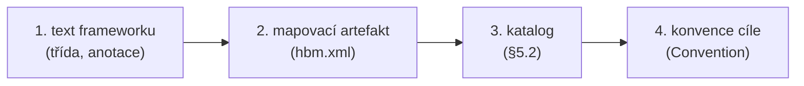

Framework, který precedenci svých artefaktů dokumentuje, se čte od nejsilnějšího a konvence materializuje na konci (rozh. [068](./decisions/068-source-framework-precedence-orders-the-reading.md)): JPA `orm.xml` před třídou, EF Core fluent konfiguraci před třídou (rozh. [132](./decisions/132-ef-core-fluent-configuration-is-read-as-a-bounded-syntactic-subset.md)), MyBatis souběh odmítá.

| Zápisová cesta builderu | Pravidlo |
|---|---|
| `AddTable`, `AddSchema`, `AddNamespace`, `SetPropertyDatabaseMapping`, `SetPropertyDatabaseType`, `MarkTransient` | vyplní jen prázdný fakt; shodné opakování nic, odlišné `Conflict` a platí první (S2) |
| `AddProperty` (= `GetOrCreatePropertyMap`) | najdi-nebo-založ, doplní jazykový typ, modifikátor, inicializátor (typy hodnotou); `HasGetter`/`HasSetter` jen přidávají, `OtherModifiers` se sjednocují (rozh. [049](./decisions/049-language-facts-under-source-precedence.md)) |
| `AddRelation`, `AddForeignKey` | najdi-nebo-přidej, navigace nese jeden vztah; jiný cíl či kardinalita `Conflict`; jiné sloupce cizího klíče téže navigace `Conflict` `ForeignKeyColumns` (platí první) |
| `AddPrimaryKey`, `SetKeyStrategyDetails` | identita = uspořádaný seznam částí; nad týmiž částmi doplní jen `Unspecified` strategii, klíčovou třídu a parametry; jiný seznam `Conflict` `PrimaryKey` (platí první klíč vcelku, vlastnosti zahozeného se nezakládají), jiná strategie části `Conflict` `PrimaryKeyStrategy` (rozh. [036](./decisions/036-primary-key-under-source-precedence.md)) |
| `MarkTransient` × persistovaná vlastnost | `Conflict` `TransientProperty` oběma směry; `[Key]` + `[NotMapped]` v jednom artefaktu vstoupí obojí a odmítne je brána (rozh. [072](./decisions/072-a-transient-property-is-a-carried-mapping-fact.md)) |

Bez konfliktu: facety z názvu typu (délka `Char` 1, přesnost `money`), `sql-type` vedle `type` mimo slovník (vyhrává `sql-type`), jméno typu a reference z `AddForeignKey` (rozh. [014](./decisions/014-language-type-model.md)). Důkaz: `SourcePrecedenceTest`.

**Konvence zdroje se materializuje podle rozh. [067](./decisions/067-a-derived-convention-is-a-statement-a-default-is-not.md)**: dokumentované odvození z tvrzení artefaktu, jen kde by prázdný fakt putoval jinam, bez záznamu; absenční výchozí hodnota (název sloupce, tabulka podle jména třídy, NHibernate `not-null` a `<generator>`) nikdy. Instance: pět konvencí EF Core (klíč, strategie z typu, nullabilita, navigace, tabulka podle `DbSet` vlastnosti — rozh. 132), u JPA primitiv → NOT NULL a výchozí sloupec cizího klíče. E4 aplikuje NHibernate builder jen jako zálohu 3. stupně (katalog ji přebije).

#### Entity a mapování: čtení

| Fakt | EF Core parser | NHibernate XML parser |
|---|---|---|
| klíč | `[Key]`, `[PrimaryKey]`, jinak `Id`, pak `<Entita>Id` bez ohledu na velikost písmen (rozh. [015](./decisions/015-mapping-fact-completion-from-the-catalog.md)). `[Keyless]` = `MarkNoKey` (rozh. [063](./decisions/063-stated-keylessness-as-a-carried-fact.md)); `[Key]` u něj → `Conflict`, `[PrimaryKey]` u něj → `Failure` brány | `<id>`; `<composite-id>` z `<key-property>` a `<key-many-to-one>` v pořadí dokumentu, `class`/`name` → `SourceKeyClass` (rozh. [006](./decisions/006-flat-composite-key-rendering.md)); `<key-many-to-one>` = části `Assigned` + vlastnící N:1 |
| strategie | `[DatabaseGenerated]` (`Identity`/`Computed` → `Auto`, `None` → `Assigned`); jinak celočíselný jednodílný `Auto`, `Guid` `Uuid`, jinak `Assigned` | `<generator>`, `<param>` kanonicky (rozh. [020](./decisions/020-canonical-generator-parameter-vocabulary.md)): `sequence` → `SequenceName` (+ `Schema`), `max_lo` → `BlockSize` + 1, `hilo` `table`/`column` → `CounterTable`/`CounterValueColumn`; ostatní doslovně do `SourceStrategyParameters` |
| cizí klíč | `[ForeignKey("A,B")]` na navigaci (pořadí = cílový klíč) = N:1 `Owning` (1:1 nevyjádří); skalární forma `[ForeignKey("Navigace")]` na vlastnosti se nečte a je `Loss`, ledaže se vlastnost jmenuje `{Navigace}Id` (totéž odvodí konvence) | `column`/`<column>` u `<many-to-one>` a `<key>`; `<many-to-many>` s `table`, `schema` → `JunctionFacts` (§4.3) |
| kolekce | konvenční navigace (níž); prvek skalár slovníku či klíčové slovo C# (`List<string>`, `List<uint>`) = primitivní kolekce: vlastnost bez vztahu a `Loss` (rozh. [048](./decisions/048-a-fact-with-no-place-in-the-model-is-a-loss.md)) | `SetCollectionKind` do `Unspecified`: `<set>` `Set`, `<list>` `List`, `<bag>` nic |
| nullabilita | sloupec nullable = bez `[Required]` a s otazníkem | `not-null` |
| verze | `[Timestamp]`; `[ConcurrencyCheck]` = verze, kterou udržuje aplikace, jen jako jediný token třídy bez `[Timestamp]` nad `short`/`int`/`long`/`DateTime`, jinak `Loss` s důvodem (rozh. [116](./decisions/116-concurrency-check-is-the-version-the-application-keeps.md)); nad `ulong` nebinární (rozh. [075](./decisions/075-unknown-language-type-is-a-reported-incompleteness.md)) | `<version>`, `<timestamp>` = rodina `Timestamp` (rozh. [030](./decisions/030-scope-of-version-1-0.md)); ostatní atributy `Loss` (níž) |
| unikátnost | `[Index(…, IsUnique = true, Name)]`, `nameof` i řetězec | `unique`, `unique-key` na `<property>` i `<column>`, sdílený klíč slévá, čárka = víc skupin; `unique-key` na `<many-to-one>` (či na všech jeho `<column>`) dává člen-navigaci, jen na části sloupců `Incompleteness`; skupiny v pořadí dokumentu (rozh. [130](./decisions/130-a-unique-constraint-over-a-foreign-key-names-the-navigation.md)) |
| transience | `[NotMapped]`: jen jazyk a příznak, nic dalšího | vlastnost třídy, kterou mapování nejmenuje (`name` pod `<class>` i vnořené, sloupec `<many-to-one>`/`<key-many-to-one>`; ne `<column>`, `<param>`, `<meta>`); bez mapování nic |
| sloupec | `[Column]`, `[MaxLength]`, `[StringLength]`, `[Unicode]` (po `TypeName`); druhá odlišná hodnota `Conflict` | `column` nebo první `<column>` (přednost), `sql-type` → `SourceSqlType` |

**EF Core: fluent konfigurace** (rozh. [132](./decisions/132-ef-core-fluent-configuration-is-read-as-a-bounded-syntactic-subset.md)) — `EFCoreFluentConfigurationParser`, v seznamu EF Core první, čte tělo `OnModelCreating` kontextu a `Configure` třídy `IEntityTypeConfiguration<T>` (ta se čte, kde stojí, i bez `ApplyConfiguration`). Čte řetězec nad `mb.Entity<T>()`, nad lambdou `Entity<T>(b => …)`, nad proměnnou `var b = mb.Entity<T>()` a nad parametrem `Configure`; argument jen literál, `nameof`, lambda `e => e.P` či `e => new { e.A, e.B }`. Entitu, kterou jmenuje (`DbSet<T>`, `Entity<T>()`, konfigurační třída), najde, nebo založí a označí `MarkNamedByMapping` — bez deklarované třídy ji brána odmítne `Failure`. Zapisuje cestami builderu jako anotace, s pozicí u volání. Co čeká na třídu, drží `EFCoreReadingContext` sdílený s `EFCoreEntityParser`:

| Konfigurace | Fakt | Kdo zapíše |
|---|---|---|
| `ToTable(t[, s])`, `HasKey`, `HasNoKey`, `Ignore`, `HasAlternateKey` (+`HasName`), `HasIndex(…).IsUnique()` (+`HasDatabaseName`) | tabulka, schéma, klíč se strategií `Unspecified`, bezklíčovost, transience, unikátní omezení | parser konfigurace |
| `Property(e => e.P)`: `HasColumnName`, `HasMaxLength`, `HasPrecision`, `IsRequired`, `HasColumnType` (`EFCoreStoreType`, sdílené s `[Column(TypeName)]`), `IsRowVersion`; `IsUnicode` až na konci jednotky (po typu) | sloupec, délka, přesnost, nullabilita, typ, verze, unicode | parser konfigurace |
| `IsConcurrencyToken`, `ValueGeneratedNever`/`OnAdd` | token podle rozh. 116, strategie jako `[DatabaseGenerated]` | parser třídy |
| `HasOne`/`HasMany(e => e.N)` + `WithOne`/`WithMany` + `HasForeignKey` (1:1 jen `HasForeignKey<T>`) | vztah z obou konců (`RelationshipFor`: vlastní, nebo zrcadlený z protistrany), bez `HasForeignKey` sloupce N:1 konvencí | parser třídy u navigace, před jejími anotacemi; fakt a pozice patří jednotce třídy |
| `DbSet<T>` vlastnost; `HasDefaultSchema` | tabulka (konvence 067), schéma každé entity zdroje bez vlastního | parser třídy, pod `[Table]` a `ToTable` mlčky |

Parser třídy pak: nullabilitu z typu jen tam, kde ji nikdo netvrdil; konvenční klíč jen bez klíče z konfigurace, nad ním doplní strategii z typu; `[Keyless]` vedle `HasKey` `Conflict` (klíč platí); vlastnost z `Ignore` čte jako `[NotMapped]`; navigace z konfigurace, kterou třída nedeklaruje, `Loss`. **Get-only auto-vlastnost** (bez `set` i `init`) čte také jako `[NotMapped]`, beze záznamu a s mrtvými anotacemi (`[Key]` na ní odmítne brána, rozh. 072), ledaže ji EF Core mapuje přes pomocné pole (rozh. [134](./decisions/134-a-property-without-a-setter-gets-the-narrowest-setter-its-framework-writes-through.md)): kolekční navigace (prvek není skalár), nebo člen, který konfigurace jmenuje — `Property`, `HasKey`, `HasIndex`, `HasAlternateKey`, `HasOne`/`HasMany` (`EFCoreReadingContext.MarkNamed`), konec vztahu z `With…` (`RelationshipFor`) a člen `HasForeignKey` u závislé strany (`Names`: `HasForeignKey<T>`, strana reference, u kolekce třída s inverzní navigací, bez ní kterákoli jiná). Mimo podmnožinu `Loss` (výčet v [`subset.md`](./subset.md) 2.2): příkaz, který není řetězcem nad tvůrcem (`base.OnModelCreating`, `ApplyConfiguration…` mlčí), argument, který není literálem, volání se známým týmž tvůrcem (řetěz pokračuje), jiné volání (řetěz končí). Nečitelný text hlásí jen parser třídy. Důkaz: `EFCore/EFCoreFluentConfigurationTest`.

- **Dapper: alias ve volání, které mapuje řádky na entitu** (rozh. [131](./decisions/131-a-column-alias-in-a-typed-dapper-call-states-the-column-of-the-property.md)) — úroveň 1b, `DapperColumnAliasParser` v entitním průchodu za třídou, tedy před katalogem. Volání (`Query…`, `QueryFirst…`, `QuerySingle…`, `QueryUnbufferedAsync`) s jediným typovým argumentem nebo `typeof(T)`, jeden čtecí příkaz (`DapperSqlQueryParser.RowMappings`); `T` jednoznačně entita převodu; holý sloupec pod aliasem ve vnější projekci tabulky entity (vyslovené, jinak kandidát rozh. 050; `SqlRenamedColumns` v `TransactSql`); alias jmenuje skalární vlastnost (přesně, pak bez ohledu na velikost písmen), od sloupce se liší a v projekci se neopakuje → `SetPropertyDatabaseMapping` (`ColumnName`), bez záznamu, fakt nese jednotka s voláním. Dva sloupce pro jednu vlastnost `Conflict`, platí první; týž sloupec do dvou vlastností obojí. Meze: subset.md 2.2 (`Dapper/DapperColumnAliasTest`).
- **`Loss` při čtení** (výčty v [`subset.md`, 2.1 a 2.2](./subset.md#22-mapování)): EF Core neznámá anotace, `[Index]` bez `IsUnique`, `[InverseProperty]` na skaláru, `[ForeignKey("Navigace")]` na skaláru, primitivní kolekce a `[ForeignKey]` či `[InverseProperty]` na ní; sdílené čtení C# atribut a pole (výš); NHibernate `property-ref`, forma `<key-many-to-one>` a JPA `@Id` na vztahu (bez sloupců `Incompleteness`), index `<list>`, `<map>`, `inverse`, `cascade`, druhý `<column>` vlastnosti a bez kategorie `check`, `default`, `index` (doslovný SQL je vyňatá oblast 5).
- **Hranice plochého čtení NHibernate** (vyňatá oblast 2): dědičnost, komponenty, `<join>`, `<natural-id>`, `<idbag>`, `<array>` a kolekce hodnot vydají `Loss`, stejně jako jmenné seznamy atributů každého čteného prvku podle schématu 5.7.0, jejichž záznam říká cenu (`formula`, `where`, `subselect`, `catalog`, `order-by`): `<class>`, `<id>`, `<composite-id>` a jeho části, `<property>`, `<version>`/`<timestamp>`, `<many-to-one>`, `<one-to-one>`, kolekce (mimo `inverse` a `cascade`, které mají vlastní záznam) s `<key>`, `<one-to-many>` a `<many-to-many>`, a vnořený `<column>` vztahu, z něhož se čte jen jméno (u `<many-to-one>` i `unique-key`). `node` nenese nic (režim XML entit NHibernate nemá).
- **Přežívající atribut záznam nemá** (kritérium rozh. [067](./decisions/067-a-derived-convention-is-a-statement-a-default-is-not.md)): co NHibernate builder z modelu napíše sám, se neztrácí — `generated="always"` binární verze (rodina tvrzená mapováním, ne doplněná katalogem), `insert`/`update="false"` u reference nad sloupcem klíče a u `<property>` nad sloupcem `<many-to-one>` či `<key-many-to-one>` (bez ohledu na velikost písmen); `mapped="true"` u `<composite-id>` s `class` a bez `name` je zrcadlená klíčová třída, kterou model nese. Round trip vlastního výstupu je tak bez záznamů (`NHibernate/NHibernateUnmodelledAttributeTest`).
- **Nečtené potomky čtených prvků** pod `<class>` hlásí týž mechanismus, každý výskyt zvlášť: `<formula>` a `<type>` jako prvek, u kolekce `<filter>`, `<subselect>`, `<loader>`, `<sql-insert>`, `<sql-update>`, `<sql-delete>`, `<sql-delete-all>`, `<synchronize>`, `<cache>`, u `<many-to-many>` `<filter>`, dále `<comment>` a `<meta>`. Čtené (`<column>`, `<generator>`, `<key>`, asociace kolekce) a hlášené jinde (index `<list>`, klíče `<map>`, prvky kolekce hodnot) na seznamech nejsou.

**Konvenční navigace EF Core** (rozh. 015, 067): vlastnost s nescalárním typem čeká v builderu (`AddConventionNavigation`) a rozhodne ji `ResolveConventionNavigations`, které volá fáze katalogu po rozpuštění klíčových tříd (§4.2), bez katalogu `Build()`.

| Kandidát | Výsledek |
|---|---|
| reference | na entitu převodu N:1 `Owning`, jinak mlčky odpadne; vlastnost v klíči se přeskočí |
| kolekce (`List`, `IList`, `IReadOnlyList`, `HashSet`, `ISet`, `IReadOnlySet`, `ICollection`, `IEnumerable`, `IReadOnlyCollection`) | `CollectionCardinality`: proti kolekci N:M, proti referenci či ničemu 1:N; prvek mimo převod 1:N; s `[ForeignKey]` 1:N hned |
| víc kandidátů | páruje `[InverseProperty]`, jinak jen jediný na každé straně, jinak `Incompleteness` |

Spojovací tabulku parser nevymýšlí (syntéza rozh. [005](./decisions/005-many-to-many-as-explicit-junction-entity.md) z katalogu). Vlastnost cizího klíče hledá jako `{Navigace}{Klíč}`, `{Navigace}Id`, `{TypCíle}{Klíč}`, `{TypCíle}Id` (bez ohledu na velikost písmen, se shodou typu) jen nad jednodílným klíčem; bez ní jde vztah bez sloupců a cíl vynechání hlásí `Convention`.

#### Entity a mapování: zápis

Entity buildery skládají string šablony; NHibernate builder plní dva `StringBuilder`y (C# a XML). **XML se neskládá interpolací**: `XmlEmitter` v `Common.Xml` (rozh. [046](./decisions/046-xml-mapping-written-through-an-element-writer.md)) bere název a dvojice název–hodnota a escapuje minimální množinu na jednom místě; používá ho i mapper MyBatisu (`orm.xml` se jen čte). Dapper builder má `BuildPrimaryKey` a `BuildForeignKey` prázdné; zahozené hlásí mechanický `Loss` z deskriptoru (rozh. [004](./decisions/004-unexpressible-facts-as-warnings.md)). Vlastnost bez setteru píše `{ get; }`, protože ji Dapper naplní přes pomocné pole (rozh. 134).

| Fakt | EF Core builder | NHibernate builder |
|---|---|---|
| strategie | anotace jen tam, kde mění chování EF Core; `Unspecified` nad celočíselným či `Guid` klíčem nic + `Convention` (rozh. [064](./decisions/064-absence-of-generation-as-a-catalog-fact.md)); `Identity`, `Sequence`, `HiLo`, `Uuid`, `Increment` `Loss` | generátor (rozh. [021](./decisions/021-generator-name-selection.md)) z kanonických faktů (`seqhilo`, `hilo`), jinak název zdroje se stejným mechanismem, je-li v `PrimaryKeyStrategyConvertor.Knows` (`guid.comb`, `foreign` → `SharesPrimaryKeyThrough`), jinak kanonický + `Loss`; `max_lo` = `BlockSize` − 1, `CounterKeyColumn`/`CounterKeyValue` `Loss`; `Unspecified` → `assigned` + `Convention` |
| složený klíč | `[PrimaryKey]` | `<composite-id>` + `[Serializable]`, `Equals`/`GetHashCode`; strategie části jiná než `Assigned` či `Unspecified` `Loss` |
| nullabilita | otazník; `required` bez inicializátoru a jen se setterem (jen jazyk; vlastnost bez setteru ho nesnese, CS9034, s užším setterem také ne, CS9032); `[Required]` jen nad nullable typem; nullable sloupec za nenullovatelnou vlastností `Loss` | `not-null`, u klíče nikdy |
| vlastnost s getterem bez setteru (rozh. [134](./decisions/134-a-property-without-a-setter-gets-the-narrowest-setter-its-framework-writes-through.md)) | persistovaná `{ get; private set; }` (`NeedsPrivateSetter`), kolekce, kterou vztah naviguje, a transientní `{ get; }`; beze záznamu | mapovaná i navigace `{ get; protected set; }` (`NeedsProtectedSetter`; užší odmítne validátor proxy), transientní `{ get; }`; beze záznamu |
| část klíče `int?` | zploštění + `Loss` `Nullability` (pomocná metoda `AbstractEntityBuilder`, rozh. [054](./decisions/054-nullable-key-part-is-a-reported-loss.md)); Dapper `?` drží | totéž |
| vztah | `[ForeignKey]` jen na vlastnící straně; chybějící vlastnost FK dogeneruje (`OrderLineOrderID`, typ z části klíče, `[Column]`) | `<many-to-one>` (N:1), `unique="true"` (vlastnící 1:1), `<one-to-one constrained="true">` (sdílený klíč), `<one-to-one property-ref>` odvozené z protistrany (bez ní `Incompleteness`) (rozh. [012](./decisions/012-foreign-key-rendering.md)) |
| verze | `[Timestamp]` jen binární (či `byte[]`), bez `TypeName`; číselná a datočasová → `[ConcurrencyCheck]` + `Loss` (inkrementuje aplikace); udržovaná aplikací → `[ConcurrencyCheck]` beze záznamu (rozh. [116](./decisions/116-concurrency-check-is-the-version-the-application-keeps.md)) | `<version>` za `<id>`, binární `generated="always"`, `<timestamp>` → `<version>` `DateTime`; udržovaná aplikací → `<version>` + `Convention` (inkrementaci přebírá NHibernate; JPA builder totéž u `@Version`); druhá či mimo běžnou vlastnost `Loss` |
| unikátnost | `[Index]` přes `nameof`; navigace → vlastnosti FK z `[ForeignKey]` (existující či dogenerované); nad nedeklarovanou vlastností či navigací bez známých sloupců `Incompleteness` | `unique`/`unique-key` na `<property>`; navigace → vždy `unique-key` na `<many-to-one>` (`unique` = 1:1); bez jména `UQ_{entita}_{členové}` + `Convention`; část klíče, verze `Loss` (rozh. [130](./decisions/130-a-unique-constraint-over-a-foreign-key-names-the-navigation.md)) |
| transience | `[NotMapped]` a deklarace | ve třídě, v mapování vynechaná |
| unicode bez rodiny | `[Unicode(false)]` bez `TypeName`; vyslovené unicode nic | `AnsiString`/`AnsiChar` (jediný `type` na `<property>` bez rodiny) |
| importy | `Microsoft.EntityFrameworkCore` jen pro `[Keyless]`, `[PrimaryKey]`, `[Precision]`, `[Index]`, `[Unicode]` (rozh. [009](./decisions/009-target-framework-descriptor.md)) | `using System;` u složeného klíče; `<class name>` holým jménem, `assembly` nikdy a bez záznamu (rozh. [028](./decisions/028-assembly-name-is-not-ours-to-invent.md)) |

NHibernate builder navíc:

- **Sloupce** z `ColumnPairs` (jeden `column`, víc `<column>`); bez párů `<many-to-one>` atribut vynechá. `<key>` kolekce bere nespárované sloupce zdroje, pak páry vlastnící N:1 protistrany (víc protistran → `InverseRelationName`), jinak klíč vlastníka ve všech částech + `Convention` (výchozí `id`, `Collection.DefaultKeyColumnName`, nad složeným klíčem selže `FKUnmatchingColumnsException`). Sloupec je zapisovatelný jednou: skalár nad sloupcem vztahu i `<many-to-one>` nad sloupci klíče dostane `insert="false" update="false"`.
- **Kolekce:** `Set` → `<set>`, jinak `<bag>`; `inverse="true"` jen u 1:N, jehož cíl v převodu nese vlastnící N:1 zpět přes tytéž sloupce; `cascade` nikdy; bez vztahu v mapování chybí + `Incompleteness`. Třída `IList<T>`/`ISet<T>`, inicializátor `new List<T>()`/`new HashSet<T>()`, jiný obsah `Loss` (rozh. [035](./decisions/035-nhibernate-collections-declared-by-interface.md); zakázané značky `virtual List<`, `virtual HashSet<`).
- **`<column>`** jen má-li co nést: délku a přesnost klíče, `sql-type` (rozh. [019](./decisions/019-neutral-database-type-vocabulary.md), i z dialektu), fakty `<version>`; precision < 1 (XSD) `Loss`.

Unicode bez rodiny MyBatis nevyjádří (`Loss`). Unikátnost nad transientní vlastností je `Loss` `UniqueConstraint`; vztah na transientní navigaci zůstává vztahem.

**Fakt konzumentského projektu se nevypisuje** (rozh. [040](./decisions/040-boundary-of-the-handed-over-artifact.md), [029](./decisions/029-database-connection-is-the-consumer-projects-fact.md)) — sestavení, připojení, soubor projektu, konfigurace, registrace v kontejneru; jmenný prostor projde, chybějící se nedoplňuje. Drží to `ConsumerProjectFactsTest` ve všech 36 směrech `ORMEnum`. Generovaný C# předpokládá C# 11+ (surové řetězcové literály v dotazech, `required` v EF Core) a verzi frameworku z deskriptoru (rozh. [013](./decisions/013-target-framework-versions.md)).

#### Dotazy: čtení a zápis

Dotazový parser zapíše instrukce (§4.4) do builderu z továrny orchestrace, mezi čtením a zápisem běží doplnění map z katalogu (§5.2) a `AbstractQueryBuilder.Build()` je vykreslí visitorem cíle. **Co se konstrukci po konstrukci přeloží, odmítne nebo napíše nativním SQL, vede [subset.md](./subset.md), části 2.3–2.12.** Tady je mechanismus: kdo čte, kdo píše a které brány rozhodují.

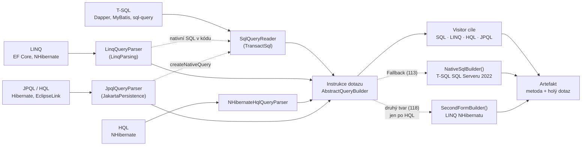

| Co se drží | Test | Rozsah |
|---|---|---|
| každý směr vydá neprázdný dotazový artefakt, žádný dotaz nezmizí mlčky | `Combined/QueryMatrixTest` nad `CrossFrameworkInputs.Directions` (součin `ORMEnum` × `ORMEnum`) | 36 směrů, z výčtu, ne ze seznamu |
| kategorie dotazů ze všech zdrojů do všech cílů; `Fallback` jen u artefaktu únikové cesty, a u něj vždy | `Combined/QueryShapeMatrixTest` (vstupy `Tests/Database/QueryShapes`) | kategorie a stupně §6.2; co běží v celé matici a co jen na devíti .NET směrech, §9 |

#### Kdo čte

| Jazyk | Čtenář | Co přidává wrapper |
|---|---|---|
| T-SQL | sdílený `SqlQueryReader` nad `SqlText` v `TransactSql` (rozh. [082](./decisions/082-t-sql-read-and-written-by-a-shared-project.md)); `TSql160Parser` (SQL Server 2022), `initialQuotedIdentifiers: true`; holý sloupec nechá holý (vlastníka dá šablona, §7), `T.*` čte jako celý řádek aliasu, alias v uvozovkách či hranatých závorkách nese `DelimitedAlias` | cestu k textu a fakta, která T-SQL nezná: Dapper (`DapperSqlQueryParser`) `IN @ids` (rozh. [106](./decisions/106-a-bare-parameter-after-in-is-dappers-collection-parameter.md)) a `isScript` (rozh. [108](./decisions/108-a-sql-unit-carries-a-query-per-select-numbered-by-position.md)); NHibernate přepis `NHibernateNativeSql`; MyBatis `#{}` a `<foreach>` (rozh. [084](./decisions/084-mybatis-wrapper-over-the-shared-sql-reading.md), *Javové frameworky*) |
| LINQ | `LinqQueryParser` v `LinqParsing` (rozh. [026](./decisions/026-home-of-shared-query-reading.md)), potomci `EFCoreLinqQueryParser`, `NHibernateLinqQueryParser` | kořen (`ctx.Set<T>()`, `ctx.Customers` proti `session.Query<T>()`; `TryReadQueryRoot`), dva fakty provideru o `LIKE` (níž), háčky `ProviderStepChangesTheRowSet`, `ProviderCommandOf`, `TryReadForeignQuery`, `TryReadProviderFunction`, `IsProviderQuerySource`, `IsProviderStaticQueryClass`, `IsCompiledQuery` a `IsProviderTrackingCall` (oba jen EF Core), `ImplicitJoinKind` (druh joinu navigace v operandu, rozh. [148](./decisions/148-a-reference-in-a-linq-operand-is-an-implicit-join-whose-kind-the-provider-takes-from-the-nullability-of-the-foreign-key.md) a [151](./decisions/151-a-reference-in-a-linq-operand-joins-left-where-its-row-may-be-absent-under-both-providers.md): `Left`, smí-li řádek reference chybět, jinak `Inner`, u obou providerů); `ReadsIntermediateResults` jen EF Core |
| HQL | `NHibernateHqlQueryParser`: vlastní tokenizer a rekurzivní sestup nad podmnožinou modelu (rozh. [062](./decisions/062-hql-read-by-a-hand-written-parser.md)); gramatiku drží round trip proti vlastnímu HQL builderu; srovnání jednohodnotové asociace s řádkem (`o.Customer = c`, `<>`), test asociace na `NULL` a cestu přes asociaci mimo `join` (`o.Customer.Name`, `o.Customer.Id`) čte stejně jako parser JPQL (řádek níž) | — |
| JPQL | `JpqlQueryParser` v `JakartaPersistence`; profily `HibernateJpqlQueryParser` (`TryReadDialectClause` pro `limit`/`offset`, `ImplementationCalls`, `ReadsIntermediateResults`, `ReadsHqlFunctions`) a `EclipseLinkJpqlQueryParser` (`ImplementationHints`); srovnání jednohodnotové asociace s řádkem (`p.customer = c`, `<>`) čte jako rovnosti sloupců cizího klíče s klíčem, odvozené ze vztahu jako join po cestě (`TryReadEntityComparison`, rozh. [101](./decisions/101-a-join-along-an-association-path-is-derived-from-the-relation.md)), jiné srovnání celé entity se nečte; `is null` / `is not null` nad celou entitou čtou parsery JPQL i HQL (`EntityNullness`) nad vlastnící jednohodnotovou asociací se známými sloupci jako nulovost sloupců cizího klíče (každý `IS NULL`, resp. `IS NOT NULL`, nad složeným klíčem konjunkce); kolekce, inverzní reference, celý řádek (`c is null`) a reference bez sloupců se odmítnou; cestu přes asociaci mimo `join` (`c.user.id`, `alert.alertHistory.clusterId`, řetěz `a.b.c.d`) čtou oba parsery v každém operandu (`ReadPathOperand`, rozh. [144](./decisions/144-a-path-through-an-association-outside-join-is-an-implicit-join-or-the-foreign-key-column.md)): cesta ke klíči, který vlastnící jednohodnotová asociace odkazuje, je sloupec cizího klíče nositele bez joinu (`ForeignKeyOf`, inverze `ColumnMember.PathOf`), každá jiná jednohodnotová asociace na cestě je vnitřní join odvozený ze vztahu jako v rozh. 101, jeden na dvojici alias–navigace a tělo dotazu (`ImplicitJoin`, registr `implicitJoins`), pod aliasem `alias_navigace` (číslovaným při kolizi); kolekce na cestě, cesta, která by přinesla join v podmínce `on`/`with` joinu (`readingJoinCondition`), a cesta, kterou mapy nerozresolvují, nechají operand nepřečtený s důvodem pro klauzuli; `join a.b.c x` kříží `a.b` implicitním joinem a `c` joinuje pod `x` | — |

- **Fázi volí deklarovaný typ obsahu** (rozh. [047](./decisions/047-content-type-reaches-the-query-parser.md)), proto ho `IQueryParser.Parse` bere v podpisu; společné je `CanParse`, entitní `Parse(source)` je na `IEntityParser`. Na jazyk připadá ve frameworku jeden dotazový parser (rozh. [025](./decisions/025-query-language-as-content-type.md)).
- SQL v C#, které není řetězcovým literálem, se nečte (`Incompleteness`, rozh. 026). Řetěz LINQ se rozkládá explicitně od hlavy k patě; `HAVING` je `Where` hned za `GroupBy`. Po `Failure` parser čte dál, aby jmenoval všechny důvody.
- HQL parser je přesný invert visitoru (entita → tabulka, vlastnost → sloupec podle map, neznámé jméno doslova); syntaktická chyba je `Failure` s řádkem a sloupcem, `update`/`delete`/`insert` na začátku `Failure` se jménem příkazu jako u JPQL, `between` dvě porovnání se `Convention` (Q14). NHibernate → NHibernate je textový round trip nad holým HQL, bez stránkování, které žije na `IQuery` (rozh. [060](./decisions/060-pagination-as-a-query-instruction.md)).
- Týž text z Dapper jednotky i z `<sql-query>` dá tutéž mezireprezentaci (`Combined/SharedSqlReadingTest`).

**Pojmenované dotazy `hbm.xml`** (rozh. [081](./decisions/081-a-unit-may-be-a-mapping-and-a-query-at-once.md)). `NHibernateXmlQueryParser` si nárokuje typ obsahu `XML` jako mapovací parser, takže dokument čtou oba průchody a parsuje se dvakrát (mezi nimi stojí doplnění z katalogu). `<sql-query>` jde přes `NHibernateNativeSql`: `{alias}` a `@x` v textu jsou `Failure`, `:name` se přepíše na `@name`. `<query-param>` je vyslovený skalár (`ScalarTypeConvertor`, rozh. [083](./decisions/083-parameter-as-the-fifth-operand-shape.md)) a brána ho drží před odvozeným, rozdíl je `Conflict`. Dotaz bez atributu `name` je `Failure`. Ostatní: subset.md 2.3 (`NHibernate/NHibernateNamedQueryDeclarationTest`).

**Pojmenované dotazy JPA** (rozh. [143](./decisions/143-a-named-query-of-jpa-is-read-where-it-is-defined.md)). `JpqlQueryParser` si vedle `JpqlQuery` a `Java` nárokuje i `XML` a v dotazovém průchodu čte definice tam, kde stojí: `JpaNamedQueryReader` sbírá z anotací každé třídy jednotky (`@NamedQuery`, `@NamedQueries`, opakovaná anotace, `@NamedNativeQuery`, `@NamedNativeQueries`; jen holé nebo s kvalifikátorem `jakarta.persistence`, anotace výrobce zůstává `Loss` entitního čtení) a z `orm.xml` (`<named-query>`, `<named-native-query>` na kořeni i v `<entity>`; jiný kořen než `entity-mappings` nevydá nic) jeden tvar `JpaNamedQueryFacts`, který parser čte jednou (`ReadDefinition`): jméno → `QueryName` (bez jména `Failure`), JPQL týmž sestupem jako řetězec `createQuery` včetně profilu, nativní text sdílenou čtečkou (`ReadNativeText`); `hints`/`<hint>` slovníkem `ImplementationHints` profilu (`ChangesRows` `Failure`, `Locks`/`MapsResult`/neznámá `Loss`), `lockMode` a potomek `<lock-mode>` mimo `NONE` `Loss`, `resultSetMapping` `Loss` `Projection`, `resultClass` mlčí, jiný člen anotace (`entities`, `classes`, `columns` nativního dotazu) i cizí potomek prvku `Loss` jmenovitě. `update`/`delete`/`insert` na začátku JPQL je `Failure` se jménem příkazu ve sdíleném čtení, tedy i pro `createQuery`. Entitní průchod (`JpaAnnotationReader`, `JpaOrmXmlParser`) tyto anotace a prvky nehlásí. Skalár parametru dává jen brána z porovnání; vazba `setParameter` v kódu, který dotaz volá, se nečte. Testy: `Hibernate/JpaNamedQueryTest`.

#### Kdo píše

| Cíl | Builder a visitor | Jazyk a obal | Artefakty |
|---|---|---|---|
| Dapper | `DapperSqlQueryBuilder` nad `AbstractSqlQueryBuilder` (`TransactSql`), `SqlQueryVisitor` | T-SQL v `connection.Query…` | C# metoda + `SqlQuery` |
| MyBatis | `MyBatisSqlQueryBuilder` nad týmž základem | T-SQL s `#{}` v `<select>` | metoda rozhraní + mapper `XML` |
| EF Core | `EFCoreLinqQueryBuilder`, `EFCoreLinqQueryVisitor` nad `AbstractLinqQueryBuilder` a `LinqQueryVisitor` (`LinqBuilding`, rozh. [118](./decisions/118-nhibernate-writes-a-linq-form-beside-its-hql.md)) | LINQ nad `ctx.Set<T>()`; metoda bere `DbContext` a vrací `IQueryable` (ověřitelné bez databáze, §6.2) | C# metoda |
| NHibernate | `NHibernateHqlQueryBuilder`, `NHibernateHqlQueryVisitor`; druhý tvar `NHibernateLinqQueryBuilder`, `NHibernateLinqQueryVisitor` nad `LinqBuilding` | závazně HQL v `session.CreateQuery(…)`; vedle něj LINQ nad `session.Query<T>()`, metoda bere `ISession` a vrací `IQueryable` (rozh. 118) | C# metoda + `HqlQuery` + C# metoda `CSharpLinqQuery` |
| Hibernate, EclipseLink | `HibernateJpqlQueryBuilder`, `EclipseLinkJpqlQueryBuilder` nad `AbstractJpaQueryBuilder`, `JpqlQueryVisitor` | JPQL (Hibernate s rozšířeními HQL) v `em.createQuery(…)` | Java metoda + `JpqlQuery` |

Cíl píše nativní syntaxí (rozh. [022](./decisions/022-native-query-syntax-in-builders.md)) a holý dotaz vydává vedle metody (rozh. 025).

- **Druhý tvar NHibernatu** (rozh. [118](./decisions/118-nhibernate-writes-a-linq-form-beside-its-hql.md)): šablona ho staví `SecondFormBuilder()` jen poté, co HQL vyšlo ve vlastním jazyce (po únikové cestě ne), nad týmiž instrukcemi, definicemi a mapami. Co provider 5.7.0 nevysloví, je záznam `Omitted` s artefaktem `CSharpLinqQuery` a druhý tvar nevznikne: pravý a plný vnější join, agregát nad distinktními hodnotami mimo `COUNT`, konkatenace v projekci nad textem, který smí být `NULL` (provider ji vyhodnotí na klientovi), a obecné meze LINQ (agregát bez seskupení, skalární poddotaz, který není jediným agregátem, výřez nad `Int32`, klíč-výraz bez aliasu). Levý join píše jako `GroupJoin` s `DefaultIfEmpty()`, řazení pod `DISTINCT` před projekci, řazení seskupeného dotazu s klíčem mimo projekci nad skupinou před `Select` (provider ho přeloží i s výřezem), `COUNT` nad sloupcem s `NULL` jako `Sum(e => x != null ? 1 : 0)`, `SUM` holým `Sum` (provider píše holé `sum`, rozh. 155), `LIKE` s escapovaným jádrem přes `Like` z `NHibernate.Linq`; fakta provideru drží `NHibernate/NHibernateLinqProviderTest`. Záznam, který by oba tvary vydaly o téže události, zůstává jednou (rozh. [066](./decisions/066-records-attributed-to-the-input-unit.md)).

- **Řádek v n-tici joinu LINQ**: parametr lambdy dostane číslo, kde jeho alias drží lambda obalujícího dotazu nebo proměnná odvozené tabulky (`FreshName`, rozh. [061](./decisions/061-subquery-as-a-condition-operand.md), [112](./decisions/112-a-query-as-a-row-source-is-a-named-intermediate-result.md)); do n-tice joinu ale řádek vstupuje pod aliasem (`(x1, c) => new { x = x1, c }`, `LinqJoinCall.Member`), protože podle aliasu ho čtou další kroky (`LinqScope.Row`). EF Core i druhý tvar NHibernatu, 3. stupeň v `Combined/LinqJoinRowNameTest`.
- **Projekce do SQL cíle je netypovaný řádek** (rozh. [104](./decisions/104-a-projection-into-a-sql-target-materializes-as-an-untyped-row.md)): Dapper `connection.Query(…)` a `List<dynamic>`, MyBatis `resultType="map"` a `List<Map<String, Object>>`; ostatní cíle anonymní typ, `object[]`, `Object[]`. Typ z tabulky `FROM` (entita převodu, jinak jméno tabulky v jednotném čísle se `Convention`) dostává jen dotaz bez projekce (Q3).
- **Jméno metody** (rozh. 081): `QueryName` nese jméno ze zdroje, `MethodName` ho vysloví přes `Common.Naming.QueryMethodNaming` — PascalCase pro .NET, camelCase pro JPA (`AbstractJpaQueryBuilder`), slova dělená na znacích mimo identifikátor (`rich-customers` → `RichCustomers`). Jediný nepojmenovaný dotaz je `Query`/`query`, víc jich čísluje parser pořadím v textu (`Query01`, …, `QueryMethodNaming.Positional`; nad 99 tři číslice) jako fakt textu (rozh. [028](./decisions/028-assembly-name-is-not-ours-to-invent.md)). Kolize s vyhrazeným slovem cíle se neřeší.

#### Brány a pravidla

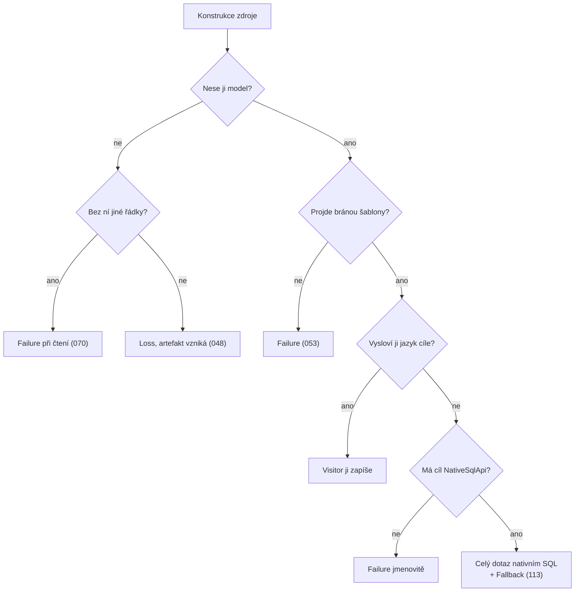

- **Dotaz s jinými řádky se nevydá** (rozh. [053](./decisions/053-a-query-that-would-return-other-rows-is-not-emitted.md)). `Failure` znamená žádný artefakt jako u entit (rozh. [010](./decisions/010-diagnostics-as-returned-data.md)) a drží to kanál: `Report` nastaví `refused`, `Build()` vrátí prázdný seznam. `Normalize()` před osmi kroky šablony odmítne porovnání bez povinného pravého operandu (`IsNull`/`IsNotNull` ho nemají, rozh. [002](./decisions/002-is-null-as-comparison-operator.md)) a logický uzel bez operandů. Převodní tabulky operátorů a množinových operací nemají větev `_ =>`. Hranicí je množina řádků, ne podmínka (rozh. [065](./decisions/065-row-set-as-the-boundary-of-rule-053.md)), takže pravidlo platí i pro joiny.
- **Totéž při čtení** (rozh. [070](./decisions/070-a-parser-refuses-what-would-change-the-row-set.md)): konstrukce mimo model, bez níž by artefakt vrátil jiné řádky, je `Failure` v místě čtení; bez níž je výstup jen chudší, je `Loss` s artefaktem (rozh. [048](./decisions/048-a-fact-with-no-place-in-the-model-is-a-loss.md)). Výčet: subset.md 2.12.
- **Úniková cesta** (rozh. [113](./decisions/113-native-sql-as-the-escape-path-and-the-vocabulary-ldbc-needs.md), naplňuje rozh. 022) — rozhoduje šablona. Nevyslovenost se zjistí **deklarací** (`QueryFeature` vedená v `TargetFrameworkDescriptor.QuerySupport` jako `NotExpressible` — `ReportUnspokenFeatures`; mezivýsledek, který cíl neuvádí — `GateDefinitions`; funkce mimo `Functions` — `GateExpression`; množinová operace bez přepsaného `BuildSetOperation`), nebo **v místě emise**, kde krok či visitor narazí na tvar, který jeho jazyk nemá (subset.md 2.6–2.11). Obojí hlásí `ReportUnspoken`: záznam `Fallback`, který `Report` nezapíše, ale podrží (`unspoken`); brána deklarace pokus rovnou ukončí.
- **Po pokusu** cíl bez `TargetFrameworkDescriptor.NativeSqlApi` změní každý `Fallback` na `Failure` — i sedmý framework bez takového API, bez zásahu do `AbstractWrappers` (S1). Cíl s API zahodí záznamy pokusu (parserové zůstanou) a předá `NativeSqlBuilder()` wrapperu tytéž instrukce, definice, mapy, jméno a limit rekurze. Ten je potomkem `AbstractSqlQueryBuilder`, píše celý dotaz týmž textem jako Dapper, nese deskriptor cíle a značku `writesNativeSql`, pod kterou deklarace jazyka cíle neplatí. Před jeho záznamy jde `Fallback` za každou konstrukci se jménem dialektu (`SqlServer2022`) a API; odmítnutí únikové cesty odmítá dotaz.

| Cíl | Builder | Volání | Parametry | Řádek výsledku |
|---|---|---|---|---|
| EF Core | `EFCoreNativeSqlQueryBuilder` | `ctx.Database.SqlQuery<TRow>($"""…""")`, celá entita `ctx.Set<T>().FromSql($"""…""")`; vrací `IQueryable` | díry interpolace (o `$` víc, než je nejdelší běh `{`); kolekce `Failure` — EF Core 10.0.10 ji naváže jako jednu hodnotu JSON | třída `{Metoda}Row`: vlastnost na sloupec, typ z brány, vždy nullovatelná, `COUNT` jako `int`, i sloupec mezivýsledku, který je `COUNT`, a `MAX`, `MIN`, `SUM` a `AVG` nad takovým sloupcem (`ResultColumn.CountsRows`; SQL Server je nad `int` vrací jako `int`); sloupec bez jména či skaláru, dvě stejná jména (bez ohledu na velikost písmen) a jméno mimo identifikátor C# `Failure` (`Projection`) |
| NHibernate | `NHibernateNativeSqlQueryBuilder` | `session.CreateSQLQuery("""…""")`; vrací `IQuery` | `:name`, kolekce `IN (:ids)` a `SetParameterList` | `AddEntity(typeof(T))`, jinak `AddScalar` s typem `NHibernateUtil`; sloupec bez jména či typu bez `AddScalar`, `Incompleteness` |
| Hibernate, EclipseLink | `JpaNativeSqlQueryBuilder` (deskriptor a profil od builderu JPQL) | `em.createNativeQuery("""…"""[, T.class])`; vrací vždy `Query` (Jakarta Persistence 3.2.0) | `?n` v pořadí signatury a `setParameter(n, …)`; kolekce s `JpaImplementationProfile.NativeQueryExpandsCollection` jako `(?n)` vázaná jednou (Hibernate 7.4.5), bez něj ji rozvine metoda (rozh. [123](./decisions/123-a-native-query-of-eclipselink-expands-a-collection-parameter-at-run-time.md), EclipseLink 5.0.0): skaláry `?1…?s`, za nimi každá kolekce tolik pozic, kolik má prvků — symbol `(?ids)` v textu nahradí `replace` výčtem složeným čítačem `position`, prvky se vážou po jednom týmž čítačem | s `T.class` jedna entita |

Všechny obaly vydávají i holé `SqlQuery`; parametry přepisuje `SqlPlaceholders.Respell` (i pro MyBatis), textový blok Javy escapuje `JpaQueryMethod.TextBlock` (i pro JPQL). Množinovou operaci nad různými entitami odmítají, kde API materializuje jednu entitu (`RefusesAnEntityOverDifferentRows`). EF Core 10.0.10 bere přes `SqlQuery` i text s `WITH` a `OPTION`, nic-li se nad ním neskládá (ověřeno `ToQueryString()` i spuštěním).

**Kroky LINQ, které mění řádky** (`ChangesTheRowSet`; neznámý krok mimo výčet je `Loss`, aby se neodmítl i `Include`):

| Krok | Zachází se s ním |
|---|---|
| `Where`, `Join`, `GroupBy`, `Skip`, `Take`, `OfType`, `SkipWhile`, `TakeWhile`, `DefaultIfEmpty`, `Last`, `LastOrDefault`, `GroupJoin`, `Zip`; koncové `Count`, `LongCount`, `Sum`, `Average`, `Min`, `Max`, `Aggregate`, `Any`, `All`, `Contains`, i `…Async` | kde se nečte, `Failure` |
| EF Core `FromSql`, `FromSqlRaw`, `FromSqlInterpolated` se skládáním; `TemporalAll`, `TemporalAsOf`, `TemporalFromTo`, `TemporalBetween`, `TemporalContainedIn` | `Failure` (`Filtering`) z háčku `ProviderStepChangesTheRowSet`; `FromSql…` bez skládání je nativní SQL |
| `First`, `Single`, `ElementAt` a `…OrDefault`, `…Async` | výřez rozepsaný před čtením — `First(p)` = `Where(p)` + `Take(1)`, `ElementAt(n)` = `Skip(n)` + `Take(1)` — s jedním `Convention` (`Pagination`) (rozh. [103](./decisions/103-a-query-expression-is-read-as-its-rewrite-and-a-single-row-terminal-as-a-slice.md), `Combined/LinqSingleRowTerminalTest`) |
| `Find`, `FindAsync` na kořeni | vyhledání řádku podle klíče, rozepsané před čtením (`ExpandFind`) na `Where(x => x.K1 == v1 && …)` přes části klíče z mapování v jejich pořadí + `Take(1)`; hodnoty jsou argumenty, nebo prvky pole v prvním z nich (token za polem se nečte), každá jako operand (parametr podle [083](./decisions/083-parameter-as-the-fifth-operand-shape.md)); jeden `Convention` (`Filtering`) jmenuje klíč a to, co artefakt nenese (hledání mezi sledovanými entitami). Bez mapování, bez klíče v něm, s jiným počtem hodnot než částí nebo mimo kořen `Failure` (`Filtering`) jmenovitě (`Combined/LinqFindTest`) |
| `SelectMany` | join po asociační cestě nebo podmínkou (tabulka níž), jinak `Failure` |
| `Include`, `Cast`, jiný neznámý krok | `Loss` |

**Hranice textu SQL** (rozh. 108). Nad celým textem (`SqlText.Selects`) je příkaz, který není čtecí `SELECT`, i syntaktická chyba `Failure` celého textu, dřív než se čte kterýkoli dotaz. Holá jednotka `SqlQuery` je skript: každý `SELECT` je dotaz s vlastním builderem (i přes `GO`), pojmenovaný pořadím před čtením (`Combined/SqlScriptTest`). Text ve volání Dapperu, v `<select>` a v `<sql-query>` je jeden příkaz a druhý `SELECT` je `Failure`, kromě `QueryMultiple` (rozh. [109](./decisions/109-a-code-unit-carries-every-query-it-hands-over.md)); rozlišení předává wrapper údajem `isScript` (S1). Uvnitř `SELECT`u (`SqlQueryReader.Read`) jsou nápovědy `Loss`, kromě `OPTION (MAXRECURSION n)`, který jde do builderu (`LimitRecursion`).

#### Jednotka v kódu nese každé předání dotazu (rozh. 109)

Jednotka `CSharp` nebo `Java` je celý soubor nebo fragment (rozh. [111](./decisions/111-a-unit-is-a-whole-source-file-that-declares-only-its-language.md)). C# čte `Common.Reading.CSharpSource.Read` každý parser jednotky C# (entitní, fluent konfigurace EF Core, aliasy Dapperu, dotazové LINQ a Dapperu): soubor (`CSharpUnit.IsFile`), jak stojí, fragment ve třídě obalu (`FragmentWrapper`); text, který se bez chyby přečte jen ve druhém tvaru, se čte v něm — metoda vedle třídy (artefakt únikové cesty EF Core) v obalu, samotné příkazy jako příkazy nejvyšší úrovně (rozh. [128](./decisions/128-a-csharp-unit-with-a-syntax-error-is-refused-with-a-position.md)). Direktivy `using` a `extern alias` na začátku fragmentu stojí před obalem; parsuje se ve verzi jazyka *preview*. Tvar textu rozhoduje o parsování, nikdy o roli.

| Jazyk | Parser | Místo předání |
|---|---|---|
| C#, Dapper | `DapperSqlQueryParser` | každé volání `SqlMapper`, které posílá SQL (`Query…`, `QueryMultiple`, `QueryUnbufferedAsync`, `Execute…` i asynchronní); SQL z argumentu `sql` jménem nebo pozicí v přetížení Dapperu 2.1.79; volání bez argumentu se přeskočí. Volání Dapper.Contrib (`DapperContrib.IsCall`: jednotka importuje `Dapper.Contrib.Extensions`, `Get<T>`, `GetAll<T>`, `DeleteAll<T>` s jedním typovým argumentem, `Insert`, `Update`, `Delete` s argumentem, i `…Async`) je předání odmítnuté `Failure` se jménem volání (rozh. [133](./decisions/133-an-add-on-package-over-a-framework-is-not-that-framework.md)) |
| C#, LINQ | `LinqQueryParser` | každý řetěz nad kořenem, který neleží uvnitř jiného (poddotaz v lambdě zůstává poddotazem); explicitní načtení EF Core (rozh. [115](./decisions/115-explicit-loading-is-the-query-the-provider-composes.md)); kořen bez kroku předaný celý (`HandOvers`) — vyčíslený `foreach`, `await foreach` (i za `WithCancellation`, `ConfigureAwait`, ty jsou `Loss`) či rozvinutím `[..]`, vrácený (`return`, `=>`, tělo lambdy), daný vlastnosti (inicializátor, přiřazení), předaný jako argument (ne `nameof`) —, jako dotaz celé tabulky s otázkami hlavy `x.M` níž: sada, kterou jednotka deklaruje, vždy, sada známá jen podle místa jen pod typem dotazu (`IsQueryType`: `IQueryable<T>`, `IOrderedQueryable<T>`, `DbSet<T>` — návratový, vlastnosti, parametru metody či konstruktoru jednotky), vyčíslení typ nepotřebuje; proměnná předaná dvakrát je jedno místo, přiřazená víckrát předá každou hodnotu (`Combined/ForEachEnumerationTest`, `Combined/HandedOverSetTest`, fakt `EFCore/EFCoreSetHandedOverProviderTest`). Tělo lambdy kompilovaného dotazu (háček `IsCompiledQuery`, EF Core `EF.CompileQuery`, `EF.CompileAsyncQuery`) je předání a první parametr lambdy kontext (`Combined/CompiledQueryTest`, fakt `EFCore/EFCoreCompiledQueryProviderTest`). Řetěz či vyčíslení nad dotazem, který jednotka deklaruje jako vlastní, je místo odmítnuté jmenovitě (hlava níž). Kořen nad typovým parametrem je místo odmítnuté jmenovitě (hlava níž). Řetěz, jehož první krok nad kořenem jen sleduje entitu (háček `IsProviderTrackingCall`, EF Core `Add`, `AddRange`, `Attach`, `Update`, `Remove`, `Entry` i asynchronně), místem není, ani kořen zapsaný před ním (`Combined/DeclaredSetTest`, fakt `EFCore/EFCoreDbSetParameterProviderTest`). Dotaz předaný kroku LINQ ve statickém tvaru (`Queryable`, `Enumerable`, `AsyncEnumerable`, háček `IsProviderStaticQueryClass`), přímo i přes proměnnou, je `Failure` se jménem volání (`StaticStepOver`). Řetěz s hromadným příkazem (háček `ProviderCommandOf`: EF Core `ExecuteDelete`, `ExecuteUpdate`; NHibernate metody `DmlExtensionMethods` — `Delete`, `Update`, `UpdateVersioned`, `InsertInto`, `UpdateBuilder`, `InsertBuilder`; i asynchronně, přes proměnnou a ve statickém tvaru) je místo odmítnuté `Failure` se jménem volání a příkazu dřív, než se nad ním cokoli čte; proměnná s jeho výsledkem dotaz nedrží (`QueryVariables.Executing`) (`Combined/BulkCommandTest`, fakty `EFCore/EFCoreBulkCommandProviderTest`, `NHibernate/NHibernateBulkCommandProviderTest`) |
| C#, jiný jazyk | háček `TryReadForeignQuery` | EF Core `Database.SqlQuery<T>`, `SqlQueryRaw<T>`, `FromSql…`; NHibernate `CreateSQLQuery`, `CreateQuery` |
| Java, JPA | `JpqlQueryParser` | každé `createQuery`, `createSelectionQuery`, `createNativeQuery`, `createNamedQuery`; definice `@NamedQuery`/`@NamedNativeQuery` na každé třídě jednotky (*Pojmenované dotazy JPA* níž) |
| Java, MyBatis | parsery anotací a rozhraní mapperu | *Javové frameworky* |

- **Jednotka bez místa předání chybou není**: dotazový parser nic nevydá ani nehlásí; jalovou jednotku hlásí obecný záznam (§5.1). Text, který entitní průchod odmítl jako nečitelný či příliš zanořený, nechají dotazové parsery bez slova.
- **Každý dotaz má vlastní builder** z továrny orchestrace, takže odmítnutý odmítá jen sebe; víc dotazů parser pojmenuje pořadím dřív, než je čte. Odmítnutí `let` nese řetěz jako anotaci (`QueryExpressionRewriter.Refusals`).
- **Argumenty volání Dapperu** pozná `ParametersOf` jménem nebo pozicí v přetížení; co z nich je `Loss` a co `Failure` (`commandType`), subset.md 2.3 (`Dapper/DapperCallArgumentTest`).

**Hlava řetězu LINQ** (`LinqParsing/QueryVariables`). Rozhoduje sémantický model Roslynu nad samotnou jednotkou bez referencí (`QueryVariables.StatementAbout`), stavěný jen nad jménem, které jednotka přiřazuje nebo deklaruje; oba průchody tak odpovídají stejně. Lokální proměnnou hledá jen v členu, který ji deklaruje (`Describe`). Hledání předání vyřadí ze syntaxe, co dotazem být nemůže, dřív než se model ptá: bez typu dotazu jen člen jména ze sad a `IQueryable` jednotky (`QueryMembers`) a proměnná, do níž jednotka takový člen či jinou proměnnou ukládá (`Holders`); parametr dá model jen metodě či konstruktoru jednotky s parametrem typu dotazu (`QueryCallables`, `ParameterTypesOf` nad kandidáty, protože bez referencí rozlišení přetížení nikdy neuspěje); dotaz deklarovaný jako vlastní hledá jen v jednotce, která nějaké jméno typem `IQueryable` deklaruje (`DeclaresAQueryOfItsOwn`); sadu deklarovanou jménem a typový parametr za ní jen mezi jmény, která jednotka deklaruje typem zdroje poskytovatele (`DeclaredSets`).

| Hlava | Čte se jako |
|---|---|
| proměnná přiřazená jedinkrát s dotazem, který se nevykonal (nekončí `ToList`, `AsEnumerable`, `First`, `Count` …, není `await`) | řetěz, který drží; jen prodlužovaná dotazem není, prodloužená dvakrát jsou dva dotazy, použitá i jinak je dotazem i ona; přiřazená víckrát či podmíněně a prodlužovaná `Failure`, i s hodnotou bez volání — holou sadou či proměnnou s dotazem (`StoredValues`); sada známá jen podle místa jen s krokem LINQ v hodnotě či pokračování (`ContinuesWithAQueryStep`, `QueryVariables.ContinuationsOf`) |
| volání (`Set<T>()`, `Query<T>()`) | kořen; bez kroku jako hodnota vlastnosti deklarované typem zdroje poskytovatele (`IsProviderQuerySource`, u EF Core `DbSet<T>`) — tělo výrazem, getter, `return` getteru, přiřazení do ní, i přes `??=` do pole — deklarace sady, ne dotaz (rozh. [158](./decisions/158-a-property-declared-dbset-declares-a-set-whatever-supplies-its-value.md), `IsSetDeclaration`; `Combined/DbSetDeclarationTest`, fakt EF Core `EFCore/EFCoreDbSetDeclarationProviderTest`) |
| člen parametru lambdy, proměnné `foreach` nebo vlastní instance | navigace v paměti; uvnitř kontextu EF Core je člen instance jeho `DbSet` (rozh. 111); člen prvního parametru lambdy kompilovaného dotazu je člen kontextu (`IsCompiledQuery`) |
| parametr, pole či vlastnost (holé i přes `this`) deklarované `IQueryable<T>`, `IOrderedQueryable<T>` či `IQueryable`; lokální proměnná tak deklarovaná s hodnotou, kterou čtení nesleduje (volání) — i přes proměnné a pole přiřazené jedinkrát a kroky LINQ (`QueryOfItsOwn`, `QueryVariables.DeclarationOf`) | `Failure` se jménem (rozh. 114): řetěz nad ním a jeho vyčíslení (`foreach`, `[..]`); vrácené či předané beze změny místem není; krok mimo LINQ (`repo.Query()`) skončí u posledního takového jména; jméno deklarované jiným typem (`list.AsQueryable()`) je paměť; proměnná či pole přiřazené víckrát odmítne `StoredValues` jako dotaz skládaný za běhu (`Combined/QueryOfItsOwnTest`) |
| parametr, lokální proměnná či pole (holé i přes `this`) deklarované typem zdroje poskytovatele (`IsProviderQuerySource`, u EF Core `DbSet<Order>`), jehož hodnotu text neurčuje — parametr vždy, lokální proměnná a pole přiřazené nejvýš jednou hodnotou, kterou čtení nesleduje (`DeclaredSet`) | kořen jako `Set<Order>()`: sada entity z typového argumentu, ať se jméno jmenuje jakkoli — řetěz nad ním, vyčíslení, předání celé (vždy, jako sada, kterou jednotka deklaruje), vnitřní posloupnost joinu, `FromSql` nad ním; člen (`orders.Local`) navigace; přiřazené víckrát odmítne `StoredValues` (`Combined/DeclaredSetTest`, fakt `EFCore/EFCoreDbSetParameterProviderTest`) |
| kořen, jehož entitou je typový parametr: `ctx.Set<T>()`, `session.Query<T>()`, jméno deklarované `DbSet<T>`, vlastní sada typu `DbSet<T>` — v kořeni dotazu i uvnitř (poddotaz, join) | `Failure` se jménem parametru a toho, kdo ho deklaruje (`TypeParameterOf`): tabulku určí typ, který dosadí volající, a ten text neříká; třída kolem je kód (`Combined/TypeParameterRootTest`) |
| `x.M` (rozh. [114](./decisions/114-what-the-unit-states-about-a-name-decides-an-ef-core-root.md)) | první odpověď: `x` je proměnná prvku, nebo lokální proměnná s vykonaným dotazem (i `Find`, `await`) → navigace; jednotka deklaruje typ `x` i člen `M` → `DbSet<T>` kořen (`IsProviderQuerySource`), `IQueryable<T>`/`IOrderedQueryable<T>` `Failure`, jinak navigace; jinak rozhoduje místo, ale jen u řetězu s krokem LINQ či poskytovatele (`IsQueryStep`, EF Core `Include`, `AsNoTracking`, `Find` …) nebo u kořene vyčísleného (`foreach`, `[..]`) či předaného celý pod typem dotazu — `Random.Shared.Next()`, `span.TotalHours.ToString()`, `x.Items.Add(…)` dotazem nejsou; nedeklarovaný typ `x`, který převod mapuje jako entitu, `Failure` (`Combined/LoadedEntityNavigationTest`) |
| `X.Entry(e).Collection/Reference/Navigation(…)` + `Query()`, `Load()`, `LoadAsync()` (rozh. 115) | kořen dotazu, který skládá poskytovatel |

**Explicitní načtení** pozná wrapper EF Core (`TryReadQueryRoot`, `LinqQueryRoot.Load`) a `EmitExplicitLoad` z něj odvodí tabulku cílové entity s podmínkou *cizí klíč = parametr* pojmenovaný po vlastnosti klíče entity v paměti (`SalesOrderID`). Entitu dá `Entry<T>`, jinak `QueryVariables.EntityStatementAbout`, jinak jediná entita s navigací toho jména; páry vztah nebo jeho protějšek (`ColumnPairsOf`). Záznam `Convention`; builder EF Core vydá řetěz nad `Set<T>()` (`Combined/ExplicitLoadingTest`). Celek drží `Combined/CodeQueryUnitTest` a `Combined/QueryFaithfulnessTest`.

#### Nativní SQL v kódu (rozh. 113)

Rozpoznání je tvrzení wrapperu o API frameworku (S1): `LinqQueryParser` se u vnějšího volání výrazu nejdřív zeptá `TryReadForeignQuery`. Co wrapper pozná, je dotaz s vlastním místem a třída kolem je kód (rozh. 111); výstup únikové cesty se tak čte zpátky.

| Framework | Čte | Mechanismus |
|---|---|---|
| EF Core | `Database.SqlQuery<T>`, `SqlQueryRaw<T>`, `FromSql…` nad kořenem bez skládání | `EFCoreNativeSqlReading`: díra interpolace = parametr toho jména, `{n}` = parametr pojmenovaný po předané hodnotě |
| NHibernate | `CreateSQLQuery`, `CreateQuery`, volání na objektu dotazu | `NHibernateNativeSql` jako u `<sql-query>`, `SetParameterList` = kolekce; HQL parserem; `SetFirstResult`/`SetMaxResults` = výřez; `AddScalar`, `AddEntity`, `AddJoin`, `SetResultTransformer` jeden `Loss`, `List`/`Future` nic, jiné volání (`UniqueResult`, `SetTimeout` …) `Loss` |
| JPA | `createNativeQuery`, `createNamedQuery`, `@NamedNativeQuery`, `<named-native-query>` | sdílená čtečka (`ReadNativeText`): `?1` → `@p1` (`SqlParameterFacts.Position`), `:name` → `@name` (`SqlPlaceholders.FromHost`), kolekce podle `setParameter` na kolekci či pole nebo `setParameterList` (definice vazbu nemá); `createNamedQuery` je `Incompleteness` — definice se čte tam, kde stojí (rozh. [143](./decisions/143-a-named-query-of-jpa-is-read-where-it-is-defined.md)); `addQueryHint("MAXRECURSION n")` Hibernatu je limit rekurze i u `createQuery`, jiný databázový hint `Loss` (`HintsDatabase`, rozh. [139](./decisions/139-hibernate-states-the-limit-of-recursion-as-a-hint-on-the-query-object.md)) |

Co se odmítá, subset.md 2.3 a 2.11. Objekt dotazu, se kterým další příkaz dělá víc než neškodné volání, je `Failure` (`ContinuedElsewhere`). Výřez z objektu dotazu jde do uzavřeného rozsahu (`AbstractQueryBuilder.PaginateReadQuery`). Deklarovaný cizí dialekt čtení zastaví (rozh. [088](./decisions/088-a-declared-foreign-source-dialect-is-not-read.md)), proto dialekt dostávají i čtečky LINQ a JPQL. Drží řádek `NativeSqlInCode` matic kategorií a `Combined/NativeSqlTest`.

#### Čtení LINQ: přepis a spojený řádek

- **Booleovský člen jako predikát** (tělo `Where`, operand `&&`, `||`, `!`, podmínka `?:`) je porovnání s `true`, s `!` s `false` (`BooleanMember`): C# na tom místě bere jen `bool`, ne `bool?`, takže hodnota nikdy není `NULL`. Jen sloupec řádku v rozsahu (`IsColumnOfScope`); hodnota ze scope zůstává nepřečtená (`Combined/LinqBooleanMemberTest`).
- **Dotazový výraz** přepíše `QueryExpressionRewriter` (rozh. 103), vnořený dřív než obalující, na řetěz metod podle tabulky specifikace C# (`join` jinde než před `select` dává `(p, o) => new { p, o }` a průhledný identifikátor `t`, druhé `from` `SelectMany`, `join … into` `GroupJoin`). Záznamy citují přepsaný text; `let` je `Failure` (`Projection`) (`Combined/LinqQueryExpressionTest`).
- **Spojený řádek** se čte ze čtvrtého argumentu `Join`, `LeftJoin`, `RightJoin`: `(ol, o) => new { ol, o }` i zploštělé `new { x.ol, x.o, a }` je celý řádek bez záznamu, sloupce jsou projekce, jedna strana sama (`(ol, o) => o`, `Select(x => x.o)`, `SelectMany` s jedním argumentem) je celý řádek té strany (projekce `*` pod jejím aliasem, bez záznamu; LINQ a HQL ho ze spojeného řádku vyberou, i je-li to zdroj — `QueryClauses.ProjectsOneWholeRow`), vynechaný řádek složeného tvaru či řádek vedle sloupců `Loss` (`Projection`). Alias spojené tabulky dá selektor, alias zdroje vnější klíčový selektor; kroky za joinem sahají na sloupec přes člen (`x.o.CustomerId`) (`Combined/LinqJoinResultSelectorTest`). Parametr jiného kroku stojí za alias zdroje (`aliasSubstitutions` v `EmitStep`), dokud rozsah neseskupil a řádek není spojený.
- **Navigace v operandu** (`o.Customer.Name`, `x.o.Customer.Region.Name`, rozh. [148](./decisions/148-a-reference-in-a-linq-operand-is-an-implicit-join-whose-kind-the-provider-takes-from-the-nullability-of-the-foreign-key.md)) se čte mechanismem cesty mimo `join` (tabulka níž, `TryReadReferencePath`): hlava je řádek entity v rozsahu (`HeadOf` — alias i přes náhradu, člen spojeného řádku, řádek spojovaný), druhá část musí být asociace mapování, jinak výraz jde dalším tvarům (`o.PlacedAt.Year` je funkce; člen slovníku ustoupí, je-li přijímač reference, `IsReference`). Druh joinu dá háček `ImplicitJoinKind` z toho, zda řádek reference smí chybět (rozh. [151](./decisions/151-a-reference-in-a-linq-operand-joins-left-where-its-row-may-be-absent-under-both-providers.md)): cizí klíč smí nést `NULL` (`ForeignKeyMayBeNull`: inverzní 1:1 vždy; `PropertyMap.IsNullable` páru, pak jazykový typ vlastnosti cizího klíče, pak mapa navigace, bez tvrzení volitelná), nebo smí chybět řádek, z něhož se reference kříží (`EntityRow.Optional`: pravá strana levého joinu, levá pravého, obě plného, řádek levého implicitního joinu) — pak `Left`, jinak `Inner`. Tak čtou oba providery: EF Core podle volitelnosti reference, NHibernate 5.7.0 levým vnějším joinem všude, kde by klauzuli mohl splnit `NULL` (`NHibernate/NHibernateLinqProviderTest`). Cesta, která končí referencí či kolekcí (`o.Customer.Region`), operandem není a join pro ni nevznikne (`IsReference`). Přinesla-li cesta do rozsahu implicitní join a rozsah nic nepromítá, promítne se celý řádek, přes který rozsah běží (`ProjectTheRowPastImplicitJoins`), aby cíle nematerializovaly spojený řádek; řádek složený selektorem joinu implicitní join nese s sebou a říká to `Loss`. Značku `!` zahodí přepis (`QueryExpressionRewriter`), za běhu nic nedělá. Test reference na `null` je test sloupců jejího cizího klíče (`TryReadReferenceNullness`, víc párů `And`), podmíněný `Count` nad ním `COUNT(sloupec)` jednoho páru (`CountedReference`); booleovský člen přes referenci je predikát. Reference sama jako operand se nečte (`Select(o => o.Customer)` `Loss`; `ColumnUnlessNavigation`); kolekce, cíl mimo převod, vztah bez párů a join uvnitř podmínky `Join` `Failure` jmenovitě (`Combined/LinqReferencePathTest`).

#### Mechanismus po konstrukcích

Tvar v modelu §4.4, brány šablony §7, pokrytí po frameworcích subset.md.

| Konstrukce | IR | Čtení | Zápis | Rozh. |
|---|---|---|---|---|
| množinová operace (Q12) | `SetOperationInstruction` | T-SQL `BinaryQueryExpression` přeskupený podle precedence SQL Serveru (`INTERSECT` váže první; změna závorek = `Convention`); LINQ `Union`, `Concat`, `Intersect`, `Except`, argument rekurzivně | Dapper závorkuje vnořenou operaci; EF Core skládá dva úplné řetězy a hlídá typ prvku; `Push()`/`Pop()` sledují hloubku, `SetOperation` řetězí | 053, 060 |
| join po asociační cestě (Q7) | `JoinInstruction` s odvozenou podmínkou | HQL `join o.Customer c`, JPQL `join o.customer c`, LINQ `SelectMany(c => c.Orders, …)`: cesta ↔ `Relation.SourceNavigationProperty` v mapách po §4.3 a §5.2; podmínka z `ColumnPairs` `FK(levá) = PK(pravá)`, stranu dá `Role`, víc párů `And`; inverzní strana bez párů bere páry vlastnící protistrany (`ColumnPairsOf`, `InverseRelationName`, rozh. [012](./decisions/012-foreign-key-rendering.md)) | cestu nevydává nikdo: SQL `ON`, LINQ `Join` s klíčovými selektory, JPA entity join s podmínkou | [101](./decisions/101-a-join-along-an-association-path-is-derived-from-the-relation.md), 065 |
| cesta přes asociaci mimo `join` (Q7) | sloupcový operand nositele, nebo `JoinInstruction` (`Inner`; v LINQ druh podle provideru) s odvozenou podmínkou a operand pod jejím aliasem | HQL `o.Customer.Name`, JPQL `alert.alertHistory.clusterId` v každém operandu (`ReadPathOperand`): cesta ke klíči odkazovanému vlastnící jednohodnotovou asociací je sloupec cizího klíče nositele (`ForeignKeyOf`), každá jiná jednohodnotová asociace vnitřní join odvozený jako řádek výš, jeden na dvojici alias–navigace a tělo (`ImplicitJoin`), alias `alias_navigace`; řetěz = joiny za sebou; kolekce, join z podmínky `on`/`with` a nerozresolvovaná cesta `Failure` jmenovitě v každé klauzuli, v projekci a řazení také (`PathNotDropped`, rozh. [152](./decisions/152-an-association-path-that-cannot-be-derived-refuses-the-query-in-every-clause.md)); LINQ `o.Customer.Name` týmž mechanismem (`TryReadReferencePath`, `ImplicitJoin`, alias `alias_Navigace`), druh joinu dá provider podle toho, zda řádek reference smí chybět (`ImplicitJoinKind`, rozh. [148](./decisions/148-a-reference-in-a-linq-operand-is-an-implicit-join-whose-kind-the-provider-takes-from-the-nullability-of-the-foreign-key.md), [151](./decisions/151-a-reference-in-a-linq-operand-joins-left-where-its-row-may-be-absent-under-both-providers.md)) | jako řádek výš; sloupec cizího klíče bez skalární vlastnosti píšou cíle JPA a HQL jako cestu (`ColumnMember.PathOf`), takže `c.user.id` se vrací jako `c.user.id` | [144](./decisions/144-a-path-through-an-association-outside-join-is-an-implicit-join-or-the-foreign-key-column.md), [152](./decisions/152-an-association-path-that-cannot-be-derived-refuses-the-query-in-every-clause.md) |
| podmínka joinu nad rámec klíčů | `JoinInstruction` | LINQ: `Where` na spojované posloupnosti (`TryReadFilteredSequence`, `ReadFilters`); `SelectMany` nad filtrovaným řetězem kořene, s `DefaultIfEmpty()` levý (`HandleCorrelatedSelectMany`) | EF Core `SplitJoinCondition`: rovnosti klíčů → selektory, konjunkty bez řádku řetězu → `Where` posloupnosti, zbytek → korelovaný `SelectMany`; EF Core 10.0.10 z toho dělá `JOIN` bez `APPLY` (`Combined/LinqJoinConditionTest`); plný vnější join skládá jako `LeftJoin` + `Concat` pravého joinu zúženého na řádky bez levého protějšku, bez záznamu (drží 3. stupeň) | 113, 065, [061](./decisions/061-subquery-as-a-condition-operand.md) |
| stránkování | `PaginationInstruction` (offset, pak limit; `RowCount` číslo nebo parametr) | LINQ `Skip`/`Take` při zavření scope; T-SQL `TOP`, `OFFSET/FETCH`; Hibernate `limit`/`offset`; objekt dotazu `setFirstResult`/`setMaxResults` | osmý krok `BuildPagination`: Dapper `TOP (n)` / `OFFSET … FETCH NEXT …`, bez řazení `ORDER BY (SELECT NULL)` se `Convention`; EF Core `.Skip()`/`.Take()`; NHibernate a JPA na objektu dotazu, vázaný počet tam nevážou jménem (`BoundParameters`) | 060, [085](./decisions/085-a-row-count-is-a-number-or-a-parameter.md) |
| `DISTINCT` | `DistinctInstruction` → `QueryClauses.Distinct` | T-SQL `UniqueRowFilter.Distinct` každé `QuerySpecification`, HQL `select distinct`, LINQ `Distinct()` | projekční krok: `SELECT DISTINCT [TOP (n)]`, EF Core řazení až za `Distinct()`; `Normalize()` drží klíče řazení v projekci a za množinovou operací relační identity; nad projekcí jen z neseskupených agregátů se značka vypustí s `Convention` | [073](./decisions/073-distinct-as-a-flag-of-the-query-scope.md) |
| agregační `DISTINCT` | příznak `Distinct` operandu (`Column`, `Computed`) vedle jeho funkce | `UniqueRowFilter` ve `FunctionCall`, `distinct` v agregátu HQL/JPQL, LINQ `g.Select(…).Distinct().Count()` | `COUNT(DISTINCT c.X)`, `count(distinct c.X)`, týž řetěz LINQ (`Combined/AggregateDistinctTest`) | [102](./decisions/102-aggregate-distinct-like-escape-and-a-parameter-among-listed-values-are-carried.md) |
| seskupení a agregát | `GroupByInstruction`, `HavingInstruction` | LINQ `g.Key`, `g.Key.Část` proti klíčům rozsahu (`GroupingKey`); selektor prvků `GroupBy` (`group l by o.X`, `GroupElement`): strana spojeného řádku — lambdy nad prvky čtou její sloupce —, hodnota — nad ni jde agregát bez argumentu (`g.Max()`) —, jiný tvar `Loss` a krok, který prvky čte, `Failure` (`Grouping`); result selector `Loss` (`Combined/LinqQueryExpressionTest`) | `COUNT(*)` nikdo nekvalifikuje aliasem; EF Core píše `COUNT(sloupec)` přesně: nad členem, který entita deklaruje jako nenulovatelný hodnotový typ (i část klíče), `g.Count()`, jinak `g.Count(e => e.Sloupec != null)` (EF Core 10.0.10: `COUNT(CASE WHEN … IS NOT NULL …)`), a sdílené čtení LINQ ten tvar čte zpět jako `COUNT(Sloupec)`; nad sloupcem řádku, který stojí na straně vnějšího joinu bez nalezené shody (levý: připojený řádek, pravý: dosavadní řádky, plný: oba; `LinqScope.OptionalAliases`), testuje existenci řádku `g.Count(e => e.l != null)` a konstantu počítá `g.Count()` (`Combined/CountOverANullableColumnTest`, i 4. stupeň s rodičem bez dětí); `SUM` nad hodnotou, která smí být `NULL`, píše EF Core pod stráží počtu hodnot `(g.Count(e => e.X != null) > 0 ? (T?)g.Sum(e => e.X) : null)`, protože jeho `Sum` je `COALESCE(SUM(x), 0)` (`CoalescesSum`), a `COALESCE(SUM(x), 0)` jako holý `g.Sum(…)`; čtení LINQ bere stráž zpět jako `SUM(X)` (`ReadSumOverValues`) a holý `g.Sum(…)` zdroje EF Core nad hodnotou, která smí být `NULL`, jako `COALESCE(SUM(X), 0)` (`TryReadAggregate`, `ProviderCoalescesSum`); druhý tvar NHibernatu píše `Sum` holý, provider 5.7.0 z něj dělá holé `sum` (`Combined/SumOverNoValuesTest`, `EFCore/EFCoreSumProviderTest`); agregát bez seskupení EF Core nativním SQL (`Combined/GroupedQueryTest`) | 113, [155](./decisions/155-sql-sum-in-ef-core-linq-is-the-projection-of-one-group-and-ef-core-sum-is-coalesce.md) |
| průměr | operand s funkcí `AVG`, i okenní agregát `AVG` — `AVG` jazyka SQL: skalár argumentu, nad celým číslem useknutý podíl | T-SQL, HQL NHibernatu a JPQL EclipseLinku `AVG(x)`; C# `Average` (i `g.Average` nad skupinou) a `avg` Hibernatu (háček `AveragesWholeNumbersInFloatingPoint` parseru JPQL) nad celým číslem `AVG(CAST(x AS Double))`, jinak `AVG(x)`; převody zpět — `(int)`, `(long)` a nullovatelné nad `Average` (pole `averageCastInto`, i u koncového agregátu poddotazu), `cast(… as Integer)`, `INTEGER`, `int`, `Long`, `BIGINT`, `long`, `BigDecimal(p,k)`, `DECIMAL(p,k)`, `decimal` nad desetinným s `k` aspoň měřítkem průměru — jako `AVG(x)` (`SqlAverage.Restored`); typ argumentu z mapování, u sloupce definice z její projekce (`ColumnsOf`, `definitionColumns`); bez typu LINQ a Hibernate `Failure` (`Aggregation`) | každý cíl převede svůj průměr do skaláru, který brána odvodila pro argument (`SqlAverage.RestorationOf`), všude, kde stojí: LINQ nad celým číslem `(int)`/`(long)`, nullovatelně ve skalárním poddotazu a nad hodnotou s `NULL` (`AverageOverValues`), HQL NHibernatu `cast(… as int\|long\|decimal)`, JPQL jmény profilu (`JpaImplementationProfile.AverageCasts`: Hibernate `Integer`, `Long`, `BigDecimal(38,s)`, EclipseLink `INTEGER`, `BIGINT`, `DECIMAL(38,s)`), `s = max(měřítko z mapování, 6)`; nad číslem v plovoucí čárce nic; bez skaláru argumentu `Fallback` (`Aggregation`). Typ, v němž zdroj HQL či JPQL průměr vydává (`Double`), se nenese. Fakta drží `EFCore/EFCoreAverageProviderTest`, `NHibernate/NHibernateLinqProviderTest`, `NHibernate/NHibernateHqlProviderTest` a javové `AverageClaimsTest` obou implementací; pravidla `Combined/AverageTest` | [161](./decisions/161-a-window-aggregate-is-a-window-of-the-vocabulary-and-the-whole-row-of-a-definition-beside-columns-is-its-columns.md), [155](./decisions/155-sql-sum-in-ef-core-linq-is-the-projection-of-one-group-and-ef-core-sum-is-coalesce.md) |
| poddotaz (Q11) | `QueryOperand.Nested` | T-SQL `ExistsPredicate`, `InPredicate`, `ScalarSubquery`; LINQ `Contains`, `Any`, `Count(p)`, koncový agregát; alias z první lambdy; tělo smí být množinová operace (T-SQL, LINQ `a.Union(b)` v přijímači, JPQL `union` v závorce poddotazu). LINQ řetěz nad kolekční navigací řádku v rozsahu (`c.Orders.Any/All/Count/Sum(…)`, `c.Orders.Select(…).Contains(x)`; `TryDecomposeNested`): zdrojem je cílová entita vztahu z mapování a první podmínkou vnořeného rozsahu korelace FK = PK z `ColumnPairs` (i z protějšku vztahu), jako u joinu po asociační cestě (rozh. 101); alias bez lambdy první písmeno entity mimo aliasy v rozsahu; co mapy nemají (mapování řádku, vztah, cílová entita, páry, N:M) `Failure` (`Subquery`) jmenovitě (`Combined/LinqCollectionNavigationSubQueryTest`) | vnořený `SELECT` týmiž kroky; EF Core vnořený řetěz, korelace řetězem scope; `NormalizeSubQueryOperand(…, out setOperation)` — tělo-množinová-operace vrací zvlášť, pravidlo jedné projekce drží nad nejlevějším členem, cíl bez množinové operace (NHibernate) dostane `Fallback`, EclipseLink také (profil `RefusesSetOperationsInSubqueries`: parser 5.0.0 ji v poddotazu odmítne); T-SQL a JPQL Hibernatu ji píší na jednom řádku týmž vykreslením jako nahoře, LINQ `a.Union(b)` v rámci `InNestedFrame` (skalární porovnání `Fallback`); skalární poddotaz s jediným `SUM` píše EF Core jako projekci nad jedinou skupinou `….GroupBy(x => 1).Select(g => (T?)g.Sum(…)).Max()` (`OverOneGroup`), nad prázdným vstupem `NULL`; provider z ní píše `MAX` nad odvozenou tabulkou skupiny, kterou SQL Server rozplete (`FirstOrDefault()` by bylo `TOP(1)`, které nerozplete), uvnitř `COALESCE(…, 0)` holým `.Sum(…)`; typ součtu, který nástroj nezná, `Fallback`; čtení zpět `ReadOneGroupSubQuery` (zakončení `Max()` i `FirstOrDefault()`), koncový `Sum` zdroje EF Core jako `COALESCE((SELECT SUM(…) …), 0)` | 061, 120, 155, [159](./decisions/159-ef-core-takes-the-value-of-one-group-by-max-not-first-or-default.md) |
| kvantifikované porovnání | `ComparisonCondition.Quantifier` | T-SQL `SubqueryComparisonPredicate` (`SOME` = `Any`); HQL a JPQL `all`/`any`/`some` za operátorem, dál smí stát jen poddotaz; LINQ `řetěz.All(p => x op p.X)` (strana s parametrem = `Select` řetězu, druhá se čte ve vnějším rozsahu) a `řetěz.Select(…).All(v => x op v)`, `Any` jen nad řetězem zakončeným `Select` (jinak `Where(p).Any()` podle 061); `All` nad jiným predikátem `Failure` jmenovitě | T-SQL, HQL, JPQL slovem (`x > all (select …)`); LINQ poddotaz v pozici pravé strany `IN` a porovnání v lambdě: `….Select(o => o.Total).All(v => x > v)` / `.Any(…)`; `NOT` nad kvantifikátorem LINQ převrátí De Morganem místo `!`; NHibernate (`CompensatesNullSemantics = false`) u `All` doplní `&& v != null`, `&& x != null` na straně, o níž mapování neříká `NOT NULL` (typ projekce přes `EntityByName` od builderu); EF Core kompenzuje sám | 119 |
| podmínka nad hodnotou, která smí být `NULL` (trojhodnotová logika SQL) | `ComparisonCondition`, `NotCondition`, `LogicalCondition` beze změny | LINQ tak, jak predikát přeloží provider zdroje (`Logic`; háčky `ProviderCompensatesNegation`, `ProviderMatchesNullInContains`, EF Core ano, NHibernate ne): `==` nad dvěma takovými hodnotami `a = b OR (a IS NULL AND b IS NULL)`, `!=` `a <> b OR a IS NULL`; negace v EF Core jako místo, kde predikát neplatí (`!(a > b)` → `a <= b OR a IS NULL …`, `!seznam.Contains(a)` → `NOT IN (…) OR a IS NULL`, `!s.StartsWith(…)` → `NOT LIKE … OR s IS NULL`, De Morgan), v NHibernatu `NOT`; `Contains` nad poddotazem, jehož hodnota smí být `NULL`, v EF Core `EXISTS (… v = x OR (v IS NULL AND x IS NULL))` (`MatchingExists`), nad poddotazem se seskupením, stránkováním či množinovou operací `Failure`; `All` NHibernatu nad hodnotou s `NULL` `NOT (x op' ANY …)`; kvantifikátor s `==`/`!=` a negace kvantifikátoru v EF Core nad hodnotou s `NULL` `Failure` (`Subquery`); podmínka, která nic `NULL` neporovná (`MeetsNoNull`), jako dosud; `Where` po `GroupBy` čte podmínku kteréhokoli tvaru | LINQ (EF Core i druhý tvar NHibernatu, týž text) píše, kde podmínka platí, pod `NOT` kde neplatí (`Holds`/`Fails`, negace De Morganem k porovnáním): `=` nad dvěma takovými `a == b && a != null`, `<>` s testem každé takové strany, relační operátor pod `NOT` obrácený, `LIKE` a `IN` pod `NOT` `!(…) && a != null`, `NOT IN` nad poddotazem s `NULL` `a != null && sub.All(v => v != null && v != a)`, `IN` nad ním s testem `a`, kvantifikátor s testy podle operátoru; *smí být `NULL`* podle `IsNeverNull` a mimo parametr (pravidlo stráže konkatenace), test hodnoty, kterou C# typuje nenulovatelně, zvednutím (`Lifted`); nad podmínkou bez `NULL` `!(…)` jako dosud; T-SQL, HQL a JPQL píší test skalárního poddotazu na `NULL` poddotazem v místě operandu (`Combined/LinqNullSemanticsTest`, `EFCore/EFCoreNullSemanticsProviderTest`, javová `NullTestedSubqueryClaimsTest`) | [156](./decisions/156-a-linq-predicate-carries-sql-three-valued-logic-in-both-directions.md) |
| výčet `IN` | `QueryOperand.ValueList` | T-SQL literály, LINQ `Contains` nad inline kolekcí, HQL `in (`; příjemce `Contains` rozhoduje: řetěz kořene = poddotaz, sloupec = `LIKE`, identifikátor = kolekční parametr | `IN (…)`, EF Core `new[] { … }.Contains(x)`, nad nullable sloupcem `new int?[]` (proti kolekčnímu parametru a poddotazu `x.Value`); smíšené rodiny odmítá `Normalize()` (`Combined/InValueListTest`) | [074](./decisions/074-a-list-of-values-as-the-fourth-operand-shape.md) |
| okamžik | `QueryConstant` skaláru `DateTime`, ISO vždy s časem | LINQ `new DateTime(…)`: tři hláskování typu, tři arity, nezáporné literály | T-SQL a HQL čtou okamžik jako `QueryConstant` skaláru `String`; `Build()` ho přetypuje podle porovnaného sloupce (§7), do LINQ `DateTime.Parse("…")` | [024](./decisions/024-typed-query-operand.md) |

**Parametr** (`QueryOperand.Bound`, rozh. 083). Čtečky odstraní zdobení: `@id`, LINQ holý identifikátor (skalár) a příjemce `Contains` (kolekce), HQL `:id` a `?`, JPQL `:id`, `?1`, `in :ids`, MyBatis `#{id}` a kanonický `<foreach>`. Dapper wrapper pozná `IN @ids` nad tokeny lexeru ScriptDomu, ozávorkuje ho a předá `SqlParameterFacts(IsCollection: true)` (`DapperCollectionParameters`); čtečka každého `SELECT`u dostane jen fakta ze svého rozsahu (`SqlSelect.Offset`, `Length`). Skalár doplní brána šablony z mapování (§7). Kolekci zapíše Dapper `IN @ids`, NHibernate `in (:ids)` se `SetParameterList`, JPA `in :ids`, MyBatis `<foreach>`; EF Core zachytí parametr metody. Poziční tvar přežije jen do JPQL, jinde `p1`, `p2` se `Convention` (`Dapper/DapperCollectionParameterTest`).

**`LIKE`** (`ComparisonCondition` s `Like` a `Escape`; rozh. [051](./decisions/051-like-pattern-translated-not-carried-over.md), 102). Do LINQ se vzorek překládá: `%x%` → `Contains`, `x%` → `StartsWith`, `%x` → `EndsWith`, bez zástupných znaků rovnost, jinak `EF.Functions.Like`; ostatní cíle píšou `ESCAPE` zpět. LINQ parser čte opačně a jádro řetězcové metody escapuje znakem `!`, protože provider EF Core argument escapuje sám (`ProviderEscapesStringMethodArguments`); NHibernate čte jádro doslova. Argument, který není literál, je `Like` nad `Concat` s `EscapePattern` (rozh. 107), do SQL, HQL a JPQL řetězem `REPLACE` s `ESCAPE '!'`. Přetížení se `StringComparison` se nečte, filtr je `Failure` (`Filtering`) (`Combined/LikeEscapeTest`, `Combined/LinqStringMethodTest`).

**Výraz** (`QueryOperand.Computed`, `QueryExpression`, rozh. [107](./decisions/107-an-expression-is-the-sixth-operand-shape-and-stands-wherever-an-operand-stands.md)). Čtečky čtou slovník `QueryFunction` svým pravopisem; T-SQL `+` je `Concat`, je-li strana řetězcová už tvarem, jinak `Add`; LINQ `Substring` posouvá pozici o jedna a visitor ji vrací; HQL a JPQL čtou `select` až po `from` a joinech. Závorkování podle precedence drží `ExpressionSpelling`; `CASE` bez `ELSE` píše LINQ `(T?)null`, JPQL `else null`. NHibernate dostává u aritmetiky desetinného a celého čísla `cast(… as decimal)` se `Convention`. Agregát přímo nad agregátem (`MAX(SUM(x))`, `MAX(COUNT(*))`) odmítnou čtečky T-SQL, JPQL a HQL už při čtení, slovy brány, která vidí jen agregát uvnitř výrazu (`Combined/ExpressionOperandTest`). `TargetFrameworkDescriptor.Functions` uvádí funkce, které sonda potvrdila proti připnuté verzi: NHibernate a Jakarta Persistence bez `DateAdd` a `DateDiff`, EclipseLink navíc bez `Cast` (`QueryFunctionVocabulary.AllBut`), ostatní vše (`EachDescriptorSpeaksWhatItsProbeFound`). Konkatenaci, jejíž hodnota smí být `NULL` — sloupec, za který mapování neručí, i `NOT NULL` na volitelné straně vnějšího joinu (`HoldsNoNull`), agregát, poddotaz, `CASE` bez `ELSE`, `COALESCE` končící takovou hodnotou; ne literál, sloupec bez `NULL` ani parametr —, píše LINQ pod stráží `(a == null || b == null ? null : a + b)` (`GuardedConcatenation`, hodnoty z `OperandStructure.NullSources`, nullovatelnost `IsNeverNull`), protože EF Core 10.0.10 překládá `+` nad textem jako `COALESCE(a, N'') + COALESCE(b, N'')`, kdežto SQL, HQL i JPQL dávají `NULL`; literál `NULL` v ní dává `(string)null`. Čtečka LINQ bere stráž, jejíž testy jsou hodnoty konkatenace, zpět jako holou konkatenaci bez `Loss` (`ReadNullGuarded`); jinou stráž čte jako `CASE`. Druhý tvar NHibernatu stráž nepíše (`GuardsConcatenation`): ve filtru a řazení provider 5.7.0 konkatenaci překládá sám, v projekci ji vynechá. Drží kategorie `ConcatenationOverANullableColumn` a `Combined/ExpressionVocabularyTest`.

**Seskupení podle výrazu, okenní funkce, agregace do seznamu** (rozh. 113). Funkce provideru čte háček `TryReadProviderFunction` (EF Core `EF.Functions.DateDiff…`), HQL funkce Hibernatu háček `ReadsHqlFunctions` jeho parseru. EclipseLink váže každý literál jako parametr (`JpaImplementationProfile.BindsLiterals`; klíč seskupení s literálem by se lišil od projekce, chyba 8120), ale vázání je nastavení dotazu, ne jazyka: `BuildGrouping` nechá klíč v JPQL a `FinalizeText` přidá na objekt toho jediného dotazu `.setHint(QueryHints.BIND_PARAMETERS, HintValues.FALSE)` (`InlineLiteralsCall` profilu; literály *i parametry* dotazu jdou do SQL doslova), holé JPQL hint nenese stejně jako výřez; implementace, která váže a přepínač nemá, by šla nativním SQL (`ComputedGrouping`). EF Core píše klíč jako anonymní typ: výraz pod aliasem projekce, sloupec pod svou vlastností a dva sloupce s vlastností téhož jména (`Id` dvou tabulek) pod aliasy svých projekcí — bez nich nativním SQL (`Grouping`), protože C# jméno člena dvakrát nevezme (CS0833); `.Value` u nullovatelného sloupce mimo část klíče (`Receiver`, `Unwrapped`, `IsKeyPart`), `string.Join` jen nad hodnotou textu bez `NULL` — sloupcem, nebo výrazem jen nad takovými sloupci a literály (`IsTextThatHoldsNoNull`, `HoldsNoNull`) —; seznam nad korelovaným poddotazem (`STRING_AGG` bez `GROUP BY` jako jediná projekce skalárního poddotazu) jako řetěz seskupený konstantou, `string.Join` nad tou jedinou skupinou a `Max()` (`OverOneGroup`, rozh. [159](./decisions/159-ef-core-takes-the-value-of-one-group-by-max-not-first-or-default.md); nad prázdným vstupem skupina není a poddotaz dá `NULL` jako `STRING_AGG`, což agregát přes celý výsledek nesmí), čtený zpět bez seskupení i se zakončením `FirstOrDefault()` (`ReadOneGroupSubQuery`; kategorie `ListAggregationOverACorrelatedSubquery`, LDBC IC 1), `COALESCE` jako `??` s levou stranou, kterou C# typuje jako nenullovatelnou hodnotu, zvednutou do nullovatelné (`Lifted`: agregát přes prvek `g.Sum(t => (int?)t.x)`, počet `(int?)g.Count()`, člen přetypováním, skalární poddotaz s jedním agregátem `(decimal?)(…).Min(…)` podle skaláru projekce), literál `NULL` — mimo slovník, `Incompleteness` — jako `null`, pod `CAST` jako `(long?)(null)` a `EF.Functions.DateDiff…` jen nad dvěma hodnotami téhož skaláru — datum proti okamžiku přetížení nemá (EF Core 10.0.10) a jde nativním SQL. Drží `Combined/ExpressionVocabularyTest` a katalog LDBC. **Okno** (`QueryExpression.Window`, rozh. 113 a [161](./decisions/161-a-window-aggregate-is-a-window-of-the-vocabulary-and-the-whole-row-of-a-definition-beside-columns-is-its-columns.md)) nese pořadovou funkci (`Ranking`, řazení povinné) nebo jeden z pěti agregátů nad listovým argumentem (`WindowAggregate`, `Argument`; `*` jen pod `COUNT`, řazení volitelné — s ním běžící agregát ve výchozím rámci dialektu); čtečka T-SQL (`ReadWindow`) a háček HQL (`ParseWindowAggregate` za agregátem, `ParseOverClause`) čtou obojí, visitory T-SQL a JPQL píší obojí (HQL 7.4 ověřeno sadou `hibernate/WindowAggregateAndJoinSubqueryClaimsTest`), LINQ a HQL 5.7 ustupují pod `WindowFunction`. Brána typuje okenní agregát jako agregát (`COUNT` → `Long`, jinak skalár argumentu; průměr nad oknem píše a čte se jako bez okna, řádek *průměr* tabulky výš) a za agregát pravidla seskupení ho nebere; rámec, `DISTINCT` v okně a agregát pod oknem odmítají čtečky jmenovitě. **Poddotaz v podmínce joinu** (rozh. [162](./decisions/162-a-subquery-stands-in-a-join-condition-as-in-any-condition.md)) je operand jako ve `WHERE`: visitory ho vykreslují týmž zpětným voláním, LINQ builder ho třídí jako konjunkt, který jmenuje řádek řetězu (`SplitJoinCondition`, `Rest`), tedy korelovaný `SelectMany`; co z něj dělají připnuté verze, drží `NHibernate/NHibernateHqlProviderTest`, `EFCore/EFCoreJoinSubqueryProviderTest` a javové `eclipselink/JoinSubqueryClaimsTest`; tvary drží `Combined/JoinConditionSubqueryTest`.

**Mezivýsledek** (`WithInstruction(Name, Body)`, rozh. [112](./decisions/112-a-query-as-a-row-source-is-a-named-intermediate-result.md)). Čtení: T-SQL `ReadCommonTableExpression` a `ReadDerivedTable` (jména čtených tabulek předem, `StatementTableNames`); Hibernate `with` a poddotaz ve `from` háčkem `ReadsIntermediateResults`, který EclipseLink nezapíná. LINQ zavře rozsah jako tělo definice (`SplitScope` v `EmitChainCore`), když řetěz pokračuje krokem nad projekcí, výřezem nebo `Distinct()`; jménem je proměnná (`ChainSteps.EndsWithVariable`), jinak parametr dalšího kroku; proměnná ve vnitřní posloupnosti joinu je jedna definice (`DefineVariable`, `IsJoinedSequence`). Zápis: Dapper a MyBatis `WITH a AS (…)` (`WithClause`), Hibernate `with a as (…)`, EF Core lokální proměnné metody (`DefinitionStatements`, `FreshName`), NHibernate a EclipseLink nativní SQL. LINQ řadí za projekcí podle všech klíčů, když některý jmenuje alias projekce a projekce nese všechny; nenese-li některý a dotaz je seskupený, řadí nad skupinou před `Select` (`BuildOrdering`, `KeyBeforeProjection`: alias se rozepíše na hodnotu projekce, ostatní klíče jsou klíče seskupení či agregáty skupiny — `g.Key.Id`, `g.Count()`), takže výřez vybere tytéž řádky; EF Core 10.0.10 i provider NHibernatu 5.7.0 ten tvar přeloží (`Combined/ExpressionVocabularyTest`, `NHibernate/NHibernateLinqProviderTest`, kategorie `OrderingByAnUnprojectedKeyUnderASlice`). V neseskupeném dotazu vede klíč mimo projekci se stránkováním k nativnímu SQL, bez něj k `Loss`.

**Rekurze** (rozh. 113). Tělo definice je množinová operace kotvy a členu, který jmenuje definici; limit z `OPTION (MAXRECURSION n)` nese builder (`LimitRecursion`, `RecursionLimit`; 0 bez limitu, chybějící = výchozí limit dialektu). Hint `addQueryHint` čte čtečka JPQL Hibernatu i ze seznamu nápověd v jednom literálu (`"MAXRECURSION 10, MAXDOP 1"`, jak ho dialekt vloží do klauzule); ostatní nápovědy a argument, který není literálem, jsou `Loss` jmenovitě. Čtečky T-SQL a JPQL Hibernatu čtou jméno definice v jejím těle jako zdroj řádků; o rekurzi a jejích pravidlech rozhodne šablona (§7), která dá rekurzivnímu členu jména sloupců kotvy (`Named`, `NamedAs`). Konstanta s aliasem v projekci (`0 AS Depth`) se čte, bez aliasu je `Loss` — kromě dalšího členu množinové operace, kde ji čtečka nese a šablona jí dá jméno levého členu podle pozice jako výrazu bez aliasu (`NamedByPosition`: v definici, nahoře v dotazu i v poddotazu; jen bezejmenným sloupcům). Zápis: Dapper a MyBatis `WITH … OPTION (MAXRECURSION n)` (`RecursionOption`, `WritesRecursionLimit`), Hibernate `with x as (… union all …)` a limit jako hint na objektu dotazu `.unwrap(org.hibernate.query.Query.class).addQueryHint("MAXRECURSION n")`, který jeho dialekt napíše jako tutéž klauzuli (profil `RecursionLimitCall`, rozh. [139](./decisions/139-hibernate-states-the-limit-of-recursion-as-a-hint-on-the-query-object.md)); EF Core, NHibernate a EclipseLink vždy nativní SQL (`Fallback`, `Recursion`). Cyklus hlídá text dotazu (`RecursiveWalkOfACyclicGraph`). Katalog LDBC tak přeložil IC 12 (§9); jeho dotazy na cesty rekurzi nepíší (§6.2, rozh. [140](./decisions/140-ldbc-path-queries-as-breadth-first-search-in-non-recursive-definitions-with-the-depth-of-the-data.md)).

#### Jména entit, ne tabulky

HQL, JPQL i LINQ jmenují entity a vlastnosti, takže buildery mapují sloupce zpět přes `EntityMaps`, které jim předá orchestrace (`ColumnMember` v `AbstractWrappers`); Dapper také, protože `Query<T>` jmenuje entitu. Mezireprezentace nese sloupec, ne vlastnost: parsery HQL a JPQL přeloží vlastnost podle map (`ColumnFor`), LINQ podle mapy řádku, k němuž alias patří, i u připojované tabulky před výběrem výsledku (`ColumnOf`), takže vlastnost nad přejmenovaným sloupcem dojde do SQL jako sloupec a parametr porovnaný s ní dostane jeho skalár (`Combined/LinqColumnNameTest`). Kde se k tabulce žádná entita nemapuje, i u cíle joinu, odvodí se jméno se `Convention`. Alias se k entitě přiřadí i tam, kde zdroj tabulku nevyslovil (`AliasedEntities`; u Dapperu a MyBatisu podle rozh. [050](./decisions/050-one-home-for-the-singular-plural-heuristic.md)). **Holý sloupec** (bez tabulky, T-SQL zdroj) dostane řádek v šabloně (`QualifyColumns`, před typováním literálů a bránou parametrů, každý rozsah): nad jedním zdrojem řádků zdroj, nad joinem jediný alias, jehož entita sloupec mapuje (skalární vlastnost, nebo cizí klíč vlastnící reference), jinak zůstane holý — SQL cíl ho píše holý, jak stál ve zdroji, cíl, který sloupec píše jako člen řádku (`WritesColumnsAsMembers`: LINQ, HQL, JPQL), jde nativním SQL (`Fallback` s kategorií klauzule); první tabulka joinu ho nedostane. Klíč řazení, který jmenuje alias projekce, sloupcem není. **Celý řádek jedné proměnné rozsahu** (`QueryClauses.MaterializedAlias`, `MaterializedTable`, `MaterializesTheSource`): nad jediným zdrojem je absencí projekce (Q3), nad joinem ho SQL píše `t.*`, LINQ `.Select(x => x.t)`, HQL a JPQL `select t`, výsledný typ je entita za tím aliasem; vedle sloupců `Loss` a vypadne; operandem `IN` či skalárního porovnání být nesmí (`Failure`). **Alias, který zdroj oddělil** (`DelimitedAlias`): SQL cíl `[…]` (i holé jméno řazení, které není identifikátorem), cíl nad členy ho vezme holý, je-li identifikátorem, jinak nativním SQL (`Fallback`); třída řádku `SqlQuery` EF Core takový sloupec odmítne. Drží `Combined/JoinSelectListTest`. Odvození drží jen `Common.Naming.EntityTableNaming`: `EntityNameFor` ubere koncové `s` (bez ohledu na velikost písmen, u názvu delšího než jeden znak), `TableCandidatesFor` nabídne název, jak je, a pak druhé číslo (páruje na ně i `LinqQueryParser.ResolveTable`), `TableNameFor` dá jediný název pro benchmarking (§5.2).

**Sloupec cizího klíče bez skalární vlastnosti** (obvyklý tvar JPA) píší jazyky nad entitami přes referenci, která ho nese:

| Místo | HQL, JPQL | LINQ (EF Core) |
|---|---|---|
| podmínka joinu, jejíž rovnosti pokrývají všechny páry vlastnící reference (i nad složeným klíčem) | reference porovnaná s řádkem: `p.customer = c` (HQL `with`, JPQL `on`) | vlastnost cizího klíče, kterou deklaruje entitní builder (navigace + jméno klíče, `EFCoreColumnMember`) |
| jinde | cesta přes referenci ke klíči: `p.customer.CustomerID` | totéž |
| kde by cesta stála join — EclipseLink vždy (profil `KeyThroughReferenceJoins`; jeho `p.customer.id` je vnitřní join, který ztratí řádky s `NULL`), NHibernate u části složeného klíče | nativní SQL se záznamem `Fallback` (rozh. [113](./decisions/113-native-sql-as-the-escape-path-and-the-vocabulary-ldbc-needs.md)) | — |

**Joiny, které EclipseLink 5.0.0 nenapíše** (změřeno proti 5.0.0, rozh. [117](./decisions/117-the-interactive-v1-validation-set-judges-the-ldbc-catalog-at-the-fourth-level.md)): entitní join uvnitř poddotazu vypustí z SQL i s podmínkou a sloupec připojené entity čte z kořene poddotazu (profil `DropsJoinsInSubqueries`). Vnitřní join v poddotazu proto builder JPA píše původním tvarem JPQL — další proměnnou rozsahu ve `from` poddotazu, s podmínkou joinu jako první konjunkcí `where` a filtrem s disjunkcí nahoře v závorce (`RenderSubQuery`, `joinsAsRangeVariables`, `JpqlQueryVisitor.RangeVariable`); EclipseLink ho píše jako křížový join s podmínkou ve `WHERE`, tedy tytéž řádky. Vnější join v poddotazu takový tvar nemá a jde nativním SQL s `Fallback` (`Subquery`). Vnitřní entitní joiny píše EclipseLink za všechny vnější, takže podmínka vnějšího joinu s aliasem vnitřního jmenuje tabulku, kterou SQL Server ještě nezná, a ten ji odmítne (`InnerJoinsFollowOuterJoins`, `BuildJoins`) — nativní SQL s `Fallback` (`Join`; rozh. 113). Hibernate 7.4.5 píše obojí entitním joinem. Drží kategorie `SubqueryWithAJoinAsTheRightSideOfIn` a `CorrelatedExistsWithAJoin` (matice i 4. stupeň), `EclipseLink/EclipseLinkQueryTest`, `Combined/LdbcCatalogTest` (IC 5 a BI 5 kvůli pořadí joinů) a soudce. Katalog FIBEN (rozh. [149](./decisions/149-fiben-as-a-third-reference-domain-run-on-demand-against-a-judge-of-our-own.md)) k tomu změřil dvě další věci: EclipseLink 5.0.0 vypustí z SQL i joiny **člena množinové operace** (`UNION` dvou spojených členů vrátil řádky jejich kořenů), takže množinová operace se spojeným členem jde do EclipseLinku nativním SQL s `Fallback` (`SetOperation`; profil `DropsJoinsInSetOperations`, `RenderSetOperand`); a Hibernate 7.4.5 rozresolvuje nekvalifikované jméno v joinu nejdřív proti atributům entit z `from` (`join POSTALADDRESS p` vedle entity `ADDRESS` se sloupcem `POSTALADDRESS` spojil sloupec), takže JPQL pro Hibernate píše takto zastíněnou entitu plně kvalifikovaným jménem třídy (`Fiben.POSTALADDRESS`; profil `ResolvesNamesAsAttributesBeforeEntities`, `JpqlQueryVisitor.Qualified`; `Hibernate/HibernateShadowedEntityJoinTest`). Klauzuli `HAVING` EclipseLink 5.0.0 přestaví na kořen bloku, je-li její první operand s proměnnou (čteno zleva, konstanta a parametr ji nemají) cesta přes jinou proměnnou — entitní join, proměnnou rozsahu, vnější blok: každá cesta klauzule pak jmenuje atribut kořene toho jména, takže dotaz za běhu odmítne (`Invalid query key`), nebo čte sloupec kořene (`having max(l.id)` → `HAVING (MAX(t0.id) > ?)`) a vrátí jiné řádky bez chyby. Takový dotaz jde nativním SQL s `Fallback` (`PostAggregationFiltering`; profil `RebuildsHavingOnTheRoot`, `BuildPostFilter`, `FirstVariableIn`). Otevře-li klauzuli cesta přes kořen, `CASE` (LDBC IC 3, BI 16) či poddotaz, čte EclipseLink všechny cesty, jak stojí, a dotaz zůstává v JPQL; projekci, `GROUP BY` a `ORDER BY` nepřestaví nikdy. Drží `EclipseLink/EclipseLinkQueryTest`, javová `eclipselink/JoinedHavingClaimsTest` a běh FIBEN.

Složený klíč joinu píše EF Core jako anonymní typ se jmenovanými členy; člen, jehož nullabilita se liší od protějšku, přetypuje na nullable, a typy členů bere z entity, kterou rozsah přiřadil aliasu (i konvencí pojmenování, rozh. [050](./decisions/050-one-home-for-the-singular-plural-heuristic.md)). Drží to `Combined/ForeignKeyColumnWithoutPropertyTest` a javové `hibernate/ReferenceKeyClaimsTest`, `eclipselink/ReferenceKeyClaimsTest`.

**Jméno entity a alias, které jsou klíčovým slovem cílového jazyka**, se píšou tak, aby je parser cíle přijal; jiná jména zůstávají bajtově stejná. Co který parser nebere, je změřené proti připnutým verzím (`Combined/KeywordNameTest`, javové `hibernate/KeywordNameClaimsTest`, `eclipselink/KeywordNameClaimsTest`):

| Cíl | Jméno entity | Alias |
|---|---|---|
| NHibernate (HQL 5.7.0, `HqlNames`) | jako cíl entitního joinu kvalifikované jmenným prostorem z `<hibernate-mapping>` (`inner join Shop.Order o with …`); v čele `from` (i v poddotazu) jen u sedmi slov, která parser nebere nikde (`ascending`, `descending`, `cross`, `left`, `right`, `skip`, `take`); bez jmenného prostoru nativní SQL s `Fallback` | podtržítko na konci (`order_`) v deklaraci i ve všech cestách; alias projekce se nemění |
| Hibernate, EclipseLink (JPQL, `JpqlNames`) | JPQL jméno kvalifikovat neumí: co implementace nebere (profil `EntityNamesRefused`, `EntityNamesRefusedAsJoinTarget` — Hibernate 7.4.5 `true`, `false`, `null`; EclipseLink 5.0.0 čtrnáct slov všude, mj. `from`, `where`, `table`, `union`, `left`, `set`, a dalších dvacet pět jako cíl joinu, mj. `select`, `member`, `case`, `date`), jde nativním SQL s `Fallback` | vyhrazený identifikátor JPQL dostane v obou implementacích podtržítko na konci — proměnná řádku, výsledková proměnná projekce (`count(o) as count_`, `order by value_`) i sloupce mezivýsledku; EclipseLink 5.0.0 ho jako výsledkovou proměnnou odmítá (mj. `count`, `value`, `size`, `key`, `sum`, `max`, `date`, `new`), Hibernate 7.4.5 ne |

#### Deskriptory, typy a dialekt

**Co cíl vyžaduje a co nevyjádří, deklaruje deskriptor** `TargetFrameworkDescriptor` (`AbstractWrappers.Descriptors`, instance ve wrapperech; rozh. 009); zdrojový dostane orchestrace přes `DescriptorFactory`, bez builderu.

| Pole | Obsah |
|---|---|
| `Version` | cílová verze (rozh. 013), jediná zafixovaná (§1), builder podle ní nevětví; čte ji záznam běhu (§5.1) |
| `Dialect` | `DatabaseDialect`, jen `SqlServer2022` (rozh. [086](./decisions/086-target-database-dialect-declared-by-the-descriptor.md)); má ho i Dapper |
| `Ecosystem` | `DotNet` / `Java` (`Model`, rozh. [090](./decisions/090-the-cross-ecosystem-matrix-counts-itself.md)); čte ho jen ověření F10 |
| vynucené členy | co builder přidá mimo doménu; import mezi ně nepatří |
| `Support` (hodnoty `FactSupport`) | *vyžaduji* ⊂ *umím vyjádřit* / *neumím vyjádřit* pro třináct `MappingFactCategory`: `TableName`, `SchemaName`, `ColumnName`, `DatabaseType`, `Length`, `PrecisionAndScale`, `Nullability`, `PrimaryKey`, `PrimaryKeyStrategy`, `ForeignKeyColumns`, `VersionColumn`, `UniqueConstraint`, `TransientProperty` |

*Vyžaduji* čte brána úplnosti (`Failure`), *vyžaduji* a *umím* poptávka do katalogu, *neumím* mechanický `Loss` (§5.1); po frameworcích [`subset.md`, 1.5](./subset.md#15-slovník-mapování) — Dapper všech třináct *neumím*, MyBatis devět, klíč vyžadují NHibernate a JPA.

**Deskriptor deklaruje, builder implementuje, test váže** (rozh. 037): builder vyhodnocuje podmínku sám (`NHibernateEntityBuilder.HasCompositeKey`), `EnforcedMembersTest` hledá člen výskytem řetězce (pozná `virtual` chybějící všude, ne u jedné vlastnosti) i jeho nepřítomnost, v matici přes každou hodnotu `ORMEnum` a obě hodnoty každé podmínky (kromě `Always` a NHibernate + JPA bez klíče).

**Dialekt zdroje** (rozh. [088](./decisions/088-a-declared-foreign-source-dialect-is-not-read.md)) smí deklarovat požadavek (`ConvertRequest`, nepovinně `ConversionHandler.Convert`): `SourceSqlDialect` v `Model` (`SqlServer2022`, `AnotherSystem`), záměrně ne `DatabaseDialect`; `null` je dnešní chování. Pravidlo `Common.Sql.ForeignDialect` platí ve `SqlQueryReader` (`TransactSql`), `SqlTypeSpelling.Read` (`Common.Sql`) a u `sql-type` v `NHibernateXMLMappingParser`; deklarace teče konstruktory parserů (`ParserFactory.Create`, u JPA `JpaReadingContext`), ne builderem. Cizí dialekt zastaví doslovné SQL (`Failure` bez kategorie; u dvojaké jednotky jen dotazová půlka, rozh. [066](./decisions/066-records-attributed-to-the-input-unit.md)) a doslovný typ (`Loss` `DatabaseType`, ani na únikovou cestu); LINQ, HQL, JPQL, `jdbcType` a katalog ne — katalog, který fakt dodal, nese jeden `Conflict` (rozh. [091](./decisions/091-the-catalog-completes-a-foreign-source-and-says-so.md)). Výčet v [`subset.md`, 2.1](./subset.md#21-vyňaté-oblasti).

**Převodní tabulky** .NET wrapperů překládají rodiny (rozh. 019) a nikdy nehází výjimku: neznámý typ jde do `SourceSqlType` bez rodiny s `Incompleteness`.

- EF Core parser čte argumenty (`varchar(50)`, `decimal(18,2)`, `datetime2(3)`) a únikové typy s rodinou: `money`/`smallmoney` (`Decimal` 19/10, 4), `datetime`/`smalldatetime` (`Timestamp` 3/0), `image`, `rowversion`. NHibernate `Currency` → `Decimal(19,4)` + `Loss`.
- **Doslovný typ má přednost před rodinou** (rozh. [052](./decisions/052-literal-sql-type-reaches-the-ef-core-annotation.md)) v `[Column(TypeName)]` i `sql-type`; převod tam a zpět není bijekce, kritériem není rovnost řetězců.
- NHibernate čte z názvu typu jen rodinu (`Timestamp` je datočasový, ne `rowversion`; `LocalDate` → `Date`, `LocalDateTime`/`UtcDateTime` → `Timestamp`, i `Byte[]`); `DateOnly` a `TimeOnly` `TypeFactory` neregistruje. Emitovaná jména jsou ověřená proti `TypeFactory` 5.7.0 (`binary`, `XmlDoc`); neregistrovaná (`AnsiStringClob`, pevná délka ≠ 1) nahradí nejbližší jako `Narrowing`.
- **Doslovný typ z dialektu** (rozh. 086) doplní, co slovník cíle neunese — jen bez doslovného typu zdroje, s příznakem řádku `RestoredByColumnType` a facetami, které dialekt vyhláskuje: `nchar(n)`, `char(n)`, `text` + `Convention`. Temporální ústup a pevná délka bez délky zůstávají `Loss`. SQL Server 2022 je deklarovaná mez.

**Atribut `type` NHibernate** (`<id>`, `<key-property>`): `VarChar` → `String`/`AnsiString` podle unicode (neuvedené = unicode), `Char` 1 → `Char`/`AnsiChar`, jiná délka `String`/`AnsiString`. U temporálních rodin a `BigInt` rozhoduje i skalár (rozh. [071](./decisions/071-five-scalars-with-a-counterpart-in-both-ecosystems.md)):

| Sloupec | `DateTime` | `DateOnly` | `TimeOnly` | `TimeSpan` |
|---|---|---|---|---|
| `date` | `Date` | `DateOnlyAsDate` | | |
| `time` | `Time` | | `TimeOnlyAsTime` | `TimeAsTimeSpan` |
| `datetime2` | `DateTime` | předpoklad NHibernate + `Loss` | `TimeOnlyAsDateTime` | |
| `bigint` | | | `TimeOnlyAsTicks` | `TimeSpan` |

`datetimeoffset` → `DateTimeOffset`. Bez databázového typu odhadne `GuessFromScalarType` (`NHibernateUtil.GuessType` 5.7.0; `TimeSpan` → **`bigint` s ticky**, ne `time` jako EF Core); u reference, kolekce a `Object` atribut vynechá.

#### Javové frameworky

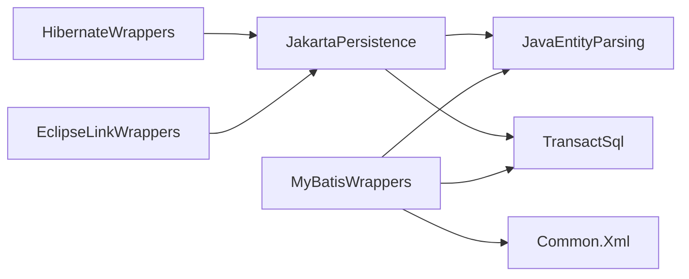

**Hibernate a EclipseLink jsou dva profily nad sdílenou JPA vrstvou** (rozh. [077](./decisions/077-hibernate-wrapper-over-the-shared-jpa-layer.md), [080](./decisions/080-eclipselink-as-the-second-profile-over-the-jpa-layer.md), stavba 076); konstrukce po konstrukcích v [`subset.md`, 1.6 a 2](./subset.md#16-po-frameworcích).

- **Čtení:** `JavaClassReader` → `JpaEntityParser` (přístup z `@Access`, jinak z umístění `@Id`) → `JpaAnnotationReader` → `JpaEntityFacts` → `JpaMappingWriter`, týmiž cestami jako `JpaOrmXmlParser`. `orm.xml` se čte první (rozh. 068): odlišná anotace je `Conflict`, `metadata-complete` anotace vypne (`JpaReadingContext`). Temporální přesnost nese `secondPrecision` (rozh. [079](./decisions/079-fractional-second-precision-as-second-precision.md)). Reference bez `@JoinColumn` dostane **výchozí sloupec `<atribut>_<sloupec klíče>`** jako tvrzení zdroje (rozh. 067) zpětným voláním `AddForeignKey(conventionalColumns)` před katalogem — ne nad složeným klíčem, `@JoinTable`, `@MapsId`, jiným `referencedColumnName` a cílem mimo převod. `referencedColumnName` jde přes `AddStatedReferencedColumns` (§7): fáze `Build()` ho porovná s klíčem odkazované entity (u 1:N a vlastních sloupců `@JoinTable` s klíčem vlastním) bez ohledu na velikost písmen a jako množinu — shoda mlčí, jiný sloupec je `Loss` (model páruje s klíčem, rozh. 012), cíl mimo převod se neposoudí. Bez místa v modelu a `Loss` se jménem: `@Table(catalog, indexes)` / `<table catalog>`, `<index>`, `@Column(table)`, `@JoinColumn(table, columnDefinition)`; `insertable = false`, `updatable = false` na `@Column` i `@JoinColumn` jen mimo sloupec, který v téže třídě mapuje i vztah, resp. i skalár — tam je to idiom jen pro čtení, který model odvozuje z páru a cíle píšou znovu (rozh. 012). `unique = true` na `@JoinColumn` / `<join-column>` (i ve `@JoinTable`) je zkratka za `@UniqueConstraint` nad sloupcem (rozh. [130](./decisions/130-a-unique-constraint-over-a-foreign-key-names-the-navigation.md)): pod `@OneToOne` je důsledkem kardinality a nic nepřidá, nad sloupcem, který mapuje i skalár třídy, je jeho jednočlenné omezení, nad jediným spojovacím sloupcem `@ManyToOne` omezení nad navigací (pozice na `@JoinColumn`); jeden sloupec složeného FK, `@JoinTable` a jednosměrné `@OneToMany` → `Incompleteness` `UniqueConstraint`; kardinalitu nemění. `@UniqueConstraint` překládá sloupec na skalár, jinak na navigaci, jejíž vyslovené spojovací sloupce pokrývá celé (část → `Incompleteness`); spojovací sloupec nevysloveného jména se nepozná. `@MappedSuperclass` má vlastní záznam: třída není entita. **`@Id` na `@ManyToOne`/`@OneToOne`** (odvozená identita, v `orm.xml` `id="true"`) se čte jako `<key-many-to-one>`: každý vyslovený sloupec `@JoinColumn` je část klíče pojmenovaná sloupcem, `Assigned`, vztah stojí vedle nad týmiž sloupci s `nullable = false` a cíle ho píšou jen pro čtení (rozh. 012), typ části doplní odkazovaný klíč (`Convention`); změna formy `Loss`, bez `@JoinColumn` `Incompleteness` a klíč kratší, na kolekci `Loss` (`Hibernate/HibernateDerivedIdentityTest`).
- **Jazyková osa** (076): primitiv je nenullovatelný a dává NOT NULL, reference nullovatelná, ledaže `nullable`/`optional = false`; obal na `@Id` nenullovatelný; pole bez přístupových metod je veřejná vlastnost s oběma, pole jen s getterem vlastnost bez setteru, které .NET cíl setter doplní (rozh. 134); `final`, `volatile` `Loss`; inicializátor jen jako literál shodný v obou jazycích; `Instant`, `java.util.Date` jsou `Unknown` (075); databázový typ se z javového neodvozuje.
- **Zápis** (`AbstractJpaEntityBuilder`, „explicitní JPA"): `@Table(name)` a `@Column(name)` vždy (chybějící tabulka = jméno entity + `Convention`), `nullable` jen tvrzené, `@GeneratedValue` vždy konkrétní: `Auto` podle profilu, `Identity`/`Uuid` doslova, `Sequence` a `HiLo` se `SequenceName` jako `SEQUENCE` s `@SequenceGenerator`, jiné `HiLo` jako `TABLE` s `@TableGenerator`; nevyslovené jméno sekvence (`<Entita>_SEQ`), `allocationSize` (krok profilu) i přejmenování hi/lo nesou `Convention`; `Assigned` nic, `Unspecified` nic + `Convention`, `Increment` `Loss`, `foreign` → `@MapsId`; složený klíč `@IdClass` s vnořenou `public static class … implements Serializable` (jméno ze `SourceKeyClass`, jinak `<Entita>Id` + `Convention`), bez párů `@JoinColumn(<navigace>_<sloupec klíče>)` + `Convention`; vlastnící 1:1 `@JoinColumn(unique = true)` z kardinality; unikátní omezení v `@Table(uniqueConstraints)` nad sloupci, navigace jako její spojovací sloupce (z párů, jinak výchozí jméno), bez nich `Incompleteness` (rozh. [130](./decisions/130-a-unique-constraint-over-a-foreign-key-names-the-navigation.md)); inverzní 1:1 `@OneToOne(mappedBy)` z vlastnící protistrany, bez ní člen `@Transient` + `Incompleteness`; 1:N `@OneToMany(mappedBy)`, jinak jednosměrně s `@JoinColumn`; kolekce bez vztahu člen `@Transient` + `Incompleteness` (holé pole by provider četl jako základní sloupec s celou kolekcí — sloupec, který zdroj netvrdil; odpověď NHibernate a MyBatis builderu na týž tvar). C# `virtual`, `override`, `sealed`, `new`, `required` odpadnou mlčky, literál se překládá (`1.5m` → `new BigDecimal("1.5")`). Sloupec `Char` s délkou bez doslovného typu zdroje má `columnDefinition = "char(n)"`, unicode `"nchar(n)"` (rozh. 086, [169](./decisions/169-a-fixed-width-value-is-the-value-sql-returns-in-every-target.md)). Konvertor pevné šířky podle profilu (`AppendFixedWidthRead`): EclipseLink u vlastnosti bez `TrimmedOnRead` `@Convert(converter = <Entita>.FixedWidth<n>.class)` a vnořená `FixedWidth<n>`, která hodnotu doplní mezerami na `n` a kterou konzument uvádí v persistence unit; Hibernate u vlastnosti s `TrimmedOnRead` vnořená `TrimmedFixedWidth`, která odřízne koncové znaky do U+0020; obojí `Convention`, nad klíčem (JPA na identifikátor konvertor nepoužije) a bez délky `Loss`. Vynucené členy: `JakartaPersistenceDescriptor`.
- **Dotazy:** `JpqlQueryParser` (ruční sestup, rozh. [062](./decisions/062-hql-read-by-a-hand-written-parser.md)) čte podmnožinu JPQL, kterou model unese, včetně joinu po asociační cestě (rozh. [101](./decisions/101-a-join-along-an-association-path-is-derived-from-the-relation.md)) a cesty přes asociaci mimo `join` (rozh. [144](./decisions/144-a-path-through-an-association-outside-join-is-an-implicit-join-or-the-foreign-key-column.md), tabulka *Mechanismus po konstrukcích*), `between` (`Convention`), `{d '…'}` a množinových operací; `new Dto(…)` je `Loss`, nerozresolvovaná cesta, join bez `on`, čárka a syntaktická chyba `Failure` (rozh. [070](./decisions/070-a-parser-refuses-what-would-change-the-row-set.md)). Z jednotky `Java` bere řetězec každého `createQuery`/`createSelectionQuery` (rozh. 109; nativní a pojmenovaný rozh. [113](./decisions/113-native-sql-as-the-escape-path-and-the-vocabulary-ldbc-needs.md)) a definice `@NamedQuery` každé třídy, z jednotky `XML` definice `<named-query>` (rozh. [143](./decisions/143-a-named-query-of-jpa-is-read-where-it-is-defined.md), §5 *Kdo čte*), složený za běhu je `Incompleteness`. `setFirstResult`/`setMaxResults` s literálem či identifikátorem → `PaginationInstruction` (rozh. [060](./decisions/060-pagination-as-a-query-instruction.md), [085](./decisions/085-a-row-count-is-a-number-or-a-parameter.md)), nečitelné `Failure` `Pagination`; objekt, který jednotku opustí, se nesleduje. Ostatní volání na objektu rozdělí `ReadQueryObject` ([`subset.md`, 2.3](./subset.md#23-jednotka-a-předání-dotazu)). `AbstractJpaQueryBuilder` vydá metodu nad `EntityManager` (`TypedQuery<Entita>` či `Query`, JPQL v textovém bloku, výřez na objektu) a holé `JpqlQuery`; vícečlennou podmínku joinu závorkuje kvůli EclipseLinku 5.0.
- **Rozhraní:** `ORMEnum.Hibernate`/`EclipseLink`, obsah `Java`, `JpqlQuery`, `XML` (i `orm.xml`); `/required-content` jednotky 11, 12, 14 a 15, 16, 18 (Java, `orm.xml`, JPQL), vzorky `CustomerSampleHibernate`/`CustomerSampleEclipseLink`.

| Profil (`…Descriptor.Profile`) | Hibernate | EclipseLink 5.0.0 ([tutoriál](./analysis/tutorials/eclipselink-getting-started.md)) |
|---|---|---|
| `AUTO` (čtení nematerializuje) | `SEQUENCE` `<Entita>_SEQ`, krok 50 + `Convention` | `TABLE` `SEQUENCE(SEQ_NAME, SEQ_COUNT)`, řádek `SEQ_GEN`, krok 50 + `Convention` |
| implicitní jména | malými | velkými — builder píše každé jméno, katalog páruje bez ohledu na velikost (`TableImage.FindColumn`) |
| nationalizace (háček 2) | `@Nationalized` | `columnDefinition` `nchar(n)`/`nvarchar(n)`/`ntext` (`JpaSqlTypeWriting`), délka 255 a rodina z jazyka + `Convention`, jinak `Loss` |
| pevná šířka (rozh. [169](./decisions/169-a-fixed-width-value-is-the-value-sql-returns-in-every-target.md)) | neořezává; ze zdroje EclipseLink konvertor `TrimmedFixedWidth` | ořezává (`TrimsFixedWidthOnRead`): projekce `concat(x, '')`, konvertor `FixedWidth<n>`; čtečka dává textovým vlastnostem `TrimmedOnRead` |
| vendor anotace (háček 3) | `@Nationalized`, ostatní `Loss` | prázdný; `fetch = LAZY` na referenci `Loss` (weaving) |
| dotaz (háček 4 `TryReadDialectClause`, `ImplementationCalls`, `ImplementationHints`) | HQL `limit`/`offset`; `setPage`, `getKeyedResultList`, `getResultCount` | `FUNC`, `OPERATOR`, `SQL`, `COLUMN`, poddotaz za čárkou ve `FROM` se nečtou, `limit` `Failure`; nápovědy `eclipselink.jdbc.max-rows` aj. |

**F7 a F9 jsou nárokované** (§9): 1. stupeň v xUnit, 2.–4. stupeň javová sada (§6.2); shodu deskriptorů mimo profil drží `TargetFrameworkDescriptorTest`.

**MyBatis stojí na dvou jazykových vrstvách a žádné frameworkové** (rozh. [084](./decisions/084-mybatis-wrapper-over-the-shared-sql-reading.md)).

- **Čtení:** třída a rozhraní mapperu jsou jednotka `Java`, mapper `XML` (rozh. 081, 111); parsery `MyBatisEntityParser`, `MyBatisMapperInterfaceParser` (`@Results`, `@One`, `@Many`, podpisy) a `MyBatisAnnotationQueryParser` (`@Select`), nad mapperem `XML` `MyBatisXmlMappingParser` a `MyBatisXmlQueryParser`. Týž `<namespace, id>` v anotaci i XML je `Failure` (rozh. 068), poznaný sdíleným čtecím kontextem. `<resultMap>` (i pro víc entit) dá sloupce, `javaType`, `jdbcType`; `<id>` není klíč tabulky (`Incompleteness`), klíč, tabulka, facety, nullabilita, strategie klíče ani verze se z mapperu nečtou, `<association>`/`<collection>` jsou navigace bez sloupců, odporující si `<resultMap>` dají `Conflict`, `autoMapping="false"` dělá ostatní vlastnosti transientní, alias `type="Author"` se rozřeší jménem entity. Bez místa v modelu a `Loss` se jménem: `<cache>`, `<cache-ref>`, `<parameterMap>` (záznam bez entity, patří jmennému prostoru), `typeHandler` na `<id>`/`<result>`, anotace na doménové třídě a jejím poli. `mybatis-config.xml` se nečte ani nevydává, artefakt na něm nezávisí.
- **Příkaz** připraví `MyBatisStatementText`: statické značky rozvine, OGNL značky odmítne (rozh. [053](./decisions/053-a-query-that-would-return-other-rows-is-not-emitted.md)), kanonický `<foreach>` je kolekční parametr, `#{name}` → `@name`; `${}`, `@` už ve zdroji a `{call …}` odmítne. Zápisové příkazy a jiný jazykový ovladač jsou `Failure`, volby příkazu (`MyBatisQueryParser.ReadOptions`) `Loss`; skalár parametru dá `javaType`, `parameterType` nebo podpis metody (rozh. [083](./decisions/083-parameter-as-the-fifth-operand-shape.md)).
- **Zápis:** POJO bez importu z frameworku a bez konstruktoru (jediný, negativní vynucený člen) + mapper s jedním `<resultMap autoMapping="false">`; dotaz jako metoda rozhraní s `@Param` + `<select id resultType>` (SQL jen v XML); jmenný prostor `<balík>.<Entita>Mapper`. Kolekční vlastnost bez vztahu do `<resultMap>` nepíše (MyBatis 3.5 pro ni nemá type handler a mapper by odmítl) a hlásí `Incompleteness`; člen na třídě zůstává. Profil deskriptor nemá.

**Překladová cesta cizí kód nekompiluje ani nespouští a artefakt nenese přihlašovací údaje** (rozh. 029, S4). `/convert` jen parsuje a skládá; Roslyn kompilace (`Common.Compilation`, §2) běží jen v testech a v `AdvisorBenchmarking`. Připojení žádný builder nevypisuje (EF Core bere `DbContext` parametrem, `hibernate.cfg.xml` ani `persistence.xml` nevznikají); `OnConfiguring` s `UseSqlServer(…)` ve vstupu se nečte a `Loss` nevydá. Drží to `ArtifactCarriesNoCredentialsTest`.

### 5.1 Diagnostika převodu

Převod vrací vedle artefaktů diagnostické záznamy (rozh. [010](./decisions/010-diagnostics-as-returned-data.md)): `ConversionHandler.Convert` vrací `ConversionResult` (`Sources`, `Records`, `CatalogState`, `CatalogReadTime` — §5.2) a `/convert` ho propisuje do `ConvertResponse`. Záznam běhu (S6) nese navíc:

| Pole | Obsah | rozh. |
|---|---|---|
| `RunId` | nový pro každý běh | |
| `SourceFrameworkVersion`, `TargetFrameworkVersion` | z deskriptorů | [013](./decisions/013-target-framework-versions.md) |
| `TargetDatabaseDialect` | systém, pro který platí doslovné typy sloupců | [086](./decisions/086-target-database-dialect-declared-by-the-descriptor.md) |
| `DeclaredSourceDialect` | dialekt vyslovený zdrojem; `null` = nic | [088](./decisions/088-a-declared-foreign-source-dialect-is-not-read.md) |
| `MaxNestingDepth` | strop hloubky čtení; `0` = vypnutý | [092](./decisions/092-input-nesting-depth-capped-before-the-descent.md) |
| `ToolVersion` | `ToolRelease.Version` z `<Version>` v `Directory.Build.props`, bez `+commit` | [034](./decisions/034-central-version-management.md) |

Frontend ukazuje fakta běhu v pásu nad výstupem a záznamy pod ním, po entitách s `Failure` první (§6.3). Výjimka je vyhrazená chybě programu; neparsovatelný vstup je záznam (rozh. [093](./decisions/093-unreadable-input-is-a-unit-failure.md)).

Záznam `ConversionRecord` (`AbstractWrappers.Diagnostics`) nese podle F11 `Kind`, `Framework`, `Artifact`, `Entity`, `Property`, `Category`, `Feature`, `Unit`, `Query` a `Reason`. `ConversionRecordKind` je výčet událostí, ne stupnice závažnosti; seznam konstrukcí po druzích je v [subset.md](./subset.md).

| Druh | Kdy vzniká | Artefakt | rozh. |
|---|---|---|---|
| `Failure` | chybí kategorie *vyžaduji*; vlastnost bez jazykového typu; entita, kterou jmenuje jen mapování (`MarkNamedByMapping`) a žádná jednotka nedeklaruje její třídu; klíč i jeho popření; vstup hlubší než strop; nečitelný text jednotky; parser nepřečte konstrukci měnící řádky; orchestrace (níž) | nevznikne | [063](./decisions/063-stated-keylessness-as-a-carried-fact.md), [070](./decisions/070-a-parser-refuses-what-would-change-the-row-set.md) |
| `Loss` | fakt zdroje, který cíl nevyjádří: kategorie *neumím vyjádřit* (celý Dapper), zúžení v místě emise, nečitelná hodnota (`length="MAX"`, `nullable="ano"`), fakt bez místa v modelu (bez kategorie), kontext EF Core v jednotce | platný, chudší | [048](./decisions/048-a-fact-with-no-place-in-the-model-is-a-loss.md), [111](./decisions/111-a-unit-is-a-whole-source-file-that-declares-only-its-language.md) |
| `Convention` | výstup tvrdí, co zdroj neřekl: konvence cíle za mlčení zdroje (`assigned`, explicitní styl JPA), konvence třetího stupně, doslovný typ z dialektu, třída jednotky nečtená jako entita | vznikne | [012](./decisions/012-foreign-key-rendering.md), [064](./decisions/064-absence-of-generation-as-a-catalog-fact.md) |
| `Incompleteness` | modelu chybí fakt: neznámá cílová entita, sloupce neodpovídají klíči, N:M bez spojovací entity, typ `Unknown`; stavy fáze doplnění | z toho, co je | [015](./decisions/015-mapping-fact-completion-from-the-catalog.md), [075](./decisions/075-unknown-language-type-is-a-reported-incompleteness.md) |
| `Supplied` | fakt dodal katalog (jediný nosič původu) | s faktem | 015 |
| `Conflict` | zdroj × katalog nebo dva vstupy; dvě entity se stejným prostým jménem (klíčová třída nalezená ve vlastním rozsahu entity ne); `[Key]` vedle `[Keyless]` | vítězí zdroj, resp. dříve přečtené | [017](./decisions/017-source-precedence-for-mapping-facts.md), [094](./decisions/094-entity-identity-inside-a-conversion.md), [142](./decisions/142-a-key-class-claim-binds-first-to-the-class-nested-in-the-entity-that-names-it.md) |
| `Fallback` | cíl napsal celý dotaz nativním SQL přes API svého frameworku | vázaný na dialekt | [113](./decisions/113-native-sql-as-the-escape-path-and-the-vocabulary-ldbc-needs.md) |
| `Omitted` | druhý tvar dotazu (LINQ NHibernatu) konstrukci nevysloví; závazný tvar (HQL) stojí sám | druhý tvar nevznikne, závazný ano | [118](./decisions/118-nhibernate-writes-a-linq-form-beside-its-hql.md) |

**Vyžadovaný primární klíč** mají NHibernate a obě implementace JPA; EF Core píše bezklíčovou entitu jako `[Keyless]`, Dapper a MyBatis jako prostou třídu. Důvod rozliší chybějící klíč od popřeného (`HasNoKey`); vazbu drží `TargetFrameworkDescriptorTest`.

#### Tři zdroje záznamů

1. **Buildery a parsery**: kanál `Records` s veřejnou `Report`. Před generováním brána `CheckCompleteness`, při emisi `ReportLosses` (fakty modelu × *neumím vyjádřit*) a zúžení z builderů.
2. **Fáze doplnění** z katalogu (§5.2).
3. **Orchestrace** `ConversionHandler` (rozh. [045](./decisions/045-a-conversion-that-produced-nothing-says-so.md)), vždy `Failure`: jednotka v jazyce, který zdroj nečte (u hodnoty s rolí, např. `CSharpEntity`, důvod jmenuje správnou z `ConversionContentTypes.LanguageOf`); jednotka, ze které nic nevzešlo; převod bez artefaktu (HTTP 200). První dvě platí napříč oběma průchody (rozh. [081](./decisions/081-a-unit-may-be-a-mapping-and-a-query-at-once.md)). Prázdná jednotka se přeskočí bez záznamu.

Nečitelné XML hlásí `XmlSource` jednou větou s řádkem a sloupcem v textu klienta; u dokumentu obou průchodů (`hbm.xml`, mapper MyBatisu) jen mapovací parser. Nečitelné C# hlásí touž větou `CSharpSource` (rozh. [128](./decisions/128-a-csharp-unit-with-a-syntax-error-is-refused-with-a-position.md)): první chyba syntaktických diagnostik Roslynu (bez kompilace, S4), zpráva Roslynu v invariantní kultuře, řádek fragmentu bez řádků obalu a chyba v závěru obalu na konci posledního řádku klienta; mluví entitní průchod, dotazový mlčí. Ze stromu, který Roslyn zotavením doplnil, se nepřekládá nic.

**Atribuce** (rozh. [066](./decisions/066-records-attributed-to-the-input-unit.md)): `Unit` = `ConversionSource.Name`, jinak `unit N`. Entitní záznamy vzniklé při `Parse` jednotky připíše orchestrace (`AttributeRecords`); záznamy doplnění a generování jednotku nenesou. Dotazové záznamy nesou jednotku vždy a `Query` se jménem ze zdroje, u více nepojmenovaných `Query01` atd.

#### Původ artefaktu a kniha tvrzení

Doplněk záznamů (rozh. [137](./decisions/137-text-runs-the-full-width-and-controls-keep-a-fixed-width.md)): záznam mluví o tom, co nedoputovalo; kniha o každém faktu. Píše ji jen báze `AbstractEntityBuilder` a orchestrace, wrappery nic.

| Co | Kde | Obsah |
|---|---|---|
| původ artefaktu | `ConversionSource.Entity`, `.Units` (jen na artefaktu) | entita, pro kterou artefakt vznikl (`null` u dotazu); jednotky, které entitu založily nebo obohatily (z návratu `Parse`, `AttributeFacts`), u dotazu jednotka, ze které byl přečten (orchestrace); prázdný seznam = syntetizovaná entita |
| kniha tvrzení | `ConversionResult.Facts` → `ConvertResponse.facts`, `ConversionFact` | po faktu modelu při generování: `Entity`, `Property`, `Category`, `Value`, `Origin`, `Unit`, `Outcome` |

- **Fakt** = jedna kategorie deskriptoru na entitě či vlastnosti (`FactsOf`, instanční čtení `Carries`): klíč a strategie po částech, cizí klíč po vztahu, unikátní omezení po omezení. `Value` je hodnota modelu (`200`, `Customers`, `identity`, sloupce čárkou); klíč, verze a nepersistovanost ji nemají.
- **`Origin`**: `Source` + `Unit`, přibyl-li fakt v modelu po `Parse` té jednotky (rozdíl klíčů *entita × vlastnost × kategorie*, první vítězí, rozh. 017); `Catalog`, mluví-li o něm záznam `Supplied`; jinak `Derived` (fáze sestavení).
- **`Outcome`**: `NotGenerated` (brána úplnosti), `Dropped` (deskriptor *neumím vyjádřit* nebo záznam `Loss` o faktu), jinak `Carried` — doplněk ztrát podle rozh. 004, nic navíc.
- **Pozice** (rozh. [137](./decisions/137-text-runs-the-full-width-and-controls-keep-a-fixed-width.md), volitelná vrstva): `Source` = `SourcePosition(Unit, Start, Length)` ve znacích jednotky, jak ji poslal klient; `Targets` = `TargetPosition(Artifact, Start, Length)` po typu obsahu artefaktu entity, tolik, kolik builder označil. Vstup: parser otevře `At(range, FactRefinement…)` kolem čtení prvku či anotace, báze přidělí rozsah faktům, které v modelu přibyly (vnořené rozsahy berou své dřív; `null` rozsah nic neotevře). Výstup: `Mark`/`Write`/`MarkAt` při zápisu, `MarkXml` strukturálním čtením vlastního XML, `MarkRest` deklarace členu pro fakty vyslovené mlčením; `Build()` převede značky na pozice v hotovém artefaktu (buffer je v obsahu doslova). Parser bez `At` a builder bez značek jsou úplné, pozice jen chybějí. Všech šest vrstev je plní (Dapper nemá co); Dapper → cokoli nemá vstupní pozice.
- Hlídá `Combined/FactLedgerTest`, `Combined/FactPositionTest` (celá matice: vyslovený fakt stojí ve své jednotce, přenesený v artefaktu, hodnota se na pozici píše), přes HTTP `Api/ConvertEndpointTest`.

#### Dotazová větev

Tentýž kanál (rozh. [022](./decisions/022-native-query-syntax-in-builders.md)): `AbstractQueryBuilder` má `Records`, `Report` a `Descriptor`, `ConversionHandler` seznamy slévá. `QueryFeature` má 18 hodnot (12 os, podle nichž T2 dělí matici, a `Expression`, `IntermediateResult`, `Recursion`, `ComputedGrouping`, `WindowFunction`, `ListAggregation`). Nevyjádřitelnou hlásí mechanicky `ReportUnspokenFeatures` jako `Fallback`, u cíle bez API pro nativní SQL jako `Failure`. `Failure` znamená, že dotaz nevznikne; drží to `Report` sám (rozh. [053](./decisions/053-a-query-that-would-return-other-rows-is-not-emitted.md)).

| `QueryFeature` | Nevyjádří |
|---|---|
| `SetOperation` | NHibernate |
| `IntermediateResult`, `ListAggregation` | NHibernate, EclipseLink |
| `Recursion`, `WindowFunction` | EF Core, NHibernate, EclipseLink |
| `ComputedGrouping` | sdílený deskriptor JPA (oba profily ho přebíjejí) |

### 5.2 Doplňování mapovacích faktů z katalogu

Projekt `DatabaseCatalog` (rozh. [015](./decisions/015-mapping-fact-completion-from-the-catalog.md)) dělí mechanismus (`ICatalogReader`) od řízení (`CatalogCompletion.Complete` v `ConversionHandler.Convert`).

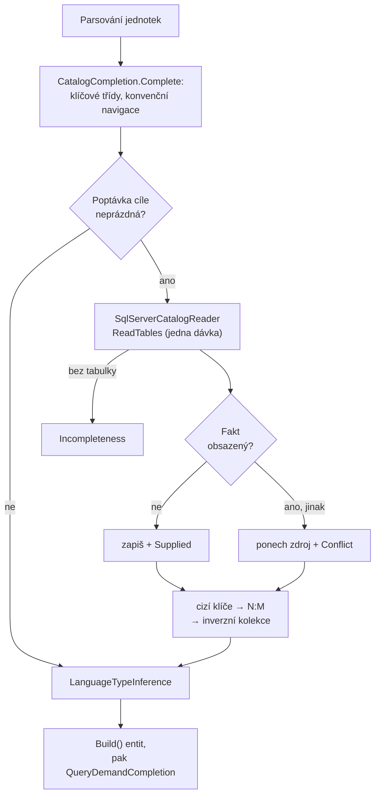

**Poptávka** = kategorie deskriptoru *vyžaduji* a *umím vyjádřit*; prázdná (Dapper) znamená nulový dotaz. Zápis je přírůstkový a idempotentní. Transientní vlastnost fáze přeskakuje celou (rozh. [072](./decisions/072-a-transient-property-is-a-carried-mapping-fact.md)).

#### Čtečka

- **`SqlServerCatalogReader`** obslouží dávku jedním připojením a čtyřmi dotazy do `sys.*` (sloupce, primární a cizí klíče, unikátní omezení); připojení otevírá líně a drží po dobu života. Jména tabulek jdou jako `nvarchar(128)`; každá velikost dávky stojí ~1,2–1,4 MB plan cache (měřeno 2026-08-26).
- **`TableImage`**: sloupce (rodina, unicode faceta, délka ve znacích, precision/scale, nullabilita, IDENTITY, rowversion, default constraint), části PK v pořadí, cizí klíče s páry, `UniqueConstraintImage`. Hrubší rodina nese i `SourceSqlType` (rozh. [019](./decisions/019-neutral-database-type-vocabulary.md)).
- **Podíl F4** (`Catalog/CatalogMetadataShareTest`): fakty obou schémat testovací databáze (`TestSchema.sql` a LDBC) vyčte ScriptDom ze skriptů fixtury a porovná s `TableImage`. Fakt je tabulka, sloupec, typ (rodina a unicode), nullabilita, délka, přesnost, měřítko a celý primární klíč, cizí klíč či unikátní omezení v pořadí; mez 95 % a odchylky zapsané v testu, výsledek v [záznamech běhů](./runs/README.md#podíl-f4).
- **Kandidáti**: uvedená tabulka, jinak jméno entity s/bez `s` (`EntityTableNaming.TableCandidatesFor`, rozh. [050](./decisions/050-one-home-for-the-singular-plural-heuristic.md)); víc schémat → `dbo`, jiná víceznačnost se hlásí.
- **`CachingCatalogReader`** pamatuje odpovědi (i záporné) po dobu života, kterou volí vlastník (běh Advisoru, testovací kolekce).

#### Co katalog dodává

| Fakt | Dodá se | Jinak |
|---|---|---|
| sloupec, `DatabaseType`, facety | prázdný fakt | rozdíl → `Conflict` |
| `VersionColumn` | jen kladně (rowversion) | — |
| primární klíč | nepopřený, každý sloupec má vlastnost | popřený → `Conflict`, vítězí zdroj |
| strategie části klíče | `Unspecified`: IDENTITY → `Identity`, bez defaultu → `Assigned` | default constraint → `Incompleteness`; tvrzená `Identity`/`Auto` nad sloupcem bez IDENTITY či `Assigned` nad IDENTITY → `Conflict` |
| unikátní omezení | nová množina členů, po cizích klíčích: sloupec skaláru → vlastnost, celý FK vlastnícího vztahu → navigace (rozh. [130](./decisions/130-a-unique-constraint-over-a-foreign-key-names-the-navigation.md)); název bezejmenné | jiný název → `Conflict`; část FK či sloupec bez člena → `Incompleteness` |
| cizí klíč | cíl v převodu, navigace existuje (celý PK → 1:1, jinak N:1) | bez navigace → záznam |
| inverzní kolekce | 1:N bez sloupců, kolekce bez vztahu; nic, nese-li sloupce (vyslovené či spárované) její vlastnící protistrana — vlastnící many-to-one či one-to-one s navigací, určená jako v builderech: `InverseRelationName`, jinak jediný kandidát; dvě bez jména nechají kolekci katalogu —, klíč pak builder i join po cestě berou z ní | jiné sloupce → `Conflict` |
| jazykový typ | jen z mapování, i bez připojení: `date` → `Date`, `time` → `TimeOfDay`, binární → `ByteArray` | `Convention` |

**N:M** (rozh. [005](./decisions/005-many-to-many-as-explicit-junction-entity.md)): spojovací tabulka (`JunctionShape`) má celý PK ze sloupců právě dvou cizích klíčů. Entita na ní dostane `IsJunctionTable` se záznamem `Supplied`; tabulky mimo převod najde `FindJunctionTables`; nevyužitá spojovací tabulka a sloupce nad rámec obou klíčů jsou `Incompleteness`. Vztah N:M bez tabulky dostane `JunctionFacts`, kolekční navigace bez vztahu nový vztah N:M; dvojznačnost s přímým cizím klíčem se hlásí.

#### Připojení a stav

Připojení je nepovinné: `/convert` ho čte z `ConnectionStrings:CatalogDatabase`; chybějící i nedostupné končí `Incompleteness` a konvencemi. Stav nese `CatalogPhaseResult` (`CatalogConnectionState`):

| Stav | Význam |
|---|---|
| `NotConfigured` | připojení není nastavené |
| `Unused` | prázdná poptávka nebo žádná pojmenovaná entita |
| `Reached` | katalog přečten |
| `Unreachable` | čtení selhalo |

Čas: `CatalogReadTime`, `null` = nezkoušeno. Měření S3: [záznamy běhů](./runs/README.md#výkon-překladu-s3).

Selhání čtení nese důvod záznamu s textem výjimky. `SqlServerCatalogReader` ho vydá začerněný proti vlastnímu řetězci (`CredentialRedaction`, rozh. [160](./decisions/160-credentials-are-in-no-generated-source-and-no-text-about-a-run-and-progress-has-the-grain-of-the-processing.md)): SqlClient u odmítnutého přihlášení jmenuje uživatele, záznam pak zní „Login failed for user '\*\*\*'."; původní výjimka zůstává vnitřní.

#### Poptávka dotazu

Rozh. [105](./decisions/105-a-query-formulates-its-own-demand-on-the-catalog.md): `CatalogDemand()` (§7) vydá tabulky, ze kterých se typuje parametr a které neváže mapování. Orchestrace přečte všechny dotazové jednotky, předá poptávky `QueryDemandCompletion.Complete` a pak volá `Build()` — jedno čtení na převod. Zapíše se jen `Table` a `Schema` entity, až po entitních artefaktech; `Supplied` (`TableName`, `QueryParameter`) nese první dotaz. Jinak `Incompleteness` a brána vydá `Failure`. `CatalogPhaseResult.Then` bere nejsilnější stav (`Unreachable` > `Reached` > `Unused` > `NotConfigured`) a sčítá časy.

#### Cizí deklarovaný zdroj

Rozh. [091](./decisions/091-the-catalog-completes-a-foreign-source-and-says-so.md): zdroj s `AnotherSystem` se doplní taky; běh nese jediný `Conflict` bez kategorie, pokud fáze vydala aspoň jeden `Supplied` nebo `Conflict` (`ForeignDialect.ContradictsTheCatalog`).

Čtečku sdílí i benchmarking (`QualifyEntityTableNames`, jeden `CachingCatalogReader` na běh Advisoru) a `LinqQueryParser.ResolveTable` čte tabulky, které fáze zapsala do `EntityMaps` (S1).

## 6. Ověření artefaktů, frontend a rozhraní

Nasazovací pohled (spouštění, konfigurace, testy, testovací databáze) je v [`ORMConvertor/README.md`](../ORMConvertor/README.md) (rozh. [058](./decisions/058-only-the-operational-half-of-the-deployment-view-moves.md)), proto tu §6.1 a §6.4 chybějí; velikost sady a ostatní záznamy běhů jsou v [`runs/`](./runs/README.md) (rozh. [167](./decisions/167-records-of-runs-and-measurements-have-a-folder-of-their-own.md)). Jediný proces ASP.NET Core nese REST API i frontend pod `/orm`, bez přihlášení. Připojovací řetězce jsou v repozitáři prázdné (S4, rozh. [029](./decisions/029-database-connection-is-the-consumer-projects-fact.md)); bez katalogu F4 a F6 přes rozhraní neplatí (§5.2). S3 je změřený s víc než čtyřicetinásobnou rezervou proti 30 s; S5 platí v rozsahu, který v repozitáři existuje (§9): jeden `docker-compose.yml` spouští systém i obě sady.

### 6.2 Ověření generovaných artefaktů

Čtyři stupně rozh. [016](./decisions/016-generated-artifact-verification-levels.md), všechny implementované; dotazy podle rozh. [027](./decisions/027-query-artifact-verification.md), čtvrtý stupeň nad dotazem je diferenční ověření (rozh. [089](./decisions/089-differential-verification-as-the-fourth-level-over-a-query.md)) a nad dotazy Interactive katalogu LDBC validační sada LDBC (rozh. [117](./decisions/117-the-interactive-v1-validation-set-judges-the-ldbc-catalog-at-the-fourth-level.md)). Každý stupeň má negativní polovinu.

| Stupeň | Co se ověřuje | .NET cíle (EF Core, NHibernate, Dapper) | Java cíle (Hibernate, EclipseLink, MyBatis) | Kde |
|---|---|---|---|---|
| 1. tvar | jak je artefakt zapsán (S2) | řetězcové aserce | totéž | testy parserů a builderů |
| 2. překlad | přeloží se / rozparsuje | `CSharpSourceCompiler`; `hbm.xml` proti XSD z balíku NHibernate; SQL Dapperu parserem | `javac` nad classpath sady | `Tests/Verification/`, `GeneratedArtifactTest` |
| 3. přijetí | framework přijme bez provedení | `BuildSessionFactory`, `CreateQuery`; model EF Core, `ToQueryString()`; Dapper splývá s 2. | továrna Hibernate / EclipseLink / MyBatis, JPQL `createSelectionQuery` / `createQuery` | totéž |
| 4. běh | entita se uloží a načte s touž identitou; dotaz vrátí kanonické řádky; dotaz Interactive katalogu LDBC řádky validační sady; dotaz na cestu řádky algoritmu v testu | `Dapper*PersistenceTest`, `DifferentialVerificationTest`, `LdbcJudge/LdbcValidationTest`, `LdbcJudge/LdbcPathQueryTest` | `*/GeneratedArtifactTest`, `differential/`, `ldbc/` | kolekce `TestDatabaseSchema`; `@Tag("integration")`; soudce nad `LdbcSnb` |

#### Entitní větev .NET

- **2. stupeň** — `GeneratedEntityCompiler` dodá implicitní usings SDK a reference balíku cíle (příspěvek projektu, ne artefaktu).
- **3. stupeň NHibernate** — `MsSql2012Dialect`, explicitní `MicrosoftDataSqlClientDriver`, vypnuté `hbm2ddl.keywords` (jinak by otevíralo spojení); atribut `assembly` dodá harness (rozh. [028](./decisions/028-assembly-name-is-not-ours-to-invent.md)); handler `AssemblyResolve` je procesně globální a páruje se jménem, proto souběh ověření vylučuje sdílený zámek kolem celého kroku (`AssemblyResolveGate`).
- **3. stupeň EF Core** — `UseSqlServer()` bez řetězce, `EnableServiceProviderCaching(false)` (jinak cache modelu podle typu kontextu); model se ptá zpět na tabulku, schéma, klíč, cizí klíč.
- **Negativní** — neexistující vlastnost, `<composite-id>` bez `Equals`/`GetHashCode` (rozh. [006](./decisions/006-flat-composite-key-rendering.md)), entita EF Core bez klíče; kolekci deklarovanou konkrétním typem (rozh. [035](./decisions/035-nhibernate-collections-declared-by-interface.md)) odhalí až 4. stupeň (`PropertyAccessException` „Invalid Cast…"), 1. stupeň ji hlídá v `EnforcedMembersTest`.
- **Verze** — tvrzení platí pro verzi z `Directory.Packages.props` (rozh. [034](./decisions/034-central-version-management.md)); vazbu drží `DeclaredVersionsMatchTheVerificationPackages` (§1).
- **F6 se zdrojem Dapper** — `DapperToNHibernateVerificationTest`, `DapperToEFCoreVerificationTest`: `ConversionHandler.Convert` s připojením, pak 2. a 3. stupeň nad fakty jen z katalogu (pořadí částí klíče, cizí klíče, `<key>` inverzních `<bag>`). `DapperManyToManyVerificationTest`: N:M ze schématu jako junction entita; `Products` jako `ValueGenerated.Never` (rozh. [064](./decisions/064-absence-of-generation-as-a-catalog-fact.md)). Bez databáze se přeskakují ([README](../ORMConvertor/README.md#the-test-database)); F4 dokládá `SqlServerCatalogReaderTest`.

**4. stupeň** zapisuje do schématu fixture v transakci nad `OpenConnection()` s rollbackem; typy jsou dostupné přes `dynamic`. Tím je naplněné F3:

| Vztah | Test | NHibernate | EF Core |
|---|---|---|---|
| 1:N | `DapperToNHibernatePersistenceTest`, `DapperToEFCorePersistenceTest` | objednávka plochým composite-id (rozh. 006) | cizí klíč z navigace |
| 1:1 | `DapperOneToOnePersistenceTest` (rozh. [012](./decisions/012-foreign-key-rendering.md), [015](./decisions/015-mapping-fact-completion-from-the-catalog.md)) | sdílený klíč ručně | klíč propíše `SaveChanges` |
| M:N | `DapperManyToManyPersistenceTest` (rozh. [005](./decisions/005-many-to-many-as-explicit-junction-entity.md)) | obě půlky klíče ručně | obě půlky z navigací |

#### Dotazová větev .NET

Nasucho v `QueryVerificationTest`; záměrně špatný dotaz v `DeeplyNestedQueryVerificationTest`, 2. stupeň každé kategorie v `Combined/QueryShapeMatrixTest`.

| Cíl | 2. stupeň | 3. stupeň |
|---|---|---|
| EF Core | `GeneratedQueryCompiler` | `ToQueryString()` (`EFCoreQueryAcceptance`) |
| NHibernate | kompilace C# | `CreateQuery(hql)` (`NHibernateQueryAcceptance`) — odmítne i nenamapované, tedy Q13 frameworkem |
| NHibernate, druhý tvar LINQ (rozh. [118](./decisions/118-nhibernate-writes-a-linq-form-beside-its-hql.md)) | kompilace C# s `NHibernate.Linq` | provider přeloží řetěz plánem dotazu bez spojení (`NHibernateLinqAcceptance`: `NhLinqExpression` → `QueryPlanCache`); 4. stupeň: diferenční matice spustí i druhý tvar (`TheLinqFormOfNHibernateReturnsTheCanonicalRows`), katalog LDBC ho zkompiluje, soudce přehrává závazný HQL |
| Dapper | kompilace a parsování SQL | splývá; tabulky a sloupce v mezireprezentaci (`TSqlAcceptance`) |
| úniková cesta (rozh. [113](./decisions/113-native-sql-as-the-escape-path-and-the-vocabulary-ldbc-needs.md)) | metoda nad API nativního SQL (`NativeSqlTest`, Java `shapes/QueryCategoryTest`) | SQL týž jako u cíle Dapper (`AFallbackEmitsTheStatementTheDapperTargetWrites`); framework ho neposuzuje |

Artefakt EF Core je veřejná statická metoda s **prvním** parametrem `DbContext`, vracející `IQueryable` z `ctx.Set<T>()`, druhý tvar NHibernatu totéž s `ISession` a `session.Query<T>()`; harness váže parametry (rozh. [083](./decisions/083-parameter-as-the-fifth-operand-shape.md)) kolekcí o jednom prvku a číslem 1, protože `Take(0)` dá `WHERE 0 = 1` (rozh. [085](./decisions/085-a-row-count-is-a-number-or-a-parameter.md)). `AdvisorBenchmarking` parametrizovaný dotaz nenajde ([`open-items.md`](./open-items.md)). Negativní: nepřeložitelný LINQ, HQL a SQL se syntaktickou chybou či neznámým členem.

#### Javová sada `JavaTests/`

Maven + JUnit mimo řešení (rozh. [076](./decisions/076-java-wrappers-in-csharp-jvm-in-containers.md)): stupeň `java-tests` v `ORMConvertorAPI/Dockerfile`, služba `java_tests`, job `java-test` ([README](../ORMConvertor/README.md#tests)). Artefakty bere jako HTTP klient běžící instance (rozh. [078](./decisions/078-java-suite-as-a-client-of-a-running-instance.md)):

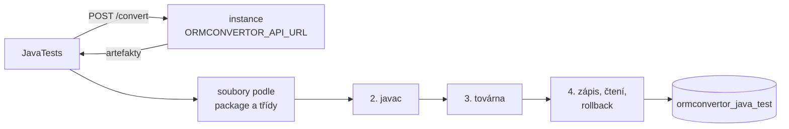

- **Prostředí** — `ORMCONVERTOR_TEST_JDBC_URL`, schéma `ormconvertor_java_test` (`ORMCONVERTOR_TEST_SCHEMA`) z téhož `TestSchema.sql`; obraz kopíruje celý `Tests/Database`, výběr dělá `<testResources>`. **Bez přeskočení**, kromě soudce LDBC a přijetí dotazů BI (`ldbc/`), které bez `ORMCONVERTOR_TEST_LDBC_JDBC_URL` a `ORMCONVERTOR_LDBC_API_URL` přeskočí s důvodem (s `ORMCONVERTOR_REQUIRE_LDBC_DATABASE=1` selžou); jinak je chybějící databáze či instance selhání.
- **Vstupy** `src/test/resources/inputs` nad tabulkami fixture, schéma přes `{{schema}}`, typ podle přípony (rozh. [111](./decisions/111-a-unit-is-a-whole-source-file-that-declares-only-its-language.md)); u Hibernatu se tvrdí `targetFrameworkVersion` = `org.hibernate.Version`, u EclipseLinku a MyBatisu jen přítomnost (verzi váže `TargetFrameworkDescriptorTest` na `pom.xml`); `Failure` shodí scénář. Dotazová metoda dostane obal s importy `jakarta.persistence` (rozh. [040](./decisions/040-boundary-of-the-handed-over-artifact.md)).
- **Směry** — Hibernate, EF Core, NHibernate → každý javový cíl; Dapper ne (nevysloví tabulku ani schéma, a tím nenasměruje katalog).

| Cíl | Bootstrap | Tvrzení profilu (`*ClaimsTest`) | Negativní |
|---|---|---|---|
| Hibernate (rozh. [077](./decisions/077-hibernate-wrapper-over-the-shared-jpa-layer.md)) | `HibernateBootstrap`, bez dialektu, `hibernate.default_schema` | entity join s `on` v každé pozici; `precision` na `LocalDateTime` → `datetime2(7)`, `secondPrecision = 3` → `datetime2(3)` (rozh. [079](./decisions/079-fractional-second-precision-as-second-precision.md)); `cast` do textu jde na SQL Server jako `varchar(max)` a ztrácí znaky mimo kódovou stránku — i s typem `nstring` (čtení pak selže) a pod `hibernate.use_nationalized_character_data`, proto převod textu na text píše úniková cesta (§5, *Výraz*); vnořený konvertor najde bez registrace a použije ho na entitu, cestu i `MAX` nad ní, podmínku nemění, `@ColumnTransformer(read)` ji přepíše (`TrimmedFixedWidthClaimsTest`) | bez identifikátoru odmítne továrna; bez konstruktoru až čtení; `@IdClass` ani `equals` 7.4.5 nevyžaduje |
| EclipseLink (rozh. [080](./decisions/080-eclipselink-as-the-second-profile-over-the-jpa-layer.md)) | `PersistenceUnitInfo` v kódu, `eclipselink.weaving = false` | bez připojení: `@GeneratedValue` → tabulka `SEQUENCE`; `String` → `VARCHAR`. Proti databázi: `having`, jehož první cesta je přes jinou proměnnou než kořen, se přestaví na kořen (`JoinedHavingClaimsTest`, §5); každý sloupec výsledku typu `CHAR`/`NCHAR` (i `MIN`, `MAX`, `COALESCE`, `CASE`) ořeže o koncové znaky do U+0020 v JPQL i nativním SQL, `nvarchar` a konkatenaci s prázdným textem ne, dokud relace nevypne `shouldTrimStrings`; vnořený konvertor najde jen mezi třídami persistence unit, kam ho `EclipseLinkBootstrap` přidá tak, jak to udělá konzument (rozh. 169, `CharTrimmingClaimsTest`). Líná reference bez weavingu netestována (hranice záruk) | bez identifikátoru |
| MyBatis (rozh. [084](./decisions/084-mybatis-wrapper-over-the-shared-sql-reading.md)) | `Configuration` v kódu, kontextový zavaděč vlákna; řádky vrací vynucený `rollback(true)` | konstruktor vynucený, `autoMapping="false"` uzavře, `<foreach>` naváže kolekci | příkaz v anotaci i XML (rozh. [068](./decisions/068-source-framework-precedence-orders-the-reading.md)) |

- **4. stupeň navíc** — `CustomerOrder` se najde podle obou částí klíče; stránkovaný dotaz z EF Core vrátí vázaný počet řádků (`setMaxResults(take)`, `#{take}`; `BoundParameters`, §7).
- **Kategorie** — `shapes/DeeplyNestedQueryTest` a `shapes/QueryCategoryTest`: do JPA jen ze zdrojů s klíčem (rozh. [063](./decisions/063-stated-keylessness-as-a-carried-fact.md)), do MyBatisu ze všech; bez databáze.
- **Velikost** (rozh. [087](./decisions/087-an-integration-test-is-a-run-against-the-database.md)) — 4. stupeň nese `@Tag("integration")`; `SuiteSizeTest` počítá invokace proti F12 (60, z toho 20 integračních), nespočitatelnou parametrizaci ohlásí jménem.

#### Diferenční ověření

Artefakt každého cíle se spustí nad fixturou a řádky se porovnají s **kanonickým výsledkem dotazu**. Sady se potkávají nad souborem; přímé porovnání by žádalo spouštět cizí kód (§9, oblast 1).

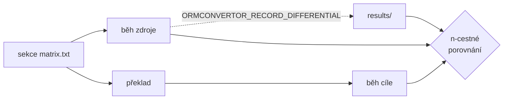

- **Měřítko patří dotazu, ne směru**; zapisuje ho jen běh zdroje.
- **Kanonický řádek** — tabulátorem oddělená pole v pořadí projekce; desetinná na `decimalScale`, plovoucí na `floatDigits`, ISO 8601, escapované řetězce, `NULL`; neznámý typ zastaví běh. Hodnoty, ne typy (rozh. [014](./decisions/014-language-type-model.md)); shodu rendererů hlídá `RendererConformanceTest`.
- **Kanonická forma výsledku** (rozh. [170](./decisions/170-rows-tied-on-the-ordering-key-compare-as-a-set-and-a-fiben-slice-gets-a-deciding-key.md)) — řádky v pořadí, v jakém přišly, každý souvislý úsek řádků se shodnou hodnotou klíče řazení seřazený podle vykresleného řádku; bez řazení se seřadí celý výsledek. Klíč jsou pole výsledku, na která padá řazení nejvnějšího dotazu zdroje (alias projekce, nebo shodný výraz; klíč mimo projekci = celý řádek, tedy porovnání v pořadí); nese ho `matrix.txt` (`orderingKey`), vazba LDBC a katalog FIBEN a proti mezireprezentaci zdroje ho drží `DifferentialMatrixTest`, `Combined/LdbcCatalogTest` a `Combined/FibenCatalogTest` (`Verification/SourceQueries` čte dotazy zdroje továrnou parserů orchestrace, `Verification/OrderingKeys` odvozuje klíč). Formu počítají obě sady (`ResultRow.Canonical`, `ResultRow.canonical`); shodu drží `renderer-conformance.txt`, chování `CanonicalFormTest` v obou.
- **Projekce** — HQL a JPQL pozičně, Dapper a MyBatis jako netypovaný řádek (rozh. [104](./decisions/104-a-projection-into-a-sql-target-materializes-as-an-untyped-row.md)); chybějící sloupec v mapě MyBatisu čte `JavaQueryRunner` jako `NULL`.
- **Fixtura** nic nezapisuje; tabulky s předponou kvůli rozh. [050](./decisions/050-one-home-for-the-singular-plural-heuristic.md). Žádný dotaz neřadí jen podle clusterovaného klíče, každé řazení je úplné.

| Soubor (`Tests/Database/`) | Obsah |
|---|---|
| `TestSchema.sql` | schéma fixture pro obě sady |
| `Differential/matrix.txt` | vlastní dotazy a kategorie T2; `orderingKey`, `mutations` |
| `*/FixtureData.sql` | `DifferentialProducts`, doména `Shop*` |
| `QueryShapes/categories.txt` | zdroje kategorie, `refusedBy`, `fallbackBy`, `*WithoutCatalog` |

- **Buňka** — přeloženo; odmítnuto (`refusedBy`, není dvojicí); nativní SQL (`fallbackBy`, dvojice + povinný `Fallback`, `AFallbackDirectionFallsBackAsStated`). Rozpis je v [`subset.md`](./subset.md); Dapper pod `refusedWithoutCatalog` je zdrojem (rozh. [105](./decisions/105-a-query-formulates-its-own-demand-on-the-catalog.md)).
- **Velikost** — každý zdroj proti pěti cílům; `DifferentialMatrixTest` tvrdí ≥ 30 dvojic a každou kategorii manifestu, kolik dvojic matice má, říká sama.

**Mutace** (vydaného artefaktu, ne překladače; `DifferentialMutationTest`), odhalené jinými řádky nebo nepoužitelným artefaktem:

- `filter` — vypuštěný filtr.
- `operator` — obrácené porovnání (i `>=` ↔ `<=`).
- `ordering` — vypuštěné řazení (i `.ThenBy`); odhalí ji jiné pořadí hodnot klíče, ne pořadí uvnitř úseku shodného klíče (rozh. 170).
- `rowCount` — počet řádků o jeden jiný (literál i vázaný `take`).
- `projection` — prohozená dvě pole.

Kategorie bez mutace (`DISTINCT`, `COUNT(DISTINCT …)`) nese kladná polovina — fixtura má duplicity.

**Cross-ecosystem** (rozh. [090](./decisions/090-the-cross-ecosystem-matrix-counts-itself.md), `Combined/CrossEcosystemMatrixTest`): překlad = celý převod scénáře přes hranici, jednou za (scénář, zdroj, cíl); end-to-end = na 4. stupni. celé převody scénářů `CrossFrameworkInputs` ve směrech přes hranici + dvojice diferenční matice přes hranici; test tvrdí součet **≥ 30** a scénář v každé ze čtyř dvojic ekosystémů (F10). Dapper → Hibernate / EclipseLink a MyBatis → NHibernate předají nasucho jen dotaz (zdroj nevysloví klíč, F6); test tvrdí celý převod, nebo důvod.

**LDBC SNB** (rozh. [110](./decisions/110-ldbc-snb-as-a-second-reference-domain.md)) — `SampleData/LdbcSnbSample.cs`: 41 čtecích dotazů (`LdbcQuery`), všech 41 `AsSpecified`, žádný `Simplified`, žádný `NotTranslated`, žádné odmítnutí; pět dotazů na cesty (IC 13, IC 14, BI 15, BI 19, BI 20) píše řetěz nerekurzivních definic podle rozh. [140](./decisions/140-ldbc-path-queries-as-breadth-first-search-in-non-recursive-definitions-with-the-depth-of-the-data.md): `Step` jsou hrany dotazu s cenou plus každá osoba sama sobě sousedem s nulovou cenou, úroveň *k* + 1 nese pro každou osobu nejlevnější cenu přes úroveň *k* plus jednu hranu (Bellman–Ford; s jednotkovou cenou prohledání do šířky), hloubka `LdbcSearchDepth` je změřená vlastnost data setu `LdbcSnbSample.DataSet` (SF 1) nad hranami dotazu z každé osoby (rozh. [141](./decisions/141-one-data-set-for-the-ldbc-catalog-and-the-depth-of-a-path-query-as-a-measured-property-of-it.md)): IC 13 a IC 14 5 (průměr `knows`), BI 19 5, BI 20 7, BI 15 11 pro příkladové období (nejvíc hran nejlevnější cesty); IC 14 vede od první osoby druhý řetěz cest, který prodlužuje cestu jen k sousedovi o krok blíž druhé osobě a váhu sečte až nad hotovými cestami. Které dotazy který cíl píše nativním SQL a proč, nese katalog (`FallbackBy`, i na `/ldbc`). `Combined/LdbcCatalogTest` převádí z Dapperu do pěti cílů nad prázdným schématem `<schéma>_ldbc` (`database/ldbc/schema.sql`, `constraints.sql`, `indexes.sql`), tvrdí `Failure` / `Fallback` podle katalogu, artefakty EF Core a NHibernate zkompiluje s entitami převodu (2. stupeň, i BI), každý text spustí a hlídá, že každý dotaz Interactive má vazbu na soudce a žádný BI ji nemá; javová `ldbc/LdbcBusinessIntelligenceAcceptanceTest` nechá dotazy BI přeložit instancí nad `LdbcSnb`, zkompiluje je a předloží továrně Hibernate, EclipseLinku a MyBatisu (2. a 3. stupeň, bez spuštění). Texty jsou ověřené proti referenčním implementacím LDBC; dotazy Interactive navíc soudcem níže, BI ne — jejich stav je tvrzením autora. Tvar textu smí sledovat plánovač SQL Serveru i implementaci jednoho cíle jen v mezích rozh. [121](./decisions/121-the-text-of-a-catalog-query-takes-the-shape-its-planner-needs-and-ldbcsnb-carries-the-indexes-its-reads-need.md) a [122](./decisions/122-the-text-of-a-catalog-query-takes-the-shape-a-targets-implementation-needs-under-the-same-criterion.md) (IC 5: okruh osob jako jedna množina; IS 7, IC 5, BI 2 a BI 5: vnější join nejmenuje alias vnitřního); poznámky dotazů na cesty nesou změřený čas čtení nad SF 1 (140); fyzický návrh `LdbcSnb` je `indexes.sql` — indexy cizích klíčů jako referenční implementace a dva rozšířené pro IC 5 —, znovu spustitelný, loader ho spustí při změně kontrolního součtu proti vlastnosti `ldbc.indexes`.

#### Soudce LDBC Interactive v1

Validační sada LDBC Interactive v1 je 4. stupněm nad 21 dotazy Interactive katalogu (rozh. [117](./decisions/117-the-interactive-v1-validation-set-judges-the-ldbc-catalog-at-the-fourth-level.md)). Řádek sady je dvojice objektů JSON *parametry\|výsledek*; čtení platí ve stavu po všech vkládáních nad ním, proto se sada přehrává v pořadí. Čtení mezi dvěma vkládáními vidí týž stav: frameworky sady je čtou souběžně, každý ve svém vlákně a v pořadí řádků, a další vkládání čeká, až všechny dočtou (rozh. [166](./decisions/166-the-judge-reads-a-segment-between-inserts-in-every-framework-at-once.md)).

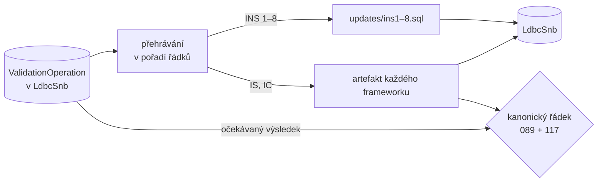

| Část | Kde | Co dělá |
|---|---|---|
| sada | `database/ldbc/validation.sql`, `load-ldbc.sh` | soubor `validation_params-sf<N>.csv` téhož scale factoru jako data do `ValidationOperation` (`Position`, `Operation` `IS1`…`INS8`, `Parameters`, `Result`); operaci pozná podle pole, které má jen ona; hlídá pořadí (data vkládání neklesají) a že žádný klíč vkládání v datech není; rozšířená vlastnost `ldbc.validation` |
| vkládání | `database/ldbc/updates/ins1.sql`–`ins8.sql` | parametry jmény polí operace (číslo `BIGINT`, text `NVARCHAR`, seznam a objekt jako JSON pro `OPENJSON`); kořen vlákna, fórum a jazyk komentáře z rodiče jako `load.sql`; přátelství obousměrně |
| kompenzace | `updates/undo.sql` | smaže řádky všech vkládání sady po klíčích, které jmenují; idempotentní, běží před přehráváním i po něm |
| vazba | `LdbcQuery.Validation`, i na `/ldbc` | operace; parametry textu z polí (`PlusDays` pro konec okna, `NextMonth`); sloupce projekce v jejím pořadí s polem výsledku a druhem (`Moment`, `Date`, `Flag`, `Set`, `Sequence`); `OrderingKey` — sloupce, na které padá řazení textu (rozh. 170), u IC 14 jen váha cesty, protože validační sada jinak neřadí (`JudgeOrdersLess`); `Ordered` je z klíče odvozený |
| převod | `LdbcJudge/LdbcCanonicalForm`, javový `ldbc/LdbcCanonicalForm` | očekávaný JSON i řádek artefaktu do kanonického řádku 089: milisekundy na okamžik či datum, příznak na 1/0, seznam jako množina seřazených prvků, prázdný seznam `NULL`, objekt jako jeden řádek; výsledek v kanonické formě rozh. 170; shodu obou drží `renderer-conformance.txt` |
| přehrávání | `LdbcJudge/LdbcReplay`, `ldbc/LdbcReplay` | aplikační zámek `ldbc.validation` na spojení; artefakt z Dapperu s `LdbcSnb` jako katalogem, přeložený a zkompilovaný jednou (`PreparedQuery`, `PreparedJavaQuery`) a spuštěný pro každé čtení; úsek mezi vkládáními čte každý framework ve vlastním vlákně (`ReadSegment`, `readSegment`), artefakt nikdy ze dvou; .NET Dapper (text katalogu), EF Core, NHibernate; Java Hibernate, EclipseLink, MyBatis s katalogem a artefakty z instance `ORMCONVERTOR_LDBC_API_URL` |

- **Verdikt** — dotaz `AsSpecified` musí souhlasit na každém čtení v každém frameworku; neshoda Dapperu (textu katalogu) je chyba textu, neshoda jen cíle chyba překladu. **Míra** — dotaz `Simplified` zapíše podíl shodných čtení do výstupu; artefakt musí běžet.
- **Negativní polovina** — pět mutací 089 nad artefaktem IC 2 v každém frameworku musí skončit neshodou nebo selháním.
- **Dotazy na cesty** (rozh. [140](./decisions/140-ldbc-path-queries-as-breadth-first-search-in-non-recursive-definitions-with-the-depth-of-the-data.md), [141](./decisions/141-one-data-set-for-the-ldbc-catalog-and-the-depth-of-a-path-query-as-a-measured-property-of-it.md)) — `LdbcJudge/LdbcPathQueryTest` nad touž `LdbcSnb` (sdílený aplikační zámek): pro IC 13, IC 14, BI 15, BI 19 a BI 20 porovná řádky textu s algoritmem testu (Bellman–Ford na hloubku, u IC 14 výčet nejkratších cest; hrany čte vlastním SQL) z příkladových parametrů i z osob, měst a firem vybraných z dat, a nad data setem, který katalog jmenuje (`LdbcSnbSample.DataSet` = vlastnost `ldbc.dataset`), změří z každé osoby hloubku dat a tvrdí, že text (`LdbcSearchDepth`) má úrovní aspoň tolik; nad jiným data setem to přeskočí s důvodem. Počet úrovní textu proti `SearchDepth` drží `Combined/LdbcCatalogTest`.
- **Konfigurace** — `ConnectionStrings:LdbcDatabase` (.NET), `ORMCONVERTOR_TEST_LDBC_JDBC_URL` a `ORMCONVERTOR_LDBC_API_URL` (Java); bez nich se soudce přeskočí s důvodem, s `ORMCONVERTOR_REQUIRE_LDBC_DATABASE=1` selže. `ORMCONVERTOR_LDBC_VALIDATION_ROWS` přehraje jen prefix sady; profil `test` přehrává 1000 řádků SF 0,1 ([README](../ORMConvertor/README.md#the-ldbc-judge)).
- **Mez času** (rozh. [146](./decisions/146-the-java-branch-measures-with-the-same-loop-in-its-own-container-and-an-execution-has-one-time-limit.md)) — každý příkaz přehrávání má mez `LdbcDatabase.CommandTimeoutSeconds` (.NET) = `QUERY_TIMEOUT_SECONDS` (Java), touž jako politika Advisoru (§8): soudce ji vloží do připojovacího řetězce (`Command Timeout`), resp. do JDBC URL (`queryTimeout`), které předává buňkám i vlastním příkazům, takže ji dostane každý příkaz nad tím spojením bez ohledu na framework; čtení nad mezí je neshoda buňky. Shodu tří míst drží `LdbcValidationTest`.
- **Doba** — čtení stojí nad SF 0,1 desítky až stovky milisekund, celá sada (přes 130 tisíc čtení) tedy hodiny; celou sadu nad SF 1 přehraje každá sada samostatným během, který trvá dny; záznamy verdiktů a jejich dobu nese [`runs/`](./runs/README.md). Test kompenzace vypíše dobu běhu rozloženou po krocích: kroky mimo buňky (zámek, kompenzace a počty řádků před a po, příprava mutací, stránkování sady, očekávané řádky, vkládání, čtení mutací) a za každý framework překlad a kompilaci jeho buněk a select a porovnání sečtené přes jeho čtení (u Javy zvlášť bootstrap cíle), nakonec průměrný select čtení každého dotazu v každém frameworku. Doba běhu je z devíti desetin select artefaktů, tedy SQL Serveru; frameworky se v ní liší o desítky procent, porovnání je zanedbatelné ([záznam](./runs/2026-10-18-ldbc-judge-time-by-step.md)).

#### Katalog FIBEN a jeho soudce

Benchmark FIBEN (IBM, Apache-2.0) je třetí referenční doména (rozh. [149](./decisions/149-fiben-as-a-third-reference-domain-run-on-demand-against-a-judge-of-our-own.md)): 152 tabulek finančního datového skladu nad ontologiemi FIBO a FRO a 237 různých dotazů SQL, ke každému otázka v přirozeném jazyce a Kimův typ zanoření. Katalog **neběží při žádném sestavení**: stav jeho dotazů je míra verze, ne invariant nástroje, a měří ho běh na vyžádání v obou sadách. Při sestavení platí jen to, co katalog říká sám o sobě (`Combined/FibenCatalogTest`: 237 klíčů, u každého otázka, typ, text, čtené tabulky mezi entitami, projektované sloupce, poznámka u každého stavu mimo první, klíč řazení podle mezireprezentace textu a výřez, který své řádky určuje — rozh. 170; každou entitu přečte parser Dapperu) a kontrakt `GET /fiben` (`Api/RestContractTest`).

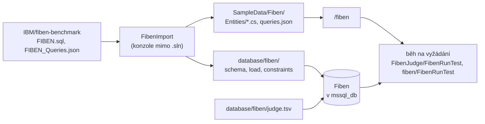

| Část | Kde | Co dělá |
|---|---|---|
| import | `FibenImport/` (konzolový projekt mimo `ORMConvertor.sln`, jako `JavaTests`; spouští se ručně nad checkoutem benchmarku) | DDL Db2 → T-SQL (typy podle deklarací, `DOUBLE PRECISION` → `FLOAT`, `TIMESTAMP` → `DATETIME2(6)`, `VARCHAR(1024)` → `NVARCHAR(1024)`, texty porovnávané binárně jako v Db2; bez indexů mimo klíče, protože benchmark žádné nedeklaruje); entita Dapper každé tabulky (jména velkými písmeny, jak je ontologie píše); dotazy `FIBEN."X"` → `X`, `FETCH FIRST n ROWS ONLY` → `TOP (n)` vlastnícího `SELECT`, číslo v uvozovkách proti číselnému sloupci bez uvozovek, bezejmenný agregát v projekci jako `AggResult<n>` (jméno, které benchmark sám užívá), jednotný zápis klíčových slov a funkcí; výřez (`TOP`, i v poddotazu), který své řádky neurčuje — není agregát bez seskupení a jeho řazení nenese všechny klíče seskupení ani všechny výrazy projekce —, dostane na konec řazení chybějící klíče seskupení, jinak výrazy projekce, vzestupně (rozh. [170](./decisions/170-rows-tied-on-the-ordering-key-compare-as-a-set-and-a-fiben-slice-gets-a-deciding-key.md); dotčené dotazy vypíše protokol převodu, `benchmarkSql` zůstává předlohou); zalomení; ke každému dotazu projektované sloupce a klíč řazení nad nimi. Co jde nad pravidla, je **záplata se jménem dotazu a důvodem** v kódu importu a musí sedět právě jednou: dvě chyby publikovaného textu (136 bez závorky, 172 bez uvozovky), čtyři `GROUP BY` přes vnější odkaz, které SQL Server odmítá (218–220, 227), odvozená tabulka bez aliasu (237), tři stejnojmenné vnořené odvozené tabulky (99). Stav jiný než *podle benchmarku* a jeho poznámka jsou v importu také |
| katalog | `SampleData/Fiben/queries.json` (generovaný, needituje se), `SampleData/Fiben/Entities/`, `FibenSample`, `FibenQuery` | klíč `q<číslo>`, číslo, `FibenNesting` (`NonNested`, `TypeN`, `TypeA`, `TypeJ`, `TypeJA`), otázky (první benchmarku, další parafráze), tabulky, sloupce, `OrderingKey` (`Ordered` odvozený), text v T-SQL, text benchmarku v Db2, `FibenTranslation` (hodnoty rozh. 110) a poznámka; `FibenSample.DataSet` jmenuje archiv (`fiben-benchmark-<commit>`); `EntitiesOf(query)` dává převodu jen entity tabulek, které dotaz čte |
| databáze | `database.Dockerfile` (`ARG FIBEN_DATASET`, commit repozitáře nebo `none`), `database/fiben/load-fiben.sh`, `init-db.sh` | `data.zip` stažený při sestavení obrazu; třetí databáze `Fiben` v `mssql_db` (`COLLATE SQL_Latin1_General_CP1_CI_AS`, SIMPLE), načtená při prvním startu svazku přes staging tabulky textu (datum `yyyymmdd`, časová značka Db2 `yyyy-mm-dd-hh.mm.ss.ffffff`, double s exponentem); vlastnost `fiben.dataset`; stejná pravidla jako loader LDBC (otázka bez odpovědi loader zastaví, poloviční databáze se načte znovu). Profil `test` databázi **nenese** (`FIBEN_DATASET: none`) |
| soudce | `database/fiben/judge.tsv`, `judge.sql`, tabulka `Judge` (`QueryKey`, `Position`, `Rendered`), vlastnost `fiben.judge` (kontrolní součet souboru) | řádky každého dotazu v kanonické formě rozh. 089 a 170, jak je vrátil text katalogu přes Dapper v doloženém běhu, který soudce jmenuje v hlavičce (podmínky rozh. 149 a 157; osm dotazů rozh. 161 a 162 jen z .NET půlky běhu, rozh. [163](./decisions/163-the-fiben-judge-takes-the-eight-queries-of-decisions-161-and-162-from-the-dotnet-half-of-the-run-of-2026-10-22.md); dnešní soubor je z běhu před rozh. 170 a obnoví se z prvního běhu po něm, [`open-items.md`](./open-items.md)); pozice 0 nese **digest** výsledku (`rows=N sha256=…` nad řádky spojenými LF), samotné řádky jen do 1 000 (tři dotazy vracejí přes 100 000 řádků); loader ho nahraje znovu, když se soubor změní. Je to **regresní soudce**: tvrdí, že verze vrací, co vrátila verze toho běhu, mění se jen novým rozhodnutím |
| běh .NET | `FibenJudge/FibenDatabase`, `FibenRun`, `FibenRunTest` | jednou za běh testů (`Lazy`), dotaz po dotazu, ve frameworcích Dapper (text katalogu, zdroj), EF Core, NHibernate: překlad s katalogem `Fiben` a jen entitami dotazu → `PreparedQuery` (kompilace, továrna) → jedno čtení → kanonické řádky (forma rozh. 170) → shoda cíle se zdrojem a zdroje se soudcem (digest, u držených řádků i řádky) → měření politikou rozh. 145 (`BenchmarkPolicy`, §8), jen nad serverem v měřicím režimu (`FibenServer`, rozh. [164](./decisions/164-the-database-server-has-a-measurement-mode-and-a-judge-mode-switched-by-one-file.md) a [166](./decisions/166-the-judge-reads-a-segment-between-inserts-in-every-framework-at-once.md): `MAXDOP` 1 — databáze, není-li nulový, jinak serveru — a `MeasurementProcessors` procesorů, výchozí `cpuset` databází v compose; jinak měření vynechá s důvodem); souhrn nese `MAXDOP`, paměť a procesory serveru; výstup `cells.tsv`, `judge-candidate.tsv` (tvar soudce) a `summary.txt` do adresáře z prostředí; mez každého příkazu `BenchmarkPolicy.ExecutionTimeoutSeconds` v připojovacím řetězci |
| běh Java | `fiben/FibenCatalog`, `FibenDatabase`, `FibenRun`, `FibenRunTest` | totéž pro Hibernate, EclipseLink a MyBatis proti instanci s katalogem `Fiben` (rozh. 078); zdrojem je text katalogu spuštěný přes JDBC; `PreparedJavaQuery` soudce LDBC (veřejná), domény zavírané po každém dotazu, protože každý dotaz má jiné entity; konstanty politiky a mez času drží `FibenRunTest.cs` rovné `BenchmarkPolicy`; výstup `java-cells.tsv`, `java-judge-candidate.tsv`, `java-summary.txt` |

- **Stupně** — 1.: dotaz `AsSpecified` dojde do každého cíle bez `Failure` (nativní SQL se počítá jako doručení a vykazuje zvlášť), dotaz `NotTranslated` musí být odmítnut; 2.: artefakt se zkompiluje a továrna ho přijme; 4.: cíl vrátí řádky zdroje (diferenční ověření, rozh. 089) a zdroj řádky soudce; bez soudce v databázi se poslední přeskočí s větou, že tento běh ho může vytvořit. Každá buňka je theory `(klíč, framework)`; sada bez konfigurace je přeskočí s důvodem, s `ORMCONVERTOR_REQUIRE_FIBEN_DATABASE=1` selže.
- **Konfigurace** — `ConnectionStrings:FibenDatabase` (.NET), `ORMCONVERTOR_TEST_FIBEN_JDBC_URL` a `ORMCONVERTOR_FIBEN_API_URL` (Java); `ORMCONVERTOR_FIBEN_QUERIES` omezí běh na klíče (kontrola, ne záznam verze), `ORMCONVERTOR_FIBEN_RESULTS` adresář výstupu, `ORMCONVERTOR_FIBEN_MEASURE=0` vynechá měření. Příkazy nese [README](../ORMConvertor/README.md#the-fiben-run), záznamy běhů [`runs/`](./runs/README.md).
- **Co běh měří a co ne** — stav každého dotazu v každém cíli, shodu řádků, časy překladu, kompilace a čtení a medián spuštění; neshodu cíle, kterou vysvětluje vyslovená mez, záznam běhu jmenuje (rozh. [157](./decisions/157-a-target-cell-that-differs-by-a-stated-limit-does-not-block-the-fiben-judge.md)). Stav každého dotazu říká katalog (`FibenSample`), ne tento text; co z něj katalog nenese, je mezí [`subset.md`](./subset.md) a stavem dotazu s poznámkou.

#### Cizí artefakt

Artefakt, který nevyrobil nástroj (rozh. [172](./decisions/172-a-foreign-artifact-enters-the-verification-levels-as-a-directory-with-a-manifest-beside-the-client.md)), vstupuje do stupňů vedle klienta: adresář se soubory jednotek cíle a manifestem `artifact.json` — `answers` (`matrix:<sekce matrix.txt>`, `fiben:<klíč>`, `ldbc:<klíč>`, `cross:<zdrojový framework>`, `example:<klíč příkladu>`), `source`, `target`, `producer` (`llm`, `human`, `tool`), `units` s `path` a `contentType` ve jménech `ConversionContentType` (u `.sql`, `.hql`, `.jpql` a `.xml` smí chybět), `metadata` libovolný objekt opsaný beze změny (povinná pole pro artefakt modelu dává rozh. [175](./decisions/175-the-comparison-with-a-language-model-is-a-protocol-over-the-foreign-path.md)). `{{schema}}` v souborech se nahradí schématem sady jako u vstupů. Obě sady čtou touž podobu (`Tests/Foreign/`, javové `foreign/`); artefakt vezme sada, které patří cíl, a instanci nástroje nepotřebuje. **Projekt** — artefakt s více dotazy (příklad, případová studie) — se soudí do třetího stupně jako jeden: entity zkompilované jednou a každý dotaz nad nimi zvlášť, model či továrna přijatá, v NHibernatu každý HQL text a v javových cílech každý dotaz vytvořený proti modelu (rozh. [173](./decisions/173-the-experiment-run-judges-the-tools-artifact-through-the-foreign-path-and-measures-mapping-completeness-by-reading-the-artifact-back.md)). **Projekt případové studie** má čtvrtý stupeň *spustitelný* (rozh. [176](./decisions/176-the-schema-of-an-excerpted-project-is-an-excerpt-created-empty-in-the-case-study-database-and-the-case-study-runs-over-it-at-the-fourth-level.md)): každý dotaz proběhne nad prázdnými tabulkami schématu projektu v databázi případových studií s hodnotou typu za každý parametr (`ForeignArtifactRun.Sample`, javový `PreparedJavaQuery.sample`; jeden prvek v kolekci), první neproběhlý dotaz zastaví projekt na `failed` a detail ho jmenuje, jinak řádek nese `ran` se součtem řádků a bez `agrees`; cíle Dapper a MyBatis ho nemají — jejich SQL nese tabulku bez schématu, jak ji zdroj pojmenoval — a končí třetím stupněm s důvodem; jiný projekt čtvrtý stupeň nemá.

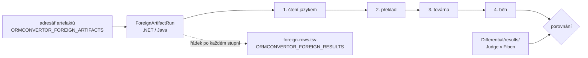

| Stupeň | Co se posoudí | .NET cíle | Java cíle |
|---|---|---|---|
| 1. čtení | jazyk cíle jednotku přečte (T3 *parsovatelný*): jen syntaktická diagnostika | Roslyn (dotazová metoda uvnitř třídy, kterou kolem ní dává i překlad), `XDocument`, `TSql160Parser`; HQL čte až 3. stupeň | `JavacTask.parse()` (dotaz uvnitř třídy, u MyBatisu rozhraní mapperu), DOM bez stažení DTD; JPQL čte až 3. stupeň |
| 2. překlad | jednotky se přeloží pod referencemi konzumenta | `PreparedQuery.Compile` (`GeneratedQueryCompiler`), bez dotazu `GeneratedEntityCompiler` | `JavaProject` entit a nad ním projekt dotazu |
| 3. přijetí | továrna cíle artefakt přijme | `PreparedQuery.Open`: model EF Core (validovaný hned, ne až prvním dotazem), továrna NHibernate a `CreateQuery` nad holým HQL, Dapper nic | továrna Hibernate / EclipseLink a dotaz vytvořený s hodnotou typu každého parametru (`PreparedJavaQuery.sample`); u MyBatisu továrna nad mappery s loaderem rozhraní |
| 4. běh | dotaz vrátí řádky; shoda s měřítkem je výsledek | `PreparedQuery.Run` → `ResultRow.Canonical` | běh jako `JavaQueryRunner` → `ResultRow.canonical` |

- **Měřítko podle klíče** — `matrix:` kanonický výsledek dotazu, argumenty, pole, klíč řazení a nastavení z `matrix.txt`, databáze fixture; `fiben:` soudce z tabulky `Judge` databáze `Fiben` (`FibenJudgeTable`; javová sada čte sloupce a klíč řazení dotazu z `SampleData/Fiben/queries.json`, `ForeignFibenCatalog`); `ldbc:` jen do 3. stupně — validační sada je přehrání, ne jedno čtení; `cross:` (scénář `CrossFrameworkInputs` jednoho zdroje) jen do 3. stupně — entita scénáře nestojí nad tabulkou fixture a 4. stupeň nad entitou píší sady scénářem na entitu; `example:` (příklad podle klíče `GET /examples`, rozh. [174](./decisions/174-the-reference-databases-of-the-experiments-are-three-by-role-and-the-case-study-of-t1-is-the-keycloak-excerpt-judged-to-the-third-level.md)) jen do 3. stupně u příkladu psaného pro nástroj (rozh. 099); u výňatku projektu (`Examples.RealProjectKeys`, javově předpona klíče v `TestSchema.CASE_STUDIES`) 4. stupeň spustitelnosti nad databází případových studií (`TestDatabase.CaseStudyConnectionString`, javově `CaseStudyDatabase`; rozh. 176). Klíč bez měřítka, cíl druhé sady, nečitelný manifest a nenastavená databáze měřítka jsou selhání sady; všechno ostatní je řádek. První stupeň čte SQL Dapperu s `IN @ids` jako `IN (@ids)` — zápis kolekčního parametru je Dapperův, ne chyba syntaxe (jako `Combined/QueryShapeMatrixTest` na 2. stupni).
- **Řádek** (`ForeignVerdict`; shodu sloupců obou sad drží `ForeignArtifactPathTest.TheRowsHaveTheColumnsTheJavaSuiteWrites`) — `artifact`, `answers`, `source`, `target`, `producer`, `language` (`target` — jazyk cíle; `native SQL` — dotaz jako příkaz SQL vedle metody u cíle, jehož jazykem SQL není, rozh. 113; `mixed` — projekt zčásti tak; `none` — bez dotazu; `refused`), `reached` (0–4), `outcome` (`unreadable`, `not compiled`, `not accepted`, `failed`, `differs`, `agrees`; `ran` u projektu případové studie bez měřítka ekvivalence; `accepted` bez dotazu, bez 4. stupně nebo u jiného projektu; `refused` jen u řádku nástroje; `timed out` doplní smyčka), `detail`, `rows`, `agrees`, časy stupňů, `metadata`. Soubory `foreign-rows.tsv` a `java-foreign-rows.tsv` v `ORMCONVERTOR_FOREIGN_RESULTS` se přepisují po každém stupni, takže běh ukončený zvenčí nechá dosažený stupeň.
- **Běh** — `ForeignArtifactRunTest` v obou sadách (theory nad artefakty z proměnné; bez ní jeden případ přeskočí s důvodem), na vyžádání, nikdy součást sestavení; proces na artefakt s mezí času dává `foreign-run.sh` ([README](../ORMConvertor/README.md#foreign-artifacts)).
- **Vstupy ven** — `ORMCONVERTOR_FOREIGN_INPUTS` (`ForeignInputs.Export`, .NET sada): složka `<druh>-<klíč>-<zdroj>` s jednotkami a `input.json` (`answers`, `source`, `units`, u FIBEN `questions`), schéma zpět jako `{{schema}}`, pro každý druh klíče — kategorie a vlastní dotazy matice z každého zdroje, scénáře, příklady, katalogy LDBC a FIBEN; artefakt k vypsanému vstupu odpovídá klíči složky.
- **Cesta se hlídá sama** — `Tests/Database/Foreign/` s `expected.txt`: na každý cíl artefakt `producer: human`, který projde a shodne se, a po jednom, který skončí na každém stupni; artefakt nástroje (`producer: tool`) projde cestou na 4. stupeň se shodou, jako přes klienta, a pod klíčem `cross:` na 3. (`ForeignArtifactPathTest` v obou sadách, javový nad artefakty z instance).

#### Experimentální běh

Tabulku T2 × T3 dává experimentální běh (rozh. [173](./decisions/173-the-experiment-run-judges-the-tools-artifact-through-the-foreign-path-and-measures-mapping-completeness-by-reading-the-artifact-back.md)): nástroj přeloží každý vstup výpisu do každého cíle a artefakt projde stupni cesty cizího artefaktu do téhož řádku s producentem `tool`; běží na vyžádání za verzi nebo zásadní změnu v kontejnerech profilu `test` jako běh FIBEN, nikdy při sestavení, se záznamem v [`runs/`](./runs/README.md). Referenční databáze jsou podle role (rozh. [174](./decisions/174-the-reference-databases-of-the-experiments-are-three-by-role-and-the-case-study-of-t1-is-the-keycloak-excerpt-judged-to-the-third-level.md), [176](./decisions/176-the-schema-of-an-excerpted-project-is-an-excerpt-created-empty-in-the-case-study-database-and-the-case-study-runs-over-it-at-the-fourth-level.md)): fixtura pro matici, scénáře a prázdné tabulky LDBC, `LdbcSnb` a `Fiben` pro katalogy, `ORMConvertorCaseStudies` pro případové studie — schémata výňatků (`SampleData/ThirdParty/<projekt>/schema.sql`), která si obě sady vytvoří prázdná, každý projekt ve vlastním schématu s předponou sady, jména tabulek napříč nimi různá (`Combined/CaseStudySchemaTest`); WideWorldImporters experimentům neslouží.

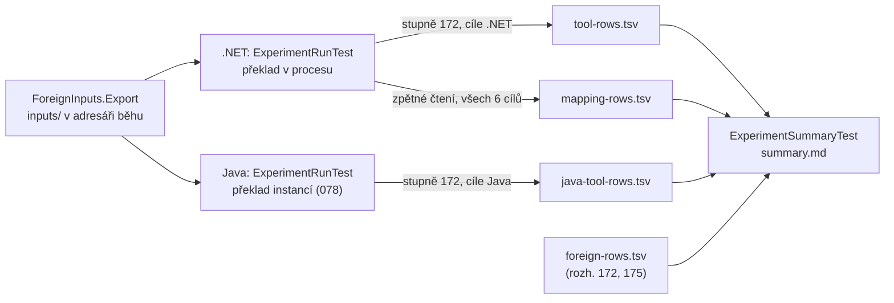

| Část | Kde | Co dělá |
|---|---|---|
| vstupy | `Experiment/ExperimentInput`, javový `experiment/ExperimentInput` | čtou složky výpisu (`input.json`) z `ORMCONVERTOR_EXPERIMENT_INPUTS`, výchozí `inputs/` pod `ORMCONVERTOR_EXPERIMENT_RESULTS`; .NET sada je vypíše, nejsou-li; `ORMCONVERTOR_EXPERIMENT_KINDS` omezí druhy, druh `fiben` vypadne bez databáze `Fiben` (javová půlka bez instance LDBC, FIBEN či případových studií tyto klíče také) |
| překlad | `ExperimentRun.Translate`, javový `judge` | katalog podle druhu: fixtura (`matrix`, `cross`, `ldbc`), `Fiben` (`fiben`), databáze případových studií (`example` výňatku, rozh. 176), žádný (ostatní `example`, rozh. 099); javová půlka volí instanci — `ORMCONVERTOR_API_URL`, `ORMCONVERTOR_LDBC_API_URL`, `ORMCONVERTOR_FIBEN_API_URL`, `ORMCONVERTOR_CASESTUDY_API_URL`; převod se záznamem `Failure` je řádek `refused` na stupni 0, jinak artefakt s jednotkami převodu, producent `tool`, metadata s verzemi (S6) a příznakem únikové cesty |
| stupně | `ForeignArtifactRun.Run`, javový `run` | tytéž jako u cizího artefaktu; řádky `tool-rows.tsv` a `java-tool-rows.tsv`, přepisované po každém stupni |
| úplnost mapování | `Experiment/MappingCompleteness`, řádky `mapping-rows.tsv` (jen .NET sada, všech šest cílů) | artefakt entit a mapování přečte parser cíle (`ParserFactory`, jednotky pod jazykem své role) zpět do mezireprezentace; fakta (`AbstractEntityBuilder.MappingFactsOf`, slovník knihy tvrzení §5.1) proti knize převodu: `expressible` = fakta knihy mimo `NotGenerated`, jejichž kategorii deskriptor cíle vyjádří; `carried` = z nich `Carried` (tvrzení nástroje); `readBack` = z nich přečtená s touž hodnotou (databázový typ podle rodiny, sloupce klíče a omezení jako množina) — míra; `invented` = fakta artefaktu mimo referenci (konvence cíle); `detail` jmenuje každý chybějící fakt s očekávanou a přečtenou hodnotou. Odchylky mezi knihou a parserem cíle nad scénářem drží jménem `MappingCompletenessTest` (`<id>` MyBatisu jako klíč, nullabilita klíče, `Auto` jako strategie profilu, databázový typ JPA z javového typu) |
| souhrn | `Experiment/ExperimentSummary`, `ExperimentSummaryTest` (poslední, až javová půlka dopíše) | `summary.md`: nad řádky nástroje po dvojicích ekosystémů, směrech, druhu vstupu × dvojici, kategorii T2 × dvojici (klíče matice) a kategorii katalogů × cíli; nad cizími řádky po producentovi, modelu a variantě z metadat (rozh. 175). Sloupce: `n`, `refused`, `native SQL`, `read`/`compiled`/`accepted` z `n`, `n4` = překlady klíčů se 4. stupněm (matice, FIBEN, případová studie) bez artefaktů bez dotazu, `ran` z `n4`, `agrees` z těch z `n4`, které mají měřítko ekvivalence (matice, FIBEN), `mapping` = součet `readBack` / součet `expressible` skupiny. Druh `case study` jsou příklady z `Examples.RealProjectKeys` |
| běh | `Experiment/ExperimentRunTest` (theory nad vstupy × cíle .NET; druhá nad vstupy × všech šest cílů pro mapování), javový `experiment/ExperimentRunTest` (`@Tag("integration")`) | bez `ORMCONVERTOR_EXPERIMENT_RESULTS` jeden případ přeskočí s důvodem; příkazy nese [README](../ORMConvertor/README.md#the-experiment-run), záznam běhu [`runs/`](./runs/README.md) |

- **Co běh soudí a co ne** — správnost ve čtyřech stupních a úplnost mapování; čas ne (běh FIBEN, rozh. 149) a verdikt nad celou sadou LDBC ne (soudce, rozh. 117). Žádný řádek neselže sadu; selhává jen cesta (vstup bez manifestu, klíč bez měřítka, nenastavená databáze druhu).
- **Protokol srovnání s LLM** (rozh. [175](./decisions/175-the-comparison-with-a-language-model-is-a-protocol-over-the-foreign-path.md)) stojí na témž výpisu a týchž řádcích: artefakt modelu jde cestou cizího artefaktu, tři pokusy na buňku při teplotě 0, varianty a ablace jako `metadata.variant`, povinná pole metadat podle T4; souhrn dává podíly po pokusech, best-of-n se čte ze řádků po klíči a cíli.

**Nárok** F7–F10, F12 a F13 stojí na stupních 2–4 javové sady a na maticích (§9, [`traceability.md`](./traceability.md)). Záznamy běhů s počty a commitem nese jen [`runs/`](./runs/README.md#velikost-sady-a-pokrytí) (rozh. [095](./decisions/095-a-dated-run-record-names-its-commit.md), [167](./decisions/167-records-of-runs-and-measurements-have-a-folder-of-their-own.md)).

### 6.3 Frontend

Statické soubory ve `wwwroot` bez frameworku, npm a buildu (rozh. [032](./decisions/032-frontend-as-static-pages-without-a-build.md)); podoba podle rozh. [137](./decisions/137-text-runs-the-full-width-and-controls-keep-a-fixed-width.md), které obrazovky dřívějších rozhodnutí převzalo celé.

| Stránka | K čemu | Rozh. |
|---|---|---|
| `index.html` | rozcestník | [033](./decisions/033-shape-of-the-static-frontend-screens.md), [137](./decisions/137-text-runs-the-full-width-and-controls-keep-a-fixed-width.md) |
| `translation.html` | oddíly bez čísel, na celou šířku okna: volitelný příklad — skupina *Inputs* (vzorek Customer každého frameworku z `/required-content` a `/samples`, nastaví zdroj i cíl na ten framework, jména jednotek z obsahu) a skupina popsaných příkladů (`/examples` podle `title`, nastaví jejich směr); obojí nahradí jednotky a dialekt nevysloví; směr jako řádek *zdroj → cíl* s prohozením a dialekt zdrojového SQL (nevysloveno se neposílá); jednotka = soubor v jednom jazyce z `/required-content`, jazyk podle přípony, jinak ho žádá validace; jednotky ze souborů, z archivu ZIP, prázdné nebo z příkladu; převod; výsledek se vstupem vedle výstupu (*from* / *went into* z `units`), pás *Facts* (`facts`, filtr po osudu; podtržení z `source`/`targets` plné a bez popisku, hledání hodnoty textem tečkované se slovem *text search* jen tam, kde pozice chybí — `facts.js` nad `marking.js`) a pás záznamů s větou ke každému druhu, sloupci *Unit*, *Query* a *Artifact* | [137](./decisions/137-text-runs-the-full-width-and-controls-keep-a-fixed-width.md), [136](./decisions/136-a-project-archive-is-unpacked-by-the-browser-with-own-code.md), [137](./decisions/137-text-runs-the-full-width-and-controls-keep-a-fixed-width.md), [088](./decisions/088-a-declared-foreign-source-dialect-is-not-read.md), [111](./decisions/111-a-unit-is-a-whole-source-file-that-declares-only-its-language.md), [066](./decisions/066-records-attributed-to-the-input-unit.md), [081](./decisions/081-a-unit-may-be-a-mapping-and-a-query-at-once.md), [099](./decisions/099-examples-are-content-not-a-choice.md) |
| `advisor.html` | všichni změření kandidáti (`measurements`) s poměrem k nejrychlejšímu; panely z `translations` — přesně změřený kód, bez katalogu | [059](./decisions/059-advisor-response-carries-the-measured-translations.md) |
| `examples.html` | na celou šířku okna; nejdřív výchozí vstup — vzorky šesti frameworků z `/required-content` a `/samples`, složené a bez převodu, s jedinou výhradou (Dapper a MyBatis klíč nemají, do NHibernate, Hibernate a EclipseLink ho dodá katalog; matici 6 × 6 hlídá `ApiContentContractTest`); pak živé příklady z `/examples`, po skupinách podle hranice, kterou překlad přechází, o dotazech, nad doménou tržiště ze čtyř zdrojů, dvě aplikace, z jejichž souborů nástroj vybere entity a dotazy, a *Real projects*, výňatky z `SampleData/ThirdParty` — výčet je `ORMConvertorAPI/Data/Examples.cs`; spodní hranici drží `ExampleCatalogTest`, licence a poznámky o původu výňatků `ThirdPartySourcesTest` | [099](./decisions/099-examples-are-content-not-a-choice.md), [137](./decisions/137-text-runs-the-full-width-and-controls-keep-a-fixed-width.md), [138](./decisions/138-code-of-open-source-projects-enters-as-a-marked-excerpt-under-its-own-permissive-licence.md) |
| `ldbc.html` | katalog z `/ldbc` se stavy, tabulkou dotaz × cíl (jazyk cíle, nativní SQL, odmítnutí; z katalogu, ne ručně) a převodem dotazu; oddíly o rekurzi (proč řetěz úrovní místo rekurzivního `WITH`) a o hloubce hledání (tabulka změřených vlastností grafů podle rozh. 141, které testy ji drží) jsou ruční text, stejně jako výčty dotazů | 110, [140](./decisions/140-ldbc-path-queries-as-breadth-first-search-in-non-recursive-definitions-with-the-depth-of-the-data.md), [141](./decisions/141-one-data-set-for-the-ldbc-catalog-and-the-depth-of-a-path-query-as-a-measured-property-of-it.md) |
| `fiben.html` | katalog z `/fiben` po Kimových typech: otázka a parafráze, čtené tabulky, text v T-SQL a text benchmarku, stav s poznámkou, převod dotazu s entitami jeho tabulek; tabulka dotaz × cíl, jejíž sloupec cíle vyplní tlačítko překladem všech dotazů přes běžící instanci (1. stupeň živě, ne z katalogu); oddíl o zanoření podle Kima (typy N, A, J, JA, jak nástroj zanořený dotaz čte: poddotaz jako operand podmínky kdekoli v jejím stromu, odvozená tabulka jako pojmenovaný mezivýsledek) a oddíl nejnovějšího doloženého běhu obou sad jsou ruční text, ten druhý podle záznamu běhu v [`runs/`](./runs/README.md) | 149, [161](./decisions/161-a-window-aggregate-is-a-window-of-the-vocabulary-and-the-whole-row-of-a-definition-beside-columns-is-its-columns.md), [162](./decisions/162-a-subquery-stands-in-a-join-condition-as-in-any-condition.md) |

- **Servírování** — `UseDefaultFiles` před `UseRouting`, `MapStaticAssets` s `.br`/`.gz` z manifestu sestavení: **nový soubor se servíruje až po sestavení**. Adresy jsou relativní, `/orm` nenese žádný soubor.
- **Kód** — tvar API zná jen `js/api.js`; stav je obyčejný objekt, oblasti z `<template>`. Pico CSS a highlight.js (C#, Java, XML, SQL; HQL a JPQL gramatikou SQL) leží ve `wwwroot/vendor/` s licencí a verzí; instance běží bez sítě.
- **Vstup** — rozpracovaný stav v `localStorage` (rozh. [056](./decisions/056-work-in-progress-input-stays-in-the-browser.md)); selhání úložiště chybou není.
- **Archiv** — ZIP rozbalí vlastní `js/zip.js` (rozh. [136](./decisions/136-a-project-archive-is-unpacked-by-the-browser-with-own-code.md)): centrální adresář přes řezy `Blob`, *stored* a deflate přes `DecompressionStream`, ZIP64. Jednotkou je soubor v jazyce, který zdroj čte, se jménem podle cesty v archivu; ostatní soubory i nečitelný archiv vypíše s důvodem sbalený seznam nad okny, který se neukládá.
- **Editor jednotky** — `<textarea>` bez zalamování se sloupcem čísel řádků (`attachLineNumbers` v `ui.js`, i v Advisoru; rozh. [126](./decisions/126-line-numbers-in-the-unit-editor-by-own-code-not-an-editor-library.md)). Věta s pozicí — z validace XML před odesláním, nebo ze záznamu připsaného jednotce s „at line *L*, column *C*" (rozh. 093) — se ukáže pod jednotkou, označí řádek ve sloupci a tlačítkem *go to line* ho vybere; pozici čte klient z věty (`positionIn`), žádné pole záznamu ji nenese.
- **Výstup** — *Copy* a *Download* u panelu, ZIP balí server (`/archive`); párování jednotka ↔ artefakt je výrok serveru (`entity`, `units`); odkaz *Artifact* v pásu záznamů jde přes `entity` artefaktu, u panelu bez něj (vstupní jednotka) přes jméno odvozené z obsahu — zobrazovací heuristika (rozh. 033). Podtržení faktu stojí na pozici, kterou vyslovil server (`source`, `targets`); hledání hodnoty textem jen tam, kde pozice chybí, a stránka to u podtržení řekne (rozh. [137](./decisions/137-text-runs-the-full-width-and-controls-keep-a-fixed-width.md)). Server počítá pozice v textu, jak přišel a odešel, včetně CR LF; panel ukazuje text s LF (`renderCode`, zvýrazňovač píše přes `innerHTML`), a `windowOffsets` v `marking.js` pozici na ten znak přepočte.
- **Rozvržení** — mřížky `minmax(0, …)`, řádky `flex` se zalomením; dva sloupce dotazem na kontejner (`.panes`, `.compare-frame` — dotaz se ptá předka, nikdy prvku, který kontejner deklaruje); výška kódového panelu z výšky okna (`max(16rem, 75vh)`) a `body.wide` bez stropu šířky Pico u překladu a výkladové stránky, takže oddálení ukáže víc kódu; text bez omezení délky řádku; výběr a pole v `main` s pevnou šířkou vlevo z tokenů `--app-control-width` (24 rem), `-short` (12 rem: framework, číslo) a `-long` (40 rem: příklad, jméno souboru), na úzkém displeji ustoupí; `<summary>` široký jako jeho text, šipka u popisku; diagram potrubí nejvýš 60 rem (rozh. [137](./decisions/137-text-runs-the-full-width-and-controls-keep-a-fixed-width.md)); motiv přes `data-theme`.
- **Testy** — žádné automatické (rozh. 032); kontrakt hlídá server, rozhraní projití scénáře S7.

### 6.5 Rozhraní REST a dokument OpenAPI

Jedenáct bodů v `ORMConvertorAPI/Endpoints.cs` pod `/orm` (tvar v [README](../ORMConvertor/README.md)).

| Metoda a cesta | K čemu | Odpověď |
|---|---|---|
| `POST /convert` | překlad celou pipeline (§5); nepovinné `declaredSourceDialect` (rozh. 088) | `ConvertResponse`: artefakty (s `entity` a `units`, rozh. [137](./decisions/137-text-runs-the-full-width-and-controls-keep-a-fixed-width.md)), záznamy, kniha tvrzení `facts` (§5.1), záznam běhu (S6) s `targetDatabaseDialect` (rozh. [086](./decisions/086-target-database-dialect-declared-by-the-descriptor.md)) a `maxNestingDepth` (rozh. [092](./decisions/092-input-nesting-depth-capped-before-the-descent.md); určuje instance, v požadavku být nesmí); 400 |
| `GET /required-content`, `/required-content-advisor` | jazyky, které zdroj čte (rozh. [025](./decisions/025-query-language-as-content-type.md), 111) | definice; u Advisoru `required` a `queries` |
| `GET /samples`, `/samples-advisor` | ukázka ke každé jednotce (`ApiContentContractTest`) | slovník podle klíče jednotky |
| `GET /examples` | příklady jako celé vstupy převodu; `title` je jméno, podle kterého je vybírá překladová obrazovka | `List<ExampleDefinition>` |
| `GET /ldbc` | katalog LDBC | `LdbcCatalogDefinition` (výčty jako čísla, `refusedBy`, `fallbackBy`, `validation` s `ordered` a `orderingKey`) |
| `GET /fiben` | katalog FIBEN (rozh. 149); odtud ho bere i javová sada | `FibenCatalogDefinition` (`dataSet`, entity, dotazy s `questions`, `tables`, `columns`, `ordered`, `orderingKey`, `sql`, `benchmarkSql`, výčty jako čísla) |
| `POST /archive` | ZIP pojmenovaných dvojic, nepřekládá (rozh. [033](./decisions/033-shape-of-the-static-frontend-screens.md)) | `application/zip`; 400 |
| `POST /advisor/run`, `/advisor-test` | Advisor (§8), vyňatý ze záruk | `AdvisorRunResult`, `AdvisorSolveResponse`; 400 |

- **Typ obsahu** na vstupu říká jen jazyk: `CSharp` (90), `Java` (100); hodnoty s rolí (`CSharpEntity`, `JavaQuery`, …) nese jen artefakt.
- **Selhání** je `ProblemDetails` (RFC 9457, rozh. [044](./decisions/044-error-response-as-problem-details.md)): `application/problem+json`, 400, zpráva výjimky v `detail` (hrozba 4, [`threat-model.md`](./threat-model.md)), začerněná singletonem `CredentialRedaction` z `ConnectionStrings:*` instance (rozh. [160](./decisions/160-credentials-are-in-no-generated-source-and-no-text-about-a-run-and-progress-has-the-grain-of-the-processing.md)). Vadné či chybějící tělo dostane prázdnou 400 z rámce.
- **Log** jde jen do konzole (v kontejneru `docker logs`): `Program` odstraní výchozí poskytovatele a konzole píše přes `RedactingConsoleFormatter`, který každý řádek — zprávu, text i zásobník výjimky — pustí přes týž `CredentialRedaction` (rozh. 160). Rozvržení řádku je to výchozího jednoduchého formátovače. Drží `Tests/Api/CredentialsLeaveNoTextTest`.
- **Dokument OpenAPI** generuje `Microsoft.AspNetCore.OpenApi` ve všech prostředích na `/orm/openapi/v1.json` (rozh. [098](./decisions/098-the-number-is-decided-once-per-release.md)), s verzí `ToolRelease.Version`. Swagger UI jen v `Development`, nad týmž dokumentem s cestou `../openapi/v1.json` ([README](../ORMConvertor/README.md#deploying-a-real-instance)). Hlídá ho `Tests/Api/OpenApiDocumentTest`: mimo `Development`, verze sestavení, vypsaný seznam cest, server pod `/orm`.
- **`ORMConvertorAPI/openapi.json`** je odvozený čtecí snímek stažený z běžící instance; autoritativní je běžící dokument a `servers[0].url` se liší vždy, proto není očekávanou odpovědí testu.
- **Kontrakt přes HTTP** (rozh. [043](./decisions/043-rest-contract-guarded-over-http.md), `Tests/Api/`, `WebApplicationFactory`) v `Production` s prázdným katalogem (`CatalogState = NotConfigured`): JSON pod `/orm`, výčty jako čísla, 400 / 415, vstup bez výstupu 200 se záznamy (rozh. [045](./decisions/045-a-conversion-that-produced-nothing-says-so.md)), `unit` a `query` u záznamu, artefakt po drátě bajtově týž jako z `ConversionHandler`. Netvrdí Advisor ani frontend.

## 7. Rozhraní parserů a builderů

| Rozhraní | Člen | Smysl |
|---|---|---|
| `IParser` | `CanParse(ConversionContentType)` | umí parser tento vstupní formát |
| `IEntityParser` | `IReadOnlyCollection<EntityMap> Parse(string source)` | plní model voláními na `AbstractEntityBuilder`; vrací mapy, které jednotka založila nebo obohatila, prázdná = nic nevzešlo (rozh. [066](./decisions/066-records-attributed-to-the-input-unit.md)) |
| `IQueryParser` | `IReadOnlyCollection<AbstractQueryBuilder> Parse(contentType, source, entityMaps?)` | jazyk deklaruje jednotka (rozh. [047](./decisions/047-content-type-reaches-the-query-parser.md)); jeden builder na dotaz, prázdná není chyba (rozh. [081](./decisions/081-a-unit-may-be-a-mapping-and-a-query-at-once.md)) |

Dotazový parser builder nevyrábí: dostává `Func<AbstractQueryBuilder>` od orchestrace, která nastaví `EntityMaps` (S1). Orchestrace vybírá entitní parsery přes `OfType<IEntityParser>`.

#### Entitní builder

**Naplnění** (veřejné, framework-nezávislé metody `AbstractEntityBuilder`):

| Metoda | Chování |
|---|---|
| `BeginEntity` / `DeclareEntity` | další entita (mapovací parsery) / najdi-nebo-založ podle jmenného prostoru, názvu a obalující třídy (rozh. [094](./decisions/094-entity-identity-inside-a-conversion.md)) |
| `AddNamespace`, `AddClassHeader`, `AddSchema`, `AddTable` | hlavička entity |
| `AddProperty`, `SetPropertyDatabaseMapping` | najdi-nebo-založ, jen prázdný fakt (rozh. [017](./decisions/017-source-precedence-for-mapping-facts.md)); neznámý klíč → `Loss` |
| `MarkTransient` | nepersistovanost; proti namapované vlastnosti `Conflict` |
| `AddPrimaryKey` | trojice `(PropertyName, Order, Strategy)` nebo zkratka; další volání porovná (rozh. [036](./decisions/036-primary-key-under-source-precedence.md)), odlišné → `Conflict` |
| `AddEmbeddedPrimaryKey` | `@EmbeddedId`, odložená registrace (§4.2) |
| `SetKeyStrategyDetails` | název strategie a parametry generátoru části klíče |
| `SetCollectionKind` | druh kolekce, jen prázdný fakt |
| `AddForeignKey` | registrace vztahu, povýší typ navigace; sloupce zdroje páruje fáze rozresolvování (§4.3) |
| `AddRelation` | najdi-nebo-přidej podle navigace, vrací vztah |
| `AddStatedBaseType`, `AddStatedReferencedColumns` | tvrzení bez místa v modelu, která lze posoudit až nad celou sadou entit (bázový typ, sloupce odkazované cizím klíčem); `Build()` je rozsoudí a vydá `Loss` (rozh. [048](./decisions/048-a-fact-with-no-place-in-the-model-is-a-loss.md), §5) |

**Generování** je šablonová metoda `Build()`:

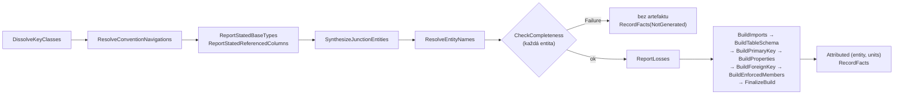

- Brána `CheckCompleteness` odmítne entitu bez vyžadované kategorie, entitu jmenovanou jen mapováním bez deklarované třídy (rozh. 132), entitu s vlastností bez jazykového typu, s klíčem i jeho popřením nebo s nepersistovanou částí klíče.
- Sedm kroků je `protected abstract (EntityMap, EntityArtifact)`; `FinalizeBuild` vrací výstupy. `EntityArtifact` drží `Code`, `Mapping` a `ClassOpened`; NHibernate plní oba.
- Výstupy `FinalizeBuild` opouštějí `Build()` kopií s `Entity` a `Units`; kniha tvrzení (§5.1) se píše po emisi entity, aby ztráta nahlášená při emisi platila jako `Dropped` (rozh. 124). `AttributeFacts(read, unit)` volá jen orchestrace po každém `Parse`.
- Klíč se píše před vlastnostmi, v pořadí klíče. Prázdné kroky: Dapper `BuildPrimaryKey`, `BuildForeignKey`, `BuildEnforcedMembers`; EF Core `BuildEnforcedMembers`; MyBatis `BuildEnforcedMembers` (vynucený člen je negativní — žádný konstruktor).

#### Dotazový builder

**Naplnění** je fluentní: `From`, `Project`, `Where(ConditionNode)`, `Join(JoinKind, left, right, ConditionNode, alias?)`, `GroupBy`, `OrderBy`, `Having`, `Paginate`, `Distinct`, `SetOperation`, `Push()`/`Pop()` (`Pop()` obalí rozsah do `SubQueryInstruction`) a `PopOperand()` pro poddotaz v operandu (rozh. [061](./decisions/061-subquery-as-a-condition-operand.md)). `SetOperation` bere za levý operand poslední uzavřený poddotaz nebo operaci a dokončí ji `Pop` na zapamatované hloubce. `Define(name, body)` zapisuje mezivýsledek mimo zásobník (rozh. [112](./decisions/112-a-query-as-a-row-source-is-a-named-intermediate-result.md)). Virtuální `MethodArtifact` (`CSharpQuery`/`JavaQuery`), `MethodName` a `QueryName`.

**Generování** je šablonová metoda (rozh. [023](./decisions/023-query-builder-template-method.md)):

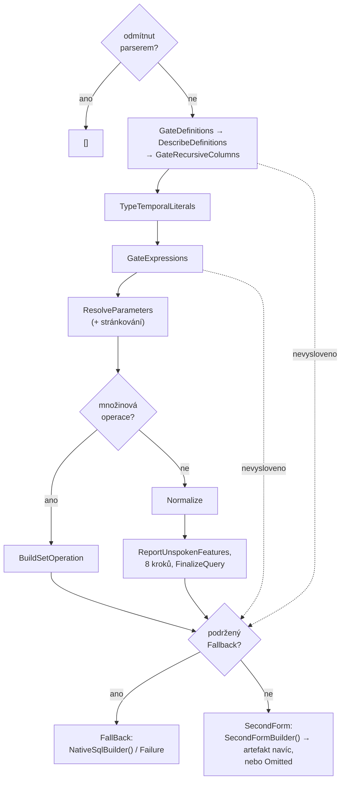

| Krok | Drží | Záznam |
|---|---|---|
| `GateDefinitions` | jméno jedno na dotaz, žádný dopředný ani laterální odkaz, pojmenované sloupce; rekurzivní definice podle rekurzivního `WITH` SQL Serveru; cíl bez mezivýsledku či rekurze ukončí pokus; limit bez rekurze → `Convention` | `Failure` `IntermediateResult` |
| `GateRecursiveColumns` | sloupce rekurzivního členu proti kotvě (počet, skalár); `COUNT` je `Long`, takže odmítne i člen, který by SQL Server přijal | `Failure` `IntermediateResult` |
| `TypeTemporalLiterals` | řetězec ISO 8601 u časového sloupce či poddotazu → časový skalár | `Failure` `Filtering` |
| `ReadFixedWidthAsTheSource` | projekce hodnot pevné šířky, jak je dostal program zdroje (rozh. [169](./decisions/169-a-fixed-width-value-is-the-value-sql-returns-in-every-target.md), odstavec *Sloupec pevné šířky*) | `Convention` `Projection`; pod `DISTINCT` s řazením podle téže projekce `Loss` |
| `GateExpressions` | skalár výrazů (`ExpressionTyping`, rozh. [107](./decisions/107-an-expression-is-the-sixth-operand-shape-and-stands-wherever-an-operand-stands.md)); `+` bez typované strany, nesjednotitelné strany, agregát nad agregátem, okenní funkce mimo projekci; funkce, kterou deskriptor cíle neuvádí v `Functions`, a okenní funkce, agregace do seznamu či klíč-výraz, které cíl nevysloví, ukončí pokus (`ReportUnspoken`) | `Failure` `Expression` (`WindowFunction`, `ListAggregation`); nevyslovené → `Fallback`, bez `NativeSqlApi` `Failure` |
| `ResolveParameters` | skalár z druhé strany porovnání, vazba jen přes uvedené mapování (`EntityFor`) | `Failure` `QueryParameter`: skalár neodvozen, dva skaláry jednoho názvu, pojmenovaný s pozičním, seznam i hodnota, jméno není identifikátor |
| `Normalize` | `QueryClauses`, Q2, Q4, Q8, pravidlo seskupení (`GroupingRuleHolds`), `DISTINCT`, vykreslitelnost stromů (rozh. [053](./decisions/053-a-query-that-would-return-other-rows-is-not-emitted.md)) | `Failure` |

**Parametry** (rozh. [083](./decisions/083-parameter-as-the-fifth-operand-shape.md)) se řeší jednou nad celým tělem, takže signatura nezávisí na pořadí skládání (S2). Skalár dává sloupec, `COUNT` (`Long`), vzorek `Like` (`String`), konstanta i jediná projekce poddotazu, v nenulovatelném tvaru; uvedený skalár (MyBatis) má přednost, rozdíl je `Conflict`. Výsledkem je `Parameters` v pořadí prvního výskytu. Stránkování (rozh. [085](./decisions/085-a-row-count-is-a-number-or-a-parameter.md)): skalár `Int`, offset před limitem; širší celočíselný uvedený skalár je `Loss`, neceločíselný `Failure`. Název jen pro počet řádků jde do `BoundParameters` (`WritesRowCountsIntoQueryText`).

**`CatalogDemand()`** (rozh. [105](./decisions/105-a-query-formulates-its-own-demand-on-the-catalog.md)) vrací `QueryTableDemand` tabulek, ze kterých se typuje parametr a které mapování neváže (§5.2).

**Brány před kroky** (`BuildArtifacts`): rozpis celého řádku definice vedle sloupců na její sloupce (`ExpandWholeRowsOfDefinitions`, rozh. 161), definice (`GateDefinitions`, `DescribeDefinitions`, `GateRecursiveColumns`), vlastník holého sloupce (`QualifyColumns`, §5), typování temporálních literálů, projekce hodnot pevné šířky (`ReadFixedWidthAsTheSource`, odstavec níže), výrazy (`GateExpressions`), parametry (`ResolveParameters`); `Normalize` pak v každém rozsahu drží pravidla seznamu `SELECT` (`GateSelectList`: celý řádek jediné proměnné = bez projekce, celý řádek vedle sloupců `Loss`, u cíle s `WritesColumnsAsMembers` holý sloupec nad joinem a oddělený alias bez identifikátoru `Fallback`) a pravidla Q2, Q4, Q8, seskupení, `DISTINCT` a bezejmenného výrazu. **Kroky** běží v pořadí relačního vyhodnocení: `BuildSource → BuildJoins → BuildFilter → BuildGrouping → BuildPostFilter → BuildOrdering → BuildProjection → BuildPagination`. Každý píše do přihrádky `QueryArtifact` a `FinalizeQuery` je skládá v pořadí cíle; přihrádka stránkování může nést volání API (NHibernate `SetFirstResult`/`SetMaxResults`). `DISTINCT` píše `BuildProjection`. Výchozí `BuildSetOperation` hlásí nevyslovenou konstrukci; cíle s množinovými operacemi ho přepisují.

**Sloupec pevné šířky** (rozh. [169](./decisions/169-a-fixed-width-value-is-the-value-sql-returns-in-every-target.md)): hodnotou čtení je hodnota SQL, doplněná mezerami na šířku. `ReadFixedWidthAsTheSource` přepíše nejvnější seznam výběru a seznamy členů množinové operace na nejvyšší úrovni, nic jiného (poddotaz, definice, podmínka i klíč zůstávají). Cíl s `TrimsFixedWidthOnRead` (EclipseLink) dostane sloupec typu `Char`, `MIN`/`MAX` nad ním a `COALESCE`/`CASE` s takovou hodnotou, kde vlastnost nenese `TrimmedOnRead`, jako `Concat(x, '')`; cíl bez něj dostane sloupec a `MIN`/`MAX` nad vlastností s `TrimmedOnRead` jako `TrimEnd(x)`. Alias zůstává, holý sloupec bez aliasu dostane jméno sloupce, u `WritesColumnsAsMembers` jméno vlastnosti; agregát bez aliasu projde bránou bezejmenného výrazu (`namelessReads`). Pod `DISTINCT`, kde se podle téže projekce řadí, se nepřepisuje (`Loss`). Drží `Combined/FixedWidthReadTest`; co frameworky s hodnotou dělají, drží `eclipselink/CharTrimmingClaimsTest`, `hibernate/TrimmedFixedWidthClaimsTest`, `EFCore/EFCoreTrimEndProviderTest`, `NHibernate/NHibernateLinqProviderTest` a `NHibernate/NHibernateHqlProviderTest`. Entitní stranu píše `AbstractJpaEntityBuilder` (§5, JPA); cíl, jehož entitní artefakt ořez nevysloví (`StatesFixedWidthReads` false: EF Core, NHibernate, Dapper, MyBatis), dostane od `AbstractEntityBuilder.ReportTrimmedReads` `Loss` za každou vlastnost s `TrimmedOnRead` nad sloupcem `Char`.

**Úniková cesta** (rozh. [113](./decisions/113-native-sql-as-the-escape-path-and-the-vocabulary-ldbc-needs.md)): `ReportUnspoken(reason, feature)` podrží záznam `Fallback`. `FallBack` bez `Descriptor.NativeSqlApi` vydá `Failure`; jinak zahodí záznamy pokusu a postaví `NativeSqlBuilder()` (přepisují `EFCoreLinqQueryBuilder`, `NHibernateHqlQueryBuilder`, `AbstractJpaQueryBuilder`), potomka `AbstractSqlQueryBuilder`, a předá mu instrukce, definice, mapy a jméno dotazu pod `writesNativeSql`. Samostatné `BuildSQL()` neexistuje (rozh. [022](./decisions/022-native-query-syntax-in-builders.md)).

**Druhý tvar** (rozh. [118](./decisions/118-nhibernate-writes-a-linq-form-beside-its-hql.md)): po úspěšném pokusu ve vlastním jazyce postaví `Build()` `SecondFormBuilder()` (přepisuje `NHibernateHqlQueryBuilder` → `NHibernateLinqQueryBuilder`), předá mu týž stav pod `writesSecondForm` a projde ho `BuildArtifacts()`: artefakty přidá k závazným a jeho záznamy připojí bez těch, které opakují záznam závazného tvaru; podržené `Fallback` a `Failure` druhého tvaru přepíše na `Omitted` („… so the query has no LINQ form and the HQL form stands alone") a artefakt nevydá. `FormName` („HQL", „LINQ") jmenuje tvary v záznamu. Druhý tvar sám neustupuje do nativního SQL ani nemá druhý tvar.

`IQueryVisitor` nemá `Visit(SubQueryInstruction)`: poddotaz vykresluje builder přes delegáta.

#### Přidání nového frameworku

Nový framework je nový projekt wrapperu (S1; u javového frameworku podle rozh. [076](./decisions/076-java-wrappers-in-csharp-jvm-in-containers.md)); nic v `AbstractWrappers`, orchestraci ani ostatních wrapperech se nemění. Potřeba, která se do sedmi kroků a deskriptoru nevejde, je změna `AbstractWrappers`, tedy rozhodnutí — háček, nebo rozdělení báze — nad potřebou toho frameworku; dopředu se entitní báze nerozděluje a její velikost se nehlídá (rozh. [153](./decisions/153-the-shared-entity-base-is-neither-split-nor-watched.md)).

| Krok | Co | Povinné |
|---|---|---|
| 1 | projekt `XyzWrappers`, přidaný do `.sln` a do seznamu `.csproj` ve stage `dotnet-build` Dockerfile | ano |
| 2 | `XyzDescriptor : TargetFrameworkDescriptor` — verze (rozh. 013), dialekt (086), `SupportOf` každé kategorie `MappingFactCategory` a `QueryFeature`, `NativeSqlApi` má-li framework API pro nativní SQL (113), `TrimsFixedWidthOnRead` ořezává-li hodnotu pevné šířky (169) | ano |
| 3 | entitní parser: `IEntityParser` nad jazykovou vrstvou (`CSharpEntityParsing`, `JavaEntityParsing`, `JakartaPersistence`) nebo vlastní; píše jen přes veřejné metody `AbstractEntityBuilder` (§7) a vrací mapy, které jednotka založila či obohatila (066) | ano |
| 4 | entitní builder: potomek `AbstractEntityBuilder` se sedmi kroky; krok, pro který framework nic nepíše, je prázdné přepsání | ano |
| 5 | dotazový parser a builder (`IQueryParser`, `AbstractQueryBuilder`), chce-li framework dotazy; bez nich orchestrace dotazové jednotky odmítne záznamem (081) | ne |
| 6 | registrace ve `Factories/` (`ParserFactory`, `EntityBuilderFactory`, `QueryBuilderFactory`, `DescriptorFactory`), hodnota `ORMEnum`, ukázky v `SampleData`, řádek v `/required-content`; frontend čte slovník ze serveru, jen `api.js` doplní popisek | ano |
| 7 | testy: entitní a dotazové testy ve složce frameworku, řádek v `CrossFrameworkInputs` (matice), u javového frameworku i `JavaTests` (076) | ano |
| 8 | **pozice tvrzení** (rozh. [137](./decisions/137-text-runs-the-full-width-and-controls-keep-a-fixed-width.md)): v parseru `using (entityBuilder.At(range, upřesnění…))` kolem čtení prvku či anotace — sdílená jazyková vrstva to dělá sama; v builderu `artifact.Mark(buffer, kategorie, vlastnost, zapsanýText)` u řádku, který fakt píše, nebo jedno `MarkXml` nad hotovým XML, a `MarkRest` deklarace členu pro zbytek | **ne** — bez nich je kniha tvrzení úplná, obrazovka hledá hodnotu textem a říká to; `FactPositionTest` pak dostane framework do výjimky, nebo do matice až s pozicemi |

Co framework dostane zadarmo: záznamy úplnosti a ztrát z deskriptoru (010), atribuci jednotek a knihu tvrzení (066, 124), doplnění z katalogu (015), původ artefaktu.

## 8. Advisor – implementační detaily

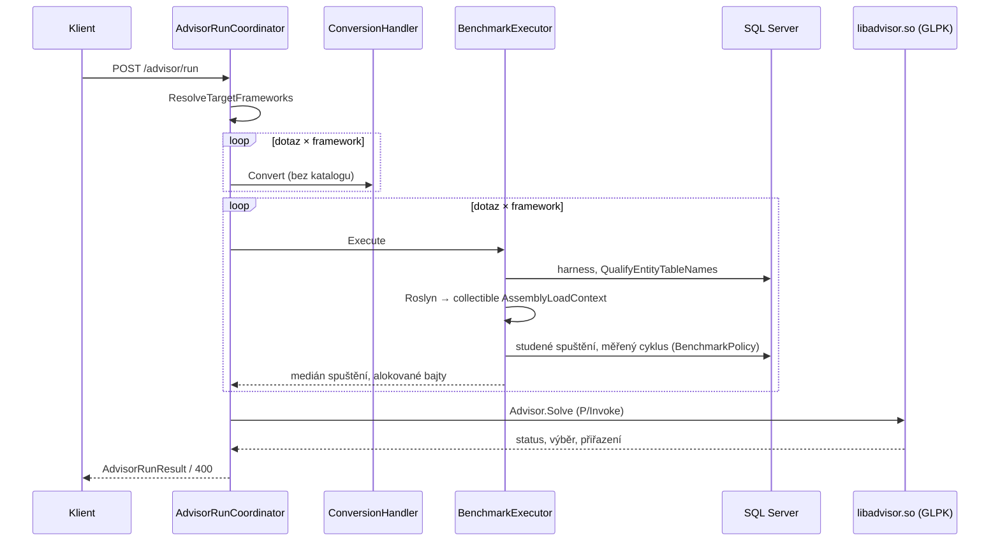

**ILP model** (`Advisor/ilp.c`, přímo GLPK C API): binární $x_{q,f}$ (dotaz $q$ na framework $f$) a $y_f$ (výběr).

- účel: $\min \sum_{q,f} z_q \, c_{q,f} \, x_{q,f}$, kde $c$ je medián doby jednoho spuštění (ms) a $z_q$ váha dotazu (nejméně 1);
- (1) $\sum_f y_f \le N$; (2) $\sum_f x_{q,f} = 1$; (3) $x_{q,f} \le y_f$; (4) $\sum_{q,f} m_{q,f} \, x_{q,f} \le MEM$ (alokace v bajtech).

Řeší `glp_intopt()` s presolverem. `[LibraryImport("libadvisor.so")]` znamená, že knihovna vzniká jen v Docker stage `advisor-native` (gcc + `libglpk-dev`); verze pro Windows není (rozh. [076](./decisions/076-java-wrappers-in-csharp-jvm-in-containers.md)).

| Koncový bod | Co dělá | Neúspěch |
|---|---|---|
| `POST /advisor/run` | přeloží, zkompiluje, změří, řeší ILP | status ≠ 0 → 400 `ProblemDetails` „Advisor solver failed with status code {status}." |
| `POST /advisor-test` | volá ILP přímo (`Memory`, `Cost`, `Z`, `MEM`, `N`, `Q`, `F`); diagnostika, nic ho nevolá | 200 se `status`, výstupní pole nepřepsaná (nuly) |

Bez `libadvisor.so` oba vracejí hlášku z P/Invoke.

**Běh:**

- Měří jen Dapper a EF Core (`SupportedFrameworks`); NHibernate z `KnownFrameworks` vypadne bez záznamu i na výslovné vyžádání. Javová větev podle rozh. [146](./decisions/146-the-java-branch-measures-with-the-same-loop-in-its-own-container-and-an-execution-has-one-time-limit.md) — služba `advisor_java` vedle aplikace, táž smyčka s hodnotami politiky z požadavku, nová jednotka práce na spuštění — zatím nestojí (položka v `open-items.md`).
- Překlad (`BuildTranslations`) běží bez katalogu, stav `NotConfigured`. Měření vyžaduje `ConnectionStrings:AdvisorDatabase` a drží jeden `CachingCatalogReader` na běh.
- **Iterační politika** (rozh. [145](./decisions/145-the-measurement-environment-and-the-iteration-policy-are-fixed.md) a [165](./decisions/165-a-cell-warms-up-by-one-cold-execution.md), hodnoty jen v `BenchmarkPolicy`, odpověď je vrací jako `policy`): `BenchmarkExecutor` vynechá jedno studené spuštění (`WarmupIterations`); měří, dokud úhrn nedosáhne 1 000 ms a nejméně třikrát. Běh FIBEN má za studené spuštění buňky čtení, které dalo její řádky. Buňka nese `MedianDurationMilliseconds` (cena ILP), `AllocatedBytes` (průměr na spuštění), `WarmupIterations`, `Iterations`. Běh jde po dotazech, v dotazu přes frameworky. Jedno spuštění má mez `ExecutionTimeoutSeconds` (rozh. [146](./decisions/146-the-java-branch-measures-with-the-same-loop-in-its-own-container-and-an-execution-has-one-time-limit.md)): `BenchmarkExecutor` ji vloží do připojovacího řetězce (`BenchmarkHarnessBuilder.WithExecutionTimeout`) jako `Command Timeout`, výchozí mez každého příkazu nad tím spojením; táž hodnota je mezí soudce LDBC (§6.2). Jedním spuštěním je čtení bez stavu jednotky práce z předchozího: Dapper nad otevřeným spojením, EF Core nad jedním `DbContext` s `NoTracking`; továrna a spojení vznikají v `Setup` mimo měření.
- **Harness bez přihlašovacích údajů** (rozh. [160](./decisions/160-credentials-are-in-no-generated-source-and-no-text-about-a-run-and-progress-has-the-grain-of-the-processing.md)): `BenchmarkHarnessBuilder.Build` řetězec nedostává; harness ho bere za běhu v `Setup(string connectionString)`, takže ho nenese zdroj ani sestavení. Drží `Combined/HarnessCarriesNoCredentialsTest` nad překladem ukázky Advisoru do Dapperu i EF Core, bez databáze i nativní knihovny — jediný test oblasti 1, protože druhá věta S4 v ní platí (§9).
- **Měřicí prostředí** (rozh. [145](./decisions/145-the-measurement-environment-and-the-iteration-policy-are-fixed.md)): obraz databáze nastaví při každém startu `max server memory (MB)` 4096 a `max degree of parallelism` 1; compose dává databázím procesory 0–1 a klientům 2–3 (`cpuset`); hostitel dává virtuálnímu stroji pevné čtyři procesory a 8 GB bez swapu. Krátký dotaz se neprodlužuje, opakuje se do meze. Turbo procesoru hostitele je mimo nástroj a může časy ovlivnit; záznam měření říká, zda bylo vypnuté.
- **Dva režimy serveru** (rozh. [164](./decisions/164-the-database-server-has-a-measurement-mode-and-a-judge-mode-switched-by-one-file.md)): měřicí režim výše je výchozí obrazu i compose; `init-db.sh` bere hodnoty z `DATABASE_MAXDOP` a `DATABASE_MAX_SERVER_MEMORY_MB`, compose procesory databází z `DATABASE_CPUSET` (prázdné = všechny procesory VM). Režim soudce je `ORMConvertor/judge.env` — všechny procesory VM, `MAXDOP` 1 pro souběžná čtení soudce (rozh. [166](./decisions/166-the-judge-reads-a-segment-between-inserts-in-every-framework-at-once.md)), paměť 4096 MB — předaný `--env-file`; v něm běží soudce LDBC (§6.2), s turbem. Měří se jen v měřicím režimu: Advisor, záznamy časů katalogu a běh FIBEN, který měření mimo něj sám vynechá (§6.2). Přepnutí je nové vytvoření kontejneru; v režimu soudce nese soubor každý příkaz compose nad systémem, jinak compose databázi vrátí do měřicího režimu.
- Odpověď nese výběr, přiřazení, měření a `translations`, tedy změřené artefakty (rozh. [059](./decisions/059-advisor-response-carries-the-measured-translations.md)).
- Paměťový strop `MaxMemoryBytes <= 0` znamená `long.MaxValue`.

**Známá omezení:**

- Parametrizovaný dotaz se nezměří: `EFCoreBenchmarkHarnessBuilder` hledá metodu s jediným parametrem `DbContext` („EF Core query method not found").
- Z jednotky s více dotazy se změří jediný (Dapper první `SqlQuery`, EF Core první metoda).
- Neřešitelná úloha (strop `MEM` pod nejúspornějším přiřazením, `N = 0`) i porucha GLPK vracejí `ilp_solve` = −1, kód GLPK se ztrácí. Obrazovka drží `N` ≥ 1, `/advisor-test` meze nekontroluje. Hláška `No feasible solution found.` se hned vyprázdní (`fflush(stdout)`), takže v `docker compose logs` stojí včas vedle logu GLPK `PROBLEM HAS NO PRIMAL FEASIBLE SOLUTION`.
- Celý Advisor je vyňatý ze záruk (§9, oblast 1); jeho funkci žádný test nedrží.

## 9. Co tahle verze nárokuje a co je vyňaté ze záruk

**Kanonické znění nároku je sekce *Guarantees* kořenového [`README.md`](../README.md)**; tady je totéž česky s odkazy na důvody a na rozpor platí README. Důkazy vede [`traceability.md`](./traceability.md), konstrukce [`subset.md`](./subset.md), zbývající práci [`open-items.md`](./open-items.md), výchozí stav [`baseline.md`](./baseline.md). Hranici stanovilo rozh. [030](./decisions/030-scope-of-version-1-0.md) a posunulo [039](./decisions/039-container-configuration-of-the-environment.md).

**Verze.** Číslo nese jen `Directory.Build.props` (rozh. [034](./decisions/034-central-version-management.md)), význam mu dává rozh. [098](./decisions/098-the-number-is-decided-once-per-release.md) (nahradilo [069](./decisions/069-major-marks-a-milestone-not-a-break.md)). Nárok popisuje `main`; vydání ho zmrazí s číslem, změny po vydání se sem zapisují hned. Poslední vydání je **`2.2.0`**, příští MAJOR **`3.0.0`** patří Advisoru nad všemi frameworky a experimentům (F15, T1–T7). Co vydání změnilo, nese anotace značky (`git tag -n99`).

### Co verze nárokuje

**Překlad dotazů je hotový v rozsahu katalogu** (F7–F10, F13): žádný dotazový parser nevynechá konstrukci, kterou zná, beze slova; každá konstrukce slovníku je vymezená rozhodnutím — nese se ve všech směrech, nebo je její odmítnutí, ztráta či zápis nativním SQL rozhodnuté a zapsané, ne zděděné z toho, že na ni nedošlo; podmnožina i se všemi případy bez úplného nebo jednoznačného překladu stojí celá v [`subset.md`](./subset.md).

| Požadavek | Stav | Co přesně se tvrdí | Zúžení |
|---|---|---|---|
| F1–F6 | nárokované | komplexní identifikátory v IR i ve frameworcích, cizí klíče na složené klíče, čtení katalogu, slučování zdrojů, úplné mapování z neúplného vstupu holého Dapperu či MyBatisu (doplňkový balíček nad frameworkem — Dapper.Contrib, MyBatis-Plus — se nečte, co z něj čtení pozná, jmenuje záznam; rozh. [133](./decisions/133-an-add-on-package-over-a-framework-is-not-that-framework.md)) | — |
| F7, F8, F9 | nárokované v užším rozsahu | Hibernate, MyBatis, EclipseLink: kritérium (≥ 20 testů entit a ≥ 15 testů dotazů v xUnit, F9 i ≥ 5 překladů mezi implementacemi JPA) doložené celé; javová sada artefakty přeloží `javac`em, předloží frameworku a spustí je proti SQL Serveru, ve třech zdrojových směrech (§6.2) | tři frameworky, ne javový ekosystém (jiný javový ORM); vztahy v rozsahu IR (§4.3), dědičnost, komponenty a spojené tabulky vyňaté i v Javě (oblast 2) |
| F8 | | | **dynamický příkaz** (`<select>` s `<if>`, `<choose>`, `<bind>`) je rodina příkazů s různými řádky, IR ji nenese a jeden člen ji nezastoupí → `Failure` se jménem značky; kanonický `<foreach>` je kolekční parametr a překládá se. Jediné místo, kde je MyBatis jako zdroj výrazně chudší (rozh. [084](./decisions/084-mybatis-wrapper-over-the-shared-sql-reading.md)) |
| F9 | | | **líné načtení reference** se netvrdí: `fetch = LAZY` na `@ManyToOne` a `@OneToOne` je bez weavingu tiše eager (fakt o nasazení), IR strategii načítání nenese, artefakt ji nevyslovuje a zdroj, který ji vyslovil, dostane záznam (rozh. [076](./decisions/076-java-wrappers-in-csharp-jvm-in-containers.md), [080](./decisions/080-eclipselink-as-the-second-profile-over-the-jpa-layer.md)); hodnotu `CHAR(n)`, kterou EclipseLink 5.0.0 ve výchozí relaci ořezává, cíl EclipseLink vrací doplněnou a zdroj EclipseLink se čte ořezaný (rozh. [169](./decisions/169-a-fixed-width-value-is-the-value-sql-returns-in-every-target.md)), s mezemi v [`subset.md`](./subset.md) 2.2 |
| F10 | nárokované | překlad scénáře přes hranici vyslovenou deskriptorem a end-to-end scénář dovedený k běhu proti databázi (rozh. [090](./decisions/090-the-cross-ecosystem-matrix-counts-itself.md)); sada tvrdí nejméně 30 překladů přes hranici a scénář v každé ze čtyř uspořádaných dvojic ekosystémů; Dapper → Hibernate či EclipseLink a MyBatis → NHibernate předají bez katalogu jen dotaz (zdroj klíč nevysloví, F6) | — |
| F11 | nárokované v užším rozsahu | za běhu kontrola úplnosti IR před generováním a strukturovaná diagnostika každého převodu (§5.1) — ověřovací kritérium F11 | syntaktickou správnost souborů ověřují testy (stupně rozh. [016](./decisions/016-generated-artifact-verification-levels.md)), ne `/convert`: překladová cesta cizí kód nekompiluje (2. věta S4) |
| F12 | nárokované | javová sada; integrační test = běh proti databázi (rozh. [087](./decisions/087-an-integration-test-is-a-run-against-the-database.md)), obě meze kritéria tvrdí `SuiteSizeTest` | — |
| F13 | nárokované v užším rozsahu | 4. stupeň nad dotazem: obě varianty proti jednomu kanonickému výsledku v repozitáři (rozh. [089](./decisions/089-differential-verification-as-the-fourth-level-over-a-query.md)); vlastní dotazy a kategorie T2 matice `Tests/Database/Differential/matrix.txt`, zdrojem všech šest frameworků, negativní polovina mutace artefaktu; kritérium hlídají sady samy. Nad katalogem LDBC soudí dotazy Interactive validační sada LDBC (rozh. [117](./decisions/117-the-interactive-v1-validation-set-judges-the-ldbc-catalog-at-the-fourth-level.md)), stav dotazů BI je tvrzení autora | „konfigurovatelná" přesnost a null jen z poloviny: měřítko a platné číslice volí matice u dotazu (`decimalScale`, `floatDigits`), null je vždy holé `NULL` — jednoznačné (řetězec je v uvozovkách), ale pevné, aby se shodly dvě sady ve dvou jazycích |
| F14 | nárokované v užším rozsahu | vícesouborový vstup, výstup po souborech; jednotka je celý zdrojový soubor (rozh. [111](./decisions/111-a-unit-is-a-whole-source-file-that-declares-only-its-language.md)): framework z něj čte entity i každé předání dotazu a nevzatou třídu jmenuje záznamem; dokument, který je mapováním i dotazem (`<query>` v `hbm.xml`), projde oběma průchody (rozh. [081](./decisions/081-a-unit-may-be-a-mapping-and-a-query-at-once.md)) | záznam ze čtení jednotky na ni ukazuje polem `unit` (jméno, nebo `unit N`; rozh. [066](./decisions/066-records-attributed-to-the-input-unit.md)), dotaz polem `query`; záznamy doplnění a generování nesou jen entitu a vlastnost, protože entitu smí vyslovit víc jednotek, i téhož jazyka (rozh. [094](./decisions/094-entity-identity-inside-a-conversion.md): týž jmenný prostor a název dá jeden artefakt); výstupní artefakt nese entitu a jednotky, které ji vyslovily, a kniha tvrzení původ i osud každého faktu včetně pozice ve vstupu a ve výstupu, kde ji framework vyslovil — všech šest ji vyslovuje, vrstva je pro nový framework volitelná (rozh. [137](./decisions/137-text-runs-the-full-width-and-controls-keep-a-fixed-width.md), §5.1); pozice u dotazů se nenárokují; kód, který dotaz sám nepředává (služba, DTO projekce), se čte jako entita; archiv ZIP rozbalí prohlížeč a soubor, který jednotkou nebude, vyjmenuje s důvodem (rozh. [136](./decisions/136-a-project-archive-is-unpacked-by-the-browser-with-own-code.md)); nenárokuje se procházení repozitáře ani jiný formát archivu než ZIP; zobrazení IR se nenárokuje ani neplánuje (rozh. [154](./decisions/154-the-intermediate-representation-is-not-shown-to-the-user.md)) |
| F15 | vyňaté | — | oblast 1 |
| S1–S3 | nárokované | modulární rozšiřitelnost, determinismus, výkon překladu ([záznamy](./runs/README.md#výkon-překladu-s3)) | — |
| S4 | 1. věta vyňatá, 2. nárokovaná | žádný generovaný zdroj — předávaný artefakt (§5) ani harness Advisoru (§8) — a žádný text o běhu — log, záznam převodu, chybová odpověď (§6) — nenese přihlašovací údaje, jimiž se nástroj připojuje: harness bere řetězec za běhu, cizí text odchází jedním začerněním; platí i v oblasti 1 (rozh. [160](./decisions/160-credentials-are-in-no-generated-source-and-no-text-about-a-run-and-progress-has-the-grain-of-the-processing.md)) | izolace spouštění: oblast 1; co si cizí kód zakóduje sám, začernění nechytí — to je 1. věta |
| S5 | nárokované v užším rozsahu | kontejnery pro systém, databázi, .NET i javovou sadu (`java-tests`, `java_tests`, job `java-test`) a instanci `test_app`, proti které javová sada překládá (rozh. [078](./decisions/078-java-suite-as-a-client-of-a-running-instance.md)); každou sadu reprodukuje jeden příkaz tam, kde je jen Docker ([README](../ORMConvertor/README.md#tests)); experimentální běh (rozh. [173](./decisions/173-the-experiment-run-judges-the-tools-artifact-through-the-foreign-path-and-measures-mapping-completeness-by-reading-the-artifact-back.md)) a běh cizích artefaktů (rozh. [172](./decisions/172-a-foreign-artifact-enters-the-verification-levels-as-a-directory-with-a-manifest-beside-the-client.md)) běží v týchž kontejnerech na vyžádání | experimentální běh je běh na vyžádání se záznamem, ne součást sestavení, a jeho čísla jsou záznam verze (oblast 6) |
| S6 | nárokované v užším rozsahu | identifikátor běhu a strojově čitelný záznam převodu: zdroje metadat, uplatněná pravidla, varování, chyby, verze (§5.1) | výsledky kompilace a testů záznam převodu nenese — překladová cesta nekompiluje (F11, 2. věta S4); nese je záznam běhu sad s commitem ([`runs/`](./runs/README.md#velikost-sady-a-pokrytí), rozh. [095](./decisions/095-a-dated-run-record-names-its-commit.md)) |
| S7 | nárokované v užším rozsahu | nečitelný text jednotky je ve všech šesti jazycích záznam o jednotce s řádkem a sloupcem, kde čtení skončilo, ne čtyřistovka (rozh. [093](./decisions/093-unreadable-input-is-a-unit-failure.md)); jednotku C#, kterou Roslyn přečte jen zotavením, odmítne na první chybě místo překladu (rozh. [128](./decisions/128-a-csharp-unit-with-a-syntax-error-is-refused-with-a-position.md)); průběžný stav překladu je po dobu volání zablokované tlačítko se stavovou větou pod ním — celý, protože volání je jeden synchronní požadavek pod sekundu (S3) a mezistav nemá (rozh. [160](./decisions/160-credentials-are-in-no-generated-source-and-no-text-about-a-run-and-progress-has-the-grain-of-the-processing.md)) | průběh běhu Advisoru S7 nenárokuje (oblast 1); validace na klientovi (prázdný vstup, typ mimo nabídku, XML přes `DOMParser`; C# a SQL ne, rozh. [033](./decisions/033-shape-of-the-static-frontend-screens.md)) je pomocník, ne brána; řádek z věty je označený ve sloupci čísel řádků editoru jednotky (rozh. [126](./decisions/126-line-numbers-in-the-unit-editor-by-own-code-not-an-editor-library.md)), sloupec zůstává ve větě; záznamy překladu se vážou k jednotce, vzešly-li z jejího čtení, jinak k entitě |
| T1–T7 | vyňaté | — | oblast 6 (T7 i oblast 1); co z T1–T6 v repozitáři stojí, říká [`traceability.md`](./traceability.md) |

**Javový nárok stojí na běhu v zafixovaném prostředí.** F7–F10, F12 a F13 stojí na zeleném běhu obou sad (profil `test` v compose, Maven s Temurinem 25, SQL Server 2022), v němž nic neselže a přeskočí se jen to, co z toho prostředí vyjímá rozhodnutí: tvar LINQ dotazu, který provider NHibernatu nevysloví a za který stojí závazné HQL (rozh. [118](./decisions/118-nhibernate-writes-a-linq-form-beside-its-hql.md)), hloubky dotazů LDBC na cesty měřené nad SF 1, které profil nenačítá (rozh. [141](./decisions/141-one-data-set-for-the-ldbc-catalog-and-the-depth-of-a-path-query-as-a-measured-property-of-it.md)), a běh katalogu FIBEN, který běží na vyžádání (rozh. [149](./decisions/149-fiben-as-a-third-reference-domain-run-on-demand-against-a-judge-of-our-own.md)); počty a commit nese [`runs/`](./runs/README.md#velikost-sady-a-pokrytí) (rozh. [095](./decisions/095-a-dated-run-record-names-its-commit.md)).

**Katalog FIBEN není nárok, je míra** (rozh. [149](./decisions/149-fiben-as-a-third-reference-domain-run-on-demand-against-a-judge-of-our-own.md), §6.2): při sestavení platí jen úplnost katalogu; kolik z 237 dotazů dojde do kterého cíle, kolik se shodne na řádcích a jak rychle, říká záznam běhu na vyžádání k verzi ([`runs/`](./runs/README.md)). Jeho soudce v `database/fiben/judge.tsv` **není nezávislá pravda** jako validační sada LDBC: čtvrtý stupeň nad FIBEN je shoda s řádky, které text katalogu vrátil v doloženém běhu, z něhož soudce vznikl — regrese mezi verzemi, ne správnost čtení otázky.

### Hranice záruk

Vyňaté oblasti jsou čtyři a vyjímají se vcelku (rozh. 030). Vyňato neznamená chybějící: oblast smí v repozitáři být a běžet, verze na ni jen neslibuje spoleh a vstup, který na ni sáhne, dostane záznam. Vedle oblastí stojí zúžení výš a vyslovené meze uvnitř nároku; všechny tři druhy vede [`subset.md`](./subset.md). Čísla 3 a 4 (oblasti vystoupily) se nepřidělují znovu.

| # | Oblast | Co platí | Rozh. |
|---|---|---|---|
| 1 | **Benchmarking a Advisor** | bez testu své funkce ([pokrytí](./runs/README.md#velikost-sady-a-pokrytí)); test oblasti drží jen 2. větu S4 nad harnessem (§8); `HarnessGenerationUtilities` stojí na tvaru generovaného textu, nativní knihovna se staví jen v Dockeru (§8). Nenárokuje se F15, T7 ani 1. věta S4 — jediné místo, kde nástroj kompiluje a spouští cizí kód; 2. věta S4 tu platí (rozh. [160](./decisions/160-credentials-are-in-no-generated-source-and-no-text-about-a-run-and-progress-has-the-grain-of-the-processing.md)). Bez `libadvisor.so` vrací `AdvisorRunHandler` hlášku, ne pětistovku | [029](./decisions/029-database-connection-is-the-consumer-projects-fact.md), [160](./decisions/160-credentials-are-in-no-generated-source-and-no-text-about-a-run-and-progress-has-the-grain-of-the-processing.md) |
| 2 | **Dědičnost, komponenty, spojené tabulky** | NHibernate `<subclass>`, `<joined-subclass>`, `<union-subclass>`, `<component>`, `<join>` a další prvky mimo plochou třídu (`<natural-id>`, `<idbag>`, `<array>`) → `Loss` u každého; týž záznam dostane C# třída odvozená od jiné entity převodu (EF Core: table per hierarchy), JPA `@Inheritance` i holé `extends` mezi dvěma `@Entity`; `@MappedSuperclass` má záznam vlastní (třída není entita, dědící entity její pole nedostanou). Totéž JPA `@Embedded`, `@ElementCollection` a `@SecondaryTable`, EF Core `[Owned]`, `[ComplexType]` a primitivní kolekce a bázová třída mimo převod (co by entita zdědila, převod nevidí). Co dědičnost znamená pro IR, zodpovězené není | 030, [048](./decisions/048-a-fact-with-no-place-in-the-model-is-a-loss.md) |
| 3 | *vystoupila:* poddotazy | poddotaz v podmínce se překládá, tvar, který cíl věrně nevyjádří, odmítá `Failure`; množinové operace a stránkování vystoupily dřív | [061](./decisions/061-subquery-as-a-condition-operand.md), [060](./decisions/060-pagination-as-a-query-instruction.md) |
| 4 | *vystoupila:* round-trip NHibernate → NHibernate | holé HQL čte vlastní parser, převod vrací týž text; zdroj v LINQ dostane vedle HQL i LINQ (rozh. [118](./decisions/118-nhibernate-writes-a-linq-form-beside-its-hql.md)) | [062](./decisions/062-hql-read-by-a-hand-written-parser.md) |
| 5 | **Databázový dialekt** | jediný je SQL Server 2022, **deklarovaný** deskriptorem cíle a vydaný záznamem běhu; kde typový slovník NHibernatu tvrzení neunese, píše doslovný typ dialektu (`sql-type`). Souměrně: deklarace jiného systému ve zdroji zastaví čtení doslovného SQL (dotaz se nevydá, typ sloupce se nepřečte, obojí se záznamem) a záznam běhu nese i dialekt zdroje; fakta z katalogu takový zdroj dostane s jediným záznamem o rozporu (§5.2). Patří sem `CHECK` a výchozí hodnota sloupce (`Loss`, jako neunikátní index), ne unikátní omezení, které IR nese a oba anotační cíle píšou. Druhý dialekt se nepřidává | [086](./decisions/086-target-database-dialect-declared-by-the-descriptor.md), [088](./decisions/088-a-declared-foreign-source-dialect-is-not-read.md), [091](./decisions/091-the-catalog-completes-a-foreign-source-and-says-so.md), [055](./decisions/055-unique-constraint-as-a-carried-mapping-fact.md), [129](./decisions/129-sql-server-2022-stays-the-only-database-dialect.md) |
| 6 | **Experimentální část zadání** | T1–T7 se netvrdí. Experimentální běh (§6.2, rozh. [173](./decisions/173-the-experiment-run-judges-the-tools-artifact-through-the-foreign-path-and-measures-mapping-completeness-by-reading-the-artifact-back.md)), referenční databáze a případová studie (rozh. [174](./decisions/174-the-reference-databases-of-the-experiments-are-three-by-role-and-the-case-study-of-t1-is-the-keycloak-excerpt-judged-to-the-third-level.md)) a protokol srovnání s LLM (rozh. [175](./decisions/175-the-comparison-with-a-language-model-is-a-protocol-over-the-foreign-path.md)) existují; čísla T1–T3 dá záznam běhu v zafixovaném prostředí ([`runs/`](./runs/README.md)), který zatím nevznikl, experimenty T4–T6 nese navazující práce. Javový ekosystém (F7–F10, F12, F13) z oblasti vyšel celý | 078, 080, 084, 087, 089, 090, 172–175 |

### Rozsah implementace ve zkratce

Šest frameworků, tři .NET a tři javové; konstrukci po konstrukci vede [`subset.md`](./subset.md) (1.x co se čte a píše, 2.x meze). Rozhodnutí jsou tu jen čísla, odkazy nese subset.

| Oblast | Co je implementované | Meze (subset) |
|---|---|---|
| Směry | 36 z `ORMEnum`, 18 napříč ekosystémy; každý vydá dotazový artefakt, žádný dotaz se neztratí mlčky (`Combined/QueryMatrixTest`) | dotaz s jinými řádky se nevydá (070; 2.12) |
| Javové frameworky | Hibernate (077) a EclipseLink (080) nad vrstvou JPA: čtou anotace a `orm.xml`, píšou anotace, JPQL oběma směry; MyBatis (084) bez vrstvy frameworku | F7–F9 výš |
| Kategorie (T2) | tvary manifestu nad doménou sedmi entit (projekce, filtrace, join, agregace, řazení, stránkování, poddotazy, množinové operace a další) každým směrem, který zdroj vysloví (`Combined/QueryShapeMatrixTest`, manifest `Tests/Database/QueryShapes/categories.txt`); každá i na 4. stupni, javové cíle na 2. a 3. (`shapes/QueryCategoryTest`); záměrně špatný dotaz 6 × 6 (`Combined/DeeplyNestedQueryTest`) | 1.3–1.4; parametr zdroje Dapper se typuje jen s katalogem (105, 106) |
| Parametry, výrazy | parametr jako pátý tvar operandu (083, 085, 102), výraz jako šestý (107): aritmetika, konkatenace, funkce uzavřeného slovníku (`QueryFunction`), `CASE`, všude, kde stojí operand; konstanta pod aliasem v projekci | 2.4, 2.8 — mj. funkce mimo slovník (`CONVERT`, `LEFT`, `SYSDATETIME()` …), `+` bez typované strany, agregát nad agregátem, výraz v projekci bez aliasu |
| Mezivýsledek, rekurze | `WITH` a odvozená tabulka (112), rekurze s `OPTION (MAXRECURSION n)` (113) | 2.10 — mj. laterální odkaz, pravidla rekurzivního `WITH` SQL Serveru, `COUNT` přičítaný ke konstantní kotvě (model `Long`, T-SQL `int`); mez hloubky je obsah dotazu |
| Seskupení, okna, seznamy | seskupení podle výrazu, `ROW_NUMBER`, `RANK`, `DENSE_RANK` a pět agregátů nad oknem v projekci (113, 161), `STRING_AGG`, `DateAdd`, `DateDiff`, `Round`, `Sqrt`, `Cast` (113); zápis cíle až po sondě proti připnuté verzi | rámec okna, pořadová funkce bez řazení a `DISTINCT` v okně se nečtou — v projekci dotazu `Loss`, uvnitř mezivýsledku `Failure`, protože dotaz kolem ho čte jménem —, okenní funkce mimo projekci a agregát pod oknem se odmítají; převod s délkou či mimo pět typů, jednotka data mimo rok až sekundu, `ROUND` se třemi argumenty a nedoslovný oddělovač se nečtou, `string.Join` jen nad prvky skupiny; co cíl vysloví jen jinak, jde nativním SQL (2.8–2.9) |
| Join nad rámec rovností | EF Core filtrem spojované posloupnosti nebo korelovaným `SelectMany`, čte se zpět do `ON` | pravý a plný → nativní SQL, `GroupJoin` se nečte (2.6) |
| Úniková cesta | EF Core, NHibernate, Hibernate a EclipseLink píšou, co jejich jazyk nevysloví, celým dotazem v nativním SQL deklarovaného dialektu, vždy se záznamem `Fallback`, a měří se na 4. stupni; Dapper a MyBatis ji nemají. Nativní SQL předané v kódu se čte zpět jako týž dotaz; kolekci v nativním SQL EclipseLinku rozvine generovaná metoda (123) | odmítá se kolekční parametr (EF Core), množinová operace nad dvěma entitami, kde API materializuje jednu, LINQ nad nativním SQL a dotaz skládaný za běhu (1.2, 2.3, 2.11) |
| Druhý tvar NHibernatu | ke každému dotazu v HQL i LINQ nad `session.Query<T>()` (118), sdíleným zápisem LINQ s EF Core; 2. a 3. stupeň plánem provideru, 4. diferenční maticí | co provider 5.7.0 nevysloví, je `Omitted` a HQL stojí samo (2.6, 2.9); závazným tvarem zůstává HQL — stupně nad katalogem LDBC a soudce berou ten (Advisor NHibernate neměří, §8) |
| Katalog | `ColumnPairs` mezi entitami i z katalogu (015, §5.2); bez připojení konvence se záznamem; dotaz poptává vazbu tabulky jednou dávkou za převod (105) | — |
| Typy | `LangType` (014), rodiny `DatabaseType` s facetami (019) | — |
| Advisor | jen Dapper a EF Core | oblast 1 |
