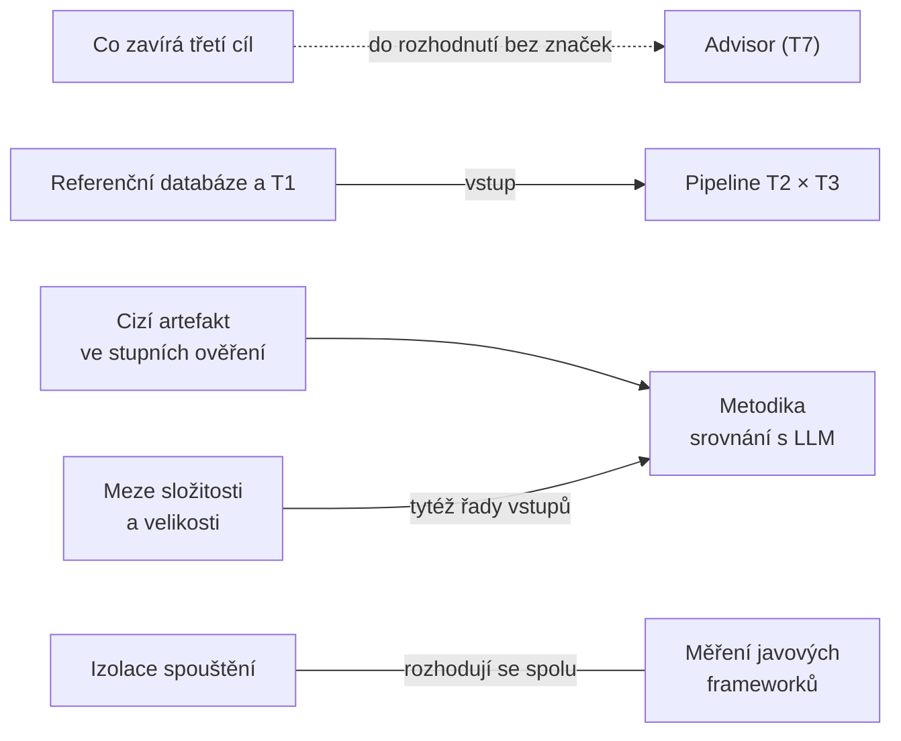

# Otevřené položky

Jediný seznam toho, co zbývá. **Rozhodnutí** končí novým souborem v [`decisions/`](./decisions/README.md) a řádkem v jeho rejstříku, **práce** (už rozhodnutá) kódem a aktualizací [`architecture.md`](./architecture.md), podle potřeby i [`subset.md`](./subset.md) a [`traceability.md`](./traceability.md). Hotová položka odsud mizí; co verze nárokuje, říká §9 a kanonicky sekce *Guarantees* kořenového [`README.md`](../README.md).

**Pořadí nesou jen značky** (rozh. [018](./decisions/018-work-order-as-item-marker.md)) na začátku kurzívového řádku vazeb: **Na řadě** nejvýš jedna položka, **Potom** nejvýš dvě, ostatní se berou podle priorit z požadavků. **Vada** — vstup v nároku, z něhož vznikne artefakt, který cíl odmítne nebo který tiše znamená něco jiného — se opravuje přednostně jako práce a nárok, který vyvrací, do opravy platí jen s výhradou; dnes žádná otevřená není. Cíle zadání: cíl 1 = vydání `1.2.0`, cíl 2 = `2.0.0`, cíl 3 = příští MAJOR `3.0.0` (rozh. [098](./decisions/098-the-number-is-decided-once-per-release.md)).

## Kde jsme vůči specifikaci

Schválená [specifikace](./specifikace.tex) (kap. *Milníky* a *Harmonogram*) a [záměr](./zamer.tex) s koncem projektu **2026-12-01**:

| Milník | Obsah | Termín | Stav |
|---|---|---|---|
| 1 — .NET část | klíče, vztahy, katalog, diagnostika, dotazová matice, čtyři stupně ověření | červenec–srpen | hotovo, `1.2.0` |
| 2 — specifikace a analýza | specifikace, rozhodnutí o javové straně, analýza běhového prostředí pro Javu | září | hotovo |
| 3 — Java a cross-language | Hibernate, MyBatis, EclipseLink, překlad .NET ↔ Java | září–říjen | hotovo, `2.0.0`; dotazy dokončené v `2.1.0`; katalog LDBC přeložený celý v `2.2.0`, zbývá [verdikt soudce nad SF 1](#verdikt-soudce-ldbc-nad-celou-sadou-sf-1) |
| 4 — testy a experimenty | javová sada s diferenčním ověřením (F12–F13) | říjen–listopad | hotovo |
| | zobrazení mezireprezentace (F14) | | **chybí** |
| | cross-language matice T2 s metrikami T3 | | **chybí** pipeline a metriky; matice existuje v testech |
| | příprava infrastruktury pro navazující LLM experimenty (T4–T6) | | **chybí** |
| | základní srovnání Advisoru (T7), *podle časových možností* | | sekundární |
| 5 — odevzdání | experimenty (T2, T3, T7), dokumentace, odevzdání a příprava obhajoby | listopad | [nerozepsáno](#milník-5-nemá-v-seznamu-žádnou-položku) |

T1 (případová studie nebo testovací sada) žádá kapitola *Experimentální požadavky*; žádný milník ji nejmenuje.

## Přehled

Rejstřík, ne pořadí.

| Položka | Oblast | Druh | Pož. |
|---|---|---|---|
| [Verdikt soudce LDBC nad SF 1](#verdikt-soudce-ldbc-nad-celou-sadou-sf-1) | Dotazy | práce | F13, T2, T3 |
| [Co zavírá třetí cíl](#co-zavírá-třetí-cíl-schválený-záměr-advisor-nejmenuje) | Třetí cíl | rozhodnutí | F15, T1–T7 |
| [Experimentální pipeline T2 × T3](#experimentální-pipeline-kterou-záměr-žádá-neexistuje) | Třetí cíl | rozhodnutí | S5, T1–T3 |
| [Referenční databáze experimentů a případová studie T1](#referenční-databáze-experimentů-a-případová-studie-t1) | Třetí cíl | rozhodnutí | T1, T2, T7, F4 |
| [Meze složitosti a velikosti vstupu](#meze-složitosti-dotazu-hloubky-zanoření-a-velikosti-tříd-nikdo-nehledal) | Třetí cíl | rozhodnutí | S3, T3–T5 |
| [Zobrazení mezireprezentace](#mezireprezentace-se-nezobrazuje-ačkoli-f14-ji-jmenuje) | Třetí cíl | rozhodnutí | F11, F14 |
| [Artefakt, který nevyrobil nástroj, ve stupních ověření](#ověřovací-stupně-nad-artefaktem-který-nevyrobil-nástroj) | Třetí cíl | rozhodnutí | T3–T6 |
| [Metodika srovnání s LLM](#metodika-srovnání-s-llm-a-vymezení-proti-souběžným-pracím) | Třetí cíl | rozhodnutí | T4–T6 |
| [Advisor nad všemi frameworky](#advisor-měří-jen-dapper-a-ef-core) | Advisor | práce | F15, T7 |
| [Srovnání s variantami a heuristikou](#srovnání-advisoru-s-jednotlivými-frameworky-a-heuristikou-chybí) | Advisor | práce | T7, F15 |
| [Izolace spouštění cizího kódu](#izolace-spouštění-cizího-kódu-advisorem) | Advisor | rozhodnutí | S4, F15, T7 |
| [Měření javových frameworků](#čím-advisor-měří-javové-frameworky) | Advisor | rozhodnutí | F15, T7, S4 |
| [Parametrizovaný dotaz](#parametrizovaný-dotaz-advisor-nezměří) | Advisor | rozhodnutí | F15, T4, T7 |
| [Nedoplněný překlad](#advisor-měří-nedoplněný-překlad) | Advisor | rozhodnutí | F15, T7 |
| [Jednotka s víc dotazy](#jednotka-s-víc-dotazy-vstupuje-do-advisoru-jako-jeden-dotaz) | Advisor | rozhodnutí | F15, T7 |
| [Iterační politika benchmarku](#iterační-politika-benchmarku-je-konstanta-v-kódu) | Advisor | rozhodnutí | T7 |
| [ADO.NET provider v benchmarcích](#sjednocení-adonet-provideru-v-benchmarcích) | Advisor | rozhodnutí | T7 |
| [Testy Advisoru a benchmarkingu](#advisor-a-benchmarking-nemají-žádné-testy) | Advisor | práce | T7, S6 |
| [Nedostupnost nativní knihovny](#advisor-hlásí-nedostupnost-nativní-knihovny-až-po-odeslání-běhu) | Advisor | práce | F15, S7 |
| [Milník 5 do seznamu](#milník-5-nemá-v-seznamu-žádnou-položku) | Odevzdání | práce | — |
| [Vstupní archiv projektu](#vstupní-archiv-projektu-který-f14-připouští) | Užitečné | rozhodnutí | F14, S7 |
| [Reprodukovatelnost sestavení](#vynucení-stylu-a-reprodukovatelnost-sestavení) | Užitečné | rozhodnutí | S2, S5 |
| [Trvalý identifikátor vydání](#trvalý-identifikátor-vydání) | Užitečné | rozhodnutí | — |

Co na čem stojí (vazby, které položky samy vyslovují):

---

## Dotazy

Katalog LDBC (rozh. [110](./decisions/110-ldbc-snb-as-a-second-reference-domain.md)) je přeložený celý: 36 dotazů podle specifikace, 5 se zjednodušením, žádný cíl žádný neodmítá a nativním SQL píše každý cíl jen to, co jeho jazyk nemá — počty vede [`architecture.md`](./architecture.md) §6.2, konstrukce a důvody [`subset.md`](./subset.md) 1.2–1.4 a 2.11. Úniková cesta po kouscích a rekurze rozepsaná do pevného počtu joinů zůstávají zamítnuté rozh. [113](./decisions/113-native-sql-as-the-escape-path-and-the-vocabulary-ldbc-needs.md). Zbývá doklad stavu „podle specifikace".

#### Verdikt soudce LDBC nad celou sadou SF 1
*Na řadě. Práce podle rozh. [117](./decisions/117-the-interactive-v1-validation-set-judges-the-ldbc-catalog-at-the-fourth-level.md); stojí na [095](./decisions/095-a-dated-run-record-names-its-commit.md), [121](./decisions/121-the-text-of-a-catalog-query-takes-the-shape-its-planner-needs-and-ldbcsnb-carries-the-indexes-its-reads-need.md) a [122](./decisions/122-the-text-of-a-catalog-query-takes-the-shape-a-targets-implementation-needs-under-the-same-criterion.md). Požadavky F13, T2, T3.*

Soudce běží v compose profilu `test` jen nad prefixem 1000 řádků SF 0,1. Doklad, který rozh. 117 bere za stav „podle specifikace", je celá sada SF 1 v obou sadách nad `mssql_db` na MIS3 — **samostatný běh, nikdy součást jiné práce**; jak se pouští a odkud se bere výsledek, říká [README](../ORMConvertor/README.md#the-ldbc-judge).

| | |
|---|---|
| rozsah | 138 747 řádků, z toho 131 706 čtení; obě sady po sobě, protože se o databázi dělí zámkem |
| doba | .NET sada 86 řádků za minutu (2026-10-10, prvních 2 888 řádků), tedy asi 27 hodin; javová podobně nebo déle. Čas nesou IC 14 (1,2 s na čtení a framework), IC 9 (0,9 s) a IC 3 (0,65 s); zkrátit ho může index nebo tvar textu v mezích 121, ne sada |
| kam výsledek | záznam běhů v README a řádek F13 v [`traceability.md`](./traceability.md); podíl shodných čtení IC 13 a IC 14 do metrik T3 a do poznámek katalogu |
| co rozhodne | IC 14 jde jednou procházkou do tří kroků; nad prefixem 800 řádků SF 0,1 souhlasila ve všech šesti frameworcích ze 100 %. Ukáže-li celá sada čtení, které mez mine, skládá se IC 14 z obou konců jako IC 13 (dvě procházky po dvou krocích, setkání jako join, `DISTINCT` nad cestou). Tvary IS 7 a IC 5 z rozh. 122 projdou celou sadou poprvé |

## Třetí cíl: experimenty

Matice T2 s metrikami T3, příprava T4–T6 a zobrazení mezireprezentace (F14) jsou milník 4, experimenty T2, T3 a T7 milník 5 a T1 žádá kapitola *Experimentální požadavky*. Oblast je ze záruk vyňatá (§9, oblast 6) a je látkou na `3.0.0`. Značku nese jen první položka, protože na ní stojí ostatní.

#### Co zavírá třetí cíl: schválený záměr Advisor nejmenuje
*Potom. Ke kontrole: rozh. [098](./decisions/098-the-number-is-decided-once-per-release.md) („příští MAJOR je `3.0.0` za Advisor nad všemi frameworky a za experimentální část"); stojí na něm věta §9 o příštím MAJOR a sekce *Beyond this version* kořenového [`README.md`](../README.md). Požadavky F15, T1–T7.*

Zadání ([`requirements.md`](./requirements.md), F15, T7) a prototyp vedly k Advisoru jako třetímu cíli. Schválený [záměr](./zamer.tex) ho mezi pěti úkoly řešitele nemá: pátým úkolem je experimentální prostředí, výzkumným využitím srovnání s metodami založenými na LLM. [Specifikace](./specifikace.tex) staví experimentální infrastrukturu do milníku 4 a vede Advisor (F15, T7) jako *sekundární cíl podle časových možností*, ale kapitola *Zbývající práce a postup* cíl 3 dál jmenuje „Advisor, benchmarking a experimenty". Rozhodnout, co `3.0.0` zavírá. Experimenty bez Advisoru znamenají 098 **nahradit** (už se podle něj vydávalo) a přepsat větu v §9, v README i úvod oblasti [Advisor](#advisor); Advisor znamená odůvodnit odchylku od úkolů záměru, a pátý úkol i výzkumné využití pak zůstanou otevřené jako vyslovená odchylka.

#### Experimentální pipeline, kterou záměr žádá, neexistuje
*Platí, ať třetí cíl zavře cokoli: tabulku T2 × T3 žádá milník 4. Ke kontrole: rozh. [039](./decisions/039-container-configuration-of-the-environment.md) a [089](./decisions/089-differential-verification-as-the-fourth-level-over-a-query.md); souvisí s [078](./decisions/078-java-suite-as-a-client-of-a-running-instance.md). Zúžení S5 v §9, UC5 v [`use-cases.md`](./use-cases.md). Požadavky S5, T1, T2, T3.*

Ověřovací polovina pátého úkolu záměru hotová je: obě sady staví, spouštějí a diferenčně ověřují generovaný kód v zafixovaném prostředí. Chybí experimentální polovina — nic nevolá `/convert` přes všechny dvojice frameworků a kategorie dotazů a nepočítá podíly parsovatelných, kompilovatelných, spustitelných a funkčně ekvivalentních výstupů ani úplnost přenesených mapovacích vlastností (T3). Rozhodnout:

- kde pipeline bydlí — třetí profil compose, nebo profil `test` rozšířený o běh, který vydá tabulku měření s identifikátorem běhu a verzemi (S6);
- co je vstupem — dnes `CrossFrameworkInputs`, `QueryShapeInputs`, diferenční matice a vstupy javové sady; žádný není případovou studií T1;
- kam se ukládá výstup, když rozh. [042](./decisions/042-measured-benchmark-output-out-of-git.md) vyloučilo naměřený výstup z gitu;
- jak se počítají podíly T3 nad čtyřmi stupni rozh. [016](./decisions/016-generated-artifact-verification-levels.md); funkční ekvivalenci dává diferenční ověření.

#### Referenční databáze experimentů a případová studie T1
*Ke kontrole proti záměru: rozh. [016](./decisions/016-generated-artifact-verification-levels.md) (testy nad vlastním schématem, WideWorldImporters zamítnutá). Kandidát: `LdbcSnb`, rozh. [110](./decisions/110-ldbc-snb-as-a-second-reference-domain.md). Požadavky T1, T2, T7, F4.*

Záměr i specifikace jmenují jedinou referenční databázi, SQL Server s WideWorldImporters; ta slouží compose stacku, Advisoru a ukázkám `/samples`, kdežto obě sady a 4. stupeň běží nad vlastním schématem, což rozh. 016 odůvodňuje pro *ověřování*. Pro *experimenty* odpověď chybí: T2 běží nad fixturou, T7 nad WideWorldImporters a T1 nad ničím. Specifikace čte T1 jako „případovou studii **nebo testovací sadu**" s netriviálními entitami, vztahy a read-only dotazy, a tomu katalog LDBC SNB odpovídá; zmrazené zadání ([`requirements.md`](./requirements.md), T1) ale žádá open-source aplikaci a [`traceability.md`](./traceability.md) u T1 říká, že LDBC aplikací není. Rozhodnout, které čtení T1 platí, nad čím který experiment běží a kde se to vysloví.

#### Meze složitosti dotazu, hloubky zanoření a velikosti tříd nikdo nehledal
*[Záměr](./zamer.tex) (*Využití pro výzkumnou činnost*: posoudit „praktickou použitelnost navrženého přístupu a jeho omezení"); [specifikace](./specifikace.tex) S3 („konkrétní výkonnostní výsledky budou součástí vyhodnocení") a kap. *Vyhodnocení*. Souvisí s rozh. [092](./decisions/092-input-nesting-depth-capped-before-the-descent.md) a [`threat-model.md`](./threat-model.md), hrozba 2; srovnání metodicky vede [položka o LLM](#metodika-srovnání-s-llm-a-vymezení-proti-souběžným-pracím). Požadavky S3, T3, T4, T5.*

Známé jsou dva body: S3 jedním měřením (100 entit a 100 dotazů EF Core → NHibernate pod sekundu, [README](../ORMConvertor/README.md#translation-performance-s3)) a hloubky, ve kterých parsery shodí proces (rozh. 092, za stropem 128). Kde nástroj přestane stačit — pád, `Failure`, čas či paměť mimo praktické použití, nebo tichý chybný výstup — nikdo systematicky nehledal. Hledá se řadami vstupů rostoucími po jedné ose:

- složitost dotazu: počet joinů, podmínek a hloubka podmínkového stromu, počet a zanoření poddotazů, mezivýsledky `WITH`, množinové operace, délka výrazů;
- hloubka zanoření až ke stropu a s vypnutým stropem ve všech šesti jazycích — 092 změřilo pád parserů, ne překlad celou cestou;
- velikost třídy: počet vlastností, vztahů a částí klíče, velikost souboru jednotky;
- velikost převodu: počet entit, jednotek a dotazů v jednom požadavku, bez katalogu i s ním (čtení katalogu zvlášť, S3).

U každého bodu řady čas, paměť a výsledek na čtyřech stupních rozh. [016](./decisions/016-generated-artifact-verification-levels.md) (metriky T3). **Výsledky je třeba poměřit s překladem pomocí LLM a dalšími přístupy nad týmiž řadami:** zero-shot a few-shot (T4), varianta s RAG a agentní (T5) a přístupy souběžných prací M. Čorovčáka a I. Oboňové — na které ose a kde který přístup selže, a vedle správnosti čas, cena (tokeny) a stálost výsledku mezi pokusy, protože nedeterminismus a náklady jsou to, čím specifikace přístup s LLM od deterministického odlišuje. Projekt podle T4 připraví řady a měření tak, aby srovnání šlo provést; plné srovnání nese navazující diplomová práce. Rozhodnout osy a generátor řad (syntetické, nebo škálované dotazy katalogu LDBC a příkladů), co se počítá za mez a zda řady běží v [experimentální pipeline](#experimentální-pipeline-kterou-záměr-žádá-neexistuje).

#### Mezireprezentace se nezobrazuje, ačkoli F14 ji jmenuje
*Milník 4 specifikace. Zúžení F14 v §9. Souvisí s rozh. [010](./decisions/010-diagnostics-as-returned-data.md), [033](./decisions/033-shape-of-the-static-frontend-screens.md) a [098](./decisions/098-the-number-is-decided-once-per-release.md). Požadavky F11, F14.*

F14 žádá zobrazit vstup, mezireprezentaci, výstup a diagnostiku; `/convert` mezireprezentaci nevrací, takže ji obrazovka nemá odkud vzít. Cena není ve vykreslení: serializovaný tvar `EntityMap`, klíčů, vztahů a dotazových instrukcí se stane součástí REST kontraktu i s verzováním podle rozh. 098. Rozhodnout, zda bude plnohodnotnou částí odpovědi, nebo výslovně nestabilním náhledem — i ten je součástí kontraktu.

#### Ověřovací stupně nad artefaktem, který nevyrobil nástroj
*Příprava T4 podle milníku 4. Blokuje to rozh. [078](./decisions/078-java-suite-as-a-client-of-a-running-instance.md) („klient, ne čtenář souborů") — ke kontrole proti záměru. Souvisí s [016](./decisions/016-generated-artifact-verification-levels.md), [027](./decisions/027-query-artifact-verification.md), [089](./decisions/089-differential-verification-as-the-fourth-level-over-a-query.md). Požadavky T3–T6.*

Všechny čtyři stupně posoudí jen výstup nástroje: javová sada si artefakty bere z `/convert`, .NET ověření volá `ConversionHandler.Convert`. Artefakt od LLM nebo lidský překlad nemá kudy vstoupit, ačkoli metriky T3 jsou definované nad artefaktem, ne nad nástrojem. Rozh. 078 zamítlo čtení artefaktů ze souborů dvěma argumenty: otisk v gitu zestárne a dokazuje sám sebe — artefakt LLM je ale měřenou věcí, datovanou a přiřazenou k modelu, promptu a pokusu —, a soukromý kontrakt dvou sad, který platí zčásti, protože rozvržení adresáře se stane kontraktem mezi pipeline a sadou. Rozhodnout: 078 nahradit, nebo doplnit vstupní cestu vedle klienta; jak sada artefakt pojmenuje (pravidlo JLS §7.6 platí dál) a jak záznam běhu řekne, čí artefakt to byl.

#### Metodika srovnání s LLM a vymezení proti souběžným pracím
*Stojí na položce výš. Záměr jmenuje souběžné práce M. Čorovčáka (univerzální objektový model, LLM) a I. Oboňové (migrace dotazů s LLM); řádky T4–T6 v [`traceability.md`](./traceability.md) jsou prázdné. Požadavky T4, T5, T6.*

Podle specifikace projekt jen *připraví* data, rozhraní a měřicí infrastrukturu; plné zero-shot, few-shot, RAG, agentní a ablační experimenty nese navazující práce. Zadání předepisuje, co uvést (model a verze, prompt, teplota, počet pokusů, tokeny, čas, náklady), ne vstup, pravdu a míru shody: vstupem je táž množina jednotek jako u matic, pravdou kanonický výsledek (rozh. 089), shodou metriky T3 nad čtyřmi stupni (016). Rozhodnout rozsah (kolik z 36 směrů, které kategorie, zda i entity a mapování a [řady hledání mezí](#meze-složitosti-dotazu-hloubky-zanoření-a-velikosti-tříd-nikdo-nehledal)), počet pokusů a zacházení s nedeterminismem vůči bajtově shodnému výstupu nástroje (S2), co dostane varianta RAG (T5), co vypíná ablace (T6) a vymezení proti oběma souběžným pracím.

## Advisor

Advisor, benchmarking a T7 jsou podle specifikace **sekundární cíl podle časových možností**, který nesmí omezit hlavní cross-language cíl; ze záruk je vyňatý vcelku (§9, oblast 1), popis je v [`architecture.md`](./architecture.md) §8. Značky pořadí položky nenesou, dokud nepadne [Co zavírá třetí cíl](#co-zavírá-třetí-cíl-schválený-záměr-advisor-nejmenuje).

#### Advisor měří jen Dapper a EF Core
*Práce. [Specifikace](./specifikace.tex) F15 a T7 („rozšířen o nové frameworky"), maketa obrazovky Advisoru se šesti kandidáty (kap. *Uživatelské rozhraní*). Javová větev stojí na [rozhodnutí o měření](#čím-advisor-měří-javové-frameworky). Požadavky F15, T7.*

`SupportedFrameworks` drží Dapper a EF Core; NHibernate z `KnownFrameworks` vypadne bez záznamu i na výslovné vyžádání a Hibernate, EclipseLink ani MyBatis harness nemají ([`architecture.md`](./architecture.md) §8). NHibernate je práce jen na .NET straně — harness nad vygenerovaným mapováním a HQL, který zůstává závazným tvarem (§9); javové frameworky čekají na rozhodnutí o měření.

#### Srovnání Advisoru s jednotlivými frameworky a heuristikou chybí
*Práce. [Specifikace](./specifikace.tex) T7 („porovnán s jednotlivými frameworky a alespoň jednou jednoduchou heuristikou"), kap. *Vyhodnocení* a tabulka variant na maketě obrazovky Advisoru (kap. *Uživatelské rozhraní*). Požadavky T7, F15.*

Obrazovka ukazuje po dotazech všechny změřené kandidáty s poměrem k nejrychlejšímu a součet přiřazených řádků (§6.3). Variant téhož workloadu, které specifikace žádá, není: pro každého kandidáta „vše v jednom frameworku", heuristika volící každému dotazu nejrychlejšího kandidáta a ILP. Všechny se spočítají z měření, která běh už má; otevřené je jen, zda součty variant váží vahami dotazů jako účel ILP (maketa je nevažuje) a jak varianta řekne, že porušila strop paměti či počtu frameworků.

#### Izolace spouštění cizího kódu Advisorem
*[`threat-model.md`](./threat-model.md), hrozba 1; hranici pro javovou větev vyslovilo rozh. [076](./decisions/076-java-wrappers-in-csharp-jvm-in-containers.md). Požadavky S4, F15, T7.*

`/advisor/run` je jediné místo, kde nástroj cizí kód kompiluje a spouští: `RoslynBenchmarkCompiler` ho zavede do kolektibilního `AssemblyLoadContext` a `BenchmarkExecutor` ho volá v procesu aplikace, s jejími právy a připojením, bez limitu CPU, paměti i času. Rozhodnout, kudy povede hranice — samostatný proces s limity OS, kontejner na běh, nebo zúžení vstupu. Volba mění měřená čísla (startovní režie, JIT, paměť) a rozhoduje se spolu s [metodologií javové větve](#čím-advisor-měří-javové-frameworky), která podle 076 běží mimo proces. Do té doby platí jen předpoklad důvěryhodné sítě.

#### Čím Advisor měří javové frameworky
*Riziko „Metodologie měření pro Javu" ve [specifikaci](./specifikace.tex) (kap. *Rizika*); hranici dalo rozh. [076](./decisions/076-java-wrappers-in-csharp-jvm-in-containers.md): javová větev mimo proces aplikace, JVM v kontejneru. Rozhoduje se spolu s [izolací spouštění](#izolace-spouštění-cizího-kódu-advisorem), dotýká se [iterační politiky](#iterační-politika-benchmarku-je-konstanta-v-kódu). Požadavky F15, T7, S4.*

.NET větev měří v procesu vlastní smyčkou `BenchmarkExecutor`: `Stopwatch` a `GC.GetAllocatedBytesForCurrentThread`, tedy průměrnou dobu a alokované bajty na operaci jen volajícího vlákna — to jsou $c_{q,f}$ a $m_{q,f}$ ILP (§8). Hibernate, EclipseLink ani MyBatis nemá co změřit. Hledá se prostředek volně dostupný (licence slučitelná s MIT nástroje, bez komerční licence), udržovaný a spolehlivý, který poběží v zafixovaném obrazu s Temurinem 25 v linuxovém kontejneru bez zvláštních práv a dá čas, paměť a další údaje srovnatelné s .NET větví. Varianty měřicího jádra se vylučují (stav k 2026-10-12):

| Varianta | Čas | Paměť | Licence, verze |
|---|---|---|---|
| **A. JMH** (OpenJDK Code Tools), jen javová větev | režimy `AverageTime`, `SampleTime` (percentily), `SingleShotTime` (studený běh); fork JVM, zahřátí, interval spolehlivosti, výstup JSON | profiler `gc`: `gc.alloc.rate.norm` v B/op přes `getTotalThreadAllocatedBytes` (JDK 21+, všechna vlákna), `gc.count`, `gc.time`; profiler `mempool`: špička každého poolu za iteraci | GPLv2 s Classpath Exception; 1.37 (2023-08), tutéž bere JDK pro vlastní mikrobenchmarky |
| **B. Vlastní smyčka** zrcadlící `BenchmarkExecutor` | `System.nanoTime()` | `com.sun.management.ThreadMXBean#getCurrentThreadAllocatedBytes` (JDK 14+), přesný protějšek `GC.GetAllocatedBytesForCurrentThread` | jen JDK |
| **C. JMH + BenchmarkDotNet**, obě větve na zavedeném harnessu mimo proces aplikace | Java jako A; BDN totéž v .NET (zahřátí, pilot, statistika, samostatný proces) | BDN `MemoryDiagnoser` přes `GC.GetTotalAllocatedBytes(precise: true)`: všechna vlákna, tatáž sémantika jako JMH na JDK 21+ | BDN MIT; 0.15.8 |

- **A** je de facto standard a řeší, co vlastní smyčka v JVM neřeší (OSR, eliminace mrtvého kódu přes `Blackhole`, profil JIT oddělený forkem). Harness generuje anotační procesor `jmh-generator-annprocess` při kompilaci `javac`em. Výchozí nastavení (5 forků, 5 + 5 iterací po 10 s) míří na nanosekundy, pro dotaz do databáze se vysloví vlastní. Asymetrie zůstává: Java s forkem a statistikou, .NET v procesu s alokacemi jednoho vlákna.
- **B** dává symetrii s .NET bez závislosti, ale přenáší i nezdůvodněné konstanty, nemá rozptyl ani fork a to, co JMH řeší za nás, musí obhájit práce sama — u dotazu do databáze je toho málo, ne nic.
- **C** je nejobhajitelnější srovnatelnost pro T7: dva zavedené harnessy stejné stavby a sémantiky alokací. Cena: přestavět i .NET větev (BDN generuje vlastní projekt a staví ho `dotnet build` za běhu Advisoru; `InProcessEmitToolchain` by kód nechal v procesu) a změnit význam dosavadních .NET čísel. Samostatný proces je zároveň hranice, kterou hledá izolace.

Další údaje se kombinují s kteroukoli variantou; do ILP vstoupí, jen řekne-li to rozhodnutí:

- **JFR** (součást OpenJDK i Temurinu 25; v JMH `-prof jfr`, programově `jdk.jfr.consumer`): pauzy GC, halda po GC (`jdk.GCHeapSummary`), vzorky alokací, čtení ze soketu k databázi (`jdk.SocketRead`), od JDK 25 přesné časy vybraných metod bez změny kódu (JEP 520, `jdk.MethodTiming`). Rozloží čas na ORM, ovladač a síť; protějšek v .NET je EventPipe (`dotnet-counters`, `dotnet-trace`).
- **Strana SQL Serveru**, jediné údaje z podstaty stejné pro obě větve: relace Extended Events na `rpc_completed` a `sql_batch_completed` filtrovaná podle `client_app_name` (JDBC `applicationName`, ADO.NET `Application Name`) dá počet příkazů na operaci (N+1), `duration`, `cpu_time`, `logical_reads` a řádky. `sys.dm_exec_query_stats` dá totéž po plánech, ale míchá klienty a mizí s plánem z cache. Obojí chce serverové oprávnění.

Rovnou zavržené: komerční profilery (YourKit, JProfiler) nejsou volně dostupné; async-profiler (Apache 2.0, 4.5) vzorkuje, přesné B/op nedá a v kontejneru chce `perf_event_open` (seccomp, případně `SYS_ADMIN`); `memory.peak` cgroupy kontejneru je špička celého procesu včetně page cache a haldy rezervované podle `-Xmx`, rozdíl mezi dotazy v ní zanikne; JMeter a Gatling měří zátěží latenci klienta, alokace ne.

Rozhodnout:

- variantu A, B, nebo C — podle toho, zda ILP smí v jednom běhu míchat .NET a javové kandidáty; jen pak musí být čísla obou větví přímo srovnatelná;
- kterou paměť měří obě větve: alokace na operaci (dnešní kód, JMH `gc`, BDN), nebo špičku, kterou za $mem(q,f)$ bere článek *A Unified Framework for Object-Relational Mapping Translation and Performance-Aware Selection* (§8.1; JMH `mempool`, JFR);
- co je jedna operace: EF Core harness drží jeden `DbContext` přes všechny iterace; drží javová větev jednu `Session`, `EntityManager` či `SqlSession` (cache první úrovně zkreslí opakované čtení), nebo je otevírá v každé operaci — a továrna (`SessionFactory`, `EntityManagerFactory`, `SqlSessionFactory`) zůstane mimo měření;
- které další údaje se uloží a ukážou.

#### Parametrizovaný dotaz Advisor nezměří
*Plyne z rozh. [083](./decisions/083-parameter-as-the-fifth-operand-shape.md). Požadavky F15, T4, T7.*

`EFCoreBenchmarkHarnessBuilder` hledá veřejnou metodu s právě jedním parametrem `DbContext`; metodu s parametry dotazu přeskočí a běh skončí „EF Core query method not found". Rozšířit hledání je snadné; rozhodnout je třeba, **čím se parametr naplní** — výchozí hodnotou typu (měří prázdný výsledek), hodnotou od volajícího (nové pole požadavku), nebo hodnotou z katalogu (váže měření na data) — a zda dotaz, jehož parametr naplnit nejde, vypadne se záznamem, nebo se běh odmítne.

#### Advisor měří nedoplněný překlad
*Rozh. [059](./decisions/059-advisor-response-carries-the-measured-translations.md) svou variantu 3 zamítlo jen pro teď; souvisí s [015](./decisions/015-mapping-fact-completion-from-the-catalog.md). Požadavky F15, T7.*

Překladová fáze `/advisor/run` volá `ConversionHandler.Convert` bez připojení, takže měří překlad bez doplnění z katalogu, kdežto `/convert` tentýž vstup doplní; odpověď to přiznává stavem měřených artefaktů. Rozhodnout, zda překladová fáze dostane tutéž `CachingCatalogReader` jako benchmarková — levné, ale mění kompilovaný harness, takže se musí přeměřit. K tomu patří agregace `CatalogReadTime` přes převody běhu, dnes u všech null.

#### Jednotka s víc dotazy vstupuje do Advisoru jako jeden dotaz
*Plyne z rozh. [108](./decisions/108-a-sql-unit-carries-a-query-per-select-numbered-by-position.md) a [109](./decisions/109-a-code-unit-carries-every-query-it-hands-over.md). Požadavky F15, T7.*

`AdvisorRunCoordinator` měří každou jednotku workloadu jedním během a ILP dostane za identifikátor jednu cenu, jednotka ale může nést víc dotazů: `DapperBenchmarkHarnessBuilder` změří první `SqlQuery`, `EFCoreBenchmarkHarnessBuilder` první metodu, na kterou narazí reflexe, ostatní vypadnou beze slova. Rozhodnout: takovou jednotku odmítnout, nebo ji rozložit na víc dotazů workloadu (`Query01`, …) — to mění počet proměnných ILP, a tedy co je dotaz workloadu.

#### Iterační politika benchmarku je konstanta v kódu
*Specifikace (kap. *Rizika*) slibuje politiku vyslovit a odůvodnit jako součást metodologie. Požadavek T7.*

`BenchmarkExecutor` měří každý pár dotaz × framework pevně: dvě zahřívací iterace, pilotní běh a z něj 3–20 měřených iterací s cílem ~500 ms. Konstanty nejsou odůvodněné ani nastavitelné, a přitom určují rozptyl a délku běhu. Rozhodnout, jaké hodnoty metodologie vysloví a čím je podloží a zda budou parametrem požadavku; změna bez rozhodnutí mění význam dosavadních čísel.

#### Sjednocení ADO.NET provideru v benchmarcích
*Podklad: audit [2026-08-02](./audits/2026-08-02-post-step-4-audit.md), kap. 3.4.2; [srovnání frameworků](./analysis/orm-frameworks-comparison.md) a `benchmarks/README.md`. Požadavek T7.*

Dapper, EF Core, linq2db a RepoDB běží v benchmarcích na `Microsoft.Data.SqlClient`, NHibernate, EF6 a PetaPoco na `System.Data.SqlClient` (přes `benchmarks/Common`) — metodologický confound. Rozhodnout: přepnout NHibernate na `MicrosoftDataSqlClientDriver`, najít pro PetaPoco provider nad `Microsoft.Data.SqlClient` a přeměřit, nebo confound popsat v textu práce.

#### Advisor a benchmarking nemají žádné testy
*Práce; §8. Požadavky T7, S6.*

Testy nepokrývají `Advisor` ani `AdvisorBenchmarking`: P/Invoke do ILP solveru, stavbu harnessů ani `HarnessGenerationUtilities`, které z generovaného textu tahá názvy typů, jmenné prostory a `[Table]` regulárními výrazy a nullabilitu přepisuje textovou náhradou — právě to se nejsnáz rozejde s generátorem. Proto je oblast ze záruk vyňatá vcelku; testy přijdou, až z vyňaté oblasti vystoupí.

#### Advisor hlásí nedostupnost nativní knihovny až po odeslání běhu
*Práce. Podle rozh. [076](./decisions/076-java-wrappers-in-csharp-jvm-in-containers.md) je Advisor kontejnerový a build pro Windows nevzniká. Požadavky F15, S7.*

Mimo Linux a Docker chybí `libadvisor.so`; `AdvisorRunHandler` vrátí text `DllNotFoundException` až po vyplnění a odeslání formuláře (úvod obrazovky na kontejner upozorňuje předem). Aby obrazovka nedostupnost řekla místo běhu, potřebuje koncový bod „je Advisor na tomhle hostiteli k dispozici?" — malý, ale ve vyňaté oblasti.

## Odevzdání

#### Milník 5 nemá v seznamu žádnou položku
*[Specifikace](./specifikace.tex), kap. *Milníky / Výstupy* a *Vyhodnocení*; konec projektu 2026-12-01 podle [záměru](./zamer.tex).*

Milník 5 — experimentální výsledky, finální dokumentace, odevzdání a příprava obhajoby — tu nemá položky. Specifikace k němu slibuje u obhajoby běžící instanci z `docker compose` s překladem reálných artefaktů mezi .NET a Javou, reprodukci testovací sady jedním příkazem a výsledky experimentů s naměřenými ukazateli kvality nástroje; výsledky mají být podkladem vědecké publikace. Oblast je třeba do seznamu rozepsat; experimenty samy nesou položky [třetího cíle](#třetí-cíl-experimenty).

## Užitečné, ne nutné

Prospělo by to, ale žádná věta záruk na tom nestojí a nic tím není blokované; značky pořadí položky nedostávají.

#### Vstupní archiv projektu, který F14 připouští
*Rozh. [111](./decisions/111-a-unit-is-a-whole-source-file-that-declares-only-its-language.md) ho výslovně nechalo otevřené; souvisí s [`threat-model.md`](./threat-model.md), hrozba 2. Zúžení F14 v §9. Požadavky F14, S7.*

F14 jmenuje vedle celých tříd „případně archiv projektu"; nástroj bere jen soubory, které uživatel vybere, takže archiv musí rozbalit sám. Po rozh. 111 je převod souboru na jednotku funkcí přípony, a archiv tím zlevnil. Rozhodnout, zda ho rozbalí prohlížeč (kontrakt `/convert` beze změny), nebo server (nový vstup a s ním limit velikosti a počtu jednotek z hrozby 2); co se stane se souborem v jazyce, který zdroj nečte, a s cestou v archivu jako jménem jednotky; a zda tím zúžení F14 v §9 padá.

#### Vynucení stylu a reprodukovatelnost sestavení
*Podklad: audit [2026-08-23](./audits/2026-08-23-post-release-1-1-0-audit.md), kap. 8.4. Souvisí s rozh. [034](./decisions/034-central-version-management.md) a [039](./decisions/039-container-configuration-of-the-environment.md). Požadavky S2, S5.*

„Reprodukovatelné prostředí" dnes znamená „jedním příkazem", ne „bajtově stejně": chybí zámek závislostí, základní obrazy i akce CI (`actions/checkout@v5` a spol.) visí na pohyblivých značkách a pravidla stylu build nevynucuje. Rozhodnout, zda se S2 rozšíří z výstupu překladu i na sestavení (zámek, digesty, styl v CI), nebo jde o údržbu, která počká.

#### Trvalý identifikátor vydání
*Podklad: audit [2026-08-23](./audits/2026-08-23-post-release-1-1-0-audit.md), kap. 8.1, a [fair-software.eu](https://fair-software.eu/). Souvisí s rozh. [098](./decisions/098-the-number-is-decided-once-per-release.md). Až úplně na konci vývoje.*

Citaci nesou jen značka v gitu a `CITATION.cff`; z pěti doporučení fair-software.eu chybí záznam v registru. Rozhodnout, zda se fork cizího prototypu archivuje pod vlastním identifikátorem (kde a s jakým autorstvím — `LICENSE` nese dva držitele) a zda tím je nástroj „publikovaný" ve smyslu předpokladu rozh. 098; pak se 098 nahrazuje.
