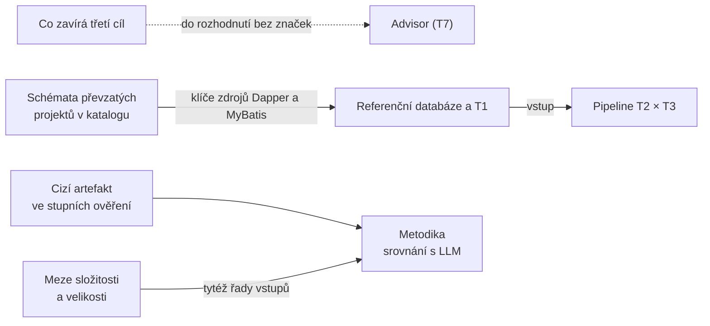

# Otevřené položky

Jediný seznam toho, co zbývá. **Rozhodnutí** končí novým souborem v [`decisions/`](./decisions/README.md) a řádkem v jeho rejstříku, **práce** (už rozhodnutá) kódem a aktualizací [`architecture.md`](./architecture.md), podle potřeby i [`subset.md`](./subset.md) a [`traceability.md`](./traceability.md). Hotová položka odsud mizí; co verze nárokuje, říká §9 a kanonicky sekce *Guarantees* kořenového [`README.md`](../README.md).

**Pořadí nesou jen značky** (rozh. [018](./decisions/018-work-order-as-item-marker.md)) na začátku kurzívového řádku vazeb: **Na řadě** nejvýš jedna položka, **Potom** nejvýš dvě, ostatní se berou podle priorit z požadavků. **Vada** — vstup v nároku, z něhož vznikne artefakt, který cíl odmítne nebo který tiše znamená něco jiného — se opravuje přednostně jako práce a nárok, který vyvrací, do opravy platí jen s výhradou; položka vady začíná slovem *Vada* v kurzívovém řádku vazeb. Cíle zadání: cíl 1 = vydání `1.2.0`, cíl 2 = `2.0.0`, cíl 3 = příští MAJOR `3.0.0` (rozh. [098](./decisions/098-the-number-is-decided-once-per-release.md)).

## Kde jsme vůči specifikaci

Schválená [specifikace](./specifikace.tex) (kap. *Milníky* a *Harmonogram*) a [záměr](./zamer.tex) s koncem projektu **2026-12-01**:

| Milník | Obsah | Termín | Stav |
|---|---|---|---|
| 1 — .NET část | klíče, vztahy, katalog, diagnostika, dotazová matice, čtyři stupně ověření | červenec–srpen | hotovo, `1.2.0` |
| 2 — specifikace a analýza | specifikace, rozhodnutí o javové straně, analýza běhového prostředí pro Javu | září | hotovo |
| 3 — Java a cross-language | Hibernate, MyBatis, EclipseLink, překlad .NET ↔ Java | září–říjen | hotovo, `2.0.0`; dotazy dokončené v `2.1.0`; katalog LDBC přeložený celý v `2.2.0` a doložený celou validační sadou SF 1 ve všech šesti frameworcích nad texty dotazů na cesty s mezí |
| 4 — testy a experimenty | javová sada s diferenčním ověřením (F12–F13) | říjen–listopad | hotovo |
| | zobrazení mezireprezentace (F14) | | vyňato rozh. [154](./decisions/154-the-intermediate-representation-is-not-shown-to-the-user.md) |
| | cross-language matice T2 s metrikami T3 | | **chybí** pipeline a metriky; matice existuje v testech |
| | příprava infrastruktury pro navazující LLM experimenty (T4–T6) | | **chybí** |
| | základní srovnání Advisoru (T7), *podle časových možností* | | sekundární |
| 5 — odevzdání | experimenty (T2, T3, T7), dokumentace, odevzdání a příprava obhajoby | listopad | [nerozepsáno](#milník-5-nemá-v-seznamu-žádnou-položku) |

T1 (případová studie nebo testovací sada) žádá kapitola *Experimentální požadavky*; žádný milník ji nejmenuje.

## Přehled

Rejstřík, ne pořadí.

| Položka | Oblast | Druh | Pož. |
|---|---|---|---|
| [Verdikt soudce po přepisu dotazů na cesty](#verdikt-soudce-nad-celou-sadou-sf-1-po-přepisu-dotazů-na-cesty) | Dotazy | práce | T2, T3, F13 |
| [Co zavírá třetí cíl](#co-zavírá-třetí-cíl-schválený-záměr-advisor-nejmenuje) | Třetí cíl | rozhodnutí | F15, T1–T7 |
| [Experimentální pipeline T2 × T3](#experimentální-pipeline-kterou-záměr-žádá-neexistuje) | Třetí cíl | rozhodnutí | S5, T1–T3 |
| [Referenční databáze experimentů a případová studie T1](#referenční-databáze-experimentů-a-případová-studie-t1) | Třetí cíl | rozhodnutí | T1, T2, T7, F4 |
| [Schémata převzatých projektů v katalogu](#schémata-převzatých-projektů-v-katalogu-instance) | Třetí cíl | rozhodnutí | F6, T1 |
| [Meze složitosti a velikosti vstupu](#meze-složitosti-dotazu-hloubky-zanoření-a-velikosti-tříd-nikdo-nehledal) | Třetí cíl | rozhodnutí | S3, T3–T5 |
| [Kořen bez kroku v proměnné přiřazené víckrát](#kořen-ef-core-bez-kroku-v-proměnné-přiřazené-víckrát-se-nečte-a-třída-kolem-vyjde-jako-entita) | Dotazy | vada; práce | F14, F11 |
| [Podíl kritéria F4](#podíl-ověřovacího-kritéria-f4-se-nevykazuje) | Ověření | práce | F4 |
| [Čtení S4 a S7](#čtení-s4-a-s7-log-zdroj-harnessu-advisoru-a-průběžný-stav) | Ověření | rozhodnutí | S4, S7 |
| [Co katalog FIBEN odmítá](#co-katalog-fiben-odmítá-okenní-agregát-a-stínovaný-alias-odvozené-tabulky) | Dotazy | rozhodnutí | T2, T3 |
| [Artefakt, který nevyrobil nástroj, ve stupních ověření](#ověřovací-stupně-nad-artefaktem-který-nevyrobil-nástroj) | Třetí cíl | rozhodnutí | T3–T6 |
| [Metodika srovnání s LLM](#metodika-srovnání-s-llm-a-vymezení-proti-souběžným-pracím) | Třetí cíl | rozhodnutí | T4–T6 |
| [Advisor nad všemi frameworky](#advisor-měří-jen-dapper-a-ef-core) | Advisor | práce | F15, T7 |
| [Srovnání s variantami a heuristikou](#srovnání-advisoru-s-jednotlivými-frameworky-a-heuristikou-chybí) | Advisor | práce | T7, F15 |
| [Izolace spouštění cizího kódu](#izolace-spouštění-cizího-kódu-advisorem) | Advisor | rozhodnutí | S4, F15, T7 |
| [Javová větev Advisoru](#javová-větev-advisoru-podle-rozh-146-nestojí) | Advisor | práce | F15, T7, S4 |
| [Buňka jako proces a cena prvního výsledku](#buňka-měření-jako-proces-a-cena-prvního-výsledku-podle-rozh-147-nestojí) | Advisor | práce | F15, T7, S4, S6 |
| [Parametrizovaný dotaz](#parametrizovaný-dotaz-advisor-nezměří) | Advisor | rozhodnutí | F15, T4, T7 |
| [Nedoplněný překlad](#advisor-měří-nedoplněný-překlad) | Advisor | rozhodnutí | F15, T7 |
| [Jednotka s víc dotazy](#jednotka-s-víc-dotazy-vstupuje-do-advisoru-jako-jeden-dotaz) | Advisor | rozhodnutí | F15, T7 |
| [ADO.NET provider v benchmarcích](#sjednocení-adonet-provideru-v-benchmarcích) | Advisor | rozhodnutí | T7 |
| [Testy Advisoru a benchmarkingu](#advisor-a-benchmarking-nemají-žádné-testy) | Advisor | práce | T7, S6 |
| [Nedostupnost nativní knihovny](#advisor-hlásí-nedostupnost-nativní-knihovny-až-po-odeslání-běhu) | Advisor | práce | F15, S7 |
| [Milník 5 do seznamu](#milník-5-nemá-v-seznamu-žádnou-položku) | Odevzdání | práce | — |
| [Reprodukovatelnost sestavení](#vynucení-stylu-a-reprodukovatelnost-sestavení) | Užitečné | rozhodnutí | S2, S5 |
| [Trvalý identifikátor vydání](#trvalý-identifikátor-vydání) | Užitečné | rozhodnutí | — |

Co na čem stojí (vazby, které položky samy vyslovují):

---

## Dotazy

Katalog LDBC (rozh. [110](./decisions/110-ldbc-snb-as-a-second-reference-domain.md)) je přeložený celý: 41 dotazů podle specifikace, žádný cíl žádný neodmítá a nativním SQL píše každý cíl jen to, co jeho jazyk nemá — počty vede [`architecture.md`](./architecture.md) §6.2, konstrukce a důvody [`subset.md`](./subset.md) 1.2–1.4 a 2.11. Úniková cesta po kouscích a rekurze rozepsaná do pevného počtu joinů zůstávají zamítnuté rozh. [113](./decisions/113-native-sql-as-the-escape-path-and-the-vocabulary-ldbc-needs.md); pět dotazů na cesty píše prohledání do šířky v nerekurzivních definicích s hloubkou změřenou nad SF 1 (rozh. [140](./decisions/140-ldbc-path-queries-as-breadth-first-search-in-non-recursive-definitions-with-the-depth-of-the-data.md), [141](./decisions/141-one-data-set-for-the-ldbc-catalog-and-the-depth-of-a-path-query-as-a-measured-property-of-it.md)). Text katalogu i všech pět cílů doložila celá validační sada SF 1 ([záznam](../ORMConvertor/README.md#whole-set-runs)) — nad texty s mezí; nad novými texty cest zatím jen prefix (položka níže).

#### Verdikt soudce nad celou sadou SF 1 po přepisu dotazů na cesty
*Na řadě. Práce podle rozh. [140](./decisions/140-ldbc-path-queries-as-breadth-first-search-in-non-recursive-definitions-with-the-depth-of-the-data.md) a [141](./decisions/141-one-data-set-for-the-ldbc-catalog-and-the-depth-of-a-path-query-as-a-measured-property-of-it.md); samostatný běh obou sad, který spouští Míra jménem ([`ORMConvertor/README.md`](../ORMConvertor/README.md), *The LDBC judge*). Požadavky T2, T3, F13.*

Pět dotazů na cesty je `AsSpecified` a soudce je posuzuje verdiktem, ne mírou; celou sadou SF 1 prošly jen texty s mezí (záznamy *Whole-set runs*), dnešní texty prefixem. Zbývá celá sada nad dnešními texty, .NET a javová sada po sobě, se záznamem do *Whole-set runs*. V zafixovaném prostředí rozh. [145](./decisions/145-the-measurement-environment-and-the-iteration-policy-are-fixed.md) potrvá .NET sada podle prefixů 2,5–5 dní a javová 2,5–3 dny (záznam *Time by step* v [`ORMConvertor/README.md`](../ORMConvertor/README.md)), takže pozastavení Windows Update musí přesáhnout konec. Je třeba zodpovědět, zda soudce, který není měřením, poběží s `max degree of parallelism` 1, nebo si ho na dobu běhu vypne: čtení IC 14 v EF Core pod ním trvají desítky sekund (vnořené poddotazy jeho SQL), v ostatních frameworcích dvě. Neshoda IC 13 nebo IC 14 by byla chybou textu nebo překladu, ne vlastností sady; čtení IC 14 v EF Core nad mezí 600 s (rozh. [146](./decisions/146-the-java-branch-measures-with-the-same-loop-in-its-own-container-and-an-execution-has-one-time-limit.md)) vlastností jeho SQL, kterou by řešilo nové rozhodnutí.

#### Kořen EF Core bez kroku v proměnné přiřazené víckrát se nečte a třída kolem vyjde jako entita
*Vada; práce. Nárok překladu dotazů do opravy platí s výhradou (§9, [`subset.md`](./subset.md) 2.13). Ke kontrole: rozh. [109](./decisions/109-a-code-unit-carries-every-query-it-hands-over.md) (proměnná přiřazená víckrát je dotaz skládaný za běhu), [111](./decisions/111-a-unit-is-a-whole-source-file-that-declares-only-its-language.md) (výjimka 1: třída s místem předání entitou není), [114](./decisions/114-what-the-unit-states-about-a-name-decides-an-ef-core-root.md) (co jednotka o jménu uvádí). Požadavky F14, F11.*

`IQueryable<Order> q = ctx.Orders; if (onlyRich) q = q.Where(o => o.Amount > 100); return q.ToList();` předává poskytovateli dotaz skládaný za běhu, který má podle rozh. 109 odmítnout `Failure` se jménem proměnné. Nástroj ho nepřečte vůbec: v inicializátoru hledání předání žádné volání nenajde a pokračování `q.Where(…)` ani `q.ToList()` se nerozloží, protože proměnnou přiřazenou víckrát čtení nesleduje. Dotaz zmizí beze slova a třída kolem vyjde jako entita (sonda z 2026-10-21: služba `Report` vydala prázdnou entitu `Report`); s `ctx.Orders.AsQueryable()` v inicializátoru se odmítne správně. Opravit tak, aby holý kořen uložený do proměnné, kterou kód prodlužuje a jejíž hodnotu text nefixuje, byl odmítnutým místem jako řetěz v ní. Kořen známý jen podle místa přitom smí začít dotaz jen tam, kde proměnnou prodlužuje krok LINQ či poskytovatele (`IsQueryStep`) — jinak by `var items = request.Items; if (…) items = other; items.Add(x);` vyšlo jako dotaz skládaný za běhu.

## Ověření

#### Podíl ověřovacího kritéria F4 se nevykazuje
*Práce. [`traceability.md`](./traceability.md), F4 a *Kritéria ověření, která zatím nikdo nespočítal*; očekávaná odpověď je skript schématu fixture (rozh. [016](./decisions/016-generated-artifact-verification-levels.md)). Požadavek F4.*

Kritérium F4 žádá „správně získáno ≥ 95 % sledovaných metadat" a F4 je nárokovaný v plném rozsahu; testy katalogu tvrdí jednotlivé fakty schématu fixture, podíl ale nespočítá nikdo. Spočítat ho nad `Tests/Database/TestSchema.sql` — každý sledovaný druh faktu (tabulka, sloupec, typ, nullabilita, primární a cizí klíč, unikátní omezení, délka, přesnost, měřítko) z očekávané odpovědi proti tomu, co vrátí `SqlServerCatalogReader` — a vykázat ho tam, kde ho traceability cituje; nevyjde-li, F4 zúžit.

#### Čtení S4 a S7: log, zdroj harnessu Advisoru a průběžný stav
*Rozhodnutí. Ke kontrole: rozh. [029](./decisions/029-database-connection-is-the-consumer-projects-fact.md) (připojení je fakt projektu spotřebitele), [033](./decisions/033-shape-of-the-static-frontend-screens.md) (tvar obrazovek); [`traceability.md`](./traceability.md), S4 a S7; [`threat-model.md`](./threat-model.md), aktiva. Požadavky S4, S7.*

Druhá věta S4 zakazuje přihlašovací údaje k databázi „v generovaných zdrojových souborech ani v lozích"; §9 a traceability ji nárokují celou, obsahem nároku je ale jen předávaný artefakt překladu, který hlídá `ArtifactCarriesNoCredentialsTest`. Log nehlídá nic: model hrozeb o něm říká, že nese počty a časy, `BenchmarkExecutor` do něj ale zapisuje i výjimku spuštěného kódu se zprávou, jejíž obsah nástroj neurčuje. Generovaný zdroj vzniká i mimo překlad: harness Advisoru (`DapperBenchmarkHarnessBuilder`, `EFCoreBenchmarkHarnessBuilder`) vloží připojovací řetězec jako konstantu do zdroje, který zkompiluje a spustí v procesu — soubor nevznikne a Advisor je vyňatá oblast 1, nárok to ale neříká. S7 jmenuje „průběžný stav zpracování", o kterém README, §9 ani traceability nemluví; obrazovka překladu ukazuje během požadavku značku zaneprázdnění a větu „Converting…", Advisor uplynulý čas, stav po jednotkách ani po fázích nevzniká. Rozhodnout, zda druhá věta S4 platí pro artefakt i log — pak log potřebuje test nebo pravidlo, co do něj smí —, nebo se nárok zúží na artefakt, a zda zúžení jmenuje i harness Advisoru; a zda průběžný stav S7 splní značka zaneprázdnění nad požadavkem, který podle měření S3 trvá pod sekundu (pak to §9 a traceability řeknou a doloží projitím scénáře S7), nebo se S7 v té části zúží.

## Třetí cíl: experimenty

Matice T2 s metrikami T3 a příprava T4–T6 jsou milník 4, experimenty T2, T3 a T7 milník 5 a T1 žádá kapitola *Experimentální požadavky*. Oblast je ze záruk vyňatá (§9, oblast 6) a je látkou na `3.0.0`. Značku nese jen první položka, protože na ní stojí ostatní.

#### Co zavírá třetí cíl: schválený záměr Advisor nejmenuje
*Potom. Ke kontrole: rozh. [098](./decisions/098-the-number-is-decided-once-per-release.md) („příští MAJOR je `3.0.0` za Advisor nad všemi frameworky a za experimentální část"); stojí na něm věta §9 o příštím MAJOR a sekce *Beyond this version* kořenového [`README.md`](../README.md). Požadavky F15, T1–T7.*

Zadání ([`requirements.md`](./requirements.md), F15, T7) a prototyp vedly k Advisoru jako třetímu cíli. Schválený [záměr](./zamer.tex) ho mezi pěti úkoly řešitele nemá: pátým úkolem je experimentální prostředí, výzkumným využitím srovnání s metodami založenými na LLM. [Specifikace](./specifikace.tex) staví experimentální infrastrukturu do milníku 4 a vede Advisor (F15, T7) jako *sekundární cíl podle časových možností*, ale kapitola *Zbývající práce a postup* cíl 3 dál jmenuje „Advisor, benchmarking a experimenty". Rozhodnout, co `3.0.0` zavírá. Experimenty bez Advisoru znamenají 098 **nahradit** (už se podle něj vydávalo) a přepsat větu v §9, v README i úvod oblasti [Advisor](#advisor); Advisor znamená odůvodnit odchylku od úkolů záměru, a pátý úkol i výzkumné využití pak zůstanou otevřené jako vyslovená odchylka.

#### Experimentální pipeline, kterou záměr žádá, neexistuje
*Platí, ať třetí cíl zavře cokoli: tabulku T2 × T3 žádá milník 4. Ke kontrole: rozh. [039](./decisions/039-container-configuration-of-the-environment.md) a [089](./decisions/089-differential-verification-as-the-fourth-level-over-a-query.md); souvisí s [078](./decisions/078-java-suite-as-a-client-of-a-running-instance.md). Zúžení S5 v §9, UC5 v [`use-cases.md`](./use-cases.md). Požadavky S5, T1, T2, T3.*

Ověřovací polovina pátého úkolu záměru hotová je: obě sady staví, spouštějí a diferenčně ověřují generovaný kód v zafixovaném prostředí. Chybí experimentální polovina — nic nevolá `/convert` přes všechny dvojice frameworků a kategorie dotazů a nepočítá podíly parsovatelných, kompilovatelných, spustitelných a funkčně ekvivalentních výstupů ani úplnost přenesených mapovacích vlastností (T3). Rozhodnout:

- kde pipeline bydlí — třetí profil compose, nebo profil `test` rozšířený o běh, který vydá tabulku měření s identifikátorem běhu a verzemi (S6);
- co je vstupem — dnes `CrossFrameworkInputs`, `QueryShapeInputs`, diferenční matice a vstupy javové sady; případovou studií T1 může být výňatek Keycloaku v `SampleData/ThirdParty` (rozh. [138](./decisions/138-code-of-open-source-projects-enters-as-a-marked-excerpt-under-its-own-permissive-licence.md));
- kam se ukládá výstup, když rozh. [042](./decisions/042-measured-benchmark-output-out-of-git.md) vyloučilo naměřený výstup z gitu;
- jak se počítají podíly T3 nad čtyřmi stupni rozh. [016](./decisions/016-generated-artifact-verification-levels.md); funkční ekvivalenci dává diferenční ověření.

#### Referenční databáze experimentů a případová studie T1
*Ke kontrole proti záměru: rozh. [016](./decisions/016-generated-artifact-verification-levels.md) (testy nad vlastním schématem, WideWorldImporters zamítnutá). Je vstupem [experimentální pipeline](#experimentální-pipeline-kterou-záměr-žádá-neexistuje). Kandidáti: `LdbcSnb`, rozh. [110](./decisions/110-ldbc-snb-as-a-second-reference-domain.md), a `Fiben`, rozh. [149](./decisions/149-fiben-as-a-third-reference-domain-run-on-demand-against-a-judge-of-our-own.md); výňatek Keycloaku, rozh. [138](./decisions/138-code-of-open-source-projects-enters-as-a-marked-excerpt-under-its-own-permissive-licence.md) a [katalog zdrojů](./analysis/real-world-sources.md). Požadavky T1, T2, T7, F4.*

Záměr i specifikace jmenují jedinou referenční databázi, SQL Server s WideWorldImporters; ta slouží compose stacku, Advisoru a ukázkám `/samples`, kdežto obě sady a 4. stupeň běží nad vlastním schématem, což rozh. 016 odůvodňuje pro *ověřování*. Pro *experimenty* odpověď chybí: T2 běží nad fixturou, T7 nad WideWorldImporters a T1 nad ničím. Specifikace čte T1 jako „případovou studii **nebo testovací sadu**" s netriviálními entitami, vztahy a read-only dotazy, a tomu katalog LDBC SNB odpovídá; zmrazené zadání ([`requirements.md`](./requirements.md), T1) ale žádá open-source aplikaci a [`traceability.md`](./traceability.md) u T1 říká, že LDBC aplikací není. Open-source aplikací je výňatek Keycloaku v `SampleData/ThirdParty` a čísla zadání splní (21 entit, vztahy, deset složených klíčů, 47 čtecích dotazů); jeho schéma ale v žádné databázi nástroje není. Rozhodnout, které čtení T1 platí, nad čím který experiment běží a kde se to vysloví.

#### Co katalog FIBEN odmítá: okenní agregát a stínovaný alias odvozené tabulky
*Rozhodnutí. Ke kontrole: rozh. [112](./decisions/112-a-query-as-a-row-source-is-a-named-intermediate-result.md) (mezivýsledek jmenovaný jednou za dotaz), [113](./decisions/113-native-sql-as-the-escape-path-and-the-vocabulary-ldbc-needs.md) (slovník: tři pořadové funkce nad oknem, bez okenního agregátu), [061](./decisions/061-subquery-as-a-condition-operand.md) (poddotaz jako operand podmínky). Doklad: katalog FIBEN (rozh. [149](./decisions/149-fiben-as-a-third-reference-domain-run-on-demand-against-a-judge-of-our-own.md)). Požadavky T2, T3.*

Dotazy FIBEN dvou tvarů nástroj nepřeloží do žádného cíle a katalog je nese jako `NotTranslated` s důvodem: (1) **agregát nad oknem** (`AVG`, `MAX`, `MIN OVER (PARTITION BY …)`) uvnitř odvozené tabulky — q99 a q237; slovník výrazů nese jen `ROW_NUMBER`, `RANK` a `DENSE_RANK` s řazením, a sloupec mezivýsledku se nesmí zahodit, proto `Failure`; (2) **skalární poddotaz v podmínce `ON` vnějšího joinu** (`LEFT JOIN … ON x = (SELECT …)`) — q124–126 a q200–202; podmínka joinu v reprezentaci nese sloupce a konstanty, ne poddotaz. Třetí tvar, **stínovaný alias** (tři vnořené odvozené tabulky jmenované `a`, q99), import přejmenoval, protože čtečka hledá definici jménem a jeden dotaz ji jmenuje jednou (112). Rozhodnout, co z toho slovník přibere: okenní agregát jako sedmý tvar agregátu (EF Core ho v LINQ nemá — nativní SQL; HQL 7 a JPQL ne; HQL 5.7 ne), poddotaz v podmínce joinu (EF Core jen přes `SelectMany`/`Where` po joinu, JPQL `ON` s poddotazem Hibernate 7 unese), a zda smí čtečka rozlišovat stejnojmenné definice podle rozsahu; co se nepřibere, je mez v [`subset.md`](./subset.md) 2.9–2.10 a katalog ji nese jako stav dotazu.

#### Schémata převzatých projektů v katalogu instance
*Ke kontrole: rozh. [015](./decisions/015-mapping-fact-completion-from-the-catalog.md), [099](./decisions/099-examples-are-content-not-a-choice.md) (příklady běží bez katalogu) a [138](./decisions/138-code-of-open-source-projects-enters-as-a-marked-excerpt-under-its-own-permissive-licence.md). Podklad: [`analysis/real-world-sources.md`](./analysis/real-world-sources.md), *Převzaté výňatky*. Dodá klíče zdrojů Dapper a MyBatis [referenční databázi a případové studii T1](#referenční-databáze-experimentů-a-případová-studie-t1). Požadavky F6, T1.*

Výňatky Chinooku (vrstva Dapper) a JPetStore nemají klíč — Dapper a MyBatis ho nevysloví —, takže do NHibernate, Hibernate a EclipseLink je nástroj bez katalogu odmítne, a do EF Core odvodí entity z tabulek bez třídy. Všechny převzaté projekty své schéma zveřejňují: Keycloak migracemi a Ambari skriptem pro SQL Server, Chinook autorovou databází pro SQL Server, JPetStore skriptem HSQLDB, který T-SQL přečte. Rozhodnout, zda je databáze compose stacku načte vedle WideWorldImporters a `LdbcSnb` — jen schéma, prázdné tabulky —, aby převod výňatku na instanci s katalogem doplnil klíče, sloupce a vztahy, a jak se vyhnout víceznačnosti jmen tabulek mezi schématy ([`architecture.md`](./architecture.md) §5.2, *Kandidáti*).

#### Meze složitosti dotazu, hloubky zanoření a velikosti tříd nikdo nehledal
*[Záměr](./zamer.tex) (*Využití pro výzkumnou činnost*: posoudit „praktickou použitelnost navrženého přístupu a jeho omezení"); [specifikace](./specifikace.tex) S3 („konkrétní výkonnostní výsledky budou součástí vyhodnocení") a kap. *Vyhodnocení*. Souvisí s rozh. [092](./decisions/092-input-nesting-depth-capped-before-the-descent.md) a [`threat-model.md`](./threat-model.md), hrozba 2; srovnání metodicky vede [položka o LLM](#metodika-srovnání-s-llm-a-vymezení-proti-souběžným-pracím). Požadavky S3, T3, T4, T5.*

Známé jsou dva body: S3 jedním měřením (100 entit a 100 dotazů EF Core → NHibernate pod sekundu, [README](../ORMConvertor/README.md#translation-performance-s3)) a hloubky, ve kterých parsery shodí proces (rozh. 092, za stropem 128). Kde nástroj přestane stačit — pád, `Failure`, čas či paměť mimo praktické použití, nebo tichý chybný výstup — nikdo systematicky nehledal. Hledá se řadami vstupů rostoucími po jedné ose:

- složitost dotazu: počet joinů, podmínek a hloubka podmínkového stromu, počet a zanoření poddotazů, mezivýsledky `WITH`, množinové operace, délka výrazů;
- hloubka zanoření až ke stropu a s vypnutým stropem ve všech šesti jazycích — 092 změřilo pád parserů, ne překlad celou cestou;
- velikost třídy: počet vlastností, vztahů a částí klíče, velikost souboru jednotky;
- velikost převodu: počet entit, jednotek a dotazů v jednom požadavku, bez katalogu i s ním (čtení katalogu zvlášť, S3).

U každého bodu řady čas, paměť a výsledek na čtyřech stupních rozh. [016](./decisions/016-generated-artifact-verification-levels.md) (metriky T3). **Výsledky je třeba poměřit s překladem pomocí LLM a dalšími přístupy nad týmiž řadami:** zero-shot a few-shot (T4), varianta s RAG a agentní (T5) a přístupy souběžných prací M. Čorovčáka a I. Oboňové — na které ose a kde který přístup selže, a vedle správnosti čas, cena (tokeny) a stálost výsledku mezi pokusy, protože nedeterminismus a náklady jsou to, čím specifikace přístup s LLM od deterministického odlišuje. Projekt podle T4 připraví řady a měření tak, aby srovnání šlo provést; plné srovnání nese navazující diplomová práce. Rozhodnout osy a generátor řad (syntetické, nebo škálované dotazy katalogu LDBC a příkladů), co se počítá za mez a zda řady běží v [experimentální pipeline](#experimentální-pipeline-kterou-záměr-žádá-neexistuje).

#### Ověřovací stupně nad artefaktem, který nevyrobil nástroj
*Příprava T4 podle milníku 4. Blokuje to rozh. [078](./decisions/078-java-suite-as-a-client-of-a-running-instance.md) („klient, ne čtenář souborů") — ke kontrole proti záměru. Souvisí s [016](./decisions/016-generated-artifact-verification-levels.md), [027](./decisions/027-query-artifact-verification.md), [089](./decisions/089-differential-verification-as-the-fourth-level-over-a-query.md). Požadavky T3–T6.*

Všechny čtyři stupně posoudí jen výstup nástroje: javová sada si artefakty bere z `/convert`, .NET ověření volá `ConversionHandler.Convert`. Artefakt od LLM nebo lidský překlad nemá kudy vstoupit, ačkoli metriky T3 jsou definované nad artefaktem, ne nad nástrojem. Rozh. 078 zamítlo čtení artefaktů ze souborů dvěma argumenty: otisk v gitu zestárne a dokazuje sám sebe — artefakt LLM je ale měřenou věcí, datovanou a přiřazenou k modelu, promptu a pokusu —, a soukromý kontrakt dvou sad, který platí zčásti, protože rozvržení adresáře se stane kontraktem mezi pipeline a sadou. Rozhodnout: 078 nahradit, nebo doplnit vstupní cestu vedle klienta; jak sada artefakt pojmenuje (pravidlo JLS §7.6 platí dál) a jak záznam běhu řekne, čí artefakt to byl.

#### Metodika srovnání s LLM a vymezení proti souběžným pracím
*Stojí na položce výš. Záměr jmenuje souběžné práce M. Čorovčáka (univerzální objektový model, LLM) a I. Oboňové (migrace dotazů s LLM); řádky T4–T6 v [`traceability.md`](./traceability.md) jsou prázdné. Požadavky T4, T5, T6.*

Podle specifikace projekt jen *připraví* data, rozhraní a měřicí infrastrukturu; plné zero-shot, few-shot, RAG, agentní a ablační experimenty nese navazující práce. Zadání předepisuje, co uvést (model a verze, prompt, teplota, počet pokusů, tokeny, čas, náklady), ne vstup, pravdu a míru shody: vstupem je táž množina jednotek jako u matic, pravdou kanonický výsledek (rozh. 089), shodou metriky T3 nad čtyřmi stupni (016). Rozhodnout rozsah (kolik z 36 směrů, které kategorie, zda i entity a mapování a [řady hledání mezí](#meze-složitosti-dotazu-hloubky-zanoření-a-velikosti-tříd-nikdo-nehledal)), počet pokusů a zacházení s nedeterminismem vůči bajtově shodnému výstupu nástroje (S2), co dostane varianta RAG (T5), co vypíná ablace (T6) a vymezení proti oběma souběžným pracím.

## Advisor

Advisor, benchmarking a T7 jsou podle specifikace **sekundární cíl podle časových možností**, který nesmí omezit hlavní cross-language cíl; ze záruk je vyňatý vcelku (§9, oblast 1), popis je v [`architecture.md`](./architecture.md) §8. Značky pořadí položky nenesou, dokud nepadne [Co zavírá třetí cíl](#co-zavírá-třetí-cíl-schválený-záměr-advisor-nejmenuje).

#### Advisor měří jen Dapper a EF Core
*Práce. [Specifikace](./specifikace.tex) F15 a T7 („rozšířen o nové frameworky"), maketa obrazovky Advisoru se šesti kandidáty (kap. *Uživatelské rozhraní*). Javové frameworky nese [položka javové větve](#javová-větev-advisoru-podle-rozh-146-nestojí). Požadavky F15, T7.*

`SupportedFrameworks` drží Dapper a EF Core; NHibernate z `KnownFrameworks` vypadne bez záznamu i na výslovné vyžádání ([`architecture.md`](./architecture.md) §8). NHibernate je práce jen na .NET straně — harness nad vygenerovaným mapováním a HQL, který zůstává závazným tvarem (§9), s novou `ISession` na spuštění podle rozh. [146](./decisions/146-the-java-branch-measures-with-the-same-loop-in-its-own-container-and-an-execution-has-one-time-limit.md).

#### Srovnání Advisoru s jednotlivými frameworky a heuristikou chybí
*Práce. [Specifikace](./specifikace.tex) T7 („porovnán s jednotlivými frameworky a alespoň jednou jednoduchou heuristikou"), kap. *Vyhodnocení* a tabulka variant na maketě obrazovky Advisoru (kap. *Uživatelské rozhraní*). Požadavky T7, F15.*

Obrazovka ukazuje po dotazech všechny změřené kandidáty s poměrem k nejrychlejšímu a součet přiřazených řádků (§6.3). Variant téhož workloadu, které specifikace žádá, není: pro každého kandidáta „vše v jednom frameworku", heuristika volící každému dotazu nejrychlejšího kandidáta a ILP. Všechny se spočítají z měření, která běh už má; otevřené je jen, zda součty variant váží vahami dotazů jako účel ILP (maketa je nevažuje) a jak varianta řekne, že porušila strop paměti či počtu frameworků.

#### Izolace spouštění cizího kódu Advisorem
*[`threat-model.md`](./threat-model.md), hrozba 1; hranici pro javovou větev vyslovilo rozh. [076](./decisions/076-java-wrappers-in-csharp-jvm-in-containers.md) a umístilo rozh. [146](./decisions/146-the-java-branch-measures-with-the-same-loop-in-its-own-container-and-an-execution-has-one-time-limit.md), pro .NET větev rozh. [147](./decisions/147-a-cell-is-a-process-and-reports-the-cost-of-the-first-result-beside-the-steady-state.md). Požadavky S4, F15, T7.*

`/advisor/run` je jediné místo, kde nástroj cizí kód kompiluje a spouští: dnes ho `RoslynBenchmarkCompiler` zavede do kolektibilního `AssemblyLoadContext` a `BenchmarkExecutor` ho volá v procesu aplikace, s jejími právy a připojením, bez limitu CPU a paměti; čas drží jen mez spuštění dotazu (146). Hranice je rozhodnuta: podle 147 je každá buňka měření vlastním procesem v obou větvích (dětský proces runneru v .NET, dětský `java` služby `advisor_java`). Zbývá rozhodnout limity toho procesu — CPU, paměť, práva (S4) — a do té doby platí jen předpoklad důvěryhodné sítě.

#### Javová větev Advisoru podle rozh. 146 nestojí
*Práce podle rozh. [146](./decisions/146-the-java-branch-measures-with-the-same-loop-in-its-own-container-and-an-execution-has-one-time-limit.md); hranici dalo rozh. [076](./decisions/076-java-wrappers-in-csharp-jvm-in-containers.md), politiku rozh. [145](./decisions/145-the-measurement-environment-and-the-iteration-policy-are-fixed.md), vzor klienta přes HTTP rozh. [078](./decisions/078-java-suite-as-a-client-of-a-running-instance.md). Požadavky F15, T7, S4.*

Hibernate, EclipseLink ani MyBatis nemá Advisor čím změřit. Rozh. 146 je měří touž smyčkou jako .NET větev ve službě `advisor_java` vedle aplikace: javový projekt vedle `JavaTests` (kompilace artefaktů `javax.tools.JavaCompiler`, továrny jako `HibernateBootstrap`, `EclipseLinkBootstrap` a `MyBatisBootstrap` javové sady, smyčka s hodnotami politiky z požadavku, `System.nanoTime()` a `ThreadMXBean#getCurrentThreadAllocatedBytes`, nová `EntityManager` či `SqlSession` na spuštění, `queryTimeout` z politiky v JDBC URL), stage obrazu ze stejného obrazu Maven a Temurin 25 jako `java-tests`, služba v compose s `cpuset` 2–3, v aplikaci klient `IBenchmarkExecutor` pro javové frameworky s adresou `Advisor:JavaRunnerUrl` (compose ji nastaví), `KnownFrameworks` a `SupportedFrameworks` o tři javové frameworky širší a kandidát bez služby vypadlý se záznamem. Odpověď služby má tvar `BenchmarkMeasurementDto`; obrazovka Advisoru pak ukáže šest kandidátů, jak ji kreslí maketa specifikace. Podle rozh. [147](./decisions/147-a-cell-is-a-process-and-reports-the-cost-of-the-first-result-beside-the-steady-state.md) služba sama neměří: pro každou buňku spustí dětský proces `java` z téhož obrazu a classpath, v němž běží smyčka, a vrací i jeho `SetupMilliseconds` a `FirstExecutionMilliseconds`.

#### Buňka měření jako proces a cena prvního výsledku podle rozh. 147 nestojí
*Práce podle rozh. [147](./decisions/147-a-cell-is-a-process-and-reports-the-cost-of-the-first-result-beside-the-steady-state.md); smyčku a politiku dalo rozh. [145](./decisions/145-the-measurement-environment-and-the-iteration-policy-are-fixed.md), mez času a javovou službu rozh. [146](./decisions/146-the-java-branch-measures-with-the-same-loop-in-its-own-container-and-an-execution-has-one-time-limit.md). Požadavky F15, T7, S4, S6.*

Buňka měření běží v procesu aplikace a vrací jen ustálený stav; první spuštění, v němž se frameworky liší o řády, se zahazuje a nemá definovaný stav plánu. Rozh. 147 dělá z buňky proces a přidává pět veličin: v .NET větvi `RoslynBenchmarkCompiler` zapíše sestavení do souboru a `BenchmarkExecutor` spustí nový konzolový projekt `AdvisorBenchmarking.Runner` (do seznamu `.csproj` ve stage `dotnet-build` obrazu), který provede `Setup` a smyčku rozh. 145 a vypíše JSON se `SetupMilliseconds`, `FirstExecutionMilliseconds` (první zahřívací spuštění, uchované) a dosavadními hodnotami; rodič proces po nejdelší přípustné době ukončí. `AdvisorRunCoordinator` před buňkou vyprázdní cache plánů měřené databáze (`ALTER DATABASE SCOPED CONFIGURATION CLEAR PROCEDURE_CACHE`), po ní přečte z `sys.dm_exec_query_stats`, `sys.dm_exec_query_plan` a `sys.dm_exec_plan_attributes` plány vzniklé od začátku buňky — `CompileMilliseconds` (součet `CompileTime`), `Plans`, `PhysicalReads` — a buňku s fyzickým čtením spustí ještě jednou celou; bez práv na pohledy vrátí serverové veličiny jako chybějící se záznamem. `BenchmarkMeasurement`, `BenchmarkMeasurementDto` a `advisor.js` nesou a ukazují nové veličiny vedle mediánu; ILP se nemění. Po implementaci `architecture.md` §8, tvar záznamu v `ORMConvertor/README.md` (*Catalog query times*) a hrozba 1 v `threat-model.md`.

#### Parametrizovaný dotaz Advisor nezměří
*Plyne z rozh. [083](./decisions/083-parameter-as-the-fifth-operand-shape.md). Požadavky F15, T4, T7.*

`EFCoreBenchmarkHarnessBuilder` hledá veřejnou metodu s právě jedním parametrem `DbContext`; metodu s parametry dotazu přeskočí a běh skončí „EF Core query method not found". Rozšířit hledání je snadné; rozhodnout je třeba, **čím se parametr naplní** — výchozí hodnotou typu (měří prázdný výsledek), hodnotou od volajícího (nové pole požadavku), nebo hodnotou z katalogu (váže měření na data) — a zda dotaz, jehož parametr naplnit nejde, vypadne se záznamem, nebo se běh odmítne.

#### Advisor měří nedoplněný překlad
*Rozh. [059](./decisions/059-advisor-response-carries-the-measured-translations.md) svou variantu 3 zamítlo jen pro teď; souvisí s [015](./decisions/015-mapping-fact-completion-from-the-catalog.md). Požadavky F15, T7.*

Překladová fáze `/advisor/run` volá `ConversionHandler.Convert` bez připojení, takže měří překlad bez doplnění z katalogu, kdežto `/convert` tentýž vstup doplní; odpověď to přiznává stavem měřených artefaktů. Rozhodnout, zda překladová fáze dostane tutéž `CachingCatalogReader` jako benchmarková — levné, ale mění kompilovaný harness, takže se musí přeměřit. K tomu patří agregace `CatalogReadTime` přes převody běhu, dnes u všech null.

#### Jednotka s víc dotazy vstupuje do Advisoru jako jeden dotaz
*Plyne z rozh. [108](./decisions/108-a-sql-unit-carries-a-query-per-select-numbered-by-position.md) a [109](./decisions/109-a-code-unit-carries-every-query-it-hands-over.md). Požadavky F15, T7.*

`AdvisorRunCoordinator` měří každou jednotku workloadu jedním během a ILP dostane za identifikátor jednu cenu, jednotka ale může nést víc dotazů: `DapperBenchmarkHarnessBuilder` změří první `SqlQuery`, `EFCoreBenchmarkHarnessBuilder` první metodu, na kterou narazí reflexe, ostatní vypadnou beze slova. Rozhodnout: takovou jednotku odmítnout, nebo ji rozložit na víc dotazů workloadu (`Query01`, …) — to mění počet proměnných ILP, a tedy co je dotaz workloadu.

#### Sjednocení ADO.NET provideru v benchmarcích
*Podklad: audit [2026-08-02](./audits/2026-08-02-post-step-4-audit.md), kap. 3.4.2; [srovnání frameworků](./analysis/orm-frameworks-comparison.md) a `benchmarks/README.md`. Požadavek T7.*

Dapper, EF Core, linq2db a RepoDB běží v benchmarcích na `Microsoft.Data.SqlClient`, NHibernate, EF6 a PetaPoco na `System.Data.SqlClient` (přes `benchmarks/Common`) — metodologický confound. Rozhodnout: přepnout NHibernate na `MicrosoftDataSqlClientDriver`, najít pro PetaPoco provider nad `Microsoft.Data.SqlClient` a přeměřit, nebo confound popsat v textu práce.

#### Advisor a benchmarking nemají žádné testy
*Práce; §8. Požadavky T7, S6.*

Testy nepokrývají `Advisor` ani `AdvisorBenchmarking`: P/Invoke do ILP solveru, stavbu harnessů ani `HarnessGenerationUtilities`, které z generovaného textu tahá názvy typů, jmenné prostory a `[Table]` regulárními výrazy a nullabilitu přepisuje textovou náhradou — právě to se nejsnáz rozejde s generátorem. Proto je oblast ze záruk vyňatá vcelku; testy přijdou, až z vyňaté oblasti vystoupí.

#### Advisor hlásí nedostupnost nativní knihovny až po odeslání běhu
*Práce. Podle rozh. [076](./decisions/076-java-wrappers-in-csharp-jvm-in-containers.md) je Advisor kontejnerový a build pro Windows nevzniká. Požadavky F15, S7.*

Mimo Linux a Docker chybí `libadvisor.so`; `AdvisorRunHandler` vrátí text `DllNotFoundException` až po vyplnění a odeslání formuláře (úvod obrazovky na kontejner upozorňuje předem). Aby obrazovka nedostupnost řekla místo běhu, potřebuje koncový bod „je Advisor na tomhle hostiteli k dispozici?" — malý, ale ve vyňaté oblasti.

## Odevzdání

#### Milník 5 nemá v seznamu žádnou položku
*[Specifikace](./specifikace.tex), kap. *Milníky / Výstupy* a *Vyhodnocení*; konec projektu 2026-12-01 podle [záměru](./zamer.tex).*

Milník 5 — experimentální výsledky, finální dokumentace, odevzdání a příprava obhajoby — tu nemá položky. Specifikace k němu slibuje u obhajoby běžící instanci z `docker compose` s překladem reálných artefaktů mezi .NET a Javou, reprodukci testovací sady jedním příkazem a výsledky experimentů s naměřenými ukazateli kvality nástroje; výsledky mají být podkladem vědecké publikace. Oblast je třeba do seznamu rozepsat; experimenty samy nesou položky [třetího cíle](#třetí-cíl-experimenty).

## Užitečné, ne nutné

Prospělo by to, ale žádná věta záruk na tom nestojí a nic tím není blokované; značky pořadí položky nedostávají.

#### Vynucení stylu a reprodukovatelnost sestavení
*Podklad: audit [2026-08-23](./audits/2026-08-23-post-release-1-1-0-audit.md), kap. 8.4. Souvisí s rozh. [034](./decisions/034-central-version-management.md) a [039](./decisions/039-container-configuration-of-the-environment.md). Požadavky S2, S5.*

„Reprodukovatelné prostředí" dnes znamená „jedním příkazem", ne „bajtově stejně": chybí zámek závislostí, základní obrazy i akce CI (`actions/checkout@v5` a spol.) visí na pohyblivých značkách a pravidla stylu build nevynucuje. Rozhodnout, zda se S2 rozšíří z výstupu překladu i na sestavení (zámek, digesty, styl v CI), nebo jde o údržbu, která počká.

#### Trvalý identifikátor vydání
*Podklad: audit [2026-08-23](./audits/2026-08-23-post-release-1-1-0-audit.md), kap. 8.1, a [fair-software.eu](https://fair-software.eu/). Souvisí s rozh. [098](./decisions/098-the-number-is-decided-once-per-release.md). Až úplně na konci vývoje.*

Citaci nesou jen značka v gitu a `CITATION.cff`; z pěti doporučení fair-software.eu chybí záznam v registru. Rozhodnout, zda se fork cizího prototypu archivuje pod vlastním identifikátorem (kde a s jakým autorstvím — `LICENSE` nese dva držitele) a zda tím je nástroj „publikovaný" ve smyslu předpokladu rozh. 098; pak se 098 nahrazuje.
